# 상생임대주택 특례 검토 체크리스트

> **정본 지식은 [[상생임대주택]]** — 제도의 개념·취득시기 함정·사례는 그 문서가 소유한다.
> 이 문서는 **상담·검토 현장에서 순서대로 물어보며 판정하는 업무용 도구**다.
> **검토기준일: 2026-08-15** / 조문 대조 기준: 소득세법 시행령 시행 2026-07-01(MST 286211), 소득세법 시행 2026-07-01(MST 280405), 소득세법 시행규칙 시행 2026-07-01(MST 286379), 국세기본법 시행 2026-08-11(MST 288571)
>
> 🆕 **2026-08-15 예규 결론 확보(18건).** 종전에는 법제처 OPEN API가 국세청 해석례 **본문·문서번호를 제공하지 않아** 제목·일자만 확보된 상태였다(6장 참조). 이번에 외부 공개자료로 **문서번호와 결론**을 확보해 아래 항목들을 확정 서술로 승격했다 — 특히 **C-8 해소**(양도시까지 증액제한 불요)와 **B-5 갱신 유형별 분기선**(묵시적 갱신 ↔ 명시적 연장)이 실무 판정을 바꾼다. → **8장 「확보된 예규 결론」**
>
> ⚠️ **법제처 API 검색 결과만으로 "그런 예규는 없다"고 판단하지 말 것.** API의 국세청 해석례 색인은 제목·일자만 담고 있어 **문서번호로 조회하면 반드시 0건이 나온다.** 실재하는 예규를 부존재로 오판한 사례가 있었다(2026-08-15).

---

## 0. 이 체크리스트를 쓰는 법

### 항목의 세 가지 성격 — 섞어 읽으면 오판한다

| 표기 | 성격 | "아니오"일 때 |
|---|---|---|
| 🔴 **필수** | 특례의 실체요건 | 원칙적으로 특례 **탈락** |
| 🟡 **실익** | 탈락요건이 아니라 "이 특례가 필요한가·얼마나 이득인가" | 탈락 아님. **실익 재계산** |
| ⚪ **리스크** | 자동탈락이 아니라 과세관청이 부인을 시도할 지점 | 탈락 아님. **입증자료 보강** |
| 🔵 **절차** | 협력의무(신고·첨부) | 즉시 탈락으로 단정 금지. **사후구제 검토** |

> ⚠️ **가장 흔한 오판 5가지**
> 1. 조정대상지역·취득시기(0-2)를 상생임대의 **필수요건으로 착각** → 아니다. 실익판단이다.
> 2. 신고서 미제출(D단계)을 **즉시 탈락으로 처리** → 실체요건 충족 시 다툴 여지가 있다.
> 3. 상생임대만 하면 **장특공제 80%**로 착각 → 아니다. 아래 6단계 참조.
> 4. 🆕 상생 2년을 채운 **뒤의 후속계약이 5%를 넘겨서 탈락**이라고 판단 → 아니다. **무관하다**(8장 서면법규재산2024-1315).
> 5. 🆕 계약이 여러 건일 때 **기간만 더해서** 18개월을 맞춤 → 기간이 아니라 **갱신 유형**이 합산 여부를 가른다(2단계 「갱신 유형 분기선」).

### 한 문장 요약

> 내가 산 집을 **먼저 1년 6개월 이상 임대**하고 → **다음 계약에서 5% 이하로 올려 2년 이상 실제 임대**하면 → 그 집을 팔 때 **내가 직접 2년 살지 않았다는 이유로는** 비과세·장특공제 표2를 막지 않는다.

---

## 1. 의사결정 흐름도

```mermaid
---
config:
  flowchart:
    defaultRenderer: elk
---
flowchart TD
    START([검토 시작]) --> Q0{"0-1 · 양도 당시<br/>세법상 주택인가?"}
    Q0 -->|아니오| OUT0["❌ 특례 대상 아님<br/>(§155의3 전제)"]
    Q0 -->|예| Q1{"A-1 · 양도일 현재<br/>1세대 1주택인가?<br/>(간주 포함)"}

    Q1 -->|예| Q2{"A-3 · 파는 집이<br/>상생임대한 바로 그 집?"}
    Q1 -->|아니오| Q1B{"A-2 · 일시적2주택·상속<br/>혼인·동거봉양 등<br/>간주특례 해당?"}
    Q1B -->|예| Q2
    Q1B -->|아니오| OUT1["❌ 탈락<br/>양도시점 조정 검토"]

    Q2 -->|예| Q3{"B-1·B-2 · 취득 후 내가<br/>직접 체결한 계약 있나?<br/>(승계분 자체는 제외)"}
    Q2 -->|아니오| OUT2["❌ 탈락<br/>상생실적은 그 주택에 귀속"]

    Q3 -->|있음| Q3C{"B-5 · 직전계약이<br/>2건 이상으로 나뉘었나?"}
    Q3 -->|없음| Q3B{"B-3 · 승계 후 갱신·재계약으로<br/>적격계약이 생겼나?<br/>⚠️ 정본과 충돌쟁점"}
    Q3B -->|예| Q3C
    Q3B -->|아니오| OUT3["❌ 직전임대차계약 부존재<br/>→ 탈락"]

    Q3C -->|아니오| Q4
    Q3C -->|예| Q3D{"B-5 · 중간계약의 성격은?"}
    Q3D -->|"묵시적 갱신<br/>(주임법 §6)"| Q3E["✅ 합산 인정<br/>2024-648 · 2025-294"]
    Q3D -->|"명시적 연장<br/>단기분할"| OUT3B["❌ 합산 불가<br/>2024-565 · 2024-3576 · 2023-1062"]
    Q3D -->|"요구권 갱신<br/>(§6의3)"| CHECK2["⚠️ B-5b 미결<br/>직접 회신 없음<br/>고액이면 사전답변"]
    Q3E --> Q4
    CHECK2 --> Q4

    Q4 -->|예| Q5{"C-1·C-2 · 직전 대비<br/>5% 이하 인상?<br/>(전월세 전환 시 환산)"}
    Q4 -->|아니오| Q4B{"§155의3④ · 임차인 사정으로<br/>승계 + 무증액 재계약?"}
    Q4B -->|예| Q4C["기간 합산 후 재판정"]
    Q4B -->|아니오| OUT4["❌ 탈락"]
    Q4C --> Q5

    Q5 -->|예| Q6{"C-4 · 상생계약 체결일이<br/>2021.12.20~2026.12.31?"}
    Q5 -->|아니오| OUT5["❌ 탈락"]

    Q6 -->|예| Q7{"C-5·C-6 · 계약금 지급<br/>증빙 + 실제 임대개시?"}
    Q6 -->|아니오| OUT6["❌ 탈락<br/>(기한 내 재계약 가능여부 검토)"]

    Q7 -->|예| Q8{"C-7 · 상생계약으로<br/>실제 2년 이상 임대?"}
    Q7 -->|아니오| RISK7["⚠️ 조문상 요건 결여<br/>계약형태별 예규 확인"]
    RISK7 --> Q8

    Q8 -->|예| PASS
    Q8 -->|아니오| Q8B{"§155의3④ 합산<br/>또는 공실기간 인정?"}
    Q8B -->|예| PASS
    Q8B -->|아니오| Q8D{"H · 재개발·재건축·리모델링<br/>으로 퇴거·멸실인가?<br/>🔎 전후 합산 예규 확인"}
    Q8D -->|예| PASS
    Q8D -->|아니오| OUT8["❌ 탈락"]

    PASS(["✅ 실체요건 충족<br/>거주요건 제한 배제<br/>(이후 후속계약 증액은 무관<br/>— 2024-1315)"]) --> Q9{"A-4 · 2년 이상 보유 등<br/>나머지 비과세요건?"}
    Q9 -->|아니오| OUT9["❌ 비과세 불가<br/>(특례는 거주요건만 면제)"]
    Q9 -->|예| Q10{"E · 개정 양도기한<br/>적용대상 양도분인가?"}

    Q10 -->|해당없음| Q11{"0-3 · 양도가액<br/>12억 초과?"}
    Q10 -->|미확정| CHECK["🔎 양도 직전<br/>최종 공포 시행령 재확인"]
    CHECK --> Q11

    Q11 -->|아니오| RES1["✅ 전액 비과세 가능<br/>장특공제 계산 불요"]
    Q11 -->|예| RES2["✅ 고가주택 과세분 발생<br/>→ 6단계 장특공제 계산"]

    RES1 --> DG["🔵 D단계 신고서 제출<br/>+ ⚪ G단계 실질과세 방어"]
    RES2 --> DG

    style PASS fill:#2d6a4f,color:#fff
    style RES1 fill:#2d6a4f,color:#fff
    style RES2 fill:#2d6a4f,color:#fff
    style OUT0 fill:#9b2226,color:#fff
    style OUT1 fill:#9b2226,color:#fff
    style OUT2 fill:#9b2226,color:#fff
    style OUT3 fill:#9b2226,color:#fff
    style OUT4 fill:#9b2226,color:#fff
    style OUT5 fill:#9b2226,color:#fff
    style OUT6 fill:#9b2226,color:#fff
    style OUT8 fill:#9b2226,color:#fff
    style OUT9 fill:#9b2226,color:#fff
    style OUT3B fill:#9b2226,color:#fff
    style CHECK fill:#bb8a00,color:#fff
    style CHECK2 fill:#bb8a00,color:#fff
    style RISK7 fill:#bb8a00,color:#fff
    style Q8D fill:#bb8a00,color:#fff
    style Q4C fill:#1d4e89,color:#fff
    style Q3E fill:#2d6a4f,color:#fff
```



---

## 2. 단계별 판정표

### 0단계 — 선결 및 실익판단

| No | 성격 | 항목 | 근거 | 판정 | 실무 포인트 |
|---|---|---|---|---|---|
| 0-1 | 🔴 필수 | 양도 당시 세법상 **주택**인가 | 시행령 §155의3① 본문 | ☐ | 상가·사무실 용도변경 시 별도 검토. **다가구주택은 일부 호실만 요건 충족한 경우** 별도 쟁점 |
| 0-2 | 🟡 **실익** | 2017.8.3. 이후 취득 + 취득 당시 **조정대상지역**인가 | §154① 괄호 | ☐ | **특례 요건 아님.** "아니오"면 탈락이 아니라 *비과세 목적의 실익이 작을 수 있음*. 단 장특공제 실익은 별도로 남는다 |
| 0-2b | 🟡 **실익** | §154①**5호** 해당하는가(조정대상지역 공고일 **이전** 계약금 지급 + 계약금 지급일 현재 세대가 **무주택**) | §154①5호 | ☐ | **해당하면 애초에 거주요건이 없다** → 특례 자체가 불요. 0-2보다 먼저 걸러야 상담시간을 아낀다 |
| 0-3 | 🟡 **실익** | 양도가액 **12억 초과** 고가주택인가 | 소득세법 §89①3호 | ☐ | 12억 이하 → 요건 충족 시 전액 비과세, 장특공제 계산 불요 / 초과 → 6단계 필수 |

### 1단계 — 세대·주택 요건 (양도시점)

| No       | 성격            | 항목                        | 근거         | 판정  | 실무 포인트                                                                  |
| -------- | ------------- | ------------------------- | ---------- | --- | ----------------------------------------------------------------------- |
| A-1      | 🔴 필수         | 양도일 현재 **1세대 1주택**(간주 포함) | §155의3① 본문 | ☐   | §155·§155의2·§156의2·§156의3 **및 그 밖의 법령**에 따른 간주 포함 → 등기상 2주택이라도 즉시 탈락 아님 |
| **A-1b** | ⚠️ **쟁점(신설)** | **상생임대 개시일**에 다주택을 보유했는가  | 예규         | ☐   | 조문은 *양도* 시점만 규정하나 **임대개시일 기준 판정을 다룬 회신이 있다**. 개시일 다주택 사안은 반드시 예규 확인     |
| A-2      | 🔴 필수(구제)     | 일시적2주택·상속·혼인·동거봉양 간주 해당   | §155 각 항   | ☐   | A-1을 살려주는 예외. 타임라인으로 확인. **조특법 §99의2 감면주택 보유** 사안은 별도 예규군 존재            |
| A-3      | 🔴 필수         | 양도 대상이 **상생임대한 그 주택**인가   | 조문 구조      | ☐   | 상생실적은 주택에 귀속되는 "쿠폰". A주택 상생 → B주택 양도는 무관                                |
| A-4      | 🔴 필수         | **2년 이상 보유** 등 나머지 비과세 요건 | §154①      | ☐   | **특례는 거주요건만 면제, 보유요건은 불면제.** §154① 단서 1~3호(보유·거주 모두 면제) 별도 검토           |
| **A-5**  | 🔴 **필수(신설)** | **직전·상생 계약 체결 당시 거주자**였는가 | 예규 2건 | ☐ | 🆕 **부인 회신이 2건이다** — 서면2023-1244(2025.02.25) 「비거주자 계약 특례 적용」**부인** / 서면법규재산2023-1281(2025.03.31) 「비거주자 소유 후 거주자 양도」**부인**. 양도시점에 거주자여도 **계약시점 비거주자면 배제**될 수 있다. 해외체류·주재원·해외파견 이력이 있으면 "확인 권장"이 아니라 **필수 확인** |

### 2단계 — 직전임대차계약

> **조문 문언**: "1세대가 주택을 취득한 후 해당 주택에 대하여 임차인과 체결한 직전 임대차계약(해당 주택의 취득으로 임대인의 지위가 승계된 경우의 임대차계약은 제외)"

| No | 성격 | 항목 | 근거 | 판정 | 실무 포인트 |
|---|---|---|---|---|---|
| B-1 | 🔴 필수 | 주택 **취득 후** 체결된 계약인가 | §155의3①1호 | ☐ | 취득시기 산정이 함정 — 입주권=사용승인일, 분양권=잔금·사용승인 중 **늦은 날**. → [[상생임대주택]] 5-1. **취득한 "날"에 체결한 계약은 직전계약에 해당한다**는 회신 있음(제목상 결론 확인) |
| B-2 | 🔴 필수 | 임차인과 **직접 체결**(승계계약 자체는 제외) | §155의3①1호 괄호 | ☐ | 세입자 낀 집 매수 = 영구 불가가 **아님**. B-3으로 |
| B-3 | ⚠️ **쟁점** | 승계 후 갱신·재계약으로 적격계약이 생겼는가 | §155의3①1호 | ☐ | **아래 「미결 쟁점」·「심판례」 참조 — 정본과 충돌** |
| B-4 | 🔴 필수 | 직전계약 **실제 임대기간 18개월 이상** | §155의3①2호·③ | ☐ | 계약서상 아닌 **실제기간**. 월력계산, 1개월 미만은 1개월(③) |
| **B-5** | 🔴 **필수(확정)** | 계약이 여러 차례로 나뉜 경우 **합산 가능한 유형**인가 | 예규 6건 | ☐ | **아래 「갱신 유형 분기선」이 결론을 좌우한다.** 묵시적 갱신=합산 / 명시적 연장·단기분할=불가 |
| B-6 | ⚪ 리스크 | 종전계약 단순 변경분을 직전계약이라 주장하는가 | 예규 | ☐ | 본인이 맺은 직전임대차의 기간단축 변경은 가능하다는 것이 정본 서술([[상생임대주택]] 5-4) |
| **B-7** | ⚠️ 쟁점(신설) | 임대인 지위에 **변동**이 있었는가(상속·이혼·부담부증여) | 예규 | ☐ | 피상속인 체결 → 동일세대 상속인 승계 / 이혼 전후 임대인 상이(甲·乙→乙) / 부담부증여 취득 — 각각 별도 회신군 |

> ### 🆕 갱신 유형 분기선 — 국세청 예규의 실제 경계 (2026-08-15 확보)
>
> 계약이 1차 → 2차 → 3차로 나뉜 사안에서 **2차가 어떤 유형인가**에 따라 결론이 정반대다. 실무에서 가장 자주 틀리는 지점이다.
>
> | 2차 계약의 성격 | 결론 | 근거 예규 |
> |---|---|---|
> | **묵시적 갱신**(주임법 §6) — 계약서 없이 자동 연장 | ✅ **1차와 합산** → 직전임대차계약 인정 | 서면법규재산2024-648 (2025.03.04) |
> | 묵시적 갱신 후 **조기종료**된 경우 | ✅ **합산 가능**(2년 + 6개월 사안) | 사전법규재산2025-294 (2025.05.28) |
> | **명시적 연장계약**(8개월 등 새 계약서 작성) | ❌ 합산 불가 · 2차를 **공백으로 볼 수도 없음** → 특례 배제 | 서면법규재산2024-565 (2025.04.21) |
> | 1·2·3차 구조에서 **중간계약이 조기종료**되어 1·3차만으로 판정 | ❌ 요건 불충족 | 서면법규재산2024-3576 (2025.03.28) |
> | **1년 이하 단기계약 2건** 합산 | ❌ 합산 불가 | 서면법규재산2023-1062 (2024.11.18) |
> | 잔여기간에 대한 **단순 재작성**(조건 동일) | ✅ 직전계약 인정 | 서면부동산2023-2302 (2024.05.03) |
>
> **읽는 법**: 국세청은 *"당사자가 새 계약을 능동적으로 만들었는가"* 로 가른다. **법률의 힘으로 자동 연장된 것**(묵시적 갱신)은 하나의 임대차로 보고, **당사자가 새로 합의해 만든 것**(연장계약·단기분할)은 별개 계약으로 본다.
>
> ⚠️ **미결 — 계약갱신요구권(주임법 §6의3) 행사에 의한 갱신은 어느 쪽인가.**
> 위 회신 중 이 유형을 직접 다룬 것은 없다. 양쪽으로 끌 수 있다.
> - **묵시적 갱신 쪽 논거**: §6(묵시적 갱신)과 §6의3③(요구권 갱신)은 **동일한 법문 구조**를 갖는다 — *"전 임대차와 동일한 조건으로 다시 임대차한 것으로 본다"*. 법정 갱신이라는 성질도 같다. 전자를 합산하면서 후자를 배제할 합리적 근거를 찾기 어렵다.
> - **명시적 연장 쪽 논거**: 실무상 **새 계약서를 작성**하고 §7 범위에서 **증액**하므로 외형이 연장계약과 구별되지 않는다. 시행규칙 §74의3(합산은 무증액 시에만)의 취지를 원용하면 **증액된 갱신은 합산 대상이 아니라는** 반론이 가능하다.
>
> 👉 **금액이 크면 사전답변을 권한다.** 실제 사례는 [[상생임대주택-직전임대차-통산-쟁점-사례]] 참조.

### 3단계 — 상생임대차계약

| No | 성격 | 항목 | 근거 | 판정 | 실무 포인트 |
|---|---|---|---|---|---|
| C-1 | 🔴 필수 | 직전 대비 보증금·임대료 **증가율 5% 이내** | §155의3①1호 | ☐ | 환산 후 판정 |
| C-2 | 🔴 계산법 | 전세↔월세 전환 시 **민특법 §44④ 기준** 환산 | §155의3② | ☐ | 독립 탈락요건이 아니라 **C-1의 계산방법**. 근거 사슬은 아래 3장. 렌트홈 계산기 활용 |
| C-3 | ⚪ 리스크 | 관리비·별도약정금 등 **우회 임대료** | 국기법 §14 | ☐ | 정상적 관리비 인상은 무관. "이름만 관리비인 임대료"가 문제 |
| C-4 | 🔴 필수 | 체결일 **2021.12.20.~2026.12.31.** | §155의3①1호 | ☐ | 조문 원문 확인 완료 |
| C-5 | 🔴 필수 | **계약금 지급사실이 증빙서류로 확인** | §155의3①1호 | ☐ | **조문상 명문 요건**("~로 한정한다"). 단 갱신·묵시적 갱신 등 계약금이 없는 형태는 예규 확인 필요 |
| C-6 | 🔴 필수 | 실제 **임대 개시** | §155의3①1호 | ☐ | 계약만 하고 입주 없으면 불가 |
| C-7 | 🔴 필수 | 상생계약 **실제 임대기간 2년 이상** | §155의3①3호 | ☐ | 조기퇴거 시 3-8로 |
| **3-8** | 🔴 **구제** | 기간 미달 시 **§155의3④ 합산요건** 충족하는가 | §155의3④ + 시행규칙 §74의3 | ☐ | ① **임차인의 사정**으로 임대 계속 불가 ② 새 계약의 **보증금·임대료가 증가하지 않았을 것** → 두 계약 기간 **합산** |
| ~~**C-8**~~ | ✅ **해소(2026-08-15)** | 상생계약 이후 **양도시까지** 후속계약도 증액제한을 지켰는가 | **서면법규재산2024-1315** (2024.09.25) | — | **지킬 필요 없다.** 요건을 모두 충족한 상생임대주택은 *"상생임대차계약 임대기간 종료 후 새로운 임대차계약 체결 시 임대료의 증액 요건을 충족하지 않은 경우에도"* 특례를 적용받는다. **상생 2년을 채운 뒤의 계약은 몇 %를 올렸든 무관하다** |

> **🆕 3-8 근거 원문** — 시행규칙 §74의3: *"종전 임대차계약과 비교하여 새로운 임대차계약에 따른 임대보증금 또는 임대료가 증가하지 않았을 것"*. 조기퇴거·임차인 교체를 곧바로 "탈락"으로 처리하면 구제 가능한 사건을 놓친다.
>
> **🆕 3-8 보강 — 조기퇴거가 "임차인의 사정"임을 법으로 증명하는 경로**
> 갱신요구권 행사로 갱신된 임대차(주임법 §6의3)와 묵시적 갱신(§6)에서 **임차인은 언제든지 계약해지를 통고할 수 있다**(§6의3④ → §6의2 준용, 통고 후 3개월 경과 시 효력). 임대인에게는 없는 **편면적 법정 권리**다.
> 👉 따라서 갱신된 임대차에서 임차인이 중도퇴거했다면, 문자·내용증명 같은 사정 입증자료가 없더라도 **"임차인의 사정"이라는 점 자체는 법률상 추정에 가깝게 주장할 수 있다.** 조기퇴거를 약점으로만 다루지 말고 §155의3④ 진입 논거로 쓴다.
> ⚠️ 단 §155의3④ 합산은 **새 계약이 무증액일 것**을 요구하므로(시행규칙 §74의3), 새 계약에서 증액했다면 이 경로는 닫힌다. 그때는 **B-5의 갱신 유형 분기선**으로 간다.

### H단계 — 정비사업·리모델링 (🆕 신설 축)

> 정본 [[상생임대주택]]이 입주권·사용승인일을 크게 다루는 만큼 실무 빈도가 높은데, 종전 체크리스트에는 이 축이 아예 없었다. **전부 예규 영역이며 조문 근거는 없다.**

| No | 성격 | 항목 | 판정 | 실무 포인트 |
|---|---|---|---|---|
| H-1 | 🔎 예규 | **재개발·재건축**으로 임차인이 퇴거 → 사업 전후 임대기간 합산 가능한가 | ☐ | 2026.04.06 회신 존재 |
| H-2 | 🔎 예규 | **리모델링**으로 퇴거 → 전후 합산 가능한가 / 리모델링된 주택 자체의 특례 적용 | ☐ | 2025.08.27 · 2026.04.13 회신 존재 |
| H-3 | 🔎 예규 | 상생임대 기간 중 **멸실** | ☐ | 2024.09.10 회신 존재 |
| H-4 | 🔎 예규 | 요건 충족 후 **입주권으로 전환**된 상태에서 양도 / 관리처분계획인가일 이후 양도 | ☐ | 2024.11.20 · 2024.12.19 회신 존재 → [[재개발재건축-양도세]] |
| H-5 | 🔎 예규 | 소규모주택정비사업으로 취득한 **신축주택** 양도 | ☐ | 2025.03.06 회신 존재 |

### 4단계 — 절차 (🔵 즉시 탈락으로 단정 금지)

| No | 성격 | 항목 | 근거 | 판정 | 실무 포인트 |
|---|---|---|---|---|---|
| D-1 | 🔵 절차 | 양도세 **신고기한 내 특례적용신고서** 제출 | §155의3⑤, 시행규칙 §103① | ☐ | 서식 = **별지 제83호의4서식** (시행규칙 §103① 원문 확인 완료) |
| D-2 | 🔵 절차 | 직전·상생 **임대차계약서 첨부** | §155의3⑤ | ☐ | 등기사항증명서는 세무서가 행정정보 공동이용으로 확인(조문 후단) |

> **미제출 시 처리**: 조문은 "제출해야 한다"는 의무 형식이나, 협력의무 미이행이 실체요건을 갖춘 특례를 곧바로 배제하는지는 별개 문제다. 국세청도 이 쟁점을 다룬 회신을 두고 있다(2025.06.04). **"미제출 → 즉시 탈락"으로 종결하지 말고 경정청구·사후적용 가능성을 검토한다.** [결론 원문 확인 필요]

### 5단계 — 개정 양도기한 (⚠️ 현행법 아님)

| No | 성격 | 항목 | 판정 | 실무 포인트 |
|---|---|---|---|---|
| E-1 | 🔎 미확정 | 양도예정일이 **최종 개정 시행령의 적용대상 양도분**인가 | ☐ | 특정 날짜를 확정 서술하지 않는다(법령DB 미등재) |
| E-2 | 🔎 미확정 | 상생계약 2026.12.31. 이전 종료 → 2027.12.31.까지 양도 | ☐ | 개편안 방향. **입법 확정 전** |
| E-3 | 🔎 미확정 | 상생계약 2027.1.1. 이후 종료 → 종료 후 1년 vs 2029.12.31. 중 **빠른 날** | ☐ | 개편안 방향. **입법 확정 전** |

> **🔎 확인 결과(2026-08-14 대조)**: **현행 시행령 §155의3에 양도기한 요건이 없다.** 나아가 **2027-01-01 시행예정본(MST 267821)까지 대조해도 §155의3 문언은 현행과 동일**하다 — 즉 양도기한 신설은 아직 어떤 공포본에도 반영되지 않았다. E단계는 전부 개편안 기준의 *예상 판정*이며, 양도 직전 최종 공포된 시행령·부칙·적용례를 재확인해야 한다. 관련 정리는 [[2026-세제개편안-부동산]] 참조.

### 6단계 — 장기보유특별공제 실익

| No | 성격 | 항목 | 근거 | 판정 |
|---|---|---|---|---|
| F-1 | 🟡 실익 | 표2 **진입요건**(거주 2년)을 특례로 통과하는가 | 소득세법 §95②, 시행령 §159의4, §155의3① | ☐ |
| F-2 | 🟡 실익 | 표2 공제율을 **보유분·거주분으로 분리 계산**했는가 | 소득세법 §95② 표2 | ☐ |

> ### ❗ 가장 중요한 정정 — "상생임대 = 80% 공제"는 틀렸다
>
> 조문 구조를 분리해서 보아야 한다.
>
> - **시행령 §159의4**(표2 적용대상 정의): *"1주택을 보유하고 보유기간 중 **거주기간이 2년 이상**인 것"*
> - **시행령 §155의3①**: §154①·§155⑳1호·**§159의4를 적용할 때 "거주기간의 제한"을 받지 않는다**
> - **소득세법 §95② 표2**: 공제율 = 보유기간별(최대 40%) + **거주기간별**(최대 40%)
>
> 즉 상생임대 특례가 여는 것은 **표2로 들어가는 문(진입자격)**이지, **거주기간을 2년으로 만들어 주는 것이 아니다.** 표2의 거주기간별 공제율은 §95② 본문이 직접 규정하므로 여전히 **실제 거주기간**으로 계산된다.
>
> **실익 계산 예시 — 10년 보유 / 실제 거주 0년**
>
> | 구분 | 보유분 | 거주분 | 합계 |
> |---|---|---|---|
> | 특례 없음(표1 적용) | 20% | — | **20%** |
> | 상생임대 특례(표2 진입) | 40% | 0% | **40%** |
>
> → 실익은 **80%가 아니라 +20%p(표1→표2 보유공제율 상향)**다. 80%는 실제로 10년 거주까지 한 경우의 상한이다.
>
> ⚠️ *이 결론은 **조문 구조 해석**이다. 이를 직접 확인해 주는 국세청 회신을 검색에서 찾지 못했다(「상생임대주택 장기보유특별공제」 AND 검색 0건). 고액 사건에서는 사전 질의를 권한다.* [원문 확인 필요]

### 7단계 — 실질과세 (⚪ 자동탈락 아님 / 방어논거로도 쓸 수 있다)

> **국세기본법 §14** ①실질귀속 ②실질내용 ③다단계·우회거래 재구성. **계약이 실제 존재하고 실제 임대·대금수수가 있었다면, 절세효과가 생겼다는 이유만으로 §14가 자동 적용되지 않는다.** 핵심은 **외형과 경제적 실질의 일치**다.
>
> 🆕 **§14는 납세자 방어에도 작동한다.** 아래 심판례(조심 2026부0754)는 형식적 문언에 기대 특례를 부인한 처분을, **입법취지와 실질과세 원칙**을 근거로 취소했다. 형식이 불리하고 실질이 유리한 사안이라면 §14를 방패로 쓸 수 있다.

| No | 조사 포인트 | 방어 입증자료 | 판정 |
|---|---|---|---|
| G-1 | 계약일 소급작성 | 계약금 이체내역·확정일자·전월세신고일 | ☐ |
| G-2 | 5% 우회(관리비·별도금) | 실제 수취내역·특약 전부·관리비 인상의 정상성 | ☐ |
| G-3 | 형식적(특수관계) 임차인 | 임차인 전입·실거주·공과금 사용내역 | ☐ |
| G-4 | 계약금 가장거래 | 계좌 **앞뒤 흐름**(즉시 반환 여부) | ☐ |
| G-5 | 임대기간 가장(조기퇴거·공실) | 실거주·이체·보증금 반환 내역 | ☐ |
| G-6 | 단일 임대차를 서류상 2계약 분리 | 계약의 경제적 실질 일관성 | ☐ |

---

## 3. 5% 인상률 계산 (전세↔월세 전환)

`새 보증금 ÷ 옛 보증금`으로 계산하면 **틀린다.** 그런데 **근거는 민특법 §44④에서 끝나지 않는다** — §44④ 자체는 *"국토교통부령으로 정한다"*만 규정하므로, 실제 산정률까지 3단 위임을 타야 한다.

```
소득세법 시행령 §155의3②
  → 민간임대주택법 §44④           ("국토교통부령으로 정한다")
    → 민간임대주택법 시행규칙 §18  ("주택임대차보호법 §7의2에 따른 범위를 초과할 수 없다")
      → 주택임대차보호법 §7의2     (다음 중 낮은 비율)
        → 주택임대차보호법 시행령 §9 (①연 1할 ②기준금리 + 연 2%)
```

**전월세전환율(법정)** — 다음 중 낮은 비율
```
r = min( 연 10% , 한국은행 기준금리 + 연 2%p )
```

**환산보증금**
```
환산보증금 = 보증금 + (월세 × 12) ÷ r
```

**증가율**
```
증가율(%) = (상생 환산보증금 − 직전 환산보증금) ÷ 직전 환산보증금 × 100
```

> ⚠️ **역방향(월세 → 전세) 환산의 근거는 따로 있다.** 주택임대차보호법 §7의2는 문언상 **보증금 → 월차임** 방향만 규율한다. 반대 방향은 민특법 시행규칙 §18 **후문** — *"월임대료를 임대보증금으로 전환하는 경우에도 또한 같다"* — 이 근거다. 월세→전세 전환 사안에서 근거 조문을 물으면 이 후문을 대야 한다.
>
> **계약일별 기준금리를 적용**하므로 계약 날짜가 중요하다. 실무에서는 국토교통부 **렌트홈** 계산기로 검증한다(동일 산식).

---

## 4. 먼저 확보할 핵심 8개 데이터

1. 주택 **취득일** + 취득 당시 **조정대상지역 여부** (+ 취득유형: 매매·입주권·분양권·부담부증여·상속)
2. 취득 당시 **세입자 승계 여부**
3. 취득 후 **최초 직접 체결 계약**: 계약일 / 보증금·월세 / **실제** 임대기간
4. **상생계약**: 계약일 / 보증금·월세 / 실제 임대기간 / **계약 종료일** + **후속계약 조건**(C-8)
5. 상생계약 **계약금** 지급일·금액·계좌증빙
6. **중도퇴거·공실·멸실·정비사업 퇴거** 여부 + 퇴거사유(임차인 사정인가 → §155의3④ / 정비사업인가 → H단계)
7. **양도예정일**
8. 양도일 **및 상생임대 개시일** 현재 세대의 **다른 주택·분양권·입주권** + **양도가액(12억 초과 여부)** + **실제 거주기간**

> **판정 순서**: 적격 직전계약 특정 → 5% 환산계산 → 18/24개월 day-count → 양도일 1세대1주택 판정 → 개정 경과규정 → 장특공제 실익 계산
>
> 첫 관문은 **"어느 계약을 직전임대차계약으로 잡을 것인가"**다. 여기가 틀리면 이후 5% 계산이 전부 무너진다.

---

## 5. 쟁송 판단 — 조세심판원

> **법원 판례는 없다.** 법제처 판례 DB에서 상생임대주택 관련 판결은 확인되지 않는다(2026-08-14). 현재 유일한 쟁송 판단은 아래 심판례다.
>
> ⚠️ **본문 조회 가능 여부가 기관별로 다르다.** 국세청 법령해석은 법제처 OPEN API가 본문을 제공하지 않아 제목·일자만 확보되지만, **조세심판원 재결례는 전문 조회가 가능하다.** 아래는 재결 원문 기반이다.

### 조심 2026부0754 (2026.07.06 의결) — **납세자 승소, 부과처분 취소**

**쟁점**: 취득일 당일 매수인이 임차인과 새로 작성한 계약이 §155의3①1호의 **직전임대차계약**인가, 아니면 "취득으로 임대인 지위가 승계된 계약"이라 제외되는가.

**사실관계**
- 2019.7.31. 매매계약 체결 → **2020.2.12. 소유권이전등기(취득)**
- 같은 날 임차인과 2020.2.12.~2022.2.11. 전세계약 체결(쟁점임대차계약)
- 다만 특약에 *"잔금일 이전인 2019.11.9. **매도인과** 임대차계약을 체결하고 계약금을 매도인에게 지급했으며, 잔금일에 매수인과 새로 계약서를 작성한다"*는 문구가 있었음
- 2023.12.24. 동일 임차인과 후속(상생)계약 체결
- 과세관청: 특약을 근거로 **지위 승계**로 보아 특례 배제 → 양도세 부과

**심판원 판단**
- 종전임대차계약(2019.11.9.)의 **계약서 자체가 확인되지 않고**, 쟁점계약 개시 전에 임차인이 종전소유자로부터 **실제 임차·거주한 사정도 없다** → **임대인 지위를 승계했다고 보기 어렵다**
- 따라서 쟁점계약은 **직전임대차계약에 해당**
- 이후 **갱신 및 후속(상생)계약**으로 2022.2.12.부터 2년 이상 **보증금 인상 없이** 계속 임대 → §155의3① 요건 **모두 충족**
- **입법 취지(전월세시장 안정)와 실질과세 원칙**에 비추어 처분은 위법

**실무 함의**
1. **"승계" 판정은 계약서 문언이 아니라 실질로 한다.** 특약에 승계를 시사하는 문구가 있어도, 종전계약서 부존재 + 실제 임차·거주 사실 부존재면 승계가 아니다. → B-2·B-3 방어의 핵심 논거
2. **B-3 쟁점에 유리한 방향의 판단이다.** 승계가 아니라고 본 뒤 *"기존 계약의 갱신 및 후속계약"*으로 2년 요건을 충족했다고 인정했다 — 갱신을 요건 충족의 경로로 받아들였다.
3. **§14가 납세자 방패로 쓰였다.** → 7단계 서두 참조
4. ⚠️ 다만 이 사건은 **"승계가 아니다"라고 본 사안**이지, [[상생임대주택]] 5-4의 "승계계약 변경 불인정" 예규를 정면으로 뒤집은 것은 아니다. 진짜 승계 사안에는 직접 적용되지 않는다.

---

## 6. 미결 쟁점 — 판단 전 반드시 확인

### ⚠️ B-3 승계계약의 갱신: 정본과 외부자료가 충돌

- **정본 [[상생임대주택]] 5-4 (강의 기반)**: *"승계한(전 임대인으로부터 넘겨받은) 임대차 계약을 **변경**하는 것은 인정하지 않는다(예규)."*
- **외부 LLM 산출물 주장**: *"취득 후 이루어진 **갱신**계약부터 다시 따져볼 수 있고, 후속 계약이 요건을 갖추면 각각 직전·상생계약으로 인정될 수 있다."*

두 진술은 **"변경"과 "갱신"을 구분하면 양립할 수 있으나, 근거 예규 원문을 확인하기 전에는 확정 서술로 승격하지 않는다.** 관련 회신이 실재함은 확인했다(2022.10.12 · 2024.12.18). 위 심판례는 갱신에 우호적이나 승계 사안이 아니었다. **[원문 확인 필요]**

### 확인 필요 목록

| 구분 | 내용 | 상태 |
|---|---|---|
| ~~C-8~~ | 상생계약 후 **양도시까지** 증액제한 준수 의무 유무 | ✅ **해소(2026-08-15)** — 준수 불요. 서면법규재산2024-1315 |
| ~~B-5~~ | 순차계약의 합산 가능 유형 | ✅ **해소(2026-08-15)** — 「갱신 유형 분기선」 표 참조 |
| **B-5b** | **계약갱신요구권(주임법 §6의3) 행사 갱신**이 묵시적 갱신 계열인가 명시적 연장 계열인가 | ⚠️ **최대 미결** — 직접 회신 없음. 「갱신 유형 분기선」 하단 참조 |
| B-3 쟁점 | 승계 후 갱신계약의 직전계약 인정 여부 | ⚠️ 정본과 충돌 |
| A-1b | 상생임대 **개시일** 다주택 보유 시 판정 | ⚠️ 조문에 없음·회신 존재 |
| H단계 | 정비사업·리모델링 전후 임대기간 합산 | ⚠️ 전부 예규 영역 |
| F-2 | 표2 거주기간별 공제율이 실제 거주기간 기준이라는 해석 | ⚠️ 직접 확인 회신 미발견 |
| D단계 | 신고서 미제출 시 사후적용 가능 여부 | ⚠️ 결론 미확인 |
| 개편안 | 양도기한 신설의 입법 확정·공포 여부 및 적용일 | ⚠️ 2027-01-01 시행예정본까지 미등재 |
| 조문 | 양도 직전 §155의3 현행 문언 재확인 | ⚠️ 상시 |

### 쟁점별 국세청 해석례 색인 (법제처 API 기준 — 제목·일자만)

> ⚠️ **결론을 추정해 인용하지 말 것.** 아래는 "해당 쟁점을 다룬 회신이 존재한다"는 사실만 확인된 것이다. **결론이 확보된 18건은 8장**에 따로 정리했다 — 8장에 있는 항목은 8장을 우선한다.
> 검색 경로: 국세청 법령해석(taxlaw.nts.go.kr) — "상생임대주택" **총 58건**. 아래는 체크리스트 항목과 매핑되는 것을 추린 것이다.
> ⚠️ **이 색인에는 문서번호가 없다.** 법제처 API가 제목·일자만 제공하기 때문이며, **문서번호로 이 목록을 검색하면 반드시 0건이 나온다.** 그것을 "예규 부존재"로 읽으면 오판이다(8장 참조).

| 쟁점 | 해석례 제목 | 일자 |
|---|---|---|
| **B-1 취득시점** | 주택을 취득한 날에 임대차계약을 체결한 경우 직전임대차계약에 **해당함** | 2023.03.08 |
| B-1 | 주택을 취득하기 전 체결한 임대차계약의 직전임대차계약 해당 여부 | 2022.12.07 · 2025.03.17 |
| **B-3 승계갱신** | 주택을 취득하면서 **승계받은** 임대차계약을 **갱신**한 경우 | 2022.10.12 |
| B-3 승계갱신 | 승계한 임대차계약에 따라 계약서 작성없이 계약이 갱신되는 경우 | 2024.12.18 |
| B-3 갱신 | 임대차계약 **만료 전**에 체결한 갱신계약의 특례 대상 해당 여부 | 2025.10.14 |
| B-4 기간계산 | 임대차계약기간과 실제가 상이한 경우 임대기간 판정방법 | 2023.06.27 |
| B-4 기간계산 | 1개월 미만을 1개월로 보아 특례를 적용할 수 있는지 | 2022.08.17 |
| B-5 합산 | 1년 단위의 갱신계약을 연달아 체결한 경우 임대기간 합산이 가능한지 | 2024.04.25 |
| B-5 합산 | 2년 → 1년 → 2년의 임대차계약을 순차 체결한 경우 특례 적용방법 | 2023.12.27 |
| B-5 합산 | 2년(甲) → 1년(甲) → 2년(乙) 체결 시 특례 적용 여부 | 2026.06.11 |
| B-5 합산 | 1·2·3차 순차 체결 시 **1·3차 계약만으로** 판정 가능한지 | 2025.03.28 |
| B-5 | 2년 만료 후 동일임차인과 2년 갱신계약 체결 시 | 2025.12.23 |
| B-5 | 동일임차인과 2년 + 6개월(연장) 계약을 체결한 경우 | 2025.09.18 |
| **B-7 지위변동** | 피상속인이 직전계약 체결 → 동일세대 상속인이 승계하여 양도 | 2025.09.04 |
| B-7 지위변동 | 이혼 전후 직전·상생계약의 임대인이 다른 경우(甲·乙→乙) | 2026.04.06 |
| B-7 지위변동 | **부담부증여**로 취득한 경우 | 2026.01.22 |
| B-7 지위변동 | 임차인이 **사망**하여 임차권이 승계된 경우 | 2023.06.05 |
| C-2 전환 | 임대차계약 기간 중 월세에서 전세로 전환하는 경우 | 2024.01.11 |
| C-5 계약금 | 개정전 특례 기준시가 요건 적용 및 **묵시적 계약** 인정 여부 | 2023.01.25 |
| C-7 조기퇴거 | 임대기간 중 임차인의 사정으로 조기퇴거한 경우 | 2022.12.14 |
| C-7 조기퇴거 | 임차인이 중도퇴거하는 경우 퇴거일이 임대한 기간에 포함되는지 | 2025.10.14 |
| C-7 조기퇴거 | 임차인의 **조기전출**로 새로운 임대차계약 체결 시 | 2023.05.09 |
| C-7 조기양도 | 상생임대 2년이 되기 전에 양도한 경우 | 2025.06.25 |
| C-7 조기양도 | 2년 전 양도하되 **임차권을 계약으로 보장**하면서 양도한 경우 | 2024.09.23 |
| C-7 조기양도 | 2년이 되기 전 **임대인 사정**으로 양도하는 경우 | 2025.09.23 |
| **C-8 계속준수** | 특례 적용 시 **주택 양도시까지 임대료 증액제한요건 준수** 여부 | 2024.09.25 |
| **A-1b 개시일** | **상생임대개시일에 다주택**을 보유한 경우 | 2024.10.23 |
| A-1 간주 | 일시적 2주택 상태에서 요건을 갖춘 종전주택 양도 시 비과세 | 2023.05.15 |
| A-1 간주 | 일시적 2주택 상태에서 **양도일 기준**으로 요건 충족 시 | 2025.06.19 |
| A-1 간주 | 일시적 2주택인 경우 특례 적용 여부 등 | 2023.05.26 |
| A-1 간주 | 동거봉양합가 특례 적용시 특례 적용 여부 | 2024.07.08 |
| A-1 간주 | 일시적 2주택자와 1주택자가 **혼인**한 경우 | 2023.05.26 |
| A-2 중첩 | 조특법 §99의2 감면주택 보유 상태에서 상생임대주택 양도 | 2022.11.02 · 2025.12.23 |
| A-2 중첩 | 조특법 §99의2 감면주택 + 장기임대주택 보유 중 거주주택 양도 | 2025.07.17 |
| A-2 중첩 | 상속주택과 거주주택 특례 중첩 + **신고서 제출 필수 여부**(D단계) | 2025.06.04 |
| A-2 중첩 | 장기임대주택 + 1주택 보유 중 조합원입주권 취득 후 양도 | 2023.04.26 |
| A-2 거주주택 | 소득령 §155⑳ 거주기간 제한을 받지 않는지 | 2023.02.16 |
| A-2 거주주택 | 직전거주주택보유주택의 특례 적용 여부 | 2025.09.02 |
| **H-1 정비사업** | 재개발·재건축으로 임차인 퇴거 시 사업 전후 임대기간 합산 | 2026.04.06 |
| **H-2 리모델링** | 리모델링으로 임차인 퇴거 시 전후 임대기간 합산 | 2025.08.27 |
| H-2 리모델링 | 주택이 리모델링 되는 경우 특례 적용 여부 | 2026.04.13 |
| H-3 멸실 | 상생임대기간 중 멸실되어 2년을 충족하지 못한 경우 | 2024.09.10 |
| H-4 입주권 | 관리처분계획인가일 이후 요건 충족한 조합원입주권 양도 | 2024.12.19 |
| H-4 입주권 | 요건을 모두 갖추고 **입주권으로 전환**된 상태에서 양도 | 2024.11.20 |
| H-5 신축 | 소규모주택정비사업에 따라 취득한 **신축주택** 양도 | 2025.03.06 |
| 0-1 주택 | **다가구주택의 일부 호실**만 요건을 충족하는 경우 | 2026.03.09 |
| 0-1 주택 | 전차인이 해당 주택을 **가정어린이집**으로 사용한 경우 | 2024.09.20 |
| 0-1 주택 | 취득 후 임대 → **거주** → 재임대한 경우 | 2022.10.21 |
| 거주자성 | 비거주자로 상생임대차계약을 체결한 경우 | 2026.04.30 |
| 거주자성 | 비거주자로 계약 체결 후 **거주자로 전환**되어 양도 | 2025.02.25 · 2025.03.31 |
| 거주자성 | **해외파견** 중 임대차계약을 체결한 경우 | 2025.11.17 (2건) |
| G-6 분리 | 4년 단일 임대차계약을 2개의 계약으로 보아 적용할 수 있는지 | 2024.11.13 |
| G-6 분리 | 임대기간 4년짜리를 2년짜리 2개로 나누어 체결하는 경우 | 2025.12.23 |

---

## 8. 확보된 예규 결론 (2026-08-15) — **문서번호 포함**

> 6장 색인과 달리 **문서번호와 결론이 확인된** 목록이다. 인용 시 이 표를 쓴다.
> ⚠️ **출처는 국세청 원문이 아니라 외부 공개자료**(세무 전문지·세무법인 정리글)다. 신고서·불복서면에 인용하기 전에는 taxlaw.nts.go.kr에서 **원문 대조를 권한다.** 결론의 방향은 신뢰할 수 있으나, 사실관계의 세부(기간·증감률·임차인 동일성)까지 본건과 일치하는지는 원문으로 확인해야 한다.

| 문서번호 | 일자 | 쟁점 | 결론 | 매핑 |
|---|---|---|---|---|
| 서면부동산2023-2302 | 2024.05.03 | 잔여기간 계약의 **단순 재작성** | ✅ 직전계약 인정 | B-5·B-6 |
| 서면부동산2023-1967 | 2024.05.21 | **상속주택** 기존계약 승계 후 변경 | ❌ 직전계약 아님 | B-3·B-7 |
| 서면부동산2024-1244 | 2024.05.28 | **조합원입주권** 사용승인 후 체결 계약 | ✅ 직전계약 인정 | B-1 |
| 서면법규재산2024-2199 | 2024.09.20 | **비주거용**(가정어린이집) 사용 | ❌ 특례 배제 | 0-1 |
| **서면법규재산2024-1315** | **2024.09.25** | 상생 2년 종료 **후** 새 계약의 증액제한 준수 의무 | ✅ **준수 불요 — 특례 유지** | **C-8 해소** |
| 서면법규재산2023-1062 | 2024.11.18 | **1년 이하 단기계약 2건** 합산 | ❌ 합산 불가 | B-5 |
| 서면법규재산2024-802 | 2024.12.19 | **관리처분계획인가 후** 임대 | ✅ 특례 적용 | H-4 |
| 서면2023-1244 | 2025.02.25 | **비거주자** 계약의 특례 적용 | ❌ 부인 | **A-5** |
| **서면법규재산2024-648** | **2025.03.04** | **묵시적 갱신** 계약과 신규계약 합산 | ✅ **합산 가능** | **B-5** |
| 기획재정부재산-198 | 2025.03.13 | **공동소유** 중 1인 거주 | ✅ 일부 인정 | A-1 |
| 서면법규재산2022-2930 | 2025.03.18 | 공동소유 중 1인 거주(재확인) | ✅ 일부 인정 | A-1 |
| 서면법규재산2024-2648 | 2025.03.27 | 주택 **취득 전** 계약변경 | ❌ 직전임대차 아님 | B-1 |
| **서면법규재산2024-3576** | **2025.03.28** | 1·2·3차 중 **중간계약 조기종료** → 1·3차만으로 판정 | ❌ **요건 불충족** | **B-5** |
| 서면법규재산2023-1281 | 2025.03.31 | 비거주자 소유 후 **거주자로 양도** | ❌ 부인 | **A-5** |
| **서면법규재산2024-565** | **2025.04.21** | 1차(2년)→2차(**8개월 연장**)→3차(2년·타 임차인) | ❌ **2·3차 합산 불가 · 2차를 공백으로 볼 수도 없음 → 배제** | **B-5** |
| 사전법규재산2025-373 | 2025.05.21 | 단독주택 **일부 호실** 미충족 | ❌ 특례 배제 | 0-1 |
| **사전법규재산2025-294** | **2025.05.28** | 1차(2년) + **묵시적 갱신 6개월**(무증액) 합산 | ✅ **합산하여 직전임대차계약 해당** | **B-5** |
| 기준법규재산2025-20 | 2025.06.04 | 다주택자 상속·임대·상생 **중복적용** | ✅ 중복 적용 | A-2 |
| 서면부동산2024-2519 | 2024.10.23 | 상생임대 **개시일 다주택** 보유 | ✅ 인정 | **A-1b** |

### 이번에 바뀐 실무 판단 3가지

1. **C-8은 더 이상 쟁점이 아니다.** 상생 2년을 채운 뒤의 후속계약은 몇 %를 올렸든 특례에 영향이 없다(2024-1315). 종전에 "후속계약 5% 초과" 때문에 보류했던 사건은 재검토 대상이다.
2. **B-5의 판정 기준이 "기간"이 아니라 "갱신 유형"이다.** 몇 개월인지가 아니라 **묵시적 갱신인가 명시적 연장인가**가 합산 여부를 가른다(2024-648·2025-294 ↔ 2024-565·2024-3576).
3. **거주자성이 필수 확인 항목으로 올라갔다.** 부인 회신이 2건이다(A-5). 해외 이력이 있으면 계약 **체결 시점**의 거주자 판정을 먼저 한다.

---

## 7. 조문 대조 이력 (2026-08-14, Korean Law MCP)

**원문과 일치 확인**: 시행령 §155의3①~⑤ 전문 / §154① / §159의4 / 시행규칙 §74의3 / §103①(별지 제83호의4) / 소득세법 §89①3호 / §95② 표1·표2 / 국세기본법 §14 / 민특법 §44 / 민특법 시행규칙 §18 / 주임법 §7의2 / 주임법 시행령 §9

**이번 대조로 확정된 것**
- 별지 **제83호의4서식** — 시행규칙 §103① 원문으로 확정
- 특례가 배제하는 거주요건은 **§154①·§155⑳1호·§159의4** 세 곳
- **현행법에 양도기한 요건 없음** — 2027-01-01 시행예정본까지 동일
- **§155의3④ 임대기간 합산 특례** 존재 → 3-8
- §159의4는 표2 **진입자격**만 규정 → F-2 정정 근거
- **전월세전환율 근거는 4단 위임 사슬** — §44④에서 끊으면 산정률에 도달하지 못한다(3장)
- **역방향(월세→전세) 환산 근거** = 민특법 시행규칙 §18 후문
- **§154①5호** — 조정대상지역 공고일 이전 계약금 지급 무주택세대는 애초에 거주요건 없음 → 0-2b

**확정 못한 것**: 국세청 해석례 결론(법제처 API 본문 미제공 — 조세심판원은 제공됨), 2026 세제개편안 입법 상황(법령DB 미등재), F-2 해석의 예규 뒷받침

---

*본 체크리스트는 2026-08-14 기준 검토도구다. 실제 신고·불복 대응 시 최종 공포된 법령·시행령과 해석례 원문을 재확인한 후 적용한다.*

관련 문서: [[상생임대주택]](정본) · [[상생임대주택-직전임대차-통산-쟁점-사례]](실제 사례) · [[양도소득세-1세대1주택-비과세]] · [[장기보유특별공제]] · [[재개발재건축-양도세]] · [[2026-세제개편안-부동산]] · [[세무조사-대응과-모의세무조사]]
