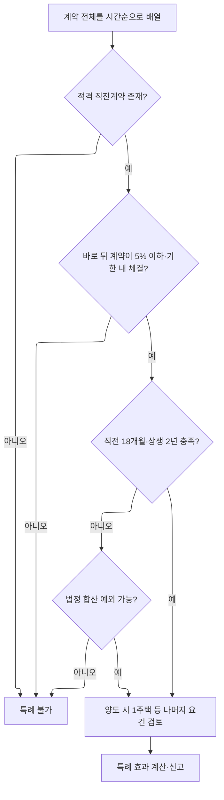

# 상생임대주택 A–Z

> **학습 목표**  
> 상생임대주택은 계약 한 건을 보는 제도가 아니다. `적격 직전임대차계약 → 적격 상생임대차계약`이라는 **두 계약의 연결 구조**를 찾고, 실제 임대기간·5%·체결시기·승계 여부를 순서대로 검증하는 제도다.

> **이 사례의 결론**  
> 현재 제공된 사실과 2026년 8월 14일 현재 확인되는 법령·국세청 해석 흐름에 따르면 **특례 적용은 어렵다고 판단하는 것이 타당하다.** 가장 좋은 후보인 `임대(3) → 임대(4)`는 직전계약인 임대(3)의 실제 임대기간이 16개월에 그쳐 18개월 요건을 충족하지 못한다. `임대(2)+(3)` 합산, 중간 계약 건너뛰기, 중도퇴거 합산으로도 치유하기 어렵다.

---

## 이 문서의 사용법

- A–Q: 제도와 법리를 학습한다.
- R–U: 현재 사례에 법리를 대입한다.
- V–Z: 자료 확인, 고객 설명, 신고 실무에 사용한다.
- `[법문]`은 법령에 직접 적힌 내용이다.
- `[해석례]`는 기획재정부·국세청의 구체적 질의회신이다.
- `[사례판단]`은 위 법문과 해석례를 현재 사실관계에 적용한 결론이다.

> **주의**  
> 이 문서는 제공된 사실을 전제로 한 개념학습·검토자료다. 임대차계약서 원본, 계좌거래, 전입세대·확정일자 자료, 양도일 현재 세대별 주택 보유현황을 확인하지 않은 상태에서는 신고 결론을 확정할 수 없다.

---

## A — At a glance: 30초 핵심

상생임대주택의 기본식은 다음과 같다.

```text
[직전임대차계약]
취득 후 체결 + 실제 18개월 이상
          ↓
임대료·보증금 증가율 5% 이하
          ↓
[상생임대차계약]
2021.12.20.~2026.12.31. 체결·임대개시
+ 계약금 수령 증빙 + 실제 2년 이상 임대
          ↓
양도 시 1세대1주택 또는 법정 간주특례
          ↓
비과세·거주주택 특례·장특공 표2의
‘거주기간 제한’ 배제
```

한 줄 암기:

> **취득 후 18개월 → 5% 이하 → 기한 내 계약·개시 → 2년 임대 → 양도 시 1주택 판정**

---

## B — Background: 제도 목적

상생임대주택 특례는 임대인이 임대료 급등을 자제하도록 유도하고 임차인의 주거 안정을 높이는 대신, 임대인이 조정대상지역 주택의 실거주 요건 등을 충족하지 못해도 일정한 양도소득세상 거주요건을 면제하는 제도다.

핵심 교환관계는 다음과 같다.

```text
임대인: 직전 계약보다 5% 이하로 인상하고 장기 임대
                     ↕
세법: 특정 1세대1주택 규정의 거주기간 제한 배제
```

상생임대주택은 별도의 임대사업자 등록제도가 아니다. 요건을 갖춘 주택을 양도할 때 특례를 주장하고 자료로 입증하는 구조다.

---

## C — Core concepts: 두 계약의 역할

### 1. 직전임대차계약

상생계약의 비교 기준이 되는 앞 계약이다.

필수 포인트:

- 소유자가 **주택을 취득한 후** 해당 주택에 관하여 임차인과 체결한 계약이어야 한다.
- 주택 취득 때문에 임대인의 지위를 자동으로 승계한 계약 그 자체는 제외된다.
- 그 계약에 따라 **실제로 임대한 기간**이 1년 6개월 이상이어야 한다.

### 2. 상생임대차계약

직전계약과 비교하여 임대보증금 또는 임대료 증가율이 5%를 초과하지 않는 뒤 계약이다.

필수 포인트:

- 2021년 12월 20일부터 2026년 12월 31일까지 체결해야 한다.
- 같은 기간 안에 임대를 개시해야 한다.
- 계약금을 지급받았다는 사실이 증빙서류로 확인되어야 한다.
- 실제 임대기간이 2년 이상이어야 한다.

### 3. 비교표

| 구분 | 직전임대차계약 | 상생임대차계약 |
|---|---|---|
| 역할 | 비교 기준 | 혜택을 만드는 착한 인상 계약 |
| 취득 후 체결 | 필요 | 구조상 필요 |
| 승계계약 그 자체 | 제외 | 비교 기준이 없으므로 단독으로 기능 불가 |
| 체결기한 | 별도 제한 없음 | 2021.12.20.~2026.12.31. |
| 실제 임대기간 | 18개월 이상 | 2년 이상 |
| 임대료 제한 | 없음 | 직전 대비 5% 이하 |
| 계약금 증빙 | 법문상 상생계약 요건과 연결 | 필요 |

---

## D — Design: 왜 반드시 ‘두 계약’을 찾는가

상생임대주택 검토의 출발점은 계약서를 날짜순으로 늘어놓고 **인접한 두 계약의 역할**을 지정하는 것이다.



실무상 중요한 원칙:

1. 중간에 실제 존재한 계약을 임의로 지울 수 없다.
2. 서로 다른 계약의 기간은 원칙적으로 자동 합산되지 않는다.
3. 동일 임차인이라는 이유만으로 여러 계약이 하나가 되지 않는다.
4. 법령 또는 해석례가 인정한 합산 사유와 조건을 따로 입증해야 한다.

---

## E — Effective dates: 어떤 시점을 기준으로 법을 보는가

이 사례의 양도일은 2026년 7월 3일이다. 따라서 양도 당시 시행 중인 규정을 우선 적용한다. 현재 확인되는 「소득세법 시행령」은 2026년 7월 1일 시행본이며, 제155조의3의 상생계약 체결기한은 **2026년 12월 31일**까지다.[^1]

중요한 구분:

- **상생계약 체결·임대개시기한**: 2026.12.31.
- **별도의 일반적인 주택 양도기한**: 현행 제155조의3 문언에는 없음.
- **사례 양도일**: 2026.7.3.이므로 양도일 당시 요건 충족 여부를 판정한다.

> 종전 검토문에 등장한 “2026.10.1. 이후 양도분에 대한 별도 양도기한 개편안”은 현행 제155조의3의 확정 법문에서 확인되지 않는다. 이 사례의 결론 근거로 사용하지 않는다.

---

## F — Framework: 전체 요건 지도

| 단계 | 질문 | 법적 기준 | 실패 시 |
|---|---|---|---|
| F1 | 양도 주택이 세법상 주택인가 | 주거용 실질 | 특례 대상 아님 |
| F2 | 양도 시 국내 1주택 또는 법정 간주인가 | §155의3① 본문 | 특례 적용 곤란 |
| F3 | 양도한 집과 상생임대한 집이 같은가 | 해당 주택 요건 | 특례 적용 곤란 |
| F4 | 취득 후 체결한 직전계약이 있는가 | §155의3①1 | 없으면 탈락 |
| F5 | 직전계약이 승계계약 자체가 아닌가 | §155의3①1 괄호 | 승계계약은 제외 |
| F6 | 직전계약으로 실제 18개월 이상 임대했는가 | §155의3①2 | 원칙 탈락 |
| F7 | 뒤 계약의 인상률이 5% 이하인가 | §155의3①1 | 탈락 |
| F8 | 상생계약을 법정 기간 안에 체결·개시했는가 | §155의3①1 | 탈락 |
| F9 | 계약금 수령이 증빙되는가 | §155의3①1 | 요건 입증 위험 |
| F10 | 상생계약으로 실제 2년 이상 임대했는가 | §155의3①3 | 원칙 탈락 |
| F11 | 중도퇴거 합산 예외가 있는가 | §155의3④, 규칙 §74의3 | 요건 없으면 합산 불가 |
| F12 | 일반 비과세·보유 요건을 충족하는가 | §154 등 | 특례만으로 치유 불가 |

---

## G — Genuine rental period: 계약기간과 실제 임대기간

법은 계약서에 적힌 예정기간보다 **실제 임대한 기간**을 본다.

예시:

```text
계약서: 2021.4.29.~2023.4.29. (24개월)
실제 퇴거: 2022.8.26.

→ 계약상 24개월이 아니라 실제 약 16개월로 판정
```

확인자료:

- 임차인의 전입·전출일
- 보증금 반환일 및 정산합의서
- 월세 지급·종료 내역
- 관리비·공과금 명의 및 사용내역
- 열쇠 인도, 명도확인서
- 다음 임차인의 입주일

주택임대차보호법상 계약기간을 2년으로 보는 규정이 있더라도, 상생임대주택의 세법상 기간요건은 **실제 임대한 기간**을 요구한다.

---

## H — Handover: 승계계약의 처리

### 1. 원칙

주택을 임차인이 있는 상태로 매수하면 매수인이 임대인의 지위를 승계할 수 있다. 그러나 「소득세법 시행령」 제155조의3은 **주택 취득으로 임대인의 지위가 승계된 임대차계약 자체를 직전임대차계약에서 명시적으로 제외**한다.[^1]

### 2. 승계 이후의 새 계약

승계계약이 끝났다고 해서 이후 모든 계약이 자동으로 배제되는 것은 아니다. 사실관계에 따라 갈린다.

| 승계 후 상황 | 해석 흐름 |
|---|---|
| 승계계약 만료 후 **새 임차인**과 새 계약, 그 뒤 동일 임대료 재계약 | 새 계약과 재계약을 각각 직전·상생계약으로 인정 가능 — 사전-2026-법규재산-0715[^2] |
| 승계계약의 조건대로 별도 계약서 없이 갱신하고 다시 재갱신 | 각 갱신이 요건을 충족하면 직전·상생계약 인정 가능 — 서면-2024-법규재산-1914[^3] |
| 부적격 승계계약을 끝내고 **같은 임차인**과 기간 또는 보증금 등을 바꿔 새 계약 | 직전계약 불인정 해석 — 재산세제과-952, 서면-2022-법규재산-4388[^4] |

### 3. 이 사례에 대한 의미

임대(1)은 전 소유자의 계약을 승계한 것이므로 직전계약으로 쓸 수 없다. 임대(2)는 같은 임차인 B와 보증금을 3.70억원에서 3.60억원으로 바꿔 별도 계약을 체결한 것으로 보이므로, 재산세제과-952의 부정적 사실관계와 유사하다.

> `[사례판단]` 임대(2)의 직전계약 적격성은 매우 위험하다. 다만 임대(2)를 납세자에게 유리하게 적격이라고 가정해도 뒤의 기간·체결시기 요건에서 다시 탈락한다.

---

## I — Increase: 5% 기준

### 1. 전세보증금만 있는 경우

```text
증가율 = (새 보증금 - 직전 보증금) ÷ 직전 보증금 × 100
```

이 사례:

| 비교 | 계산 | 증가율 | 5% 판정 |
|---|---:|---:|---|
| 임대(1) 3.70억 → 임대(2) 3.60억 | -0.10 ÷ 3.70 | -2.70% | 한도 내이나 다른 요건 실패 |
| 임대(2) 3.60억 → 임대(3) 3.78억 | 0.18 ÷ 3.60 | **5.00%** | 경계선 충족 |
| 임대(3) 3.78억 → 임대(4) 3.96억 | 0.18 ÷ 3.78 | **4.76%** | 충족 |
| 임대(4) 3.96억 → 임대(5) 4.60억 | 0.64 ÷ 3.96 | **16.16%** | 불충족 |

### 2. 주의사항

- “시세보다 싸다”는 사정은 5% 계산을 대신하지 못한다.
- 5% **이하**이므로 정확히 5.000%는 문언상 허용된다.
- 보증금 일부 반환이 있었다면 실제 변경 후 기준금액을 확인한다.
- 관리비가 실질상 임대료인지, 무상사용·가구사용료 등이 숨은 임대료인지 확인한다.

---

## J — Joined rent: 전세·월세 전환

보증금과 월세를 서로 전환한 경우에는 단순히 보증금 또는 월세 한쪽만 비교하면 안 된다. 「소득세법 시행령」 제155조의3 제2항은 「민간임대주택에 관한 특별법」 제44조 제4항의 기준에 따라 증가율을 계산하도록 한다.[^1]

실무 순서:

1. 직전계약의 보증금·월세를 확정한다.
2. 새 계약의 보증금·월세를 확정한다.
3. 계약 체결 당시 적용되는 법정 전환기준을 확인한다.
4. 환산 후 전체 임대료 증가율이 5% 이하인지 계산한다.
5. 계산표와 당시 이율 근거를 신고철에 보관한다.

> 이 사례는 현재 제공자료상 전세보증금만 비교하므로 단순 증가율을 사용했다. 월세나 별도 사용료가 있었다면 다시 계산해야 한다.

---

## K — Key evidence: 계약금 증빙

상생계약은 계약금을 지급받은 사실이 증빙서류로 확인되어야 한다.

권장 증빙:

- 임차인 명의 계좌에서 임대인 명의 계좌로 이체된 내역
- 계약서의 계약금 조항
- 수령증, 영수증
- 중개대상물 확인설명서와 중개사 확인자료
- 계약 체결일의 문자·메신저·이메일

이 사례의 임대(4) 계약금은 3,900만원으로 제시되어 있다. 계약서 기재만으로 끝내지 말고 실제 입금계좌, 입금자, 입금일, 금액을 맞춰야 한다.

> 계약금 증빙이 불분명하면 임대(4)의 나머지 요건이 좋아도 별도 탈락 위험이 생긴다.

---

## L — Leaving early: 중도퇴거와 기간 합산

### 1. 법정 예외

임차인의 사정으로 임대를 계속할 수 없어 새 임대차계약을 체결한 경우에는 일정 조건에서 새 계약 기간을 종전 계약 기간에 합산할 수 있다. 다만 시행규칙은 새 계약의 임대보증금 또는 임대료가 종전보다 **증가하지 않을 것**을 요구한다.[^5]

```text
종전 계약 중 임차인 사정으로 조기퇴거
              +
새 계약의 임대료·보증금이 같거나 낮음
              ↓
법정 기간 합산 검토 가능
```

### 2. 자동 합산이 아닌 이유

- 중도퇴거가 임대인의 사정이면 곤란하다.
- 계약 만료 후 정상적으로 새 계약을 맺은 것은 이 예외와 다르다.
- 새 계약의 임대료가 1원이라도 실질적으로 증가했다면 규칙상 무증액 요건에 부딪힌다.
- 중간 계약을 공백처럼 지우고 앞뒤 계약만 비교할 수 없다.[^6]

### 3. 이 사례

```text
임대(3): 3.78억 / 실제 16개월
       ↓ 임차인 B 중도퇴거
임대(4): 3.96억 / +4.76%
```

임대(4)의 보증금이 임대(3)보다 증가했다. 따라서 임대(4)의 기간을 임대(3)에 붙여 직전계약 18개월을 충족시키는 방식은 시행규칙 제74조의3의 **무증액 요건을 충족하지 못한다.**

---

## M — Monthly calendar: 월력 계산

직전계약과 상생계약의 임대기간은 월력에 따라 계산하고, 1개월 미만은 1개월로 본다.[^1]

이 사례의 핵심 계산:

| 계약 | 실제 임대기간 | 월력 계산 | 판정 |
|---|---|---:|---|
| 임대(2) | 2019.9.29.~2021.4.29. | 19개월 | 직전 18개월 충족 가능 |
| 임대(3) | 2021.4.29.~2022.8.26. | 15개월 + 1개월 미만 부분을 1개월로 봄 = **16개월** | 직전 18개월·상생 24개월 모두 불충족 |
| 임대(4) | 2022.8.26.~2024.8.26. | 24개월 | 상생 2년 충족 |
| 임대(5) | 2024.8.26.~2026.7.3. 양도 시까지 | 월력상 23개월 | 상생 2년 미충족 |

> 시작일·종료일이 계약서와 실제 명도·보증금 반환 자료에서 다르면 실제 날짜를 우선 재확인한다.

---

## N — New, renewed, or merged: 신규·갱신·합산의 구별

### 1. 같은 임차인 + 같은 임대료

동일 임차인과 동일한 임대료로 연장계약을 체결한 경우에는 사실관계에 따라 두 계약의 기간을 하나의 직전계약 기간으로 합산한 해석이 있다. 서면-2024-법규재산-0980은 2년 계약 만료 후 동일 임차인·동일 임대료의 2년 연장계약 중 조기퇴거가 발생한 사안에서 앞뒤 기간 합산을 인정했다.[^7]

### 2. 같은 임차인 + 임대료 인상

동일 임차인이라도 별도 계약을 체결하면서 임대료를 인상한 경우에는 앞뒤 계약의 기간을 직전계약으로 합산하지 않는 해석 흐름이 확인된다. 5% 이내 인상이라는 사실은 그 계약이 상생계약 후보가 될 수 있다는 뜻이지, 앞 계약과 자동으로 한 계약이 된다는 뜻은 아니다.[^6]

### 3. 이 사례의 임대(2)+(3)

```text
임대(2): 3.60억 / 별도 계약
임대(3): 3.78억 / 별도 계약 / +5.00% / 갱신청구권 사용
```

임대료가 변동되었고 별도 계약서가 작성된 것으로 보이므로, 동일 임차인 B라는 이유만으로 19개월+16개월을 하나의 35개월 직전계약으로 합치는 것은 최근 해석 흐름상 어렵다.

---

## O — Ownership at sale: 양도 시 1세대1주택

상생계약을 체결할 당시 반드시 1주택자일 필요는 없지만, 특례를 적용받아 양도하는 시점에는 국내 1주택을 소유한 1세대 또는 법령상 1세대1주택으로 보는 경우에 해당해야 한다.

예외적으로 포함될 수 있는 구조:

- 일시적 2주택
- 상속주택 특례
- 동거봉양·혼인 합가 특례
- 장기임대주택 보유자의 거주주택 특례
- 그 밖에 법령이 1세대1주택으로 보는 경우

반드시 확인할 것:

- 양도자·배우자·세대원의 국내 주택, 분양권, 조합원입주권
- 세대분리의 실질
- 상속주택·공동상속지분
- 오피스텔·무허가주택의 실제 주거용 사용
- 양도한 주택과 상생임대한 주택이 동일한지

상생임대주택 특례는 주택 수 문제를 자동으로 없애는 제도가 아니다.

---

## P — Privilege: 특례의 효과와 한계

### 1. 효과

요건을 충족하면 다음 규정 적용 시 거주기간 제한을 받지 않는다.

- 일반 1세대1주택 비과세의 거주요건: 시행령 제154조 제1항
- 장기임대주택 보유자의 거주주택 특례상 거주요건: 시행령 제155조 제20항 제1호
- 1세대1주택 장기보유특별공제 표2 진입을 위한 거주요건: 시행령 제159조의4

### 2. 특례가 해주지 않는 것

- 2년 이상 보유요건 등 다른 비과세요건 면제
- 양도 시 주택 수 요건 면제
- 고가주택 12억원 초과분까지 전액 비과세
- 실제 거주하지 않은 기간을 거주한 것으로 간주
- 장기보유특별공제 80% 자동 적용

### 3. 장기보유특별공제의 정확한 이해

상생임대주택 특례로 실제 거주 없이 표2 적용 자격을 얻더라도, **거주기간별 공제율은 실제 거주기간에 따라 계산**한다. 국세청은 상생임대주택에 표2의 보유기간별 공제율을 적용한다고 회신했다.[^8]

이 사례처럼 실제 거주 0년이면:

```text
표2 보유기간 공제율: 적용 가능
표2 거주기간 공제율: 0%
```

취득 2018.1.23.부터 양도 2026.7.3.까지 약 8년 보유를 전제로 하면, 특례 성립 시 표2의 보유기간별 공제율은 32% 구간이다. 특례가 성립하지 않고 일반 표1 대상이라면 같은 8년 보유 구간은 16%다. 최종 공제율은 정확한 취득·양도시기와 다른 배제사유를 함께 확인해야 한다.[^9]

### 4. 고가주택

양도가액 14.6억원은 12억원을 초과한다. 특례가 성립해 1세대1주택 비과세 요건을 충족하더라도 12억원 초과분에 대응하는 양도차익은 과세된다.

```text
고가주택 과세대상 양도차익
= 전체 양도차익 × (양도가액 - 12억원) ÷ 양도가액
```

현행 시행령 제160조의 공식이다.[^10]

---

## Q — Qualification patterns: 자주 나오는 유형

| 유형 | 판단 |
|---|---|
| 취득 후 첫 계약 2년 → 5% 이하 재계약 2년 | 전형적 가능 구조 |
| 승계계약 2년 → 바로 5% 이하 재계약 | 승계계약 자체는 직전계약에서 제외되므로 주의 |
| 승계계약 종료 → 새 임차인과 2년 → 동일 임대료 재계약 2년 | 2026 해석상 가능 구조 |
| 동일 임차인·동일 임대료 묵시 또는 명시 연장 | 사실관계에 따라 기간 합산 가능 |
| 동일 임차인과 보증금 인상 별도 갱신 | 별도 계약으로 보아 합산 부정 위험 |
| 직전 16개월 → 뒤 계약 24개월·4% 인상 | 직전 18개월 미달로 원칙 불가 |
| 상생계약 16개월 후 중도퇴거 → 무증액 새 계약 | 임차인 사정 입증 시 기간 합산 검토 |
| 상생계약 16개월 후 4% 인상 새 계약 | 합산 예외의 무증액 요건 불충족 |
| 중간 계약을 무시하고 1차와 3차 비교 | 불가 해석 |
| 상생계약 2년 완료 후 후속 계약 10% 인상 | 법문상 완료된 상생계약을 소급해 무효로 하는 별도 요건은 없음. 다만 후속 계약을 기간합산에 쓰거나 새 상생계약으로 쓰기는 어려움 |

---

## R — Record: 현재 사례 사실관계

### 1. 자산

| 항목 | 제공된 사실 |
|---|---|
| 소재지 | 성남시 소재 아파트 |
| 취득일 | 2018.1.23. |
| 취득가액 | 4.95억원 |
| 실제 거주 | 0년으로 제시 |
| 양도일 | 2026.7.3. |
| 양도가액 | 14.6억원 |
| 취득 당시 규제지역 | 성남시는 당시 조정대상지역에 포함된 것으로 확인되나, 정확한 주소·취득원인으로 최종 대조 필요[^11] |

### 2. 임대차 타임라인

| 계약 | 계약 체결일 | 임차인 | 보증금 | 실제 임대기간 | 핵심 특징 |
|---|---:|---|---:|---|---|
| 임대(1) | 전 소유자 체결 | B | 3.70억 | 계약상 24개월 | 취득으로 승계한 계약 |
| 임대(2) | 2019.8.30. | B | 3.60억 | 2019.9.29.~2021.4.29., 19개월 | 취득 후 별도 재계약, 보증금 감액 |
| 임대(3) | 2021.3.11. | B | 3.78억 | 2021.4.29.~2022.8.26., 월력 16개월 | +5.00%, 갱신청구권 사용, 중도퇴거 |
| 임대(4) | 2022.7.22. | C | 3.96억 | 2022.8.26.~2024.8.26., 24개월 | +4.76%, 계약금 3,900만원 제시 |
| 임대(5) | 2024.6.27. | 미확인 | 4.60억 | 2024.8.26.~2026.7.3. 양도 시까지 2년 미만 | +16.16% |

### 3. 한눈에 보는 흐름

```text
취득 2018.1.23.
  │
  ├─ 임대(1) 3.70억 / 전 소유자 계약 승계
  │       ❌ 직전계약에서 제외
  │
  ├─ 임대(2) 3.60억 / 19개월 / B
  │       ⚠️ 승계계약 종료 후 같은 임차인·조건변경 계약
  │
  ├─ 임대(3) 3.78억 / 16개월 / B
  │       +5.00% / 2021.3.11. 체결
  │
  ├─ 임대(4) 3.96억 / 24개월 / C
  │       +4.76% / 2022.7.22. 체결
  │
  ├─ 임대(5) 4.60억 / 양도 시까지 2년 미만
  │       +16.16% / 2024.6.27. 체결
  │
  └─ 양도 2026.7.3. / 14.6억
```

---

## S — Scenarios: 가능한 계약 조합 전수 검토

### S1. 임대(1) → 임대(2)

| 요건 | 판정 |
|---|---|
| 임대(1)이 적격 직전계약인가 | ❌ 취득으로 승계한 계약 |
| 임대(2)가 기한 내 상생계약인가 | ❌ 2019.8.30. 체결로 2021.12.20. 이전 |
| 결론 | ❌ 불가 |

### S2. 임대(2) → 임대(3)

납세자에게 유리하게 임대(2)를 적격 직전계약이라고 가정한다.

| 요건 | 판정 |
|---|---|
| 임대(2) 실제 18개월 이상 | ✅ 19개월 |
| 임대(3) 증가율 5% 이하 | ✅ 정확히 5.00% |
| 임대(3) 체결시기 | ❌ 2021.3.11.로 법정 시작일 2021.12.20. 이전 |
| 임대(3) 실제 2년 이상 | ❌ 16개월 |
| 결론 | ❌ 불가 |

임대(2) 자체도 승계계약 이후 같은 임차인과 조건을 바꾼 계약이라는 별도 적격성 위험이 있다.

### S3. 임대(3) → 임대(4)

가장 유력해 보이는 조합이다.

| 요건 | 판정 |
|---|---|
| 임대(3) 취득 후 직접 체결 | ✅ |
| 임대(3) 실제 18개월 이상 | ❌ 월력 16개월 |
| 임대(4) 5% 이하 | ✅ 4.76% |
| 임대(4) 체결·개시기한 | ✅ 2022년 |
| 임대(4) 계약금 증빙 | ⚠️ 실제 입금자료 확인 필요 |
| 임대(4) 실제 2년 이상 | ✅ 24개월 |
| 결론 | ❌ 직전계약 기간 2개월 부족 |

### S4. 임대(2)+(3) → 임대(4)

| 쟁점 | 판정 |
|---|---|
| 같은 임차인 B인가 | ✅ |
| 같은 임대료인가 | ❌ 3.60억 → 3.78억으로 인상 |
| 별도 계약인가 | ✅ 별도 계약서·갱신청구권 사용 정황 |
| 합산 가능성 | ❌ 최근 해석 흐름상 인상된 별도 갱신계약은 자동 합산되지 않음 |
| 추가 위험 | 임대(2) 자체의 직전계약 적격성도 불안정 |
| 결론 | ❌ 보수적으로 불가 |

### S5. 임대(2) → 임대(4), 임대(3)은 건너뛰기

실제로 존재한 임대(3)을 공백으로 보고 앞뒤 계약만 비교할 수 없다. 서면-2024-법규재산-3576과 서면-2024-법규재산-0565는 중간 계약을 건너뛴 재구성을 부정한다.[^6]

결론: ❌ 불가.

### S6. 임대(3)+임대(4) 기간 합산 → 임대(4)를 상생계약으로 사용

임대(3)의 16개월을 18개월로 채우기 위해 임대(4) 기간을 붙이는 구상이다. 그러나 임대(4)는 임대(3)보다 4.76% 증액되었다. 중도퇴거 합산 예외는 새 계약이 종전보다 무증액이어야 하므로 불가하다.

결론: ❌ 불가.

### S7. 임대(4) → 임대(5)

| 요건 | 판정 |
|---|---|
| 임대(4) 실제 18개월 이상 | ✅ 24개월 |
| 임대(5) 체결시기 | ✅ 2024.6.27. |
| 임대(5) 증가율 5% 이하 | ❌ 16.16% |
| 임대(5) 양도 전 실제 2년 이상 | ❌ 2026.7.3.까지 2년 미만 |
| 결론 | ❌ 불가 |

### S8. 조합별 최종 표

| 조합 | 결과 | 주된 실패 사유 |
|---|---|---|
| (1) → (2) | ❌ | 승계계약 + 상생계약 체결시기 이전 |
| (2) → (3) | ❌ | (3) 체결시기 이전 + 실제 16개월 |
| (3) → (4) | ❌ | (3) 실제 16개월 < 18개월 |
| (2)+(3) → (4) | ❌ | 인상된 별도 갱신계약 합산 곤란 + (2) 적격성 위험 |
| (2) → (4), (3) 건너뛰기 | ❌ | 중간 계약을 공백 처리할 수 없음 |
| (3)+(4) 기간합산 | ❌ | 새 계약 임대료 증가로 무증액 요건 위반 |
| (4) → (5) | ❌ | +16.16% 및 양도 전 2년 미달 |

---

## T — Traps: 이 사례가 가르치는 함정

1. **“계약서가 2년”과 “실제로 2년 임대”는 다르다.**
2. **같은 임차인이라고 계약기간이 자동 합산되지 않는다.**
3. **5% 이하 인상은 뒤 계약을 상생계약 후보로 만들 뿐, 앞 계약과 하나로 합쳐주지 않는다.**
4. **승계계약 자체는 직전계약이 아니다.**
5. **중간 계약을 지우고 유리한 앞뒤 계약만 연결할 수 없다.**
6. **중도퇴거 합산은 임차인 사정과 새 계약 무증액을 함께 요구한다.**
7. **상생계약의 체결일만 보지 말고 실제 임대개시일도 본다.**
8. **계약금은 계약서 문구보다 금융증빙이 중요하다.**
9. **특례는 거주요건만 면제하며, 보유·주택 수·고가주택 규정은 남는다.**
10. **표2를 쓴다고 80%가 되는 것은 아니다. 실제 미거주면 거주공제는 0%다.**

---

## U — Ultimate conclusion: 최종 결론

### 1. 결론

현재 자료 기준으로는 **상생임대주택 특례를 적용하지 않는 결론이 타당하다.**

### 2. 결정적 이유

```text
가장 좋은 상생계약 후보 = 임대(4)

임대(4):
✅ 2022.7.22. 체결
✅ 직전 보증금 대비 +4.76%
✅ 실제 24개월 임대
⚠️ 계약금 이체증빙 확인 필요

그러나 그 바로 앞 임대(3):
❌ 실제 16개월 < 직전계약 최소 18개월
```

### 3. 구제 논리가 작동하지 않는 이유

- 임대(2)+(3): 같은 임차인이지만 보증금을 올린 별도 갱신계약이므로 합산 곤란.
- 임대(3)+(4): 임대(4)가 증액 계약이므로 중도퇴거 합산의 무증액 요건 불충족.
- 임대(2)→임대(4): 중간의 임대(3)을 무시할 수 없음.
- 임대(4)→임대(5): 16.16% 인상 및 양도 전 2년 미충족.
- 임대(2): 승계계약 종료 후 같은 임차인과 조건을 바꾼 계약이라는 별도 적격성 위험.

### 4. 양도세상 예상 효과

제공된 사실대로 취득 당시 조정대상지역 주택이고 실제 거주기간이 0년이며 별도 예외가 없다면, 특례 불성립 시 일반 1세대1주택 비과세의 거주요건을 충족하지 못한다. 이 경우 고가주택의 12억원 초과분만 과세하는 구조가 아니라 원칙적으로 전체 양도차익이 과세대상이 되고, 장기보유특별공제도 표2가 아닌 일반 표1 검토로 넘어간다.

다만 최종 세액은 다음을 반영해 별도 계산해야 한다.

- 취득세·법무비·중개보수·자본적 지출
- 양도비용
- 공동명의·증여·상속 이력
- 양도일 현재 세대별 다른 주택·분양권·입주권
- 양도시기와 잔금·등기일
- 중과 또는 배제사유

---

## V — Verification: 추가 확인자료

### 최우선 자료

- [ ] 임대(1) 원계약서 및 매매계약서의 임대차 승계조항
- [ ] 임대(2) 계약서 원본, 임대(1) 종료합의서, 계약 체결 경위
- [ ] 임대(3) 계약서 원본과 갱신청구권 사용 표시
- [ ] 임대(3) 실제 퇴거일·보증금 반환일·명도일 자료
- [ ] 임대(3) 중도퇴거가 임차인 B의 사정임을 보여주는 자료
- [ ] 임대(4) 계약금 3,900만원의 실제 이체내역
- [ ] 임대(4) 임차인 C의 전입·전출, 보증금 반환자료
- [ ] 임대(5) 계약서와 실제 임대개시일
- [ ] 모든 계약의 월세·관리비·별도 사용료 유무

### 주택·세대 자료

- [ ] 등기사항증명서
- [ ] 취득·양도 매매계약서와 잔금내역
- [ ] 양도일 현재 주민등록등본·초본 및 가족관계증명서
- [ ] 세대원 전원의 주택·분양권·입주권 보유현황
- [ ] 건축물대장과 실제 용도
- [ ] 2018.1.23. 당시 해당 주소의 조정대상지역 여부 자료

### 기간 입증 자료

- [ ] 전입세대확인서 또는 주민등록 전입·전출 자료
- [ ] 보증금 입금·반환 계좌내역
- [ ] 임차인별 관리비 정산서
- [ ] 공과금 명의·사용량
- [ ] 중개사 확인서, 명도확인서, 열쇠 인도자료

---

## W — Workflow: CPA 실무 검토 절차

### Step 1. 양도일과 적용 법령 고정

1. 잔금청산일과 등기접수일을 확인한다.
2. 양도시기를 확정한다.
3. 그 양도일 현재 시행 법령을 저장한다.

### Step 2. 주택 수와 일반 비과세 전제 확인

1. 양도일 현재 세대 단위 주택 수를 확인한다.
2. 간주 1주택 특례가 있으면 근거조항을 지정한다.
3. 보유기간과 취득 당시 조정대상지역 여부를 확인한다.

### Step 3. 임대차 마스터표 작성

계약마다 다음 항목을 한 줄로 작성한다.

```text
계약일 / 임대개시일 / 실제 종료일 / 임차인 / 보증금 / 월세 /
계약금 / 신규·갱신·묵시갱신 / 중도퇴거 사유 / 증빙
```

### Step 4. 인접 계약 조합 생성

```text
(1)→(2), (2)→(3), (3)→(4), (4)→(5)
```

각 조합에 직전 18개월, 5%, 기한, 계약금, 상생 2년을 대입한다.

### Step 5. 합산 예외 별도 검토

1. 중도퇴거가 임차인 사정인지 확인한다.
2. 새 계약이 같거나 낮은 임대료인지 확인한다.
3. 동일 임차인·동일 임대료 연장인지 확인한다.
4. 중간 계약을 건너뛰는 구성이 아닌지 확인한다.

### Step 6. 세액 시나리오 비교

| 시나리오 | 비과세 | 고가주택 안분 | 장특공 |
|---|---|---|---|
| 특례 성립 | 12억원 기준 적용 | 12억원 초과 대응분 과세 | 표2 보유공제 + 실제 거주공제 |
| 특례 불성립·거주요건 미달 | 원칙 불가 | 고가 1주택 안분비과세 구조 불가 | 일반 표1 검토 |

### Step 7. 신고 포지션 결정

- 적용: 요건별 주장·증빙 인덱스를 만든다.
- 불적용: 특례 없이 세액을 계산하고 고객에게 차이를 설명한다.
- 경계사안: 사전답변 가능성, 수정신고·경정청구 리스크, 가산세를 함께 검토한다.

### Step 8. 신고서류 제출

법문상 양도소득세 신고기한까지 「상생임대주택에 대한 특례적용신고서」와 직전·상생 임대차계약서를 제출한다. 서식은 소득세법 시행규칙 별지 제83호의4서식이다.[^12]

이 사례의 일반적인 부동산 예정신고기한은 양도일이 속한 달의 말일부터 2개월이다. 양도일이 2026.7.3.이라면 특별한 예외가 없는 한 2026.9.30.이 예정신고·납부기한이다.[^13]

> 국세청은 특례신고서 등을 법정기한 내 제출하지 않았더라도 실체요건 충족이 확인되면 특례 적용이 가능하다고 회신한 바 있다. 그러나 신고 단계에서는 법정 서류를 기한 내 제출하는 것이 가장 안전하다.[^14]

---

## X — eXplain: 고객설명용 요약

> 이 제도는 임대계약 하나가 아니라 앞 계약과 뒤 계약을 한 쌍으로 봅니다. 앞 계약은 실제로 최소 18개월 임대해야 하고, 뒤 계약은 임대료를 5% 이하로 올린 뒤 실제 2년 이상 임대해야 합니다.
>
> 이 집에서는 네 번째 계약이 5% 이하 인상이고 실제 2년 임대돼서 좋은 상생계약 후보입니다. 하지만 그 바로 앞 세 번째 계약이 세입자의 중도퇴거로 실제 16개월에 그쳤습니다. 법에서 요구하는 18개월보다 2개월 부족합니다.
>
> 두 번째와 세 번째 계약은 같은 세입자였지만 보증금을 올려 별도 갱신계약을 썼기 때문에 두 기간을 하나로 합치기 어렵고, 세 번째 계약을 건너뛰어 다른 계약끼리 비교할 수도 없습니다. 네 번째 계약 기간을 세 번째에 붙이는 방법도 새 계약의 보증금이 올랐기 때문에 법정 합산요건에 맞지 않습니다.
>
> 그래서 현재 계약서와 실제 퇴거일이 맞다면 상생임대주택 혜택은 받기 어렵다는 결론입니다. 다만 세 번째 계약의 실제 종료일이 잘못 파악됐거나, 임대·보증금 반환이 18개월 이상 계속됐다는 객관적 자료가 나오면 다시 검토할 수 있습니다.

---

## Y — Yes/No checklist: 최종 판정표

### 일반형

- [ ] 양도일 현재 세법상 주택이다.
- [ ] 양도일 현재 1세대1주택 또는 법정 간주특례다.
- [ ] 양도주택과 상생임대한 주택이 같다.
- [ ] 주택 취득 후 체결한 적격 직전임대차계약이 있다.
- [ ] 직전계약이 단순 승계계약이 아니다.
- [ ] 직전계약 실제 임대기간이 월력 18개월 이상이다.
- [ ] 상생계약의 임대료·보증금 증가율이 5% 이하이다.
- [ ] 상생계약을 2021.12.20.~2026.12.31.에 체결했다.
- [ ] 같은 기간 안에 임대를 개시했다.
- [ ] 계약금 수령 증빙이 있다.
- [ ] 상생계약 실제 임대기간이 월력 2년 이상이다.
- [ ] 합산이 필요하면 임차인 사정과 새 계약 무증액을 입증한다.
- [ ] 중간 계약을 임의로 건너뛰지 않았다.
- [ ] 2년 이상 보유 등 다른 비과세요건을 충족한다.
- [ ] 고가주택이면 12억원 초과분을 안분 계산했다.
- [ ] 표2의 거주공제는 실제 거주기간만 반영했다.
- [ ] 특례신고서와 계약서를 신고기한 내 준비했다.

### 이 사례

- [x] 양도주택과 임대주택 동일
- [x] 취득 후 임대계약 존재
- [ ] 임대(3) 실제 18개월 이상 — **16개월**
- [x] 임대(4) 증가율 5% 이하 — **4.76%**
- [x] 임대(4) 기한 내 체결·개시
- [ ] 임대(4) 계약금 금융증빙 — **확인 필요**
- [x] 임대(4) 실제 2년 — **24개월**
- [ ] 임대(2)+(3) 합산 — **인상된 별도 계약으로 곤란**
- [ ] 임대(3)+(4) 중도퇴거 합산 — **증액으로 불가**
- [ ] 임대(4)→(5) — **16.16% 인상·2년 미달**
- [ ] 최종 특례 적용 — **현재 자료상 불가**

---

## Z — Zero-to-one recap: 최종 암기와 근거

### 1. 10문장 최종 암기

1. 상생임대주택은 앞뒤 두 계약의 조합이다.
2. 앞 계약은 취득 후 체결한 직전임대차계약이어야 한다.
3. 취득으로 승계한 계약 자체는 직전계약이 아니다.
4. 직전계약은 실제 18개월 이상 임대해야 한다.
5. 뒤 상생계약은 직전보다 임대료를 5% 초과해 올리면 안 된다.
6. 상생계약은 2021.12.20.~2026.12.31.에 체결하고 임대를 개시해야 한다.
7. 계약금 수령 증빙이 필요하다.
8. 상생계약은 실제 2년 이상 임대해야 한다.
9. 중도퇴거 기간합산은 임차인 사정과 새 계약 무증액이 핵심이다.
10. 특례는 거주요건을 면제할 뿐 주택 수·보유기간·고가주택 규정과 실제 거주공제까지 없애지 않는다.

### 2. 이 사례 한 문장

> **임대(4)는 좋은 상생계약이지만, 바로 앞 임대(3)이 실제 16개월이라 직전계약 18개월 요건을 채우지 못하고, 다른 계약을 합치거나 건너뛰어도 최근 해석상 치유하기 어려우므로 특례 불가가 타당하다.**

### 3. 법령·공식자료

[^1]: [국가법령정보센터 — 소득세법 시행령 제155조의3, 2026.7.1. 시행](https://www.law.go.kr/lsLinkCommonInfo.do?lsJoLnkSeq=1028332727). 직전계약, 5%, 체결·개시기한, 18개월, 2년, 월력 계산, 중도퇴거 합산, 신고를 규정한다.
[^2]: 국세청 사전-2026-법규재산-0715(2026.6.18.). 승계계약 종료 후 **새 임차인**과 체결한 계약 및 그 동일임대료 재계약을 각각 직전·상생계약으로 인정. [국세법령정보시스템](https://taxlaw.nts.go.kr/index.do)에서 문서번호로 검색.
[^3]: [국세법령정보시스템 — 서면-2024-법규재산-1914](https://taxlaw.nts.go.kr/qt/USEQTA002P.do?ntstDcmId=200000000000010094), 생산일 2024.12.18. 승계 후 동일조건 갱신·재갱신의 적격 가능성을 확인한다.
[^4]: 기획재정부 재산세제과-952(2023.8.10.) 및 서면-2022-법규재산-4388(2023.8.16.). 부적격 승계계약 종료 후 같은 임차인과 기간 또는 보증금을 변경한 새 계약의 직전계약 해당 여부를 부정. [국세법령정보시스템](https://taxlaw.nts.go.kr/index.do)에서 문서번호로 검색.
[^5]: [국가법령정보센터 — 소득세법 시행규칙 제74조의3, 2026.7.1. 시행](https://law.go.kr/lsLinkCommonInfo.do?lspttninfSeq=174207). 새로운 계약의 보증금 또는 임대료가 종전보다 증가하지 않을 것을 요구한다.
[^6]: 국세청 서면-2024-법규재산-0565(2025.4.21.), 서면-2024-법규재산-3576(2025.3.28.). 증액된 중간·연장계약의 기간 합산과 중간 계약을 공백으로 둔 앞뒤 계약 비교를 부정. [국세법령정보시스템](https://taxlaw.nts.go.kr/index.do)에서 문서번호로 검색.
[^7]: 국세청 서면-2024-법규재산-0980(2025.11.28.) 및 서면-2024-부동산-3727(2025.12.23.). 동일 임차인·동일 임대료 연장계약의 기간 합산을 인정한 사례. [국세법령정보시스템](https://taxlaw.nts.go.kr/index.do)에서 문서번호로 검색.
[^8]: 국세청 서면-2022-부동산-3063(2023.5.15.). 상생임대주택은 소득세법 제95조 제2항 표2의 **보유기간별 공제율**을 적용. [국세법령정보시스템](https://taxlaw.nts.go.kr/index.do)에서 문서번호로 검색.
[^9]: [국가법령정보센터 — 소득세법 제95조 제2항 표1·표2](https://law.go.kr/lsLinkCommonInfo.do?chrClsCd=010202&lsJoLnkSeq=1033141371).
[^10]: [국가법령정보센터 — 소득세법 시행령 제160조](https://law.go.kr/lsLinkCommonInfo.do?lspttninfSeq=126534). 고가주택 양도차익 및 장기보유특별공제의 12억원 안분공식.
[^11]: [대한민국 정책브리핑 — 2017년 조정대상지역에 성남 포함](https://www.korea.kr/fcatalog/access/ecatalogt.jsp?Dir=1111&callmode=normal&catimage=&eclang=ko&start=55&um=s). 정확한 아파트 주소와 취득일 기준 고시 원문을 신고 전 다시 대조한다.
[^12]: [국가법령정보센터 — 별지 제83호의4서식, 상생임대주택에 대한 특례적용신고서](https://law.go.kr/LSW/flDownload.do?flNm=%EC%83%81%EC%83%9D%EC%9E%84%EB%8C%80%EC%A3%BC%ED%83%9D%EC%97%90+%EB%8C%80%ED%95%9C+%ED%8A%B9%EB%A1%80%EC%A0%81%EC%9A%A9%EC%8B%A0%EA%B3%A0%EC%84%9C&flSeq=123914917).
[^13]: [국세청 — 양도소득세 신고·납부기한](https://webtv.nts.go.kr/nts/cm/cntnts/cntntsView.do?cntntsId=7708&mi=2309). 부동산은 양도일이 속하는 달의 말일부터 2개월.
[^14]: [국세법령정보시스템 — 기준-2025-법규재산-0020](https://taxlaw.nts.go.kr/qt/USEQTA002P.do?ntstDcmId=200000000000012419), 생산일 2025.6.4. 실체요건 충족이 확인되는 경우 특례신고서 등의 기한 내 미제출만으로 적용을 배제하지 않는다고 회신.

---

## 문서 관리 메모

- 법령 확인일: 2026.8.14.
- 사례 양도일: 2026.7.3.
- 적용 법령: 양도일 현재 시행 법령 기준.
- 다음 재검토 트리거: 계약서 원본·금융증빙·전입전출 자료 확보, 국세청 추가 해석 발표, 수정신고 또는 경정청구 검토.
