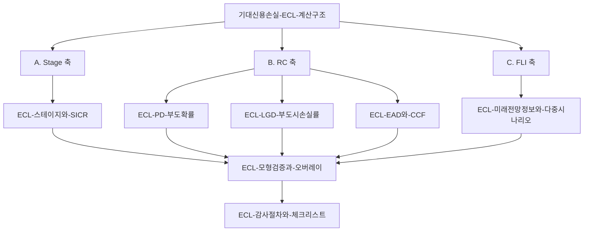

# IFRS 9 ECL 완전학습가이드

> [!info] 개요
> **이 문서는 순서만 소유한다.** 내용은 복제하지 않고 정본 페이지로 링크만 건다.
> 원자료: `raw/회계자문 및 회계감사/IFRS9 ECL/` 3부작 (기초 → 심화 → 실전). 자료 성격과 한계는 각 소스 요약에서 확인한다.

## 개념 관계도

```
                    [[기대신용손실-ECL-계산구조]]   ← 허브
                              │
        ┌─────────────────────┼─────────────────────┐
        │                     │                     │
   A. Stage 축            B. RC 축              C. FLI 축
        │                     │                     │
[[ECL-스테이지와-SICR]]   ┌───┼───┐      [[ECL-미래전망정보와-다중시나리오]]
                          │   │   │                 │
                        PD  LGD  EAD                │
                          │   │   │                 │
        [[ECL-PD-부도확률]]│   │   └[[ECL-EAD와-CCF]]│
                              │                     │
              [[ECL-LGD-부도시손실률]]               │
        └─────────────────────┼─────────────────────┘
                              │
                  [[ECL-모형검증과-오버레이]]
                              │
                  [[ECL-감사절차와-체크리스트]]   ← 업무 적용
```

**다이어그램 (위 코드블록과 같은 내용)**

%% ciat-design: 시각화 추가 — 아래 다이어그램은 바로 위 코드블록의 내용만 옮긴 것 (원문 우선) %%



## 학습 순서

### 1단계: 전체 그림 (여기서 시작)
1. [[기대신용손실-ECL-계산구조]]: ECL 한 문장 정의, EL vs ECL, IAS 39 → IFRS 9 전환, 전체 공정, 5개 층, DATA/MODEL/JUDGMENT
   → 이 한 페이지만 이해해도 "ECL이 무엇의 결과물인가"는 잡힌다.

### 2단계: Stage 축 (가장 중요)
2. [[ECL-스테이지와-SICR]]: Stage 1·2·3, SICR, Horizon Effect, Stage Migration, Cure

### 3단계: Risk Component 축
3. [[ECL-PD-부도확률]]: 경험 PD → 12M/Lifetime → 기간구조 → Basel 변환 → Credit Cycle·LDP
4. [[ECL-LGD-부도시손실률]]: 할인·비용·회수관찰기간 → 담보 LGD → **N:N 배분(가장 어려움)**
5. [[ECL-EAD와-CCF]]: 한도대출과 CCF

### 4단계: 미래전망 축
6. [[ECL-미래전망정보와-다중시나리오]]: FLI multiplier, 변수 선정, 비선형성과 확률가중, Weight 변경, Stress Test와의 차이

### 5단계: 거버넌스
7. [[ECL-모형검증과-오버레이]]: Performance Standard, Backtesting, Recalibration/Redevelopment, Overlay 4대 질문

### 6단계: 업무 적용
8. [[ECL-감사절차와-체크리스트]]: 조서 읽는 순서, Bridge 기반 자원배분, PBC, 영역별 체크리스트, RED FLAGS 15개

### 7단계: 문제로 확인
9. 원본 3편([[IFRS9-ECL-03-Final-실전문제-감사실무]])의 문제 23개 + 종합문제 4개를 직접 푼다. 정답 해설은 소스 요약의 표로 확인 가능하고, 각 문제가 검증하는 개념은 위 정본 페이지에 있다.

## 자기점검 (Level 1 → 10)

원본 3편이 제시하는 도달도를 점검한다. 답할 수 있으면 해당 단계는 넘어간 것이다.

| Level | 질문 | 관련 정본 |
|---|---|---|
| 1 | PD·LGD·EAD를 각각 설명할 수 있는가 | [[기대신용손실-ECL-계산구조]] |
| 2 | Stage 1과 Stage 2의 차이를 설명할 수 있는가 | [[ECL-스테이지와-SICR]] |
| 3 | 왜 Stage 2에서 충당금이 크게 증가하는지 **숫자로** 설명할 수 있는가 | [[ECL-스테이지와-SICR]] |
| 4 | Lifetime PD가 단순히 12M PD × 만기가 아닌 이유를 설명할 수 있는가 | [[ECL-PD-부도확률]] |
| 5 | 왜 LGD에서 회수시점과 할인율이 중요한지 설명할 수 있는가 | [[ECL-LGD-부도시손실률]] |
| 6 | 왜 N:N 담보에서 LGD 적용이 어려운지 설명할 수 있는가 | [[ECL-LGD-부도시손실률]] |
| 7 | 왜 EAD가 현재 장부잔액보다 클 수 있는지 설명할 수 있는가 | [[ECL-EAD와-CCF]] |
| 8 | 왜 평균 거시변수 하나 대신 복수 시나리오를 확률가중해야 하는지 설명할 수 있는가 | [[ECL-미래전망정보와-다중시나리오]] |
| 9 | 통계적으로 좋은 FLI 변수가 반드시 좋은 변수는 아닌 이유를 설명할 수 있는가 | [[ECL-미래전망정보와-다중시나리오]] |
| 10 | Validation과 Overlay를 설명할 수 있는가 | [[ECL-모형검증과-오버레이]] |
| **최종** | 임의의 계좌를 받고 **"왜 이 계좌의 ECL이 이 숫자인가"**에 대해 `Stage → SICR → PD → Lifetime → LGD → 담보 → EAD → CCF → FLI → Scenario → Weight → Validation → Overlay` 순서로 역추적할 수 있는가 | 전부 |

## 30초 암기카드

| 개념 | 한 줄 |
|---|---|
| PD | 차주가 부도날 확률. Stage 1은 12개월, Stage 2는 기대존속기간의 Lifetime PD |
| LGD | 부도 전제에서 최종적으로 잃을 비율. 담보회수액·회수기간·비용·할인효과가 들어간다 |
| EAD | 부도시점의 노출금액. 한도대출은 현재잔액 + 미사용한도 × CCF |
| SICR | 최초 인식 이후 신용위험이 유의적으로 증가했는지. 발생하면 12개월 ECL → Lifetime ECL |
| FLI | 과거 부도경험만 쓰지 않고 GDP·실업률·금리 등 미래경제정보를 반영하는 것 |
| 다중 시나리오 | ECL과 경제변수가 비선형이라 평균 하나로 계산한 값과 확률가중값이 다르다 |
| Overlay | 모델이 반영하지 못하는 특정 위험을 모델 밖에서 추가 반영하는 조정 |

## 이 자료를 읽을 때의 주의 (반드시)

1. **2차 가공물이다.** 3개 원본 모두 2023 Deloitte Anjin 교재 + 강의 녹취를 기반으로 외부 LLM 대화에서 작성된 학습자료다. IFRS 9 기준서 문단·감독지침 원문이 인용되어 있지 않다.
2. **수치의 대부분은 교육용 가상수치다.** 원본 2·3편이 스스로 그렇게 밝히고 있다.
3. **감독 관련 수치는 2023년 시점이다.** 최저부도율 0.05%, 최악 시나리오 20% 이상 반영, 회수관찰기간 약 2년 등 → `[현행 기준 확인 필요]`.
4. **강사 개인 견해와 기준을 구분한다.** 각 정본 페이지에서 `[강사견해]` / `[강사 강조]`로 표시했다.
5. 실제 업무 적용 시에는 소속 법인 감사방법론과 현행 감독지침이 우선한다.

## 앞으로 채우면 좋은 공백

- **집합평가 vs 개별평가**: 원자료는 비소매=등급 단위 / 소매=Pool 단위 구분과 Stage 3 개별 검토를 다루지만, **집합평가·개별평가의 기준서상 구분을 명시적으로 다루지 않는다.** 별도 자료로 보강 필요.
- **IFRS 9 기준서 문단 매핑**: 각 개념에 대응하는 기준서 근거.
- **단순화된 접근법(매출채권 등 provision matrix)**: 원자료는 금융회사 대출 중심이라 비금융업 적용을 다루지 않는다.
- **국내 감독규정 현행본** 대조.
- 재무제표 표시·주석 공시 요구사항.
