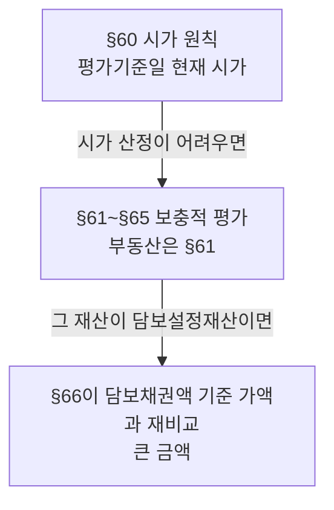

# 법조문 읽는 방법

> [!info] 개요
> 조문이 한 번에 읽히지 않는 이유는 지식이 부족해서가 아니라 **조문의 문법**을 익히지 않아서다. 아래 네 장치를 표시하며 읽는 습관이 붙으면 처음 보는 조문도 구조부터 잡힌다. 상증세법 재산평가 3개 조문(§60·§61·§66)으로 실습한다. ([[세무(TAX) 입문자를 위한 법조문 읽는 방법 상증세법 제60·61·66조로 배우는 조문 읽기-소스요약]])

## 왜 필요한가: 한 문구가 결론을 바꾼다

부동산의 보충적 평가액을 §61로 계산하고 끝냈는데, 그 부동산이 은행 대출의 담보로 잡혀 있다면 §66의 **"제60조에도 불구하고"** 한 문구 때문에 검토 범위와 결론이 달라진다.

> [!success] 확인
> ✅ **2026-09-08 조문 대조 완료(법제처 law-kr)**: 이 문서가 인용한 조문은 전부 현행 원문과 대조했다: 상증세법 **§60①**("상속개시일 또는 증여일(이하 "평가기준일"이라 한다) 현재의 시가에 따른다")·**§60③**(시가 산정 곤란 시 §61~§65)·**§61①1호** 본문과 단서·**§61④**(평가기준일 재사용)·**§66** 각 호 외의 부분과 4개 호, 조특법 **§14⑥**·**§14⑦**(2028.12.31까지 발생 소득).

## 네 가지 장치

### 1. 정의부터 확인한다

- 정의조문은 대개 법의 맨 앞(상증법 §2). 낯선 개념을 짐작으로 넘기지 않는다. §2 10호 "특수관계인"은 다시 시행령을, 시행령이 또 다른 법령을 인용한다. → [[특수관계인의범위-세법별비교]]
- **본문 조문에서 그 자리에 정의되는 용어**도 있다(§60① "상속개시일 또는 증여일(이하 '평가기준일'이라 한다)"). 이때 **"이 조에서" 같은 범위 제한 문구가 있는지**를 본다. 제한이 없으면 뒤따르는 조문에서도 그대로 재사용된다(§61④가 "평가기준일"을 이어받는다).

### 2. 본문과 단서를 나눈다

한 항·호 안에서 **"다만"** 앞은 원칙(본문), 뒤는 예외·수정·보완(단서)이다.

> [!note] 참고
> §61①1호: 토지는 개별공시지가로 평가한다(본문). **다만** 개별공시지가가 없는 토지는 관할 세무서장이 인근 유사 토지의 개별공시지가를 고려해 평가한 금액으로, 지가 급등 지역의 토지는 배율방법으로 평가한다(단서).

단서는 납세자에게 유리·불리가 정해져 있지 않다. **결론을 좌우하는 것은 "지금 사안이 단서에 해당하는가"** 이며, 해당 여부에 따라 평가방법 자체가 통째로 바뀐다.

### 3. "각 호 외의 부분"은 공통 문장이다

각 호 앞에 붙는 문장으로, 각 호를 읽을 때 **매번 뒤에 붙여 읽어야** 문장이 완성된다. 이름 때문에 "적용에서 빠진 부분"으로 오해하기 쉬우나 정반대로 **각 호 모두에 공통 적용되는 핵심 문장**이다.

> [!note] 참고
> §66 각 호 외의 부분: "다음 각 호의 어느 하나에 해당하는 재산은 제60조에도 불구하고 그 재산이 담보하는 채권액 등을 기준으로 대통령령으로 정하는 바에 따라 평가한 가액과 제60조에 따라 평가한 가액 중 **큰 금액**을 그 재산의 가액으로 한다."
> 각 호: 1. 저당권·담보권·질권이 설정된 재산 2. 양도담보재산 3. 전세권이 등기된 재산(임대보증금을 받고 임대한 재산 포함) 4. 위탁자의 채무이행 담보 목적의 신탁계약을 체결한 재산

### 4. "~에도 불구하고"

앞선 일반원칙보다 **지금 조문의 특별규칙을 우선 적용하라는 신호**다. 단, **그 조문이 정한 대상 범위 안에서만** 앞선다.

- §66의 "제60조에도 불구하고"는 §60 전체를 무효로 만들지 않는다. 오히려 조문 뒷부분에서 "제60조에 따라 평가한 가액"을 다시 불러와 **비교의 한 축**으로 쓴다.
- **다른 법률의 원칙을 뒤집기도 한다**: 소득세법 §16②는 이자소득금액을 총수입금액으로 정하지만, 조특법 §14⑥은 "「소득세법」 제16조제2항 및 제17조제3항 각 호 외의 부분 본문에도 불구하고" 벤처투자조합 등의 해당 소득에서 조합이 지출한 대응 비용을 뺀 금액을 이자·배당소득금액으로 한다(§14⑦로 2028.12.31까지 발생 소득에 한정된다. **적용기한도 함께 읽는다**).
- ⚠️ 그래서 특례 적용 가능성이 있는 사안은 본법만 보고 끝내지 말고 **국세는 조특법, 지방세는 지특법까지** 확인 범위에 넣는다.

## 세 조문이 만드는 흐름 (상증세법 재산평가)

```
§60 시가 원칙 (평가기준일 현재 시가)
   └─ 시가 산정이 어려우면 → §61~§65 보충적 평가 (부동산은 §61)
        └─ 그 재산이 담보설정재산이면 → §66이 담보채권액 기준 가액과 재비교 (큰 금액)
```

**다이어그램 (위 코드블록과 같은 내용)**

%% ciat-design: 시각화 추가 — 아래 다이어그램은 바로 위 코드블록의 내용만 옮긴 것 (원문 우선) %%



**§66은 §61을 대체하는 규정이 아니라, §60이 정한 평가 결과를 놓고 한 번 더 비교를 요구하는 규정**이다. 실무에서 결론을 좌우하는 것은 §66의 존재를 아는 것이 아니라 **지금 평가하는 재산이 각 호에 해당하는지를 사실관계로 확인하는 작업**이다. 해당하면 평가액이 크게 올라갈 수 있다. → [[감정평가-이슈]] · [[상속세-과세체계와-전략]] · [[비상장주식-보충적평가방법]]

## 조문을 펼쳤을 때의 순서

| 순서 | 확인할 것 |
|---|---|
| 1 | 조문 제목을 본다 |
| 2 | 문장의 주체와 적용 대상을 찾는다 |
| 3 | 요건과 효과를 나눈다 |
| 4 | "다만", "이 경우", "~에도 불구하고"에 표시한다 |
| 5 | 인용된 다른 조문은 번거로워도 직접 따라간다 |
| 6 | 원칙·예외·특례를 이해한 문장으로 다시 쓴다 |

- 해설서(삼일아이 등)로 큰 그림을 먼저 잡는 방법도 있으나 **최종 판단 기준은 언제나 현행 법령 원문**이다. → [[세법의-법원과-유권해석-위계]]
- 키워드로 조문을 찾을 때는 개별 조문 화면보다 전조문 화면에서 검색하고, 같은 용어가 흩어져 있으면 **정의조항이나 그 용어가 처음 쓰인 조문**부터 확인한다. 검색 결과 하나만 보고 끝내지 않는다. 하위법령과 후속 조문까지 따라가야 범위가 완성된다.

## 출처

- [[세무(TAX) 입문자를 위한 법조문 읽는 방법 상증세법 제60·61·66조로 배우는 조문 읽기-소스요약]] ([[정찬우]] 회계사)
