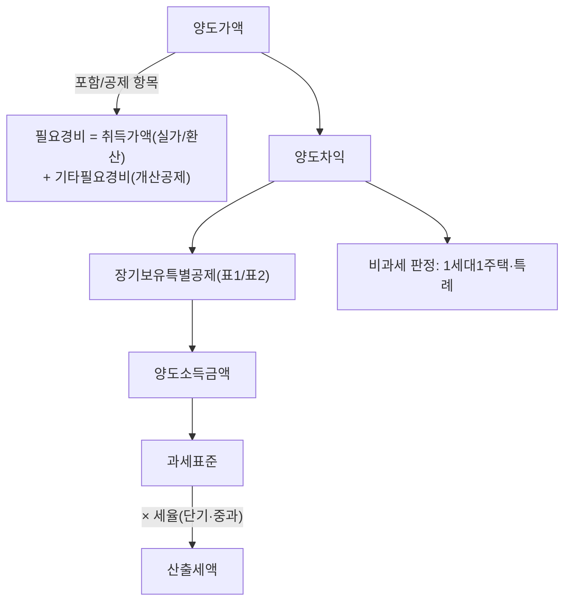

# 세무법인다솔 완전학습 가이드

> [!info] 개요
> 세무법인다솔 유튜브 스터디(원본 19개)를 학습자료화한 교재 16편의 **목차이자 학습 로드맵**이다.
> 이 문서가 **커리큘럼 순서를 소유**한다(교재 파일명에는 번호가 없다). 개별 교재는 소스에 종속되지 않는 개념 노드이고, 순서·관계는 여기서만 정의한다.
> 각 교재는 10개 섹션(먼저 결론 → 왜 중요 → 기본개념 → 판단구조 → 상세설명 → 사례 → 헷갈리는 부분 → 실무 체크포인트 → 핵심정리 → 출처)을 기본 골격으로 한다.

---

## 0. 무엇을 배우는가

부동산을 **취득 → 보유 → 양도 → 상속·증여**하는 전 과정의 세금을 다룬다. 하나의 부동산을 여러 세목(양도세·취득세·종합부동산세·상속세·증여세)이 관통하며, **세목마다 세대·주택수·특례 기준이 다르다**는 것이 실무의 핵심 난점이다.

강사진: [[안수남]](양도·상속증여), [[김홍석]](상생임대·재건축 계산), 고현식(종부세), [[안원용]](상속 민법·법인), [[엄해림]](증여 설계·부담부증여), 이현종(가업상속공제). → [[세무법인다솔]]

---

## 1. 학습 순서 (초급 → 중급 → 심화)

### 🟢 초급: 뼈대 세우기
먼저 양도세 계산의 큰 틀과 비과세를 잡는다.
1. [[양도소득세-계산구조와-취득가액]]: 모든 것의 출발점(계산구조·동일결정원칙·환산가액).
2. [[양도소득세-1세대1주택-비과세]]: 세대·거주요건·특례주택.
3. [[장기보유특별공제]]: 표1/표2, 거주요건.
4. [[양도소득세-세율과-중과]]: 세율·단기·다주택·손피거래.

### 🟡 중급: 세목별 확장
5. [[취득세-주택]]: 취득세 중과·주택수(세대 기준이 양도세와 다름).
6. [[종합부동산세]]: 보유세·1세대1주택 세액공제.
7. [[상생임대주택]]: 거주요건 면제(1주택자 필수).
8. [[증여세-과세체계]]: 증여세 유산취득세·10년 합산.
9. [[상속세-과세체계와-전략]]: 상속세 유산세·사전증여·상속개시 실무.

### 🔴 심화: 어려운 주제·전문 영역
10. [[재개발재건축-양도세]]: 입주권 비과세·권리변환일·2단계 계산.
11. [[비사업용토지]]: 양도세 최고난도(지방세법 기반 판정).
12. [[가업상속공제]]: 상속세 0원(요건 까다로움).
13. [[상속분쟁과-유류분]]: 민법(상속순위·유류분·구체적 상속분).
14. [[부동산-법인활용]]: 법인 취득·전환.
15. [[감정평가-이슈]]: 상속·증여 재산평가 확대.
16. [[부담부증여]]: 빚 낀 증여(양도세+증여세+취득세 결합), 조정지역 다주택자 주의·타이밍.

### ⚪ 통합 관점
17. [[세제-정책비판-강사견해]]: ⚠️ 현행 법령이 아닌 강사 의견 모음(사실/의견 구분 학습용).

---

## 2. 개념 관계도 (양도세 계산 흐름)

```
[양도가액] ─(포함/공제 항목)─▶ 필요경비 = [취득가액(실가/환산)] + 기타필요경비(개산공제)
      │
      ▼
[양도차익] ─▶ [장기보유특별공제(표1/표2)] ─▶ [양도소득금액]
      │                                            │
      ▼                                            ▼
   (비과세 판정: 1세대1주택·특례)              [과세표준] ─ × [세율(단기·중과)] ─▶ [산출세액]
```

**다이어그램 (위 코드블록과 같은 내용)**

%% ciat-design: 시각화 추가 — 아래 다이어그램은 바로 위 코드블록의 내용만 옮긴 것 (원문 우선) %%



세목 간 연결:
```
[세대 개념] ──┬── 양도세(60세+생계)  → 양도소득세-1세대1주택-비과세
              ├── 취득세(65세 별도)   → 취득세-주택
              └── 종부세(인별 과세)   → 종합부동산세

[재개발·재건축] ─ 부동산→권리(입주권)→부동산 ─ 재개발재건축-양도세 ↔ 장기보유특별공제(배제) ↔ 취득세-주택

[상속·증여] ─ 증여세-과세체계 ↔ 상속세-과세체계와-전략 ↔ 가업상속공제 ↔ 상속분쟁과-유류분 ↔ 감정평가-이슈
```

---

## 3. 중요도가 높은 주제 (반드시 이해)

- **동일결정원칙·환산가액·개산공제** ([[양도소득세-계산구조와-취득가액]]): 취득가 입증에 실패하면 세금이 크게 갈린다.
- **1세대1주택 세대·거주요건·특례** ([[양도소득세-1세대1주택-비과세]]): 비과세 배제 = 세금 폭탄.
- **재개발·재건축 관리처분~준공 사이 거래 금지** ([[재개발재건축-양도세]], [[장기보유특별공제]]): 5배 차이.
- **상생임대주택 5가지 판단** ([[상생임대주택]]): 1주택자 거주요건 면제.
- **취득세 판정 4단계·세목별 세대·주택수 차이** ([[취득세-주택]]): 중과 사고가 잦다.
- **종부세 1세대1주택 세액공제(최대 80%)·6/1 기준일** ([[종합부동산세]]).
- **상속: 단독 상속 회피·사전증여·유류분** ([[상속세-과세체계와-전략]], [[상속분쟁과-유류분]]).

---

## 4. 반복해서 복습할 주제 (특히 헷갈림)

- **세목마다 다른 기준**: 세대·주택수·상속주택·특례주택(양도세 vs 취득세 vs 종부세). → [[양도소득세-1세대1주택-비과세]]·[[취득세-주택]]·[[종합부동산세]] 교차.
- **취득시기**: 분양권=잔금·사용승인 중 늦은 날, 승계조합원 입주권=사용승인일. → [[상생임대주택]]·[[재개발재건축-양도세]].
- **"실가"의 두 얼굴**(실제 거래가 vs 추계가액), 환산가액은 취득만. → [[양도소득세-계산구조와-취득가액]].
- **거주주택 비과세 강제성**, 임대주택 양도차익 안분. → [[양도소득세-1세대1주택-비과세]].
- **구체적 상속분(민법) vs 상속세 합산(세법)**: 같은 생전증여를 다르게 취급. → [[상속분쟁과-유류분]]·[[상속세-과세체계와-전략]].

---

## 5. 세목별 빠른 색인

| 세목 | 교재 |
|------|------|
| 양도소득세 | [[양도소득세-계산구조와-취득가액]] · [[양도소득세-1세대1주택-비과세]] · [[장기보유특별공제]] · [[양도소득세-세율과-중과]] · [[재개발재건축-양도세]] · [[상생임대주택]] · [[비사업용토지]] |
| 취득세 | [[취득세-주택]] |
| 종합부동산세 | [[종합부동산세]] |
| 증여세 | [[증여세-과세체계]] · [[부담부증여]] |
| 상속세 | [[상속세-과세체계와-전략]] · [[가업상속공제]] · [[상속분쟁과-유류분]] |
| 법인 | [[부동산-법인활용]] |
| 재산평가 | [[감정평가-이슈]] |
| 정책·강사견해 | [[세제-정책비판-강사견해]] |

---

## 6. 학습 시 유의사항

- ⚠️ **강의 시점 기준**: 상당수 내용이 개정 진행 중(다주택 중과 유예, 상속증여세 공제 확대, 상생임대 연장, 간주임대료 신설 등)이다. 교재에는 `[강의 시점 기준]`으로 표시했으며, **현행 법령 여부는 반드시 최신 조문·유권해석으로 확인**해야 한다(모델 기억이 아니라 공식 원문 조회 우선).
- ⚠️ **[강사견해]와 사실 구분**: [[세제-정책비판-강사견해]]는 현행 법령이 아니라 강사의 주장이다.
- ⚠️ **[원문 확인 필요]**: 전사 잡음으로 확신할 수 없는 수치·날짜는 그렇게 표시했다.

---

## 관련
- 소스 카탈로그: [[세무법인다솔 유튜브 스터디]]
- 강사·법인: [[안수남]] · [[김홍석]] · [[안원용]] · [[세무법인다솔]] (고현식·이현종은 [[세무법인다솔]] 문서에 정리)
