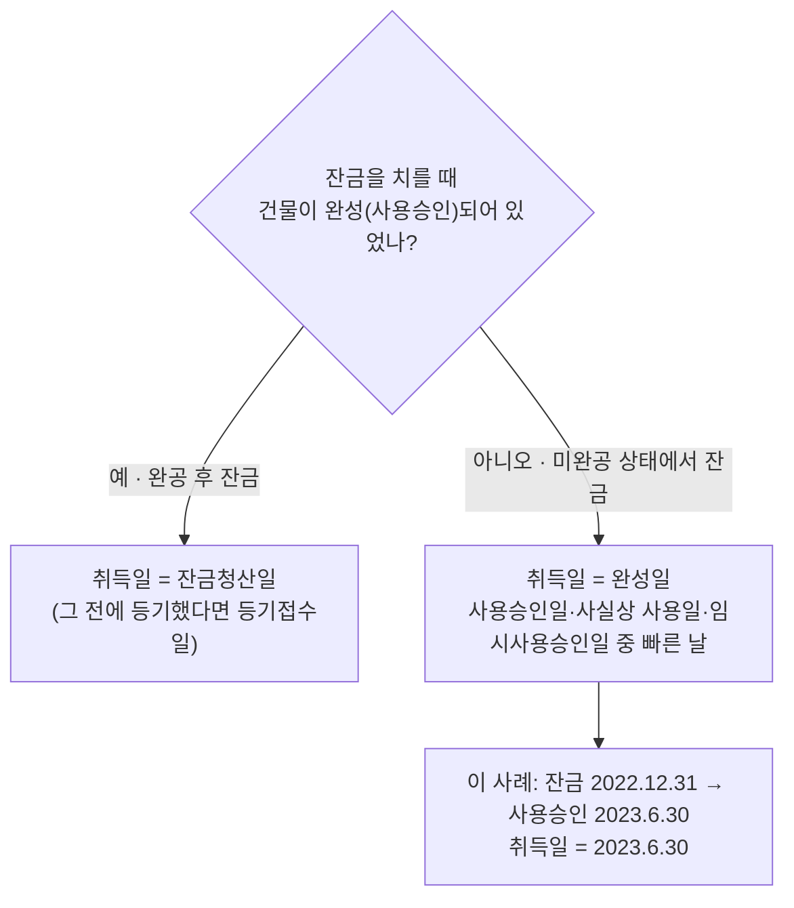

# 분양주택 취득시기 오판 위험 — 준공 전 잔금 사례

> [!info] 사례 출처
> **`case_type: external`** — 정찬우 회계사가 실제 검토 사례를 **일자·지역 등 세부 사실관계를 결론이 달라지지 않는 범위에서 각색**해 공개한 것을 옮겼다. 절차의 구조와 순서는 실제 사례 그대로이고 **일자는 예시값**이다.

---

## 이 사례가 가르치는 것

**분양주택의 취득일은 잔금일도 등기일도 아닐 수 있다.**

일반적인 분양 절차(사용승인 → 잔금 → 등기)를 전제한 통념을 **순서가 뒤집힌 단지**에 적용하면 결론이 완전히 달라진다. 1년·3년 기간 계산도, 거주요건 판정도 모두 "취득한 날"에서 출발하므로 **이 첫 단추가 틀리면 뒤의 판단이 전부 흔들린다.**

---

## 1. 사실관계

| 일자 | 내용 |
|---|---|
| 2019.6.30 | 종전주택(분양, 부부 공동) **분양계약** |
| 2022.12.31 | 분양 **잔금 완납** |
| **2023.6.30** | **사용승인 = 세법상 취득일** |
| 2023.11.15 | 소유권보존등기(시행사 명의) |
| 2023.12.31 | 소유권이전등기 접수(수분양자 명의) |
| 2024.9.15 | 신규주택(매매, 배우자 명의) 잔금·이전등기 = **신규주택 취득일** |

- 종전주택은 부부 공동명의, 신규주택은 배우자 단독 명의지만 **결론에 영향이 없다.** 1세대 1주택 비과세는 **사람이 아니라 세대 단위**로 주택 수를 세기 때문이다(소득세법 제89조 제1항 제3호).

> [!summary] 결론
> **결론**: 종전주택을 **2027년 9월 15일까지** 양도하면 일시적 2주택 비과세를 적용받을 수 있다. 다만 그 결론은 **취득일을 사용승인일(2023.6.30)로 잡은 뒤에야** 나온다.

---

## 2. 검토 순서

법리의 상세는 [[양도소득세-1세대1주택-비과세]]와 [[양도소득세-계산구조와-취득가액]]이 소유한다. 이 문서는 **검토 순서와 실무 판단**을 담는다.

```
① 취득일 확정        ← 이 사례가 걸린 지점
② 1년 경과·3년 이내 요건 대입 (초일불산입)
③ 취득 당시 조정대상지역 여부로 거주요건 확인
④ 양도 기한 관리와 입법 동향
```

---

## 3. 쟁점 1 — 취득일이 잔금일도 등기일도 아니다

분양주택의 취득일은 두 갈래로 나뉜다.

| 상황 | 취득일 |
|---|---|
| **완공(사용승인) 후에 잔금**을 치른 경우 | **잔금청산일** (그 전에 등기했다면 등기접수일) |
| **잔금을 다 치렀는데 아직 미완공**인 경우 | **완성일** = 사용승인일·사실상 사용일·임시사용승인일 중 **빠른 날** |

**판단 흐름 (위 표와 같은 내용)**

%% ciat-design: 시각화 추가 — 아래 다이어그램은 이 절 본문의 내용만 옮긴 것 (원문 우선) %%




> [!warning] 통념과 반대로 작동하는 지점
> ⚠️ 취득시기를 **"잔금일과 등기일 중 빠른 날"**로 기억하기 쉽지만, **미완공 상태에서 낸 잔금은 반대로 작동한다.** 아직 건물이 완성되지 않았으므로 **취득일이 잔금일에서 완성일로 뒤로 밀린다.**

- 이 사례는 잔금 완납일(2022.12.31)보다 사용승인일(2023.6.30)이 늦으므로, **"잔금청산일까지 완성되지 아니한 경우"**에 해당해 **취득일 = 2023.6.30**.
- ⚠️ **전제 확인 필요**: 사용승인 전에 **입주하거나 임시사용승인**을 받았다면 그 빠른 날로 취득일이 당겨진다. 실제 검토에서는 **건축물대장과 입주 자료**로 이 전제까지 확인해야 한다.
- **시행사의 소유권보존등기일(2023.11.15)이나 수분양자의 이전등기 접수일(2023.12.31)은 취득시기 판단에 등장하지 않는다.** "등기를 쳐야 취득"이라는 통념은 **상담에서 가장 자주 만나는 오해**다.

**왜 순서가 뒤집히는가**: 공사비 분쟁, 조합 내부 갈등, 기반시설 미완성 등으로 준공·정산이 늦어지는 단지에서 발생한다.

---

## 4. 쟁점 2 — 취득일 후보에 따라 결론이 정반대가 된다

| 종전주택 취득일을 무엇으로 보는가 | 신규주택 취득 가능 시점 | 2024.9.15 취득 판정 |
|---|---|---|
| 잔금 완납일(2022.12.31)로 오해 | 2024.1.1부터 | 충족처럼 **보임** |
| 이전등기 접수일(2023.12.31)로 오해 | 2025.1.1부터 | **미충족으로 오판** |
| **사용승인일(2023.6.30) = 정답** | **2024.7.1부터** | **충족** (약 두 달 반 여유) |

> [!warning] 오판했을 때의 결과
> 취득일을 **등기접수일로 잘못 알았다면 요건을 충족하고도 비과세를 포기**했을 것이고, 반대로 **잔금일 기준으로 안심하고 2024년 봄에 신규주택을 샀다면 실제로는 요건 미달로 비과세 전체를 잃었을** 사안이다.

**"가능 시점"이 다음 해 같은 날짜가 아니라 그 다음 날부터인 이유** — 세법에 별도 규정이 없는 기간 계산은 민법을 따르고(국세기본법 제4조), **민법 제157조의 초일불산입** 원칙에 따라 취득일 당일은 기간에 넣지 않는다.

⚠️ **실제로 이 경계에서 비과세를 잃은 사건이 있다.** 조심 2019서1704(2019.11.01)에서 납세자가 종전주택 취득일(2015.3.31)의 **다음 해 같은 날짜(2016.3.31)**에 신규주택을 취득했는데, 조세심판원은 **1년이 지나지 않았다**고 보아 특례 적용을 부인했다. 납세자는 초일을 산입하던 과세관청의 **옛 해석**을 따랐다고 주장했으나, **해석이 바뀐 뒤의 양도에는 신뢰보호를 인정하지 않았고 가산세 감면도 받아들이지 않았다.**

---

## 5. 쟁점 3 — 거주요건은 **취득 당시**의 조정대상지역 여부로 고정된다

| 시점 | 종전주택 소재지의 조정대상지역 지위 |
|---|---|
| ~ 2022.11.13 | 조정대상지역 |
| 2022.11.14 ~ 2025.10.15 | **해제**(국토교통부공고 제2022-1408호) ← **취득일 2023.6.30이 이 구간** |
| 2025.10.16 ~ | 조정대상지역 **재지정**(국토교통부공고 제2025-1223호) |

- 취득일 당시 **해제 상태**였으므로 이 주택에는 **거주요건이 붙지 않고 보유기간 2년만** 충족하면 된다.
- ⚠️ **2025.10.16 재지정은 이미 취득한 주택에 거주요건을 소급시키지 않는다.** 조문이 **"취득 당시"**를 기준으로 삼기 때문이다.
- 취득일부터 이미 2년이 지났으므로 **보유요건도 충족**. → 남은 것은 **2027.9.15까지의 양도 이행**뿐.

---

## 6. 실행 단계에서 관리할 세 가지

### ① 양도 기한 관리

**양도시기는 계약일이 아니라 원칙적으로 잔금청산일**이고, 잔금 전에 소유권이전등기를 접수했으면 그 접수일이다(소득세법 시행령 제162조 제1항 제2호). **이 법정 양도시기가 기한을 넘지 않도록** 관리한다.

> [!tip] 실무 팁
> 📌 매수인의 대출 일정이나 계약 지연으로 잔금일이 밀리는 일은 흔하다. **기한 몇 달 전이 아니라 반년 이상 여유를 두고 매도를 시작**하는 편이 안전하다. 조심 2019서1704처럼 **경계일에 딱 맞춘 계획은 작은 변수 하나로 무너진다.**

### ② 시행령 개정 — 처분기한 3년 → 2년 (✅ 2026.9.30 공포·10.1 시행)

> [!note] 2026-10-08 갱신
> 2026-10-08 갱신: 아래 입법예고안은 **소득령 §155①1호로 확정·시행**됐다(법제처 대조). 적용은 2026.10.1 이후 양도분, 2026.8.3까지 취득·계약금 지급분은 3년(보도·해설 기준). 이 사례의 결론(3년 유지)은 변하지 않는다. → [[양도소득세-1세대1주택-비과세]] 5-1

2026년 세제개편안의 후속으로 입법예고된 소득세법 시행령 개정안(**재정경제부공고 제2026-222호, 2026.8.7. 입법예고**)은 **종전주택이 조정대상지역에 있는 상태에서 조정대상지역의 신규주택을 취득**하는 경우 종전주택 처분기한을 **3년 → 2년**으로 단축한다.

**이 사례는 3년이 유지되는 것으로 본다.**

| 근거 | 적용 |
|---|---|
| 단축 요건 미해당 | 신규주택 취득 당시(2024.9.15) 종전·신규주택 소재지 **모두 비조정대상지역** → 조정지역 간 이동이 아님 |
| 부칙 경과조치 | **2026.8.3 이전에 신규주택을 취득**한 경우는 종전 규정(3년) → 2024.9.15 취득으로 해당 |

⚠️ **개정안은 2026년 10월 1일 시행 예정이나 아직 공포 전**이다. 최종 공포문에서 문언과 부칙이 유지되는지 확인해야 한다. `[현행 기준 확인 필요]` (→ [[2026-세제개편안-부동산]])

### ③ 규제지역 확대 흐름

- 2025.10.16 서울 전역과 경기 12곳이 조정대상지역·투기과열지구로 지정, **2026.7.1 경기 3곳 추가**.
- 이번 사이클에서 거주요건이 붙지 않은 것은 **취득 당시 비조정지역이었던 덕분**이고, 3년 처분기한은 현행법상 지역과 무관한 기본값이다.
- **개정안이 공포되면 조정지역 간 갈아타기에는 2년 기한이 적용**되므로, 앞으로는 **취득 시점의 지정 현황이 거주요건과 처분기한을 모두 좌우**한다. 갈아타기를 반복할 계획이라면 **취득 시점마다 국토교통부 공고 기준으로 지정 현황을 확인**해야 한다.

### ④ 고가주택 여부

종전주택 시세가 12억원 부근이라면, **양도 당시 실지거래가액이 12억원을 초과하는 경우 고가주택**에 해당한다(소득세법 제89조 제1항 제3호). 이때는 양도차익 전체가 아니라 **12억원 초과 비율만큼의 양도차익이 과세**되므로(같은 법 시행령 제160조 제1항), 매도 가격에 따라 **일부 과세가 발생할 수 있다는 점도 자금 계획에 넣어둔다.**

---

## 7. 상담 체크리스트로 옮길 것

1. 분양주택이면 **잔금일과 사용승인일의 선후**를 먼저 확인한다. 잔금이 먼저면 취득일은 **사용승인일**.
2. 사용승인 전 **입주·임시사용승인** 사실이 있는지 **건축물대장·입주 자료**로 확인한다.
3. 1년 요건은 **초일불산입** — "다음 해 같은 날짜"가 아니라 **그 다음 날부터**다.
4. 거주요건은 **취득 당시** 조정대상지역 여부로 고정. **이후 지정·해제는 소급하지 않는다.**
5. 양도 기한은 **법정 양도시기(잔금청산일)** 기준. **반년 이상 여유**를 두고 매도 착수.
6. 신규주택 취득 시점의 **국토교통부 지정 공고**를 확인해 기록으로 남긴다.

---

## 관련 문서

- [[양도소득세-1세대1주택-비과세]] — 일시적 2주택 특례·보유거주요건 정본
- [[양도소득세-계산구조와-취득가액]] — 취득·양도 시기 정본
- [[2026-세제개편안-부동산]] — 처분기한 단축 개정안
- [[재개발재건축-양도세]] — 조합원입주권·분양권이 개입한 경우는 별도 규정으로 판정

---

## 출처

- [[소득세법 일시적 2주택 양도세 비과세 요건 검토 사례(준공 전 잔금을 먼저 치른 분양 아파트)-소스요약]] — 정찬우 회계사(차누월드 ｜ 찬CPA), 2026-08-27
- 근거 법령: 소득세법 제89조·제98조, 같은 법 시행령 제154조 제1항·제155조 제1항·제160조 제1항·제162조 제1항, 국세기본법 제4조, 민법 제157조

> [!caution] 검증 상태
> `[원문 확인 필요]` 인용된 해석·심판례(서면인터넷방문상담5팀-657(2008.03.26), 서면-2017-법령해석재산-0785(2017.09.19), 조심 2019서1704(2019.11.01), 서면-2016-부동산-3431(2016.06.02))와 국토교통부 공고번호는 **필자 인용을 옮긴 것이며 원문 직접 대조는 하지 않았다.**
