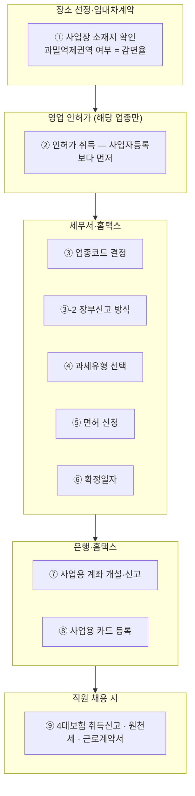

# 신규사업자 개업세팅 체크리스트

이 문서는 신규 창업 고객을 수임할 때 **개업 시점에 한 번만 할 수 있는 결정**을 놓치지 않기 위한 절차서다. 법리와 감면 요건의 근거는 여기에 두지 않고 정본 topic에서 확인한다.

> [!note] 참고
> **이 체크리스트의 존재 이유**: 개업 단계 항목의 상당수는 **사후 정정이 어렵거나 불가능**하다. 업종코드는 창업감면을, 과세유형 선택은 초기 시설투자 매입세액 환급을, 확정일자는 보증금 순위를 각각 되돌리기 어렵게 확정시킨다. 기장 수임 후 첫 마감에서 발견하면 이미 늦은 항목들이다.

## 진행 순서

```
장소 선정·임대차계약
   └→ ① 사업장 소재지 확인 (과밀억제권역 여부 = 감면율)
영업 인허가 (해당 업종만)
   └→ ② 인허가 취득 — 사업자등록보다 먼저
세무서·홈택스
   └→ ③ 업종코드 결정   ③-2 장부신고 방식   ④ 과세유형 선택   ⑤ 면허 신청   ⑥ 확정일자
은행·홈택스
   └→ ⑦ 사업용 계좌 개설·신고   ⑧ 사업용 카드 등록
직원 채용 시
   └→ ⑨ 4대보험 취득신고 · 원천세 · 근로계약서
```

**다이어그램 (위 코드블록과 같은 내용)**

%% ciat-design: 시각화 추가 — 아래 다이어그램은 바로 위 코드블록의 내용만 옮긴 것 (원문 우선) %%



> [!warning] 주의
> ⚠️ **사업자등록 시점을 오해하지 않는다.** 사업자는 원칙적으로 사업개시일부터 20일 이내 등록하며, 사업개시 전에도 신청할 수 있다. 개업 전 매입세액 공제에는 등록신청 기한·세금계산서 수취요건이 따르므로, 초기 인테리어·설비비 지출 전에 등록일정을 잡는다. "비용이 처음 발생한 날이 곧 법정 등록일"이라고 단정하지 않는다.
>
> ✅ **등록 전 지출도 구제 가능하다**: 과세기간 종료 후 **20일 이내**에 사업자등록을 하면, 등록 전에 지출한 매입세액도 공제·필요경비 인정 대상이 된다(부가가치세법§8·§39①8호, 시행령§11). 등록을 미루다 이 20일을 넘기면 초기 인테리어·설비비 매입세액이 영구히 사라진다.

## 단계별 체크

### ① 사업장 소재지: 계약 전에 확인
- [ ] **과밀억제권역에 해당하는지** 확인한다. 같은 청년창업이라도 과밀억제권역이면 감면율이 절반으로 떨어진다 → [[창업중소기업-세액감면]]
- [ ] 2027년 이후 창업 예정이면 정부안의 **수도권 일반 / 비수도권 광역시·수도권 우대지역 / 기타 비수도권 / 비수도권 우대지역** 중 예상 구간을 판정하고, 우대지역은 시행령 확정 후 재확인한다.
- [ ] 2026년 창업과 2027년 창업의 감면율을 비교하되 **국회 통과 전 정부안**임을 고객에게 명시한다. 세금 외 사업 일정·계약·매출기회도 함께 기록한다.
- [ ] 사업자등록 신청서에 적을 수 있도록 임대차계약서상의 **임대인 정보**를 확보한다
- ⚠️ 이 항목은 **계약 체결 전** 상담에서 다뤄야 실익이 있다. 계약 후에는 선택지가 없다.

### ② 영업 인허가: 사업자등록보다 먼저
- [ ] 해당 업종에 인허가가 필요한지 확인한다
- [ ] **음식점(카페·주점·치킨집 포함)**: 구청 식품위생과에서 **영업신고증**을 받는다. 구비서류는 다음 4종이다
  - [ ] 임대차계약서
  - [ ] 사업주 신분증
  - [ ] **건강진단결과서**(구 보건증)
  - [ ] **식품위생교육 수료증**
- [ ] 같은 업종이 영업하던 자리가 아니라면(신축 건물이거나 다른 업종에서 전환하는 경우) **현장 실사에 걸리는 기간**을 개업일정에 반영한다

### ③ 업종코드: 감면 여부가 여기서 결정된다
- [ ] 국세청 업종코드(6자리)를 확정한다. 근거는 [[창업중소기업-세액감면]]에서 확인한다
- [ ] 실제 영위업종이 **감면 배제 업종에 해당하는지** 확인: 음식점업 중 주점 및 비알코올 음료점업은 감면 대상에서 제외된다(조특법 §6③제7호, 2026-08-20 조문 대조). 업종코드는 실제 사업내용에 맞춘다.
- [ ] 여러 업종을 함께 하는 업소(예: 베이커리 카페)는 **상호와 업종코드가 서로 맞는지** 확인한다. 상호가 업종을 판단하는 증거가 되므로 상호를 확정하기 전에 상담하는 것이 유리하다
- [ ] 앞으로 확장할 업종을 부업종으로 추가하려는 경우에는 **조특법 §6⑩(사업확장·업종추가는 창업이 아니다)**을 먼저 알린다

### ③-2 장부신고 방식: 2027년 추계과세 배제 대비
- [ ] 창업감면 적용 예정 사업자의 신고방식을 **장부에 따른 실제소득 신고 / 추계신고**로 구분한다.
- [ ] 2027-01-01 이후 개시 과세연도부터 추계과세 시 창업감면을 배제한다는 정부안을 설명하고, 확정 법률·시행령을 시행 전에 재확인한다 → [[창업중소기업-세액감면]].
- [ ] 장부를 직접 작성할지 기장대리를 맡길지 정하고, 증빙수취·계좌/카드 분리·월마감 일정을 설계한다.
- ⚠️ 정부안은 **유료 세무대리인 선임을 의무화한 것이 아니다.** 영상 제목의 “기장 대리 필수”는 영업적 표현이며, 핵심은 추계가 아닌 장부 기반 신고다. `[LLM 해석 — 확정 법률 확인 필요]`

### ④ 과세유형: 간이 vs 일반
개업 시 판단이 필요한 **최소 실행 기준**만 둔다. 법정 적용·배제업종과 예상 공급대가, 포기신고의 구속기간, 초기 매입세액을 함께 본다. 계산구조는 [[부가가치세-과세체계와-신고]]를 참조한다.

| 판단요소 | 확인 | 결론 |
|---|---|---|
| 법정 간이과세 적용·배제 | [ ] 업종·지역·직전연도 환산 공급대가를 확인한다 | 적용할 수 있는지 먼저 판정 |
| 초기 시설·인테리어·비품에 대해 **고액의 세금계산서를 받음** | [ ] 예상 공제세액과 환급 가능성을 산정한다 | 일반과세 선택을 검토 |
| 예상 B2C 매출·매입률·거래처 요구 | [ ] 연간 세부담과 세금계산서를 발급해야 할 필요성을 비교한다 | 간이·일반의 손익을 비교 |

- ⚠️ "고액 매입이 없고 상반기 개업이면 간이, 하반기면 일반"은 강의의 경험칙일 뿐 법정 판정기준이 아니다. 일반과세를 선택하면 일정 기간 간이과세로 돌아갈 수 없는 효과까지 포함해 비교한다.
- [ ] 판단이 애매한 경우는 개별적으로 계산한 뒤 결정하고, 판단 근거를 수임 기록에 남긴다

### ⑤ 면허 신청: 사업자등록 신청서에서 함께
- [ ] **주류 판매**: 음식점에서 술을 판매하려면 사업자등록 신청서의 면허란에 주류판매 면허를 신청한다. 빠뜨리면 사업자등록증에 주류판매 번호가 없어 **주류 도매상에서 술을 살 수 없고**, 세무서를 다시 방문해야 한다
  - 코드 `542`로 강의에서 청취됨 `[자동자막 오인식 가능 — 신청 시 원문 대조]`

### ⑥ 확정일자: 임차보증금 보호
- [ ] 사업자등록과 **동시에** 세무서에서 확정일자를 신청한다
- [ ] **임대차계약서 원본에 확정일자 도장**이 찍혔는지 확인한다 (원본에 찍혀야 한다)
- [ ] 보증금이 크다면 상가건물 임대차보호법의 적용범위(보증금 환산액 한도)를 따로 확인한다 `[현행 기준 확인 필요]`

### ⑥-2 은행 방문: 확정일자와 한 번에 처리 (2026-08-24 추가)

- [ ] 사업용 계좌 개설 + 기업인터넷뱅킹 신청 + **전자세금계산서용 인증서 발급**(약 4,400원)을 은행 한 번 방문으로 함께 처리한다.

### ⑦ 사업용 계좌
- [ ] 개인사업자는 사업과 개인 거래를 분리할 **전용 계좌**를 개설하도록 권고하고, 신고의무가 생기면 홈택스에 사업용계좌로 신고한다
- [ ] 기존 개인 명의 계좌를 사업용으로 신고하지 않도록 안내한다: 사업과 무관한 개인 거래 내역까지 열람 범위에 들어가기 때문이다 [강사견해]
- **법정 신고·사용의무는 복식부기의무자**에게 적용된다. 해당 과세기간 개시일부터 6개월 이내 신고하며, 사업개시와 동시에 복식부기의무자가 된 경우에는 다음 과세기간 개시일부터 6개월 이내다. 미사용액의 0.2%, 미신고 시 수입금액 기간안분액의 0.2%와 의무거래금액의 0.2% 중 큰 금액을 가산세로 본다. 전 사업자에 대한 계좌 분리는 법정의무가 아니라 내부통제 권고다.

### ⑧ 사업용 카드
- [ ] 홈택스에 사업용 카드를 **등록**한다
- [ ] 카드를 새로 발급받을 필요는 없다고 안내한다: 혜택이 좋은 기존 개인카드를 등록해 써도 된다 [강사견해]
- 계좌는 새로 만들기를 권하고, 카드는 등록만 하면 된다. 이 차이를 고객에게 분명히 전달한다

### ⑨ 직원 채용 시: 채용 시점에 함께 처리
- [ ] 4대보험 취득신고를 한다
- [ ] 원천세를 신고하는 체계를 만든다
- [ ] 근로계약서를 작성한다
- 이행하지 않으면 2가지 위험이 생긴다: **인건비를 비용으로 처리하지 못하는 문제**(세무)와 **노동청 진정·고발**(노무)
- 상시근로자 수에 따라 노동법 적용이 달라지는 부분은 다음 문서에서 확인한다 → [[5인미만-사업장-근로기준법-특례]]

### ⑩ 사업자등록 직후 세팅: 여기서 감면이 갈린다

- [ ] **사업자 명의로 홈택스에 회원가입**한다
- [ ] 은행에서 **사업자용 공인인증서**를 발급받고 인터넷뱅킹을 신청한다
- [ ] 전자세금계산서를 발급할 때 쓸 인증수단을 확인한다: **전자세금용 인증서는 선택지 중 하나**이며, 홈택스가 지원하는 사업자 공동·금융인증서나 보안카드 등 사용 가능한 수단을 발급기관·홈택스에서 확인한다
- [ ] **현금영수증 가맹점에 가입**한다: 소비자를 상대하는 업종으로서 직전 과세기간 수입금액이 **2,400만원 이상**이면 의무다. 의료업·수의업·약사업·변호사·회계사 등 시행령상 전문직·의무발행업종은 수입금액과 무관하게 가입대상이 될 수 있다
- ⚠️ **사업용계좌 미신고·현금영수증 미가맹은 [[창업중소기업-세액감면]]을 전액 배제시킨다.** 등록 직후에 함께 끝내는 것이 안전하다
- 📌 **사업용계좌는 "복식부기의무자가 된 해의 6월 30일"이 기한**이고, 은행에서 사업자 통장을 만든 것만으로는 신고가 아니다. 판정·기한·불이익은 → **[[사업용계좌-신고의무]]**
- [ ] 카드결제를 받는다면 **카드단말기**를 설치한다 (수수료와 기능을 비교한다)
- [ ] **가스·전기·인터넷·관리비 등 공과금을 사업자 명의로 전환**하고 세금계산서 발행을 신청한다: 사업용 카드로 결제하고 있다면 따로 신청할 필요가 없다
- [ ] **인테리어 세금계산서**를 받는다
- [ ] **권리금을 지급할 때 신고할지 결정**한다: 원칙은 신고하는 것이다
- [ ] 직원이 있다면 **4대보험 사업장 성립신고**(사업장 자체에 대한 신고)와 **취득신고**(직원 개인별 신고)를 구분해 처리한다 → ⑨

### ⑪ 세금 자금 미리 떼어두기

- [ ] 고객에게 **부가가치세는 내 돈이 아님**을 초기에 각인시킨다. 통장에 들어온 매출의 10%는 고객에게서 받아 잠시 보관하는 돈이다. 직장인 출신 창업자가 특히 혼동한다
- [ ] 권하는 적립 수준: **매출의 10% 안팎**을 별도 계좌에 넣어 둔다. 음식점처럼 매입세액 공제가 제한적인 업종은 **부가세용으로만 매출의 4~5%**를 떼어 둔다 `[강사견해]`
- ⚠️ 갑자기 매출이 늘어난 해에 대비가 없으면 **세금을 낼 현금이 없어 체납자가 되고 금융활동이 제한**된다

### ⑫ 한 달 안에 정리할 것들 (2026-08-24 추가)

- [ ] **통신비·공과금 명의 전환은 소급되지 않는다.** 전환을 미루면 그 달 지출분의 매입세액공제·필요경비가 그대로 사라진다. ⑩의 "공과금 사업자 명의 전환"을 늦어도 등록 후 한 달 안에 마무리한다.
- [ ] **간편결제·기프티콘 지출을 현금영수증 지출증빙용으로 전환**한다. 개인 소득공제용 현금영수증으로 발급된 건은 사업비용 처리가 불가능하다. 앱 설정에서 사업자용(지출증빙)으로 바꿔야 한다.
- [ ] **해외 구독서비스(SaaS 등)는 홈택스에 사업자등록번호(BRN)를 입력**하면 부가세 10%가 면제된다. 입력하지 않으면 매입세액공제 없이 부가세를 그대로 부담한다.
- [ ] **해외결제(메타 광고비 등)는 홈택스에 조회되지 않는다.** 카드사 청구내역을 별도로 저장·보관해야 나중에 비용을 소명할 수 있다.
- [ ] **거래처 경조사비는 건당 20만원까지**(2027년 시행 예정 개편안이 통과되면 30만원으로 상향 → [[2026-세제개편안-사업자]]) 청첩장·부고문자 캡처로 비용 인정된다. 한도를 초과하면 초과분이 아니라 **전체가 부인**될 수 있으므로 한도를 넘기지 않도록 관리한다.
- [ ] **인건비는 지급한 달의 다음 달 10일까지 원천세 신고**가 필요하다. 채용 시점(⑨)뿐 아니라 매월 지급 시점마다 반복되는 의무임을 고객에게 안내한다.
- [ ] 상대방이 사업자가 아닌 **개인 간 거래**(당근마켓 등)는 적격증빙 수취의무 자체가 없다. 계좌이체 내역 + 거래 캡처 + 판매자 정보로 대체 소명한다.

## 수임 시 확보할 정보
- [ ] 개업예정일 · 사업장 소재지 · 상호(확정했는지 여부)
- [ ] 2026년/2027년 창업·지정·확인·선정 예정일과 정부안 적용 여부
- [ ] 대표자 연령(청년창업 요건을 판단하는 데 쓴다)
- [ ] 일반·청년·청년 신산업·벤처·에너지신기술·점프업 등 예상 감면유형
- [ ] 초기 투자 규모와 세금계산서 수취 예정 여부
- [ ] 장부작성 방식(직접기장/기장대리)과 추계신고 가능성
- [ ] 직원 채용 계획(인원·시기)
- [ ] 기존에 사업을 한 이력(§6⑩에 따라 창업에 해당하는지 판단하는 데 쓴다)

> [!warning] 주의
> ⚠️ **정보보호**: 위 항목은 판단에 필요한 범위로만 수집하고, 신분증 사본·사업자등록증 사본·계좌 내역 등 식별정보와 원본 업무자료는 이 위키가 아니라 승인된 업무시스템에서 관리한다.

## 관련
- 정본 지식: [[창업중소기업-세액감면]] (업종·감면율·창업 요건의 근거)
- 노무 교차: [[5인미만-사업장-근로기준법-특례]]
- 원천 소스: [[2026-08-18-음식점 개업 절차와 절세를 위한 기본 세팅 방법-소스요약]]
- 추가 반영(2026-08-24): [[소득세법 사업자등록 전후로 해야 할 일 — 처음 사업 시작하는 분들을 위한 세무 세팅 가이드-소스요약]]: 등록 전 매입세액공제 20일특례, 은행 일괄처리, 한 달 안에 정리할 것들(⑫)
- 개정안 소스: [[2026-08-13-창업 세액감면 개편안 총정리 기장 대리 선택이 아닌 필수가 된 이유ㅣ절세미녀-소스요약]]
- 현행 절차 근거: [소득세법 제160조의5·제81조의8](https://www.law.go.kr/법령/소득세법/제160조의5) · [소득세법 시행령 제210조의3](https://www.law.go.kr/법령/소득세법시행령/제210조의3)
- [[기장업무-전체프로세스]]: 기장업무 전체 흐름의 진입점
- [[기장고객-연간업무일정]]: 개업 후 월별·연간 신고 일정을 관리한다
- ⏳ 미작성: 간이/일반 과세유형 판정의 정본 topic
