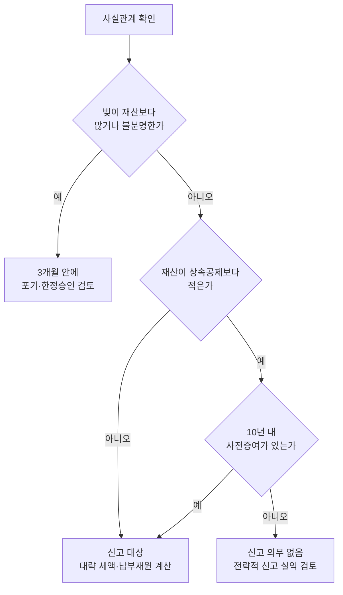

# 상속 상담 진행 가이드: 첫 연락부터 수임까지

> [!info] 개요
> 이 문서는 상속이 개시된 뒤(또는 개시가 임박했을 때) 고객이 처음 연락해 온 시점부터 **수임을 결정할 때까지** 무엇을 어떤 순서로 묻고 안내할지를 정한다.
> - 고액자산가가 **생전에** 재산 이전을 설계하려는 상담에는 [[자산가-상속증여-상담-유형과-질문]]을 쓴다.
> - 받아야 할 서류는 [[상속세-신고서류-자료요청-체크리스트]]가, 상속개시 후 기한별로 할 일은 [[상속개시-후-절차-체크리스트]]가, 법리는 [[상속세-과세체계와-전략]]이 다룬다. 이 문서는 **상담을 진행하는 순서와 고객에게 할 말**만 담는다.

> [!summary] 핵심 요약
> 첫 상담에서 답해야 할 질문은 세 가지다.
> 1. **빚이 재산보다 많은가?** → 3개월 안에 상속포기·한정승인을 검토해야 하는지 판단한다
> 2. **상속세 신고 대상인가?** → 재산과 공제를 비교하고, 10년 안에 사전증여가 있었는지 확인한다
> 3. **세금이 대략 얼마이고, 낼 돈이 있는가?** → 대략의 세액과 납부 재원을 따져 본다
>
> 이 세 질문에 답하는 데 필요한 자료만 먼저 받고, 나머지 자료는 수임한 뒤에 받는다.

---

## 0. 첫 연락 (전화·문자): 5분 안에 할 일

### 0-1. 바로 확인할 것

- [ ] **사망일**을 확인하고, 상속포기·한정승인 기한(상속개시를 안 날부터 3개월)과 신고기한(사망일이 속한 달의 말일부터 6개월)까지 남은 기간을 계산한다
- [ ] **상속인 구성**을 확인한다: 배우자가 생존해 있는지, 자녀가 몇 명인지, 상속인 중 해외에 사는 사람이 있는지
- [ ] **빚이 많을 가능성**이 있는지 묻는다. 가능성이 있으면 **고인의 돈을 쓰지 말라고 즉시 안내**한다(고인의 돈을 쓰면 단순승인으로 간주될 위험이 있다 → [[상속승인과-포기]])
- [ ] 사망신고를 했는지, **안심상속 원스톱 서비스**를 신청했는지 확인한다

### 0-2. 첫 통화에서 안내할 것

- [ ] **기한 두 가지**를 알린다: 상속포기·한정승인은 3개월, 상속세 신고는 6개월이다. 취득세 기한은 따로 있다는 점도 함께 알린다
- [ ] **지금 하지 말아야 할 일**을 알린다: 고인의 계좌나 카드를 개인 용도로 쓰는 것, 급하게 예금을 인출하는 것, 상속받을 부동산을 서둘러 처분하는 것
- [ ] **지금 해야 할 일**을 알린다: 안심상속 원스톱 서비스를 신청하고, **장례비 영수증을 한곳에 모으고**, 미납 병원비는 은행에 예외인출을 신청해 처리한다 → [[상속개시-후-절차-체크리스트]] 0-1·1-2
- [ ] **장례 기간에 돈을 요구하는 전화는 일단 의심하라**고 알린다 → [[상속개시-후-절차-체크리스트]] 0-4
- [ ] **두 곳 이상에서 상담을 받아 보시라고 권한다** (아래 0-3 참조)

### 0-3. "두 곳 이상 상담받아 보세요": 운영 방침

> [!note] 참고
> 이 권유는 법적 의무가 아니라 **사무소의 운영 방침**이다. [사무소 방침]

- **권하는 이유**: 상속세는 평가방법을 무엇으로 고르는지, 재산을 어떤 비율로 나누는지, 어디까지 신고하는지에 따라 세금이 달라지는 세목이다. 고객이 여러 곳을 비교해 보면 **설명이 구체적인 곳**을 고르게 되므로, 길게 보면 신뢰가 쌓인다.
- **비교할 기준을 함께 알려 준다** (고객이 보수만 비교하지 않도록):
  1. 부동산을 어떤 방법으로 평가할지(기준시가·유사매매사례·감정평가)와, 그 선택이 **나중에 팔 때의 양도세에 어떤 영향을 주는지까지** 설명하는가 → [[감정평가-이슈]]
  2. **배우자 몫의 비율과 2차 상속**까지 함께 계산해 주는가 → [[상속재산-협의분할-세금검토-체크리스트]]
  3. **10년치 거래내역을 검토**해 사전증여와 추정상속재산을 미리 정리하는가 → [[상속세-세무조사-대비-체크리스트]]
  4. 신고 뒤의 **세무조사 대응까지** 보수에 포함되는가
  5. 납부 방법(분납·연부연납·물납)을 안내하는가

> [!example] 말하기 예시
> "상속세는 평가 방법과 나누는 방법에 따라 세금이 꽤 달라집니다. 저희 말고도 한두 곳 더 상담받아 보시고, 비교하실 때는 **부동산 평가를 어떻게 하는지, 배우자분 몫과 다음 상속까지 계산해 주는지, 세무조사 대응이 포함되는지**를 물어보세요."

### 0-4. 1차 상담 전에 받을 자료

이 단계에서는 [[상속세-신고서류-자료요청-체크리스트]] 3절의 **1차 자료**만 요청한다. 첫 상담부터 서류를 모두 요구하면 고객이 지친다.

- 사망일, 상속인 구성 / 안심상속 조회 결과(있으면) / 부동산 목록과 대략의 시세 / 큰 예금과 대출의 규모 / **10년 안에 고인에게서 받은 재산이 있는지(상속인 각자에게 확인)** / 유언장이 있는지 / 사업체나 비상장주식이 있는지

---

## 1. 1차 상담: 세 가지 판단

**다이어그램 (아래 1-1~1-3과 같은 내용)**

### 1-1. 빚이 더 많은가

- [ ] 대출, 보증, 개인 사이의 채무, 미납 세금을 확인한다. 안심상속 원스톱 서비스에 잡히지 않는 빚이 있는지도 묻는다
- [ ] 빚이 재산보다 많거나 많은지 불분명하면 **상속포기·한정승인**을 안내하고, 필요하면 변호사나 법무사와 연결한다 → [[상속승인과-포기]] (상속을 포기하면 빚이 후순위 상속인에게 넘어가는 문제도 함께 설명한다)

### 1-2. 신고 대상인가

- [ ] 재산 합계(부동산은 대략의 시세로 계산)와 상속공제(배우자가 있으면 일괄공제 5억 + 배우자공제 최소 5억)를 비교한다 → [[상속세-과세체계와-전략]] 3-2·5-15
- [ ] ⚠️ **사전증여 여부를 상속인 각자에게 따로 묻는다.** 사망 당시 재산이 없더라도 10년 안에 받은 증여가 있으면 신고 대상이다
- [ ] 신고 의무가 없더라도 **감정평가로 재산가액을 높여 신고**하면 나중에 팔 때 양도세가 줄어드는지 검토한다(전략적 신고 → 정본 5-15, [[감정평가-이슈]])

### 1-3. 세금이 얼마쯤이고 낼 돈이 있는가

- [ ] 대략의 세액은 **범위로** 말한다(평가방법과 분할 비율에 따라 달라진다는 전제를 붙인다). 기한 안에 신고하면 3%의 신고세액공제를 받을 수 있다는 점도 알린다
- [ ] 예금이 부족하면 분납·연부연납·물납과, 배우자가 자녀 몫의 세금을 대신 내는 방법(연대납세의무)을 안내한다 → 정본 3-4·3-2f
- [ ] 재산을 나눌 계획이 있으면 상속세·취득세·보유세·양도세에 미치는 영향을 함께 검토한다 → [[상속재산-협의분할-세금검토-체크리스트]]

### 1-4. 그 자리에서 답하지 않을 것

- **비상장주식의 평가액**(재무제표를 분석해야 한다 → [[비상장주식-보충적평가방법]]), **감정평가의 효과**, **확정 세액**은 "자료를 받은 뒤 회신드리겠습니다"라고 답한다
- 가족 간 분쟁이나 유류분 같은 법률 문제는 선택지와 그 효과만 설명하고, 변호사에게 연결한다 → [[상속분쟁과-유류분]]

### 1-5. 특수 상황 체크

- [ ] 상속인 중 **해외 거주자**가 있으면 상속세 신고기한이 9개월로 늘어난다. 취득세는 기한연장 요건이 다르다는 점에 주의한다
- [ ] 피상속인이 **사업자**였다면 피상속인의 종합소득세·부가세 신고, 사업자등록 정정, 가업상속공제 해당 여부를 확인한다 → [[가업승계-검토체크리스트]]
- [ ] **재혼·혼외자·입양**이 얽혀 있으면 상속인이 누구인지부터 확인한다 → [[상속인-자격과-가족관계]]
- [ ] 상속을 받은 뒤 **건강보험 피부양자 자격**이 바뀌는지 확인한다 → [[상속개시-후-절차-체크리스트]] 4-1

---

## 2. 상담 후: 회신과 수임

- [ ] 상담 내용을 **한 장으로 정리해 회신**한다: 신고 대상인지, 세액이 대략 어느 범위인지, 기한, 필요한 서류, 보수
- [ ] 수임하면 **2차 자료 목록 전체**를 보낸다 → [[상속세-신고서류-자료요청-체크리스트]] 4절(고객 발송용 문구)
- [ ] 10년치 거래내역은 발급에 시간이 걸리므로, **금융기관을 상속인별로 나눠** 맡긴다
- [ ] 일정표를 만든다: 상속포기 판단 기한(3개월) → 평가방법과 분할안 확정 → 취득세 신고 → 상속세 신고(6개월) → 배우자 몫의 분할·이전(분할기한) → 세무조사 대응

> [!warning] 주의
> 고객의 이름·주민등록번호·계좌·금액 같은 실제 자료는 위키에 저장하지 않는다. 고객별 자료와 상담 브리프는 위키 밖의 업무시스템에서 관리하고, 의미 있는 사례만 익명화해 `practice/cases/`에 남긴다.

---

## 3. 상담 후 위키 보강

- 상담에서 새로 나온 쟁점은 해당 정본 topic에 반영한다
- 고객이 반복해서 묻는 질문은 이 문서의 0~1절에 보강한다
- 자료요청에서 빠졌던 항목은 [[상속세-신고서류-자료요청-체크리스트]]에 보강한다
- 익명화한 사례는 `practice/cases/`에 남긴다 (`case_type: anonymized-real`)

## 관련 문서

- [[상속세-신고서류-자료요청-체크리스트]]: 세무서 제출서류와 고객 자료요청 목록
- [[상속개시-후-절차-체크리스트]]: 1·3·6개월 타임라인
- [[상속세-과세체계와-전략]]: 상속세 정본
- [[상속재산-협의분할-세금검토-체크리스트]] · [[상속세-세무조사-대비-체크리스트]] · [[상속승인과-포기]]
- [[자산가-상속증여-상담-유형과-질문]]: 생전 재산 이전 설계 상담

## 출처

- 법정 기한과 제출서류는 [[상속세-신고서류-자료요청-체크리스트]]에 기록한 2026-10-14 법제처 조문 대조 결과를 따른다
- 실무 항목은 위 관련 문서들의 기존 출처를 따른다. "두 곳 이상 상담 권유"는 사용자의 사무소 운영 방침이다(2026-10-14)
