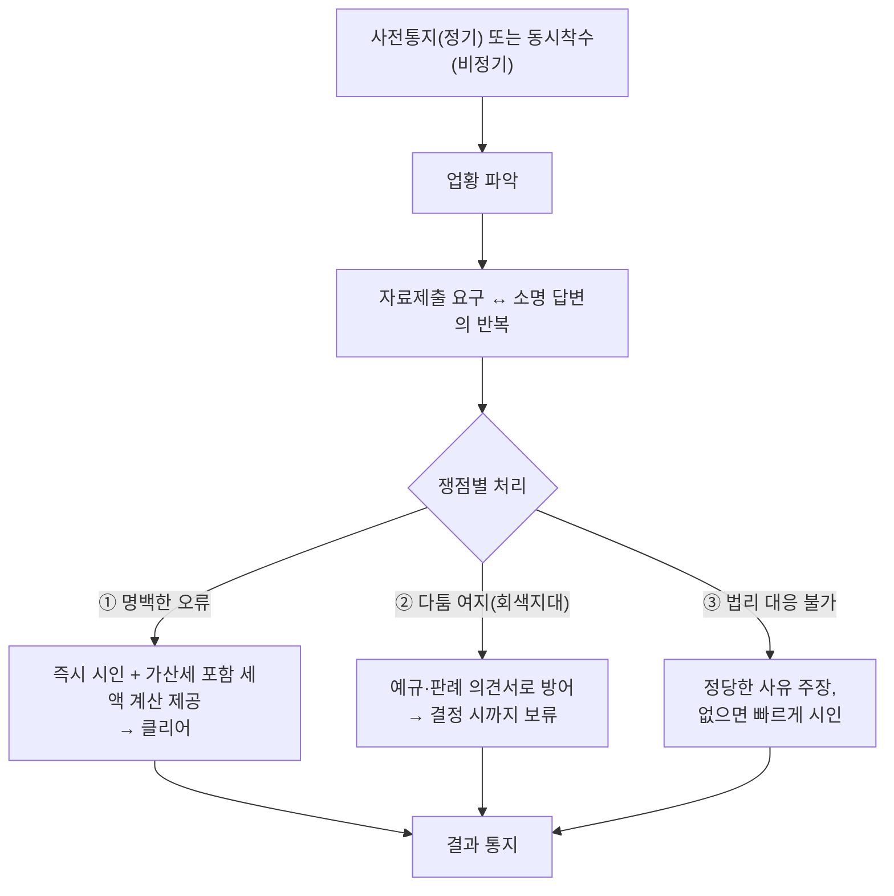

# 세무조사 대응과 모의세무조사(사전점검) 실무

> [!info] 개요
> 이 문서는 **practice 레이어의 업무 SOP**다. 세무법인다솔 안원용 변호사와 조준모 세무사(국세청 조사국 출신)의 대담을 실무 절차 중심으로 재구성했다.
> 법령과 개념은 링크된 topic에서 확인하고, 이 문서는 "어떻게 대응하는가"에 관한 절차와 체크포인트만 담는다. → [[상속세-과세체계와-전략]](세무조사 시 상속 소명), [[감정평가-이슈]].

---

## 1. 먼저 결론

세무조사는 **버티기(시간 끌기)로 넘길 수 없다.** 조사관을 자극하지 않고 **① 소명자료는 즉시 제출 → ② 다툴 것은 예규·판례로 의견서 대응 → ③ 인정할 것은 빠르게 시인**하는 것이 정석이다(다솔 2년 데이터: 혐의금액 대비 실제 추징 평균 **−80%**). 그리고 조사 통지 전에 **모의세무조사(사전점검)**로 원시자료를 미리 갖춰 두는 것이 가장 확실한 대비다.

---

## 2. 왜 중요한가

- 사업자에게 세무조사는 가장 두려운 단어지만, **대응 방식과 대리인 선택에 따라 추징세액이 크게 달라진다.**
- "시간을 끌면 넘어간다"는 가장 널리 퍼진 오해다. 실제로는 조사기간 **연장·중지·범위확대(최대 5년)**가 가능하고, 비협조는 오히려 추징을 키운다.
- 조사가 시작된 뒤에 원시자료(계약서·대금증빙)를 급하게 갖추기는 어렵다. 그래서 **사전점검**으로 미리 준비해야 한다.

---

## 3. 기본 개념: 정기조사 vs 비정기조사

국세기본법 §81의6에 근거한다.

| 구분 | 정기(전기)조사 | 비정기조사 |
|---|---|---|
| 선정 | 4~5년 주기·무작위 추출 | **구체적 혐의점**(탈세제보·분석자료) 기반 |
| 사전통지 | 착수 **20일 전** 사전통지서 | 통지 없이 **동시 착수** 가능(증거인멸 우려) |
| 특징 | 일반적 | 세액 큼, 범위확대·조세포탈 고발 가능 → **더 무섭다** |

- **일시보관(영치)조사**: 형식은 동의를 받는 것이지만 사실상 거부하기 어려운 분위기에서 진행된다. 장부·서류·**전산자료(문서파일을 한꺼번에 수거하는 장비 사용)**를 가져간다. ⚠️ **파일을 삭제해도 포렌식으로 복원**되므로 증거인멸은 사실상 불가능하다.
- **상주 조사인지 비상주 조사인지**는 서울청 조사국의 성격 차이일 뿐 **조사 강도나 추징과는 관계가 없다**(대법인은 보통 상주 조사를 받는다).
- **조세포탈 고발**: 일정액 이상을 포탈하면 검찰에 고발되어 형사처벌 대상이 된다.

## 3-1. 깨야 할 오해(루머)

- ⚠️ "시간을 끌면 못 보고 넘어간다": **사실이 아니다.** 조사기간을 연장·중지하거나 범위를 확대할 수 있고, 비협조하면 '괘씸죄'로 추징이 늘어난다.
- ⚠️ "추징세액을 목표로 정해 놓고 나온다": **억측이다.** (과거 조사이력이 있으면 비슷한 쟁점을 참고할 수는 있지만, 대개 과거를 그대로 따르지 않는다.)
- ⚠️ "조사관이 우리 회사를 다 파악하고 온다": **아니다.** 규모가 클수록 거래구조를 파악하는 데만 수 주가 걸려서 임원 인터뷰로 파악한다. 따라서 대리인이 자세히 설명하고 자료를 제공해야 한다.

---

## 4. 판단 구조 (조사 통지 후 흐름)

```
사전통지(정기) 또는 동시착수(비정기)
  → 업황 파악 → [자료제출 요구 ↔ 소명 답변]의 반복
  → 쟁점별 처리:
      ① 명백한 오류        → 즉시 시인 + 가산세 포함 세액 계산 제공 → 클리어
      ② 다툼 여지(회색지대) → 예규·판례 의견서로 방어 → 결정 시까지 보류
      ③ 법리 대응 불가     → 정당한 사유 주장, 없으면 빠르게 시인
  → 결과 통지
```

**다이어그램 (위 코드블록과 같은 내용)**

%% ciat-design: 시각화 추가 — 아래 다이어그램은 바로 위 코드블록의 내용만 옮긴 것 (원문 우선) %%



---

## 5. 상세: 대응 3원칙 (조준모 세무사)

1. **소명자료를 요청받으면 무조건 즉시 제출한다.** 유리한 것만 내고 불리한 것을 숨기지 않는다(요청목록에 있으면 그대로 낸다). 조사관과 자료를 함께 분석할 수 있게 한다.
2. **잘못된 회계처리는 예규·판례를 근거로 정당성을 주장**한다. 근거가 없으면 정당한 사유(불가피성)를 주장하고, 그것도 없으면 **빠르게 시인**한 뒤 가산세를 포함한 추징세액을 계산해 먼저 제공한다.
3. **거짓 장부를 만들거나 서류를 소급해 작성하는 일은 절대 하지 않는다.**
- 부수 원칙: **조사관을 자극하지 않는다**(고의 지연·불성실 제출을 금지한다. 그만큼 다른 쟁점을 더 본다). 모든 쟁점을 **의견서 형태**로 정리하면 조사관의 내부결재와 의뢰인 보고가 모두 수월해진다. **인정할 것은 빨리 인정**해 시간낭비·추징위험을 줄인다(선택과 집중).

### 5-1. 대리인 선택: 기장세무사 vs 조사전문/국세청 출신
- 기장세무사는 회사 사정을 잘 알지만 **1인+직원 구조**라 과세관청 소명 대응 경험이 부족할 수 있다.
- 조사전문 법인은 **TF팀(총괄 / 자료작성 / 소명대응으로 역할을 나누며, 다솔은 통상 4명)**으로 대응한다. 국세청 출신은 "조사관이 편하게 볼 수 있는 자료 형태"를 알고 있어 유리하다.
- 실무에서는 양쪽을 모두 선임한 뒤 기장세무사를 조사대응에서 제외하는 사례도 있다.

### 5-2. 가산세 40%(부정행위)·범칙조사 전환 방어 (안원용, 이하늬 편)

> [!note] 참고
> 지식 원리는 [[법인활용-소득분산과-실질과세]] 5-3에 있다. 여기서는 **대응 절차**만 다룬다.

- **가산세 40%(사기 기타 부정행위) vs 10%(일반 과소신고)를 가르는 것이 대리인의 핵심 업무.** (국세기본법 §47의3, 법령검증 완료·조회기준일 20260813: **부정행위 과소신고 40%**(역외 60%)+나머지 10%, **일반 과소신고 10%**. 무신고는 §47의2로 일반 20%.) 허위기장·이중장부·은닉·**대포통장** 매출누락은 40%, 단순 해석차·배우자/본인 명의 다른 계좌 매출누락은 통상 10%. 40%가 적용되지 않도록 조사관에게 긴밀히 소명하고 다툰다.
- **조세범칙조사 전환 방지**: 부정행위로 조세포탈 혐의가 드러나면 범칙조사로 전환 → 국세청이 자료를 직접 열람(데이터 대량 확보)하고 **형사 고발**로 이어진다. 전환 자체를 막는 것이 대리인의 중요한 역할이다.
- **추징 시 "납부 후 불복"**: 과세처분은 취소 전까지 **유효**하다("확정 안 됨"은 다툼 중이라는 뜻일 뿐). 납부불성실 가산세(연 8% 상당)가 은행이자보다 높아, 현금여력이 되면 **일단 납부하고 불복으로 다투는 것**이 실무 정석. (이하늬: 최고세율 상회 금액 전액 납부 후 불복 예정.)
- **세목 재구성 사건의 이중과세 처리**: 법인 소득이 개인 소득으로 재구성되면 법인이 낸 세금은 **경정청구 환급**으로 조정 → 이중과세 상태로 방치되지 않는다.

---

## 6. 모의세무조사(사전점검): 통지 전에 하는 대비

실제 조사와 같은 환경에서 **미리** 점검하는 절차다(다솔은 통상 **2개월** 동안 진행한다).

- 절차: 사전미팅(회계담당자의 우려사항 청취) → 실제 조사처럼 **자료요구·현장미팅** → 부족하거나 미비한 자료 식별 → 보완·정리 → 컨설팅 보고서 순서로 진행한다.
- 핵심 점검 대상 **원시자료**: **계약서 + 대금증빙 + 세금계산서 + 용역제공 입증자료.** 관행상 계약서 없이 세금계산서와 대금지급 기록만 있는 경우가 많아, 용역거래가 실제로 있었다는 입증이 취약하다.
  - 실제 조사에서 3~4일 내 15개 쟁점·100개 자료 요구를 받는데, 담당자가 실제 보유한 자료는 30~40%에 그치는 경우가 많다 → 사전 확보·보관책임 분담이 필요.
- 발견되기 쉬운 리스크(대표가 스스로 모르는 것): 인건비, 골프회원권, 접대성 경비, 가지급금, **기업부설연구소 전담요원 미배치**(→ R&D 세액공제 추징 위험) 등.
- 효용(강사의 주장): **추징세액의 5% 미만 비용으로 그 20배 이상의 추징을 예방**할 수 있다고 한다.

---

## 7. 헷갈리기 쉬운 부분

- **비정기조사가 정기조사보다 무섭다**(혐의점이 있고, 세액이 크고, 고발 위험이 있다).
- **상주 조사인지 여부와 조사 강도는 관계가 없다.**
- **시간 끌기는 역효과를 낸다**(기간 연장·범위확대·괘씸죄).
- **혐의점이 반드시 추징으로 이어지지는 않는다**(대상을 잘못 선정했거나 동명이인을 특수관계인으로 오인한 경우 등이 있으며, 잘 대응하면 감액된다).
- **원시자료(계약서+대금증빙)가 조사 대응의 기초다**: 이 자료가 없으면 실제로 있었던 거래도 부인당할 수 있다.
- 유명인 추징 보도는 조사 착수·과세처분·불복·확정판결을 구분한다. 추징 보도만으로 탈세가 확정됐다고 표현하지 않고 사건번호·결정문을 확보하기 전에는 `[원문 확인 필요]`로 둔다.

---

## 8. 실무 체크포인트

1. 통지를 받으면 즉시 조사전문 대리인 선임을 검토한다(비정기조사는 착수 당일에 연락이 오는 경우도 있다).
2. 소명자료를 요청받으면 즉시 제출하고, 쟁점별로 **의견서**를 정리한다.
3. 명백한 오류는 가산세를 포함한 세액을 먼저 계산해 제시하고, 일찍 종결한다.
4. 회색지대에 있는 쟁점은 예규·판례를 첨부해 방어한다.
5. 거짓 장부, 서류 소급 작성, 고의적인 자료 제출 지연은 하지 않는다.
6. 평소에 **원시자료(계약서·대금증빙·용역입증)**를 폴더별로 정리하고 보관 책임자를 지정한다.
7. 고소득·고위험 업종(예: 병원)은 **모의세무조사**로 미리 진단한다.

---

## 9. 핵심 정리

- 정기조사는 20일 전에 통지하고, 비정기조사는 통지 없이 동시에 착수하며 혐의점이 있어 더 무섭다. 전산자료는 포렌식으로 복원되므로 증거인멸이 불가능하다.
- 대응 3원칙은 **즉시 제출 / 의견서 방어 / 빠른 시인**이다(거짓 장부는 금지). 조사관을 자극하지 않는다.
- 시간 끌기, 목표세액, 과거 답습에 관한 이야기는 오해다.
- **모의세무조사**로 원시자료(계약서+대금증빙+세금계산서)를 미리 확보하는 것이 최선의 대비다.

관련 문서: [[상속세-과세체계와-전략]](상속세 세무조사 소명·추정상속재산) · [[감정평가-이슈]](결정기간 내 감정평가 추징) · [[세무법인다솔]]

---

## 10. 출처

- `가만히 있으면 지나간다 세무조사 사전 점검 방법.txt` (안원용 변호사 · 조준모 세무사: 국세청 조사국 출신)

> [!caution] 검증 상태
> [원문 확인 필요] 국세기본법 §81의6 정기/비정기 선정사유, 조세포탈 고발 기준금액, 일시보관 절차는 현행 조문으로 확인해야 한다. 추징 −80%/−85%는 강사(다솔) 자체 데이터에 근거한 주장이다.
