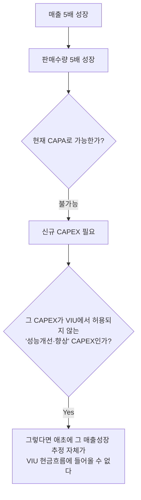

# DCF·가치평가 및 평가보고서 검토 실무

## 0. 이 문서 사용법: 3분 요약

**평가는 두 방향으로 쓴다.** 내가 만들 때(Valuation)와 남이 만든 것을 깰 때(Review). 이 문서는 각 논점을 두 관점으로 나란히 쓴다.

**가장 중요한 한 가지**: DCF의 가치는 개별 가정이 아니라 **가정 사이의 연결**에서 무너진다. 매출을 5배로 늘리면 판매량·설비·인력·CAPEX·감가상각비·운전자본이 전부 따라 움직여야 한다. 하나라도 안 움직이면 그 지점이 곧 공격점이다.

**읽는 순서 3가지**
- 처음 배우는 경우 → 2 → 3 → 5~8 → 9~11 → 12 → 20 → 21
- 평가를 직접 설계하는 경우 → 2 → 3 → 22(자료 리스트) → 5~12 → 17/18 → 20
- 남의 평가보고서를 받은 경우 → 1.3(STEP 1~10) → 4 → 21(Red Flags) → 23(질문) → 24(체크리스트)

**절대 외우지 말아야 할 것**: 이 문서의 모든 시장수치(Rf·MRP·Size Premium·회사채 수익률·세율). 원자료가 **2020년 12월** 기준이다. 외울 것은 **왜 그것이 문제가 되는가**라는 논리뿐이다.

---

# 1. 전체 Framework

## 1.1 이 문서의 두 축

| | Valuation / Advisory 관점 | Review / Challenge 관점 |
|---|---|---|
| 질문 | 이 항목을 **어떻게 추정할 것인가** | 이 추정을 **어떻게 깰 것인가** |
| 산출물 | 모델, 가정 근거, 민감도 | 이슈 리스트, 질의사항, 증빙 요청, 결론 |
| 실패 모드 | 근거 없는 의지치를 모델에 넣음 | 엑셀 검산에 시간을 쓰고 스토리를 놓침 |
| 핵심 역량 | Driver 설계 능력 | Driver 간 모순 탐지 능력 |

두 관점은 **같은 지식의 앞뒤**다. 잘 깨는 사람이 잘 만든다. 이 문서에서 각 논점은 원칙적으로 다음 구조를 반복한다.

> [!note] 참고
> `### 개념` → `### 평가 수행 로직` → `### Review logic` → `### Red flags` → `### 질문` → `### Required evidence` → `### Cross-check`

작은 논점에서는 이 골격을 무리하게 채우지 않는다.

## 1.2 5개 관문 (모든 평가에 공통)

1. **무엇을** 평가하고 있는가 (평가대상·평가단위)
2. **어떤 현금흐름**을 평가하고 있는가 (FCFF / FCFE / 배당)
3. 그 현금흐름의 위험을 **할인율과 일관되게** 반영했는가 (통화·물가·세전후·리스크 중복)
4. 미래추정이 **현실적으로 가능**한가 (과거 실적 · 외부시장 · 생산능력 · 재투자)
5. 결과가 **다른 시장정보와 비교했을 때 말이 되는가** (multiple · 거래사례 · 전기 평가 · 인수가격)

([[외부평가보고서검토및관련유의사항_GPT]] 프레임을 정본으로 채택)

## 1.3 검토 순서 STEP 1~10

평가보고서를 받자마자 WACC부터 파는 것은 비효율적이다. **DCF value를 크게 왜곡시키는 것은 WACC 0.3% 차이보다 비현실적인 매출·마진·TV인 경우가 훨씬 많다** ([[Deal VS 과거 이슈사항 및 평가사례_GPT]]).

| STEP | 대상 | 이 문서 |
|---|---|---|
| 1 | 평가대상·평가단위·Carrying Amount 범위 | §2, §14 |
| 2 | 전기 Forecast Accuracy (Look-back) | §4 |
| 3 | Revenue | §5 |
| 4 | Cost / Margin | §6 |
| 5 | CAPEX / Capacity / Depreciation | §7 |
| 6 | NWC | §8 |
| 7 | Terminal Value / Normalization | §9, §10 |
| 8 | WACC | §11 |
| 9 | Sensitivity / Headroom | §20 |
| 10 | Disclosure Tie-out | §25.4 |

## 1.4 이 문서의 중심 연결관계 (Cross-check Chain)

```text
Market
  ↓
Market Share
  ↓
Volume
  ↓
Capacity
  ↓
Headcount / CAPEX
  ↓
Cost / Depreciation
  ↓
NWC
  ↓
FCFF
  ↓
Terminal Normalization
  ↓
WACC
  ↓
Enterprise Value
  ↓
Net Debt / Non-operating Assets
  ↓
Equity Value
```

손상평가에 적용할 때는 뒤에 다음을 잇는다.

```text
Recoverable Amount
  ↓
Carrying Amount
  ↓
Impairment / Headroom
```

**이 체인의 어느 한 마디에서 모순이 생기면, 그 가정으로 되돌아가 다시 Challenge한다.** 이것이 이 문서 전체의 사용법이다.

## 1.5 검토의 3 Level

| Level | 무엇을 보나 | 예 | 난이도 |
|---|---|---|---|
| **1. Mechanical** | 산식이 맞나 | TV = FCF/(WACC−g) 계산 오류, ref 링크 오류 | Excel 검산으로 잡힘 |
| **2. Internal Consistency** | 모형 내부가 일관적인가 | 매출 +20%인데 CAPEX 0, ΔNWC 0 | ★ 실무 핵심 |
| **3. External Consistency** | 외부 현실과 맞는가 | 시장 3% 성장, 회사 25% 성장 → 점유율 근거? | ★ 실무 핵심 |

([[외부평가보고서검토및관련유의사항_GPT]])

## 1.6 출처 층위: 이 문서가 지키는 4분류

원자료(2020년 내부교육자료)에는 성격이 다른 내용이 섞여 있다. 이 문서는 다음을 구분해 표기한다.

| 표기 | 의미 |
|---|---|
| (무표기) | 현재도 유효한 일반적 valuation / advisory / review logic |
| `[2020 내부관행]` | 당시 특정 법인의 review practice·threshold. 일반규칙이 아님 |
| `[시점 의존 수치]` `[현행 기준 재확인 필요]` | Rf·MRP·회사채·Size Premium·세율 등 |
| `[K-IFRS]` `[기준원 교육자료]` `[금감원 가이드라인]` | 기준서·감독기관이 직접 요구하는 내용 |
| `[LLM 해석]` | 원자료에 근거 문장이 없고 LLM 산출물에서 추가된 서술 |

**⚠️ 과거 내부 실무관행을 기준서의 절대 요구사항처럼 쓰지 않는다.** 예: "PGR 1% 초과 = 기준서 위반", "특정 Beta 기간만 사용 가능", "특정 회사채 만기만 사용 가능". 셋 다 사실이 아니다.

---

# 2. 평가목적과 평가대상

## 개념

가치평가에서 가장 흔한 치명적 오류는 숫자를 잘못 계산하는 것이 아니라 **평가대상을 잘못 정의하는 것**이다. 평가목적이 바뀌면 현금흐름에 넣을 수 있는 가정 자체가 바뀐다.

## 평가목적별 차이

| 평가목적 | 관점 | 현금흐름에 넣을 수 있는 것 |
|---|---|---|
| **VIU (사용가치)** | Entity-specific. 회사가 현재 상태 자산으로 창출하는 가치 | **제한 있음**: 아직 확약하지 않은 구조조정, 자산의 성능개선·향상 관련 유출입 제외 `[K-IFRS 1036.33]` |
| **FVLCD / FVLCTS (처분부대원가 차감 공정가치)** | Market participant | 원칙적 제약 없음. "모든 이용가능한 정보" 사용 가능 `[K-IFRS 1036]` |
| **거래가치 / 투자검토** | 특정 인수자 관점 가능 | 시너지·인수후 계획 반영 가능(협상용) |
| **PPA (이전대가 배분)** | Market participant | 취득자 특유 시너지는 원칙적으로 제외 |
| **공시용 평가**(합병비율·자산양수도) | 금감원 외부평가업무 가이드라인 적용 | §15 참조 |

> [!note] 참고
> `[K-IFRS 1036]` **회수가능액 = max(순공정가치, 사용가치)**. 회사가 DCF를 돌렸다고 해서 그것이 곧 VIU라고 단정하면 안 된다. 무엇을 산출한 것인지 먼저 확정한다.

## 평가단위 (손상평가)

- 해당 자산이 **독립적인 현금유입**을 창출하는가 → 아니면 어느 CGU에 속하는가
- 전기와 CGU 구성이 **일관적**인가 (조직개편·사업양수도·공장폐쇄로 변경 필요한가)
- 영업권이 **어느 CGU 또는 CGU 집단에 배분**되어 있는가

평가단위가 틀리면 이후 DCF가 아무리 정교해도 의미가 없다.

## 처분부대원가에 넣을 수 있는 것 `[K-IFRS 1036]`

| 포함 | 제외 |
|---|---|
| 법률비용, 인지세 및 관련 거래세, 자산제거원가, 매각 가능한 상태로 만드는 과정과 **직접 관련된 증분원가** | 사업축소·재조정과 관련한 **해고급여 및 기타 원가** |

## Review logic

- 보고서 표지·서론에서 **평가목적·평가대상·가치기준(value standard)** 을 먼저 확정한다. 이게 없거나 모호하면 그 자체가 이슈다.
- 목적이 VIU인데 현금흐름에 신규 공장 증설 효과가 들어 있으면 **§7.4로 직행**한다.

### 질문
1. 이 보고서가 산출한 것은 사용가치입니까, 처분부대원가 차감 공정가치입니까?
2. 평가단위(CGU)는 무엇이며 전기와 동일합니까? 변경했다면 사유는?
3. 영업권은 어느 CGU에 배분되어 있습니까?

---

# 3. Cash Flow / Discount Rate / Value Basis Matching

## 개념: 이 문서에서 가장 자주 쓰는 원칙

세 가지가 **같은 basis**에 있어야 한다.

```text
Cash Flow  ↔  Discount Rate  ↔  Carrying Amount (비교대상 장부금액)
```

`[기준원 교육자료]` "방법론에 관계없이, **현금흐름과 할인율에 관한 가정은 일관되어야만 한다.** 세후현금흐름은 세후할인율로, 세전현금흐름은 세전할인율로 할인되어야만 한다. 이와 유사하게, 현금흐름의 통화는 항상 할인율의 통화와 대응되어야만 한다."

## 대응표 (반사적으로 나와야 함)

| 현금흐름 | 평가대상 | 할인율 |
|---|---|---|
| **FCFF** | Enterprise / Operating Value | **WACC** |
| **FCFE** | Equity Value | **Ke (Cost of Equity)** |
| 배당 | Equity Value | Ke |

$$FCFF = NOPLAT + D\&A - CAPEX - \Delta NWC$$

$$Equity\ Value = Operating\ Value + Non\text{-}operating\ Assets - Net\ Debt - Minority\ Interest$$

- FCFF는 채권자와 주주 **모두**에게 귀속되는 현금흐름이다(부채 상환 전, 재투자 후).
- FCFE는 주주에게만 귀속: 부채 원리금 상환 후. **금융업은 사업 특성상 FCFF 적용이 어려워 FCFE를 쓴다.**
- **FCFE를 WACC로 할인하는 것은 계산오류가 아니라 valuation architecture 자체의 오류다.**

## Matching이 깨지는 5가지 방식

| 유형 | 사례 |
|---|---|
| 통화 불일치 | KRW 현금흐름을 USD WACC로 할인 / 브라질레알 현금흐름을 USD WACC로 |
| 물가 불일치 | Nominal FCF를 실질 할인율로 |
| 세전후 불일치 | 세전 현금흐름을 세후 할인율로 |
| **위험 이중계상** | 현금흐름에서 이미 특정 리스크를 낮춰놓고 WACC에도 risk premium 가산 |
| 범위(boundary) 불일치 | FCFF 기준 EV를 산출해놓고 비교대상 장부금액에는 비영업자산·이자부부채를 섞음 → §14 |

## 통화 조정식

기능통화가 다른 통화의 Kd를 쓸 수밖에 없을 때 `[DVS Page 9]`:

$$Kd_{조정} = (1+Kd_{국내}) \times \frac{1+Inflation_{해외}}{1+Inflation_{국내}} - 1$$

> [!note] 참고
> 핵심은 "기능통화"라는 명칭이 아니라 **현금흐름에 내재된 통화·물가·시장 전제와 할인율이 동일한 basis인가**이다 ([[Deal VS 과거 이슈사항 및 평가사례_GPT]]의 교정).

---

# 4. Forecast Accuracy / Back-testing

## 개념

**반복 평가(recurring)에서 가장 먼저 봐야 할 자료.** 전기 평가 당시의 당기 예측값과 당기 실적을 비교한다. 이것이 경영진 전망의 신뢰성이라는, 다른 무엇으로도 대체할 수 없는 증거를 만든다.

$$Forecast\ Error = Actual - Prior\ Forecast$$

## 평가 수행 로직 (Valuation)

평가를 **직접 수행할 때도** 반드시 한다. 회사가 준 사업계획을 그대로 모델에 넣기 전에, 그 회사가 과거에 사업계획을 얼마나 맞췄는지를 먼저 본다. 상시적으로 미달하는 회사라면 **사업계획 조정을 평가인이 먼저 제안**해야 한다.

`[EXT Page 59]` "매출액 추정이 경영진이 승인한 사업계획에 기반하였는지 검토 필요. 단 해당 경우에도 **과거 사업계획이 실적치와 차이가 큰 경우 또는 특별한 근거 없는 의지치가 과도하게 반영되어 있을 경우, 사업계획의 조정 고려 필요.**"

## Review logic: 차이의 3분해

| 분해 | 내용 | 함의 |
|---|---|---|
| **External factor** | 경기침체, 환율, 원자재 가격, 규제, 산업수요 감소 | 당기 추정에 반영됐는지만 확인 |
| **Company-specific factor** | 수주 실패, 생산차질, 고객 이탈, 신제품 출시 지연, 인력 부족 | 구조적인지 일회성인지 판단 |
| **Forecast bias** | 매년 공격적 계획 → 미달 → 다음 해 다시 회복 가정 (Hockey-stick) | ★ **반복되면 경영진 전망의 신뢰성 자체가 감사이슈** |

## 예시

| 구분 | 전기 평가 시 FY26 Forecast | FY26 Actual | 차이 |
|---|---:|---:|---:|
| 매출 | 1,000 | 650 | −350 |
| EBIT | 100 | 20 | −80 |

이 상태에서 당기 보고서가 FY27 매출 1,200을 제시하면, 당기 사업계획을 그대로 받아서는 안 된다.

### Red flags
- 전기 대비 실적 괴리가 큰데 **당기 추정에 아무 조정이 없음**
- 매년 "내년부터 회복"이 반복됨
- 전기 forecast 자료를 회사가 제공하지 못함 / 폐기했다고 함

### 질문
1. 전기 사업계획과 실제 실적 차이의 주요 원인은 무엇입니까?
2. 당기 사업계획에는 그 차이가 어떻게 반영되었습니까?
3. 최근 3~5년 사업계획 대비 달성률 추이를 제시해 주십시오.

### Required evidence
전기 평가보고서 / 전기 사업계획 원본 / 당기 확정 실적 / 차이 분석 자료 / 이사회 보고자료

---

# 5. Revenue Forecast

## 개념

매출은 **전체 추정에서 가장 중요한 항목**이며, `[EXT Page 59]` "가치평가 전문가의 조력에 한계가 존재함에 따라 **해당 산업·회사에 대한 높은 이해를 가진 감사인(또는 실무자)의 검토가 우선적으로 필요**"하다.

핵심 흐름:

```text
Market → Market Share → Volume → Price → Revenue
```

$$Revenue = Market\ Size \times Market\ Share$$
$$Revenue = Volume \times Price$$

**매출성장률만 보는 것은 거의 의미가 없다.** 100 → 350을 만드는 것이 시장성장인지, 점유율인지, 가격인지, 신제품인지, CAPA 증설인지를 분해해야 각 driver를 따로 검증할 수 있다.

## 5.1 Market

### 평가 수행 로직
- 산업 key driver를 먼저 정의한다 (예: 건설중장비 = 인프라 투자·GDP, 제약 = 유병인구·약가정책, 자동차부품 = 완성차 생산계획).
- 외부 시장자료 확보: `[EXT Page 59]` 딜로이트 인텔리넷(EIU, Gartner, Forrester), DART 공시 사업의 내용, KISLINE 산업보고서, 관련 산업협회 자료, 검색.

### Review logic
- 자료 **출처의 신뢰성** (평가대상회사에 질의, 교차검색)
- 자료 **작성일**: Outdated 시장보고서는 특히 주의
- 외부자료의 **시장 정의·지역 범위**가 회사가 실제 영위하는 세부 시장과 일치하는가
- ★ **Value 기준인가 Volume 기준인가**

### Red flags
- **시장 금액 성장률을 그대로 판매수량 증가율로 사용**: 금액에는 가격효과와 Mix 효과가 섞여 있다.

$$Market\ Value\ Growth = Volume\ Growth + Price/Mix\ Effect$$

- `[EXT Page 59]` "시장규모를 금액기준으로 추정한다면 외부 시장데이터도 금액기준으로 적용해야 함. **단가가 지속적으로 하락하는 산업의 경우 수량기준 외부 데이터를 적용하면 오류 가능성이 높다.**"
- 3~4년 지난 산업보고서를 그대로 인용 `[DVS Page 32, 코멘트 (6)]`

### 사례: Market Size → Volume 변환의 함정 `[DVS Page 32, 코멘트 (2)(3)]`

시장규모 1조원, 회사 제품 판매단가 20만원이라고 해서

$$Market\ Volume = \frac{Market\ Value}{회사\ 판매단가}$$

로 계산하면 안 된다. **회사 판매가격 = 시장 평균 ASP라는 전제**가 몰래 들어간다. 회사가 프리미엄 제품이면 시장 판매수량이 과소, 저가 제품이면 과대 산출된다. 그 위에 점유율을 곱하면 오차가 그대로 증폭된다.

## 5.2 Market Share

### 개념
시장이 10% 성장하는데 회사 매출이 100% 성장한다면, **핵심 가정은 시장성장이 아니라 점유율 상승**이다. 검토질문 자체가 바뀐다.

- ❌ "시장이 성장합니까?"
- ⭕ "**왜 경쟁사 점유율을 빼앗아 올 수 있습니까?**"

### 평가 수행 로직
점유율 상승을 모델에 넣으려면 그 근거를 driver로 환원한다: 확보된 수주계약 / 신규 고객 등록(vendor 등록) / 유통망 확대 / 경쟁사 철수 / 기술·특허 우위 / 가격정책 / 신규 CAPA 가동 시점.

### Review logic
`[DVS Page 32, 코멘트 (4)]` "시장이 성장하고 있는데 **점유율도 큰 폭으로 증가**하고 있음. 경쟁사 대비 평가대상회사의 강점에 대한 의문."

### 사례: 점유율 0.05% → 5% `[DVS Page 31~33]`

| | FY20 | FY21 | FY22 | FY23 | FY24 | FY25 |
|---|---:|---:|---:|---:|---:|---:|
| 시장 성장률 | 10% | 10% | 10% | 10% | 10% | 10% |
| 회사 점유율 | 0.05% | 0.5% | 1.63% | 2.75% | 3.88% | 5.00% |
| 회사 판매수량 증가율 | | 1,110% | 257% | 86% | 55% | 42% |

시장은 매년 10%인데 회사 판매수량은 5년간 **약 177배**가 된다. 이 모델의 진짜 가정은 시장성장이 아니라 점유율 100배 상승이다.

- **Valuation 관점**: 실제 핵심 Driver는 Market Share다. 이걸 사업계획에 반영하려면 계약·수주·유통망 확보 근거를 문서로 확보해야 하고, 그 근거가 커버하는 연도까지만 상승을 반영하는 것이 방어 가능하다.
- **Review 관점**: 경쟁사 대비 우위 / 신규 고객 / 수주 / 유통망 / 생산 Capacity / 가격정책을 각각 확인. 그리고 마지막에 **"결과값으로 산출된 판매수량 증가율 자체가 합리적인가"** 를 다시 본다 `[DVS 코멘트 (5)]`.
- **Cross-check**: 점유율 5%를 달성하는 판매수량을 **현재 공장 CAPA로 생산할 수 있는가** → §7로 연결.

## 5.3 Volume

판매량 증가가 예상되면 **반드시 생산능력과 연결**한다.

```text
Volume ↑ → Capacity 확인 → 인력 필요 → CAPEX 필요 → NWC 필요
```

이 넷 중 어느 것도 변하지 않는데 판매량만 크게 늘면, DCF 내부의 논리적 모순일 가능성이 높다.

### 사례: Wheel Loader 매출 0 가정 `[DVS Page 42]`
현대건설기계 인도법인 평가에서 Wheel Loader는 2016년부터 일부 매출이 발생하고 있었으나 **회사의 구체적 판매계획이 없어 향후 매출 0으로 가정**했다. 실적이 있는 제품라인을 0으로 두는 것은 보수적 방향이라 수용 가능하지만, 반대 방향(계획 없는 제품에 매출을 부여)이면 즉시 이슈다.

## 5.4 Price

### 평가 수행 로직
`[EXT Page 59]` "매출단가는 시장 가격변동 추이, 평가대상의 가격정책, 산업 내 경쟁강도 및 물가상승률 등을 고려하여 추정. 단, 매출단가는 산업별로 **지속 하락 / 유지 / 상승**이 모두 존재하므로 **외부평가인이 제시한 과거 매출단가 분석 및 향후 단가 전망의 근거자료 확보가 중요**."

### Review logic
확인 항목: 과거 단가 추세 / 경쟁사 가격 / 제품 Mix 변화 / 물가상승률 / 계약단가 / 가격 전가 능력 / 가격 인하 압력.

### Red flags `[DVS Page 33, 코멘트 (10)(11)(12)]`
- 과거 판매량 확대를 위해 **단가를 계속 낮춰왔는데 추정기간에는 단가 유지**: 별도 근거 필요
- 국가별 판매단가가 크게 다름 (예: 한국 20만원 vs 중국 5만원): 제품 Spec·관세·물류·환율·유통구조·판매채널 확인 필요
- **국내에서는 단가를 못 올리는데 해외에서는 CPI만큼 올린다**. 왜 그 시장에서만 가능한가
- 다양한 시장에 판매되는 경우 **외화환산 로직**이 적정한가 `[코멘트 (9)]`

### 사례: 단가 하락의 진짜 원인 `[DVS Page 43]`
현대건설기계 인도법인 Excavator의 2014~2016 판매단가 하락은 **가격 인하가 아니라 고가 대형기종의 판매비중 감소(Mix 효과)** 였고, 동일 기종 내에서는 0~3% 인상이 있었다. → 단가 추세를 볼 때 **Price와 Mix를 분리하지 않으면 정반대의 결론**을 낸다.

## 5.5 Revenue Cross-check

Top-down과 Bottom-up이 둘 다 가능한 경우 **서로 교차 검증**한다.

| 검증 | 방법 |
|---|---|
| Market × Share vs Volume × Price | 두 경로가 같은 매출을 만드는가 |
| 판매수량 vs 생산 CAPA | §7 |
| 매출 성장 vs 인력·원가 증가 | §6 |
| 매출 성장 vs AR 증가 | §8 |
| 회사 성장률 vs 산업 성장률 | 차이 = 점유율 가정 |
| 추정 Gross margin·영업이익률 vs 경쟁사 실적 | `[EXT Page 61]` "결과적으로 산출된 Gross margin 및 영업이익이 경쟁사 분석 등을 통해 **현실 가능한 수준인지 재검증**" |

### Red flag: 추정매출의 등락
`[DVS Page 39]` "통상적으로 안정적인 영업활동을 영위하는 평가대상회사의 경우 추정기간 매출액이 **점진적으로 증가**하는 것으로 추정됨. **추정기간 매출의 등락이 있는 경우 해당 내용에 대해 주의를 요함.**" (등락 자체가 틀린 것은 아니지만 설명 없는 등락은 모델링 오류 또는 TV 왜곡의 신호다 → §9)

---

# 6. Cost / Margin Forecast

## 개념

**매출 성장만 반영하고 비용을 그대로 두는 것이 DCF의 가장 흔한 오류다.** 비용은 다음 5그룹으로 분해한다 `[EXT Page 61]`: 재료비 / 인건비(노무비) / 변동비 / 고정비 / 상각비.

## 6.1 Variable Cost (재료비·변동비)

$$Variable\ Cost = Revenue \times Variable\ Cost\ Ratio$$

### 평가 수행 로직
재료비는 ① 매출액 대비 비율 또는 ② 재료비 단가 × 판매수량 두 방법이 있다.

⚠️ `[EXT Page 61]` **매출단가가 지속 하락하는 경우 매출액 대비 비율로 추정하면 오류**가 발생한다. 매입단가는 매출단가와 다른 방향으로 움직일 수 있기 때문이다.

⚠️ `[EXT Page 61]` **당기총제조원가(생산량 기준)와 매출원가(판매수량 기준)는 직접 대응되지 않는다.** NOPLAT은 발생주의 기준이므로 **매출원가 측면의 분석**이 필요하다. 향후 추정에서 생산량 = 판매량으로 가정할 수 있으나, 그 가정이 **안전재고 측면에서 합리적인지, 운전자본 가정과 일관되는지** 검토해야 한다.

### 사례: 회전기일 정책과 변동비의 연동 `[DVS Page 51]`
현대건설기계 인도법인에서 보증수수료는 단순 매출액 비율이 아니라, **회사 정책상 매출채권 회전기일 단축에 수렴하기 위한 매출채권 할인 수수료 증가**를 반영해 회수기일 감소분만큼 비례 증가시켰다. → 비용 가정과 NWC 가정이 서로 연결된 좋은 사례.

### Red flags
- 과거 중 **가장 좋았던 원가율**을 추정기간 전체에 적용
- 일시적으로 좋았던 분기의 원가율을 장기 적용
- 매출은 증가하는데 **물류비율은 감소**
- 실제 고정비인데 변동비처럼 추정 (또는 반대)
- 환입이 발생한 연도를 포함해 평균을 냄 (→ `[DVS Page 51]` 판매보증비 사례는 **환입 연도를 제외**하고 평균을 냈다. 옳은 처리)

## 6.2 Personnel Cost

$$Personnel\ Cost = Headcount \times Average\ Salary$$

### 평가 수행 로직 `[EXT Page 61]`
평균인원과 평균임금을 **구분해서 각각 추정**한다.
- 평균인원: **생산 CAPA를 충분히 커버할 수 있는가**
- 평균임금: 최저임금 상승, 주 52시간 적용에 따른 변동 `[현행 기준 재확인 필요]`
- **임원과 직원을 구분**한다
- 국가별 임금상승률은 EIU 등 외부 전망을 국가별 과거 인건비로 가중평균 `[DVS Page 55, 한온시스템 사례]`

### 사례: 인건비 추정의 3층 구조 `[DVS Page 48~49]`
현대건설기계 인도법인:
- **급여**: 주재원 / 현지직원 구분 → 각각 EIU 한국·인도 임금상승률 적용
- 2017년 현지직원 급여 45% 급등은 **부품매출 영업 확대를 위한 일시적 채용**이므로 향후 반복 가정하지 않음 (일회성 정상화의 좋은 예)
- **용역비**(생산 관련 현지 계약직): **판매수량 증가 대비 계약직 증가 비율**을 적용해 판매량에 비례 증가 → Volume과 인건비를 명시적으로 연결한 모범 사례

### Red flags `[DVS Page 48]`
- 매출 3배 증가인데 **직원 수 동일**
- 생산량 증가인데 **생산인력 동일**
- 판매수량이 증가하는데 추가 인원 고용이 없음 (특히 **매출원가에 해당하는 인력**이면 더 주의)
- **연말 상여금 지급 회사인데 9개월 실적을 단순 연환산** → 급여 과소계상

## 6.3 Fixed Cost

$$Fixed\ Cost_t = Fixed\ Cost_{t-1} \times (1 + Inflation)$$

### Review logic `[EXT Page 61]`
- 과거에 **비경상적 비용**이 없었는지
- 추정기간 중 **과거에 발생하지 않았던 비용**이 새로 발생할 수 있는지
- 중요한 **준고정비 항목(지급수수료 등)** 은 별도 계정명세서 확인 후 구분 분석
- `[DVS Page 52]` **연말에 발생하는 경비(조세공과금 등)** 가 있는지 → 9개월 실적 기간비례 환산 시 누락 위험

### 사례 `[DVS Page 52]`
광고선전비·잡비가 2017년 9개월간 비경상적으로 급증 → 추정 시 **2014~2016 평균을 단순 월환산**해서 사용하고 그 이후 CPI 적용. 비경상 항목을 정상화한 좋은 예다.

## 6.4 Gross Margin / EBIT / EBITDA Margin

### Review logic
Margin 개선이 있으면 **원인을 구체적으로 확인**한다: 제품 Mix 개선 / 원재료 가격 하락 / 가격 인상 / 규모의 경제 / 공정 자동화 / 구조조정.

"사업계획상 개선"이라는 설명만으로는 부족하다.

### Cross-check
- 경쟁사·동종업계 Margin 수준과 비교 `[EXT Page 61]`
- Margin 개선의 원인이 **CAPEX(자동화)** 라면 §7에 그 CAPEX가 있는가
- Margin 개선의 원인이 **구조조정**이라면, VIU에서는 **확약되지 않은 구조조정은 반영 불가** `[K-IFRS 1036.33]`

### 질문
1. 원가율 개선은 구체적으로 무엇 때문입니까?
2. 그 개선을 뒷받침하는 투자·계약·공정 변경이 모델 어디에 반영되어 있습니까?
3. 경쟁사의 동일 지표 수준은 어떻습니까?

---

# 7. Capacity / CAPEX / Depreciation

## 개념

```text
Volume → Capacity → Headcount → CAPEX → Depreciation
```

**성장에는 돈이 든다.** 매출이 100 → 150 → 200으로 가는데 설비도 그대로, 재고도 그대로, 매출채권도 그대로면 가치는 과대평가된다.

## 7.1 Capacity

### 평가 수행 로직
추정 판매수량을 **평가기준일 현재 생산설비 CAPA와 가동률**에 대조한다. 초과하면 두 갈래다.
1. 증설 CAPEX를 모델에 넣는다 (거래가치·FV 평가에서 가능)
2. 넣을 수 없다면(VIU) → **매출 추정 자체를 CAPA 한도로 제한한다**

### 사례: CAPA가 매출 상한을 결정한 경우 `[DVS Page 67, 한국콜마/CJ헬스케어]`
수액 제품군에서 "**현재 설비 가동률을 고려하여 2021년 이후에는 매출이 일정하게 유지된다고 가정**". 매출을 CAPA로 캡한 모범 사례.

### Red flags
- 판매수량이 급증하는데 CAPA 검토 흔적이 전혀 없음 `[DVS Page 42]`
- 공장 가동률 자료를 회사가 제시하지 못함

## 7.2 CAPEX

### 평가 수행 로직 `[EXT Page 62]`
- **매출 추정 가정과 일관된 투자 가정**을 반영한다: 경상투자금액(과거 상각비 수준의 재투자) + 대규모 설비투자금액
- 투입 시점(기중 취득 가정)을 명확히 한다

### Red flags: 원자료가 직접 든 잘못된 반영 2가지 `[EXT Page 62]`
> [!failure] 오류
> ❌ 사업계획 매출을 부인하고 Market growth rate 수준으로 매출을 낮춰 추정했는데, **CAPEX는 공격적인 사업계획을 그대로 반영**
> ❌ 매출액은 공격적으로 성장함에도 **CAPA 분석 없이 과거 상각비 수준의 CAPEX만 반영**

추가:
- 매출 급증인데 CAPEX 없음
- 대규모 신규 CAPEX가 있는데 Dep와 연계 안 됨
- **Growth CAPEX와 Maintenance CAPEX가 혼재**되어 구분 불가

## 7.3 Maintenance CAPEX vs Growth CAPEX

| 구분 | 내용 | Terminal에서 |
|---|---|---|
| **Maintenance CAPEX** | 현재의 영업능력 유지 | ★ 정상수준 산정의 기준 |
| **Growth CAPEX** | 추가 생산능력 또는 성능 향상 | 영구적으로 반복 가정하면 안 됨 |

Terminal에서 던져야 할 질문은 이것이다.

> [!note] 참고
> **회사를 현재 operating capacity로 영구히 유지하는 데 필요한 정상화된 재투자액은 얼마인가?**

## 7.4 VIU와 Future Improvement: 가장 강력한 논증

`[K-IFRS 1036.33(2)]` "현금흐름은 경영진이 승인한 최근 재무예산/예측에 기초하여 측정한다. 그러나 **미래의 구조조정이나 자산의 성능개선 또는 향상에서 생길 것으로 예상하여 추정한 미래현금유입이나 미래현금유출은 제외**한다."

이 조항이 §5와 결합하면 다음 논증이 성립한다.

```text
매출 5배 성장
  ↓
판매수량 5배 성장
  ↓
현재 CAPA로 가능한가? → 불가능
  ↓
신규 CAPEX 필요
  ↓
그 CAPEX가 VIU에서 허용되지 않는 "성능개선·향상" CAPEX인가?
  ↓ Yes
그렇다면 애초에 그 매출성장 추정 자체가 VIU 현금흐름에 들어올 수 없다
```

**다이어그램 (위 코드블록과 같은 내용)**

%% ciat-design: 시각화 추가 — 아래 다이어그램은 바로 위 코드블록의 내용만 옮긴 것 (원문 우선) %%



→ CAPEX를 지적하는 것이 아니라 **매출 가정 자체를 무너뜨리는 논증**이다 ([[Deal VS 과거 이슈사항 및 평가사례_GPT]]가 세운 결합).

### 사례: 교체 재투자 vs 성능향상 `[DVS Page 23, 철강기업]`
2022~2024년 CAPEX가 133,300 / 135,500 / 132,400백만원으로 급증(직전 3년은 21,420~24,730). 평가인 답변:

> [!quote] 인용
> "A공장 핵심자산인 기계장치의 대부분은 1999년 취득자산으로서 기존 내용연수인 20년이 경과 중에 있으나, 유의적 성능저하 없이 운용 중이며 계속해서 가동 예정입니다. 하지만 2022년부터 교체에 필요한 설비가 급증하여 대규모 재투자계획을 수립하였습니다."

→ **성능개선이 아니라 노후 설비 교체(= Maintenance)** 라는 소명. 이 구분이 VIU 인정 여부를 가른다. 이 사례에서는 그 결과 Dep 정상화를 위해 **예외적으로 5년 초과 추정기간**을 선정했다(§9.5).

## 7.5 Depreciation

### 평가 수행 로직 `[EXT Page 62]`
- **기존 자산 상각비**: 평가기준일 현재 보유 유·무형자산의 상각 스케줄을 계산해 반영
- **추정기간 CAPEX 상각비**: 기중 취득 가정으로 추정 (현금흐름 발생 가정과 일관되게)

`[DVS Page 23]` 계산 로직:

$$Dep_t = \frac{\sum_{i<t} CAPEX_i}{내용연수} + \frac{CAPEX_t}{내용연수 \times 2}$$

→ 당해연도 CAPEX를 2로 나누는 이유는 **현금흐름 기중 발생 가정** 때문이다.

- ⚠️ **상각비는 세효과만큼만 FCF에 영향**을 미친다. 따라서 **세효과가 없는 상각비(세무상 인정되지 않는 영업권 상각비 등)** 가 반영되지 않도록 주의 `[EXT Page 62]`

### Cross-check `[DVS Page 53]` `[EXT Page 62]`
**매출원가·판관비에 반영된 상각비와 별도 CAPEX/Dep schedule을 ref check.** 보고서상 P&L 상각비와 별첨 스케줄이 안 맞는 경우가 실제로 흔하다.

### 질문
1. Forecast 판매량을 현재 생산시설에서 생산할 수 있습니까? 가동률 자료를 주십시오.
2. 추가 인력이나 설비투자가 필요하지 않습니까?
3. 이 CAPEX는 유지 목적입니까, 능력 증대·성능 향상 목적입니까?
4. 신규 CAPEX가 감가상각비 스케줄에 어떻게 반영되었습니까?

### Required evidence
설비 CAPA 자료·가동률 / 투자심의·이사회 승인 자료 / 자산별 상각 스케줄 / 발주계약서

---

# 8. NWC (순운전자본)

## 개념

$$NWC = Driver \times Turnover\ Days$$

| 계정 | 연동 손익지표 | 산식 |
|---|---|---|
| 매출채권 (AR) | 매출액 | $AR \approx Revenue \times DSO / 365$ |
| 재고자산 | 매출원가 | $Inventory \approx COGS \times Inv\ Days / 365$ |
| 매입채무 (AP) | 매출원가 | $AP \approx COGS \times DPO / 365$ |

**회전기일을 임의로 개선하면 FCF가 크게 증가한다.** 성장이 공짜로 이루어지고 있지 않은지 확인해야 하는 지점이다.

## 평가 수행 로직 `[EXT Page 62]`

1. **운전자본에 넣을 계정을 먼저 정한다.** 현금·미수수익·선수금·미지급비용 등 포함 여부가 명확하지 않은 계정은 성격을 파악해 결정한다.
2. **계정별로 연동 손익지표를 붙인다.**
3. **회전율을 산정한다.**
   - 재무관리 이론상으로는 기초/기말 평균잔액이 합리적이나, **실무적으로는 순환참조 문제 등으로 기말잔액 기준이 일반적**
   - 과거 평균과 최근 회전율의 **변동 사유를 파악**해 합리적 수준을 잡는다 (특수관계자 관련 운전자본 왜곡 주의)
   - 동종업종 평균 회전율, 회사의 운전자본 정책 고려
4. ⚠️ **추정기간 동안 항상 현금유출이 발생하는 것은 아니다.** 매출이 감소하면 NWC는 현금유입이 된다.

## Review logic

**평가기준일 현재 회전일수를 무조건 그대로 쓰면 안 된다.** 예: 6월 말 기준 재고가 성수기 대비 일시적으로 쌓였다면 그 Inventory Days를 5년간 그대로 projection하는 것은 잘못이다.

`[EXT Page 58]` "운전자본 목표 회전기일 산정 시 평가기준일 현재 **계절성 등 비경상적인 회전기일을 단순 반영 X**"

→ 과거 평균 / 최근 실적 / 회사 정책 / 경쟁사 / 계절성을 함께 본다.

## 사례: 회전기일 변경에 근거가 있는 경우 `[DVS Page 54]`

현대건설기계 인도법인:
- **매출채권**: 최근 회전기일 감소 추세 + 사업계획상 회사의 회수정책 반영
- **재고자산**: 최근 감소 추세를 반영해 2017년 9개월 회전기일이 지속된다고 가정
- **매입채무**: 2017년 9개월간 크게 감소했는데, 이는 **본사향 CKD 매입 지급기일이 180일 → 90일로 단축**된 결과이므로 향후에도 지속될 예정임을 고려해 유지

→ 회전기일 변경을 받아들일 수 있는 이유는 "추세"가 아니라 **거래조건 변경이라는 구체적 사실**이 확인되었기 때문이다. Review 시 물어야 할 것도 정확히 이것이다.

## Red flags

- 매출 증가인데 **매출채권 증가 없음**
- 재고회전일이 **근거 없이 개선**
- 매입채무 지급기간이 **근거 없이 확대** (= 공짜 자금조달 가정)
- 향후 회전율 개선을 반영하면서 **실현가능성 검토 없음**: `[EXT Page 62]` "향후 회전율의 개선을 반영하는 경우 실현가능성에 대한 검토 필요"
- **영구성장률 0% 초과인데 TV에 NWC 변동 미반영** `[EXT Page 58]` → §9.4

### 질문
1. 매출 증가에 따른 NWC 증가는 어떻게 반영됐습니까?
2. 회전기일 개선 가정의 근거는 무엇입니까? (계약조건 변경 문서가 있습니까?)
3. 특수관계자 거래로 회전기일이 왜곡된 부분은 없습니까?

### Required evidence
계정별 명세서 / 주요 거래처 결제조건 계약서 / 회수정책 문서 / 산업 benchmark

---

# 9. Terminal Value

## 개념

$$EV = \text{Explicit Period PV} + \text{PV of Terminal Value}$$

$$TV = \frac{Normalized\ FCFF \times (1+g)}{WACC - g}$$

**DCF 오류의 상당수가 TV에서 발생한다.** 그리고 많은 사람이 묻는 질문("영구성장률 몇 % 썼습니까?")보다 훨씬 중요한 질문이 있다.

> [!quote] 인용
> **"Forecast 마지막 연도가 정말 영구적인 정상상태(steady state)인가?"**

## 9.1 왜 5년인가: 추정기간의 선택

`[EXT Page 45~46]` 실제로 5년+TV는 장기 완전추정을 잘 근사한다.

| 방식 | Value |
|---|---:|
| 27년 완전추정 (성장률 10% → 0.5% 점감) | 1,932 |
| 5년 추정 + TV (Normalized) | 1,900 |

**5년을 쓰는 사유 4가지** `[EXT Page 46]`
- 산업정보·경제정보가 5년 이상 제시되지 않아 5년 이후 객관적 분석이 어렵다. 외부 정보 없이 인위적으로 기간을 늘리는 것은 **단순한 숫자 재계산에 불과**하다.
- 안정성장기 도달 시점 추정에는 정밀 컨설팅 분석이 필요해 효익 대비 비용이 과대하다.
- 회사도 보통 5년 이상의 중장기계획을 수립하지 않는다.
- `[K-IFRS 1036]` 손상검사 사용가치 추정기간은 특별한 사유 없으면 5년 초과 금지. `[금감원 가이드라인]` 은 5년 이상 확보 요구.

**5년의 단점 4가지**
- 영구가치 비중이 커져 PGR·할인율 민감도가 매우 크다
- 회사의 특성이나 가치창조 시기의 의미를 전달하기 어렵다
- 안정성장 가정 시 결과가 보수적으로 나올 수 있다
- 벤처기업, 사업기간이 정해진 에너지발전 등은 5년 초과를 더 많이 쓴다

> [!warning] 주의
> ⚠️ 참고: McKinsey는 10~15년을 권고한다는 견해도 원자료가 소개한다 `[EXT Page 45]`.

## 9.2 Normalized Revenue

마지막 연도가 다음 상태라면 그대로 TV에 쓸 수 없다.
- 대형 일회성 수주
- 신제품 Launch 직후
- 공장 Ramp-up 중
- 일시적 가격상승
- 일시적 시장점유율 증가

### 사례: 등락하는 매출의 TV `[DVS Page 19]`

| Case | FY01 | FY02 | FY03 | FY04 | FY05 | T.V. |
|---|---:|---:|---:|---:|---:|---:|
| Case 1 (안정성장) | 100 | 110 | 121 | 133 | 146 | 148 |
| **Case 2 (등락)** | 100 | 50 | 150 | 80 | **170** | **172** |
| **Case 3 (감소추세)** | 100 | 110 | 90 | 80 | **70** | **71** |

Case 2에서 FY05의 170은 상하 진동의 고점일 뿐인데 그것에 (1+g)를 곱해 영구화했다. Case 3에서는 매출이 계속 감소하는 회사에 **양(+)의 영구성장률**을 적용했다(영업이익률도 20% → 17.1%로 악화 중). 둘 다 TV가 심하게 왜곡된다.

> [!note] 참고
> `[EXT Page 58]` "**매출·영업이익이 추정기간 동안 감소하는 추세에서 영구성장률 0% 이상 적용**" 은 명시적 검토 대상이다.

## 9.3 Normalized Margin

마지막 Forecast Margin이 다음 요인으로 비정상적으로 높다면 조정 검토가 필요하다: 일시적 원재료 하락 / 비용 절감 프로그램 / 비정상적인 CAPEX 지연 / 일회성 고수익 프로젝트.

## 9.4 Normalized CAPEX / Depreciation / NWC: 3요소

`[EXT Page 47]` **Normalized CF의 3요소**

| 요소 | 산정 |
|---|---|
| **NOPLAT** | 추정기간말 NOPLAT × (1 + g) |
| **순자본적지출** (CAPEX − Dep) | 원칙적으로 **0** (즉 CAPEX = Dep). 단 유형자산 내용연수·상각비 수준을 고려해 종합 판단 |
| **순운전자본 투자** | **영구성장률에 부합하는 금액을 별도 산출** |

### CAPEX = Dep 가정의 함정 `[DVS Page 20]`

| Case 2 | FY01 | FY02 | FY03 | FY04 | FY05 | T.V. |
|---|---:|---:|---:|---:|---:|---:|
| 상각비 | 100 | 110 | 150 | 400 | 600 | **600** |
| CAPEX | (100) | (110) | (600) | (800) | (1,000) | **(600)** |

추정기간 중 대규모 투자가 발생하면 FY05 상각비 600은 **일시적으로 부풀려진 값**이다. 이걸 그대로 영구 CAPEX로 쓰면 TV가 왜곡된다. 반대로 FY05 CAPEX가 우연히 0이라고 해서 영원히 0으로 두어도 안 된다.

→ 질문은 **"현재 operating capacity를 영구히 유지하는 maintenance CAPEX가 얼마인가"** 이다.

### ★ NWC 정상화: 가장 자주 틀리는 계산 `[EXT Page 48]`

추정기간 마지막 해 매출성장률 10%, 영구성장률 3%, NWC/매출 30%인 경우:

| | 틀린 방식 (A) | 옳은 방식 (B) |
|---|---|---|
| 계산 | 추정기간말 운전자본투자 × (1+g)<br>= (30) × 1.03 = **(31)** | 추정기간말 매출 × g × 운전자본비율<br>= 1,100 × 3% × 30% = **(10)** |
| 논리 | **10% 성장 시의 투자액**을 3% 성장 세계로 끌고 옴 | 3% 성장에 필요한 운전자본만 투자 |
| CF | 102 | **123** |
| 재투자율 | 30% | **21%** |
| **TV (WACC 10%)** | **1,452** | **1,752** |

같은 회사, 같은 g, 같은 WACC인데 **TV가 21% 차이**난다. 이 한 줄이 손상 여부를 뒤집을 수 있다.

### 검증 항등식

$$g = ROIC \times Reinvestment\ Rate$$

ROIC 10%, g 3% → 재투자율 30% 필요. **성장하려면 투자해야 한다**를 정량화한 식이며, Normalized CF의 sanity check로 쓴다.

## 9.5 5년 초과 추정기간의 정당화

`[K-IFRS 1036.134(4)(다)]` "경영진이 승인한 재무예산/예측을 기초로 미래현금흐름을 추정할 때 추정대상기간과 현금창출단위에 사용하는 기간이 **5년을 초과한 경우에 이를 정당화할 수 있는 이유를 설명**"

### 사례: 정당화된 5년 초과 `[DVS Page 22~23, 철강기업]`
2022~2024년 대규모 교체투자로 상각비가 급변동하는 상황에서, **TV에 반영될 Cash Flow를 정상화(조정)하기 위해 예외적으로 5년 초과 추정기간을 선정**했다. 즉 "더 길게 보고 싶어서"가 아니라 **정상화 자체를 위해** 기간을 늘린 사례.

## Red flags (Terminal)

- 추정기간말 Dep / CAPEX / ΔNWC를 **그대로** TV에 복사 `[DVS Page 21, 바이오기업]`: 이 사례는 추정기간말 CAPEX(300)가 상각비(126)의 **2배 이상**인 상태에서 그대로 TV에 반영됐다
- 마지막 해가 매출·마진의 국지적 peak
- 매출 감소 추세인데 g > 0
- **TV가 전체 EV에서 차지하는 비중**을 보고서가 제시하지 않음
- NWC 정상화를 (1+g) 곱셈으로 처리 (위 §9.4)

### 질문
1. Terminal Year가 정상상태라고 판단한 근거는 무엇입니까?
2. Terminal CAPEX는 Maintenance CAPEX를 어떻게 반영했습니까?
3. Terminal의 ΔNWC는 어떻게 산출했습니까? (계산식을 보여주십시오)
4. Terminal Value가 전체 가치에서 차지하는 비중은 얼마입니까?

---

# 10. PGR (영구성장률)

## 개념

핵심은 **임의의 절대 숫자가 아니라 "장기적으로 지속가능한 성장률인가"** 이다. 그리고 반드시 $g < WACC$.

## 10.1 기준서가 실제로 요구하는 것

`[K-IFRS 1036.134(4)(라)]` (공시요구)
> [!quote] 인용
> "최근 재무예산/예측의 대상기간을 초과하는 기간의 현금흐름을 추정하기 위해 사용한 성장률, 그리고 **기업의 제품, 기업이 속한 산업, 기업이 영업하는 국가(들), 현금창출단위를 활용하는 시장의 장기 평균성장률을 초과하는 성장률을 사용한 경우에 그 성장률이 정당화될 수 있는 근거**"

`[K-IFRS 1036]` (추정기간 이후)
> [!quote] 인용
> "재무예산/예측 대상기간 후의 성장률은 **고정되거나 계속 감소한다고 가정**하여 현금흐름을 추정하며, 이러한 성장률은 기업의 제품, 산업, 국가 및 자산이 사용되는 시장의 **장기평균성장률을 초과할 수 없다**. 다만 정당한 사유가 있다면 증가하는 성장률을 사용하거나 장기평균성장률을 초과하는 성장률을 사용할 수 있다."
> "고정성장률인 경우에는 영구성장모형 적용이 가능하나, **감소하는 성장률을 적용해야 하는 경우에는 추정기간말 현금흐름을 기준으로 성장률을 적용하여 매년 현금흐름을 추정**한다."

## 10.2 ⚠️ "PGR 1% 초과 시 검토"의 정확한 지위

`[2020 내부관행]` 원자료는 "영구성장률 1% 초과하는 평가보고서 시 검토가 이루어져야 할 내용"이라는 제목으로 이 논의를 연다 `[DVS Page 14]`. **이것은 당시 특정 법인의 내부 review trigger이지 K-IFRS의 기준이 아니다.** 기준서가 요구하는 것은 위 10.1의 "장기평균성장률 초과 시 정당화"이며, 1%라는 숫자는 어디에도 없다.

동일하게 `[EXT Page 58]` "국내의 경우 일반적으로 0~2% 적용" 도 **관행 기술이지 규범이 아니다.**

## 10.3 PGR 검증 Benchmark `[DVS Page 14]`

| 층위 | 지표 |
|---|---|
| **Macro (과거)** | 평가대상회사가 속한 국가의 과거 명목 GDP 성장률 / 과거 산업성장률 |
| **Macro (전망)** | 향후 명목 GDP 예상성장률 / 향후 예상 산업성장률 |
| **Company** | 회사의 **장기** 과거 매출액 성장률 (및 EBITDA CAGR) |
| **Inflation** | 외부전문기관(EIU 등) 추정 **추정기간말 CPI** |
| **Industry** | 기타 외부전문기관의 산업전망 |

$$PGR \leq Sustainable\ Long\ Term\ Growth$$

### 사례: 실제 근거자료 구성 `[DVS Page 15~18]`
물류회사 사례에서 PGR 1% 초과를 정당화하기 위해 다섯 층을 모두 쌓았다.
- EIU 명목 GDP (한국, 1998~2018 실적 및 2019→2024 전망 CAGR 4.0%)
- 해양수산부 전국항만 물동량 (2013~2018 CAGR 3.5%)
- 사업부별 장기 매출 CAGR (A사업부 5.7%, B 11.0%, C 27.2%, 합계 13.7%)
- EIU 추정 추정기간말 CPI
- Transport Intelligence 「글로벌 계약물류 2018」 아시아태평양 계약물류 17~22년 **CAGR 8.8%**

### 사례: PGR 2.0%의 종합 근거 `[DVS Page 62, 한국콜마/CJ헬스케어]`
"계속기업 가정 하에 2022년 이후 영구현금흐름 산정 시 **EIU 추정 2022년 국내 명목 GDP 성장률 4.2%, 2022년 국내 소비자물가상승률 2.1% 및 국내 의약품 판매증가율(2016~2020 CAGR 5.5%)** 등을 종합적으로 고려하여 영구성장률을 2.0%로 적용."

→ 세 지표를 나열하고 그 사이 값을 취한 구조. **이것이 실무에서 방어 가능한 근거 제시 방식이다.**

## 10.4 한국의 낮은 PGR 관행과 그 반론 `[EXT Page 51]`

미국은 2~3%를 일반적으로 쓰는데 한국은 2% 이상에 거부감이 많아 **특별한 근거 없이 0% 또는 1%** 를 쓰는 경우가 많다. 원자료가 그 이유와 반론을 나란히 제시한다.

| 흔한 사유 | 반론 |
|---|---|
| 한국시장의 불확실한 미래현금흐름에 대한 보수적 견해 | **불확실성은 이미 할인율(ERP)에 반영되어 있다.** 미국보다 한국 ERP가 높은 이유가 바로 그것이다. 미국은 더 낮은 할인율을 쓰면서 PGR은 3%를 많이 쓴다 |
| 영구가치 비율이 일정 비율(예: 60%)을 넘으면 안 된다는 생각 | 영구가치 비율은 **추정기간을 얼마로 잡느냐에 따라 달라지는 값**이다. 추정기간을 짧게(5년) 잡으면 잔존가치 비율이 자동으로 높아진다. 그 상태에서 가상의 60%를 맞추려고 낮은 PGR을 쓰면 기업가치는 더 작아질 뿐이다 |
| 할인율을 고려하지 않고 자금수지 측면만 봄 / 대규모 설비투자 없이 1% 이상 성장은 어렵다 | 명목현금흐름을 명목할인율로 할인한 가치와 실질현금흐름을 실질할인율로 할인한 가치는 같다. **명목할인율로 할인하면서 1% PGR을 쓰는 것은 실질 기준으로는 음(−)의 성장, 즉 실질현금흐름의 감소를 가정**하는 것이다 |

`[EXT Page 50]` 원자료 결론: "**추정기간 동안의 성장률이 낮은 회사를 제외하고는 최소한 인플레이션율 수준의 영구성장률 가정을 적용하는 것이 바람직**하다. 영구성장률을 인플레이션율 수준으로 가정하는 것은 실질성장률을 반영하지 않은 가정이므로 특별한 예외가 없는 한 **적용 가능한 최소 기준**이다. 다만 해당 산업의 장기평균성장률이 인플레이션보다 낮으면 산업 성장률을 적용한다."

## Red flags
- 근거 없이 0% 또는 1% (보수적이라는 이유만으로)
- 근거 없이 산업·GDP 장기성장률 초과
- $g \geq WACC$
- 매출·영업이익 감소 추세인데 $g > 0$ `[EXT Page 58]`
- `[금감원 가이드라인]` **영구성장률을 과거 5년치 평균성장률보다 높게 추정**: 부적절한 평가사례로 명시됨

### 질문
1. PGR은 어떤 시장자료와 비교했습니까? 자료의 기준일은 언제입니까?
2. 회사의 장기 매출 CAGR과 이 PGR의 관계는 무엇입니까?
3. 이 PGR이 회사가 속한 산업·국가의 장기평균성장률을 초과합니까? 초과한다면 정당화 근거는?

---

# 11. WACC

## 개념

$$WACC = K_e \times \frac{E}{D+E} + K_d(1-T) \times \frac{D}{D+E}$$

$$K_e = R_f + \beta \times MRP + \alpha$$

**WACC에서는 숫자 자체보다 가정 간 일관성이 중요하다.** 그리고 리뷰 순서상 마지막에 본다(§1.3).

## 11.1 Rf (무위험이자율)

### 개념 `[기준원 교육자료]`
"투자에서 창출되는 현금흐름과 **통화가 동일하고, 동일하거나 유사한 듀레이션**을 가지는 국채의 수익률."

⚠️ **Rf 선택 가정은 MRP 선택 가정과 일관되어야 한다.** 예: MRP가 장기 무위험이자율(20년 국채) 대비 프리미엄으로 추정되었다면 Rf에 5년 국채를 쓰는 것은 불일치다.

### 실무 관행 `[EXT Page 20, 22]`
- Bloomberg 국가별 Risk-free rate (`[2020 내부관행]` VS 지침, 4대법인 주로 사용)
- 5년 국고채 이자율 (자산평가사·Local 회계법인 주로 사용): 일반적으로 수용됨
- `[DVS Page 3]` 통상 Bloomberg상 조회되는 **평가대상회사가 속한 국가의 10년 국고채 수익률**

### Review logic
확인: 통화 / 만기 / 평가기준일 / **Spot인지 평균인지** / 적용 근거

### 사례: 출처 불명확 `[DVS Page 10~11]`
전기 Rf 2.66%, 당기 1.40%가 Bloomberg 조회 평가기준일 Spot값과 차이가 있어 질의했더니 "**한국은행에서 조회되는 3분기 평균값**"이라는 답변. Rf·Rp·Rm의 Reference가 불명확해 **전부 검토사항으로 기재**했다. → 출처와 산정기준(spot/평균/기간)을 명시하지 않는 것 자체가 이슈다.

## 11.2 MRP / ERP (시장위험프리미엄)

### 개념 `[기준원 교육자료]`
"분산된 포트폴리오(시장)에서 투자자가 요구하는, 기대 무위험이자율을 초과하는 **장기 증분수익률**에 대한 측정치. **미래전망 추정치이며 따라서 직접 관측할 수 없다.**"

⚠️ "과거자료가 타당한 출발점일 수는 있지만, **과거기간의 평균수익률이 반드시 장기 기대수익률을 예측하리라는 보장은 없다.**"

### 실무 관행 `[EXT Page 20, 23~24]`
| Source | 사용 주체 |
|---|---|
| Bloomberg 국가별 ERP (해당국 시장지수 시가총액 가중 + **DDM 기반 미래 예상 시장수익률**) | `[2020 내부관행]` DTT Korea VS 내부지침, 4대법인 주로 사용 |
| Damodaran 국가별 ERP | — |
| 과거 KOSPI 지수 분석 | 자산평가사·Local 회계법인 |

⚠️ Damodaran 공시 EMRP 및 평가인이 직접 산출한 시장수익률은 **이해당사자 간 합의가 어려울 수 있다.**
⚠️ **과거 KOSPI 지수 수익률 분석으로 MRP를 도출하면 MRP를 과소평가**한다 (WACC 오류 8번, §11.9).

### COVID-19 이슈 `[2020 내부관행]` `[DVS Page 4]` `[EXT Page 24]`
- 통상 평가기준일로부터 **과거 1년 MRP 평균값** 사용이 지침이었다 (개념상 기준일 spot이 합리적일 수 있으나 **일별 편차가 커서 계속평가의 안정성 확보**를 위해)
- 2020년 COVID-19로 MRP가 과거 대비 크게 상승 → **Big4에서 조정 MRP(과거 2개년~10개년 평균값) 적용을 검토 중**
- 원자료 시점 결론: "**4대법인 내에서도 아직 적용기간에 대한 구체적인 가이드는 없음.** 다만 코로나 불확실성이 여전히 존재하는 상황을 고려하면 '원칙적'으로 ERP가 전년 대비 하락하는 것은 수용 어려움"

→ `[현행 기준 재확인 필요]` **이 논의 전체가 2020년 시점의 미결 상태다.** 현재는 각 법인 methodology를 다시 확인해야 한다.

## 11.3 Beta

### 개념 `[기준원 교육자료]`
"β는 시장의 초과 기대수익률 대비 개별주식의 초과 기대수익률의 **민감도**를 측정한다. 통상 적절한 시장지수 수익률에 대한 특정 기업 주가수익률의 **회귀분석**으로 도출된다(즉 과거 β 관계를 나타낸다). 과거 β의 사용은 **미래가 과거와 충분히 유사할 것이라는 가정** 하에 이루어진다."

비상장기업은 β를 관찰할 수 없으므로 유사상장기업의 β를 대용치로 쓴다.

### 측정기간·빈도

`[기준원 교육자료]` "자료의 질 문제(과도한 빈도는 이상항목을 추가해 통계적 질을 감소시킴)와 표본크기 문제(통계적으로 유의한 추정을 도출할 충분한 자료량) 간의 균형을 맞추기 위해 **통상 주별 또는 월별 수익률**이 사용된다. 예를 들어 2년 자료는 통상 주별, 5년 자료는 통상 월별."

"변동성이 높은 시장에서는 단기 변동성으로 인한 왜곡을 피하기 위해 **더 긴 기간(5년 β)** 을 선호하는 것이 적절할 수 있다."

`[Deloitte VKG]` 측정기간 선택의 두 축:
- **Industry-wide**: 철강·기술 같은 경기순환 산업은 한 사이클을 담기 위해 5년보다 긴 기간이 필요할 수 있다. 반대로 M&A가 활발한 IT·통신은 장기 과거자료가 없어 짧은 기간이 정당화될 수 있다.
- **Company-specific**: 개별 유사기업의 대규모 M&A·파산·구조조정 이력을 확인한 뒤 측정기간을 정한다.

`[2020 내부관행]` Deloitte Valuation Standard BV105.6.C: **60개월 선호**. BV105.6.A: 월간 간격 선호, 데이터 포인트가 부족하면 주간.
`[DVS Page 5]` 통상 2년 주간 / 5년 주간 / 5년 월간 적용.

### Blume 조정 (Beta Mean Reversion)

베타는 장기적으로 시장베타(1)로 회귀하는 경향이 있다는 것을 전제로 한다.

| Source | 조정식 |
|---|---|
| **Bloomberg** | Adjusted β = 0.67 × Raw β + 0.33 × 1.0 |
| Merrill Lynch | 0.67 × observed + 0.33 × 1.0 |
| Value Line | 0.67 × observed + 0.35 × 1.0 |
| **Deloitte** `[2020 내부관행]` | **β(adjusted) = 0.371 + 0.635 × β(historic)** (Marshall Blume 원식) |
| Barra | 자체 모형 |

### Unlever / Relever (Hamada)

$$\beta_U = \frac{\beta_L}{1 + (1-T) \times D/E}$$

$$\beta_L = \beta_U \times [1 + (1-T) \times D/E]$$

**왜 하는가**: 관찰된 β에는 **Business risk + Financial leverage**가 섞여 있다. 같은 사업이라도 부채가 많은 회사의 주식이 더 위험하다. 우리가 원하는 것은 Business risk의 분리이므로 unlever 한 뒤, **평가대상의 목표(최적) 자본구조로 relever** 한다.

`[기준원 교육자료]` 한계: Hamada 등식은 **타인자본이 영업현금흐름 변동성 위험을 전혀 부담하지 않는다는 가정**을 깔고 있다.

### Peer β 평균 방식

| 방식 | 평가 |
|---|---|
| 단순평균 | — |
| Min/Max 제외 단순평균 | `[DVS Page 11]` 시총 가중평균에서 이 방식으로 수정한 것을 **수용 가능**하다고 판단한 사례 |
| **시가총액 가중평균** | `[DVS Page 11]` "유사회사의 시가총액을 기준으로 가중평균할 시 **자료가 왜곡될 가능성**이 있어 검토사항으로 기재" / WACC 오류 11번 |

### 사례: Beta 관행의 변주와 각각의 리뷰의견 `[DVS Page 10~11]`

| 회사 | 전기 → 당기 | 리뷰의견 |
|---|---|---|
| A | 2년 주간 실질β + 7.5개년 주간 실질β 지수평활 → Bloomberg 2년 주간 조정β | 이슈 없음 (당기 수정) |
| B | 2년 주간 실질β → 5년 주간 실질β | **조정β가 아닌 실질β를 그대로 적용.** 다만 2년보다 5년 주간이 보수적 방향이므로 조회기간 변경 자체는 수용 가능 |
| C | KISLINE 52주 주간β → 2년 주간 실질β + **11개년** 주간 실질β 지수평활 | **11개년을 기준으로 지수평활한 근거 부족. 11개년 수준이 시장베타 수준이라는 근거 부족** |

→ **어떤 방식도 절대 정답이 아니다.** 리뷰의 핵심은 언제나 다음이다.

> [!note] 참고
> 왜 이 측정기간인가? 왜 이 빈도인가? 왜 이 평균방식인가?
> 회사의 business risk가 그 기간 동안 동일했는가?

## 11.4 Peer Group (유사회사)

### 개념
`[EXT Page 20]` "베타는 평가대상이 속한 산업의 risk를 반영하는 요소이기 때문에 유사상장회사를 선정할 때 **산업의 유사성이 가장 중요한 선정기준**이 된다."

그러나 **같은 산업분류에 속한다는 이유만으로 Peer가 되는 것은 아니다.**

### 확인 항목
사업모델 / 제품 / 고객 / 지역 / 성장단계 / 수익성 / 재무구조 / 자본집약도

자동차부품이라 해도 OEM vs aftermarket, ICE vs EV, Tier 1 vs Tier 3, 고객 집중도, 해외 비중, 제품 lifecycle이 다르면 risk가 다르다.

### 사례: 잘못된 선정 `[DVS Page 5]`
> [!note] 참고
> 외부평가인이 평가대상회사가 속한 **산업지수(예: KRX 반도체)에 속한 '모든' 회사를 유사기업으로 선정**했던 이슈.
> → 같은 산업지수 내라도 평가대상과 유사한 영업활동을 갖는지 검토 필요.
> → 1차 선정된 유사기업 중 **특정 event로 인해 당기 평가 시 outlier로 제외해야 할 기업**은 없는지 검토 및 평가인에게 질의.

### 사례: 잘 설계된 선정 로직 2건

**자동차부품** `[EXT Page 39~40]`
1. KIND 국내상장사 목록에서 자동차 신품부품·엔진·재제조부품 제조업 추출
2. 변속·엔진·조향·서스펜션 외 제외 + 코넥스 제외
3. DART상 관련 매출 비중 **50% 초과** 기업 선정
4. 최종 9개사 각각에 대해 **주요 제품과 주요 고객까지 명시** (동양피스톤 = 엔진피스톤/현대기아·GM·BMW …)

**온·오프라인 교육** `[DVS Page 13]`
1. 회사 제시 사업소개서 + CIQ 검색 + 시장·문헌조사로 국내 1차 선정 (10개)
2. On·Offline Education 주사업과 **사업연관성이 낮은 회사 제외** (4개 제외 → 6개)
3. LTM 기준 매출·EBITDA 등 **재무정보가 조회되지 않거나 정상 영업 수준에 미달**하는 회사 제외 (0개 제외 → 6개)

→ 좋은 Peer 로직의 공통점: **단계별로 몇 개가 남았는지, 왜 제외했는지가 문서화되어 있다.**

### 핵심 감사질문
> [!quote] 인용
> **"왜 이 회사를 Peer로 포함했으며, 왜 다른 유사회사는 제외했는가?"**
> Peer selection은 **포함 논리와 제외 논리 모두**를 확인해야 한다.

## 11.5 Capital Structure (목표자본구조)

### 개념
`[DVS Page 3, 6]` "목표자본구조는 **평가기준일 시점 평가대상회사의 자본구조가 아니며**, 일반적으로 산업평균 또는 대용기업 평균치를 사용(**시장참여자 관점**)."

`[EXT Page 58]` "일반적으로 유사상장사의 평균 자본구조 사용 — 활성시장에서 거래되는 유사상장기업의 재무구조가 안정적이고, 이들 기업이 장기적으로 달성하게 될 목표자본구조에 근접할 것이라는 가정. 평가대상의 현재 시점 자체 자본구조 적용 시 **공정가치 평가금액과 자본구성비율에 대한 순환계산** 등 실무적 문제 발생."

⚠️ `[EXT Page 37]` **장부금액 기준의 현재 자본구조를 적용하는 것은 수용할 수 없다.**

### 소수지분 vs 지배지분 `[Deloitte VKG / Valuation Standard]` `[2020 내부관행]`
- **소수지분 평가**: 소수주주는 자본구조를 바꿀 수 없으므로 **평가대상회사의 현재 자본구조 유지**를 가정하고, 회사의 기존 Kd를 사용
- **지배지분 평가**: 자본구조 변경이 적절할 수 있으므로 **산업평균 자본구조**를 최적자본구조로 반영하고, Kd도 선택된 자본구조를 고려한 신용도 기준으로

논거: 산업표준 자본구조가 가치를 최적화하며, 인수 희망자가 여럿이면 경쟁이 가격을 최적자본구조 하의 가치로 밀어올린다.

## 11.6 Cost of Debt (Kd)

### 개념
`[기준원 교육자료]` 핵심은 "기존 차입금에 대해 과거에 협상된 이자율이 아니라 **최근 차입금에 대해 측정일에 발생되는 장기이자율**". 즉 **증분차입이자율(marginal borrowing rate)** 관점.

정보 원천:
1. 재조달 필요를 고려한, 최근 피투자자가 조달한 부채의 원가 (실제 자본구조가 장기 최적 자본구조와 일관되는 경우)
2. 비슷한 신용상태 유사기업들이 조달한 차입금의 현행 시장원가
3. 실제 또는 **합성(synthetic) 신용등급**과 부도스프레드를 참조: 신용등급이 없으면 재무비율(레버리지·산업요소·재무적 강점) 분석으로 신용스프레드를 추정

### 산출 우선순위 `[2020 내부관행]` `[DVS Page 6]`
1. 평가기준일 시점 평가대상회사의 **신용등급에 해당하는 장기 회사채 이자율**
2. **가중평균 차입이자율**: 단, **무담보·장기차입금만 포함** (산업 특성상 자산담보가 필수적인 경우는 상황 고려)

신용등급이 없는 경우 `[EXT Page 36]`: **시장참여자 입장에서 적절하다고 판단되는 투자적격등급 중 가장 낮은 rating**의 장기 무보증사채 이율. (`[Deloitte VKG]` 통상 Moody's Baa 대응 등급을 쓰되, 대상회사 신용도가 투자적격과 유의하게 다르면 조정)

### Sanity check
$$K_d \geq R_f$$
정상적인 신용위험이 있는 회사의 Kd가 Rf보다 낮은 것은 매우 이상하다 (WACC 오류 9번).

해외 소재 기업 추가 확인 `[DVS Page 6]`:
- 평가대상회사가 속한 국가의 **무위험이자율보다 높은지**
- 외부전문기관(EIU) 제시 해당국 **Lending rate(단기차입이자율)보다 높은지**
- `[2020 내부관행]` IFRS 16 도입 시 이용된 **증분차입이자율(담보부이자율)보다 높아야 함** ← 강한 실무 heuristic이지 기준서 규정이 아니다

### 가장 흔한 오류
> [!quote] 인용
> "회사가 실제로 2%에 빌리고 있으니 Kd도 2%"

그 차입금이 **단기인지 / 담보부인지 / 관계회사 차입인지 / 정책금융인지 / 특수조건인지**를 봐야 한다.

### 핵심 질문
> [!note] 참고
> **시장참여자가 이 회사의 장기 신용위험을 부담한다면 요구할 수익률은 얼마인가?**

### 사례: Kd 리뷰 3건 `[DVS Page 11~12]`

| 회사 | 적용 Kd | 리뷰의견 |
|---|---|---|
| A | 차입금 평균이자율 3.00% | 이슈 없음. 다만 신용등급 A+ 기준 5년 만기 회사채는 2.385% 수준(참고 제시) |
| B | 차입금 평균이자율 2.39% | **평가대상회사는 현재 단기차입금만 보유.** 단기차입금 이자율이 채무상환능력·신용등급을 온전히 대표하지 못한다고 판단해 리뷰사항 기재. 신용등급 A0 기준 5년 만기 2.800%로 보고서 대비 약 0.4% 높음 |
| C | 3년 만기 무보증 회사채 1.80% (Kofiabond '채권금리-최종호가수익률' **AA-** 등급) | 3년 만기 적용은 백업자료 수령, 특이사항 없음. 그러나 **AA- 등급 적용에 대한 합리적 근거를 받지 못함.** 평가받은 신용등급이 없으나 KISLINE 모형등급 **BBB0** 수준 확인 → 해당 등급 5년 6.584%, 3년 6.350% 수준. **현재 적용 세전 Kd는 과소추정**으로 판단 |

→ C 사례가 특히 중요하다. 등급을 4~5노치 유리하게 잡으면 Kd가 1.80% vs 6.35%로 **3.5배** 차이난다. **"어느 등급을 왜 썼는가"가 만기 선택보다 훨씬 큰 영향을 미친다.**

### 사례: 통화 불일치 3중 오류 `[DVS Page 9]`
해외 A국 소재 B회사 사용가치 평가:

| 항목 | 값 | 문제 |
|---|---|---|
| Rf | 6.42% (A국) | — |
| **Pre-tax Kd** | **5.90%** (국내 BBB+ 5년 무보증 **사모사채**) | ① A국 통화와 불일치하는 국내 통화 발행 사모사채 이자율 적용 ② **A국 Rf(6.42%)보다 낮은 Kd** |
| Tax Rate | 20% (A국) | ③ **국내 사모사채 이자율에 A국 세율 적용** |

→ 하나의 셀에서 통화·수준·세율 세 가지가 동시에 깨졌다.

### 사례: 기능통화 USD인데 국내 기준 적용 `[DVS Page 9]`
기능통화가 USD인 C회사 평가에서 Rf 1.46%(국내), MRP 9.86%(국내 1년 평균)를 사용 → **외부평가인이 Rf·MRP를 미국시장 기준으로 수정**.

Kd 측면: 평가대상회사가 **채권단 관리 하에 있어 무보증 회사채를 실질적으로 발행할 수 없었고**, 선박·기기·부동산 리스는 지속 조달 중이었으므로 **리스부채 가중평균차입이자율로 수정**. 국내 통화로만 리스를 조달하는 경우 미국·한국 Inflation rate를 고려해 조정(§3 통화 조정식).

→ **"이 회사가 실제로 시장에서 자금을 조달할 수 있는 형태가 무엇인가"** 를 먼저 보고 Kd 대용치를 정한 좋은 사례.

## 11.7 Specific Risk Premium / Size Premium (Modified CAPM)

$$R_e = R_f + \beta \times MRP + \text{country risk premium} + \text{size premium} + \text{specific risk premium} + \cdots$$

### 개념 `[기준원 교육자료]`
CAPM 비판 중 하나는 β가 기대수익률을 충분히 설명하지 못한다는 것이다. Modified CAPM은 시장참여자가 고려할 증분위험요소를 추가할 수 있게 한다.

- **Size premium**: 작은 사업은 잠재적으로 더 큰 조직보다 위험하다. 기업규모 기준으로 구분된 주요 거래소 시장의 장기 정보를 기초로 한다.
- **Company specific risk premium**: 비유동성 등. ⚠️ **"일부 상황에서 자기자본원가를 직접 조정하는 것은 덜 명확한 것으로 받아들여진다"** 고 기준원 교육자료가 명시.

`[Deloitte VKG]` Size premium 산출은 **Duff & Phelps Valuation Handbook의 Size Premium Study**가 가장 많이 쓰인다. 단, 이 프리미엄을 쓰는 것은 **규모 외의 모든 위험을 산업·회사 고유 위험 프리미엄에서 이미 적절히 포착했다는 것을 전제**한다.

### `[시점 의존 수치]` 2019 CSRP Decile Size Premium `[EXT Page 33]`

| 구분 | 시가총액 범위 (USD mn) | Size Premium |
|---|---|---:|
| Mid-Cap 3-5 | 2,996 ~ 13,456 | 0.89% |
| Low-Cap 6-8 | 730 ~ 2,992 | 1.58% |
| Micro-Cap 9-10 | 2.46 ~ 728 | 3.39% |
| (Decile 1 최대) | 29,429 ~ 1,073,391 | −0.30% |
| (Decile 10 최소) | 2.46 ~ 322 | 5.22% |

→ `[현행 기준 재확인 필요]` **연도판이 바뀌면 수치가 바뀐다.** 표는 구조를 보기 위한 것이지 사용하기 위한 것이 아니다.

### Review logic
Specific Risk Premium이 있으면 확인:
- 어떤 위험인가
- **β나 Cash Flow에 이미 반영된 위험은 아닌가** (Double counting)
- 객관적인 산출근거가 있는가

반대로 `[EXT Page 58]` **가산이 정당화되는데 특별한 사유 없이 미적용**한 경우도 이슈다: 유사상장사와의 규모 차이, 시장 내 소수 점유율, 사업계획상 특별한 근거 없는 의지치 반영 등.

### 사례: 3년 지난 데이터 `[DVS Page 11]`
평가대상회사 C의 SRP가 전기 1% → 당기 3.67%. **3.67%는 3년 전(2017년) Duff&Phelps Size Premium** 이라는 점을 리뷰의견으로 제시. → 프리미엄 자체보다 **어느 연도 데이터를 썼는가**가 지적 대상이 된다.

## 11.8 Tax Rate

`[EXT Page 34]` 일반적으로 평가대상회사 소재 국가의 **한계세율(marginal tax rate)** 적용.

`[시점 의존 수치]` `[DVS Page 6]` "국내 회사의 경우 영업이익(법인세전이익) 200억 이하면 22%(20% + 지방소득세 20%×10%), 200억 초과면 24.2%"
→ `[현행 기준 재확인 필요]` **법인세율 구간과 세율이 이후 개정되었다. 평가기준일 현행 세율로 다시 확인해야 한다.**

관련 `[EXT Page 61]`:
- 추정 영업이익 = 과세소득 전제
- 법인세비용 발생 기간에 현금유출 가정 (미지급법인세 조정하지 않는 것이 일반적 practice)
- 세제혜택이 있는 특정 산업은 구체적 분석·반영 필요
- 과거 미실현 **이월결손금**이 있으면 세법상 공제가능 기간·범위 내에서 절감효과 반영 (`[시점 의존 수치]` 원자료는 "2016.1.1 이후 개시 사업연도, 일반기업 연간 공제한도 당해연도 소득의 80%" 기술: `[현행 기준 재확인 필요]`)
- 해외 소재 target은 해당 국가 법인세율 검토

## 11.9 ★ WACC 관련 일반적 오류 11가지 `[EXT Page 43]`

**기준원 교육자료 7가지**
1. 현금흐름과 할인율의 불일치 (FCFE를 WACC로, FCFF를 Ke로 할인)
2. 현금흐름에 내재된 위험과 할인율에 반영된 위험의 비일관성
3. 할인율 계산에 부적절한 Rf 사용 (현금흐름과 상이한 듀레이션의 국채)
4. 현금흐름 통화와 할인율 투입변수 통화의 불일치
5. 부적절한 β 사용 (피투자자 대신 **투자자**의 추정 β를 사용)
6. 부적절한 WACC 계산 (부채·자기자본의 **장부가치** 사용, 가정한 자본구조와 양립 불가능한 Kd)
7. 국가위험의 부적절한 취급 (분산 가능하다고 보아 고려 생략)

**국내 실무 추가 4가지** `[2020 내부관행]`
8. 과거 KOSPI 지수 수익률 분석으로 MRP를 도출 → **MRP 과소평가**
9. **Rf보다 낮은 Kd** 적용
10. ★ **β의 레버리지 조정에 반영된 부채비율과, Kd·Ke 가중평균에 적용한 부채비율이 상이**
11. 대용기업 β 평균 시 **시가총액 기준 가중평균**

→ 10번은 실제 모델에서 자주 발생하는데 눈에 잘 안 띈다. **relever D/E와 WACC 가중치 D/(D+E)가 같은 자본구조에서 나왔는지 반드시 셀 단위로 확인**한다.

### 질문 (WACC 종합)
1. 왜 이 Peer입니까? 제외된 유사회사의 제외사유는?
2. Beta 측정기간·빈도·평균방식을 선정한 근거는?
3. Cash Flow와 할인율의 통화기준은 어떻게 일치시켰습니까?
4. Kd가 회사의 장기 신용위험을 대표하는 이유는? 신용등급 근거자료는?
5. Rf·MRP의 출처와 기준일, spot/평균 여부는?
6. Specific Risk Premium의 산출근거와, β·CF와의 중복이 없다는 근거는?
7. Relever에 쓴 D/E와 WACC 가중치의 D/E가 동일합니까?

### Required evidence
Bloomberg / CapitalIQ 조회 화면(기준일 포함) / Peer 선정 단계별 문서 / β 원자료 / 신용등급 평정서 또는 KISLINE 모형등급 / 회사채 수익률 고시 자료 / 차입금 명세서(만기·담보·거래상대방)

---

# 12. Enterprise Value / Equity Value Bridge

## 개념

$$Firm\ Value = Operating\ Value + Non\text{-}operating\ Asset\ Value$$

$$Equity\ Value = Operating\ Value + Non\text{-}operating\ Assets - Net\ Debt - Minority\ Interest$$

`[EXT Page 54]` DCF Model 체계: 기업가치를 **영업용 자산이 창출하는 가치(영업가치)** 와 **비영업용 자산의 가치**로 나눈다. 영업가치는 FCF를 추정해 할인하고, 비영업용 자산은 **향후 영업 projection과 무관하게 개별 자산의 평가**로 산정한다.

## 12.1 재무상태표 재분류: Bridge의 출발점

`[EXT Page 55~56]` DCF 현금흐름을 추정하려면 먼저 재무상태표를 **유동성 기준 배열 → 사업연관성 기준 배열**로 재분류해야 한다.

```text
[유동성 기준]              [사업연관성 기준]
유동자산 / 유동부채    →   순운전자본 (Working Capital)
고정자산 / 고정부채    →   영업고정자산 (Operating Net Fixed Assets)
                           비영업자산
                           순차입자본 (Net Borrowing)
                           자기자본
```

$$영업자산(Invested\ Capital) = 순운전자본 + 영업고정자산$$
$$자금조달 = 순차입자본 + 자기자본$$

## 12.2 계정 분류표 `[EXT Page 56]`

| 구분 | 판단기준 | 일반적 계정과목 |
|---|---|---|
| **비영업자산/부채** | FCFF에 반영되는 현금흐름과 **무관하게 별도의 현금흐름을 발생**시키는 자산/부채. 일반적으로 FCFF를 영업수익으로 추정하므로 **관련 손익이 영업외손익으로 분류**되는 계정. 평가기준일 현재 **공정가치**로 Operating value에 가산해 Enterprise value 구성 | 현금및현금성자산(영업용 현금 제외) / 장·단기금융상품 / 매도가능증권 등 투자주식 / 관계기업투자주식 / 투자부동산 / 대여금·회원권(복지성격 제외) / 종속기업투자주식(FCFF를 별도 F/S로 추정하는 경우) |
| **이자부부채** | 자본조달 성격의 타인자본. 단 **차입금이라도 매입채무 성격의 L/C 등은 운전자본으로 구분 필요**. 전환사채·신주인수권부사채는 **희석효과 고려** | 장·단기차입금 / 사채 / 금융리스부채 / 전환사채·신주인수권부사채 / 부채로 분류된 우선주 |
| **순운전자본** | 영업수익과 연관되어 발생하고 발생주의로 인식되는 계정. **유동자산이 아닌 비유동항목이라도 매출·영업이익 변동에 따라 중요하게 변동되면 포함** | 매출채권 / 미수금·선수금 / 재고자산 / 매입채무 / 미지급비용·미지급금 (영업 무관분 제외) |

## 12.3 Review logic

- **DCF Cash Flow에 포함되지 않은 자산이 Bridge에서 가산되었는가**: 투자부동산, 관계회사 지분, 유휴부동산, 금융상품
- 반대로 **DCF에 이미 그 수익이 들어가 있는 자산을 다시 비영업자산으로 가산**하지 않았는가 (이중계상)
- 영업용 현금과 비영업 현금을 구분했는가
- 전환사채·BW가 있는데 **전환 여부를 고려한 주식수 산출**을 했는가: `[금감원 가이드라인]` 부적절 평가사례로 명시

### 사례: 비영업자산 중 중요한 지분은 별도 DCF `[DVS Page 34]`
현대건설기계 사례: (주)현대중공(중국)투자유한공사가 보유한 지분증권은 원칙적으로 **지분법 평가가 반영된 평가기준일 현재 장부가액**을 반영했으나, **3개사는 지분가치가 중요하다고 판단하여 현금흐름할인법을 적용**해 별도 평가했다.

→ 비영업자산을 장부가로 두는 것이 기본이지만, **중요성이 크면 별도 평가**한다는 실무 판단 기준.

### 질문
1. 비영업자산과 부채는 어떻게 구분했습니까? 판단기준을 제시해 주십시오.
2. 비영업자산으로 가산한 자산의 수익이 DCF 현금흐름에 포함되어 있지 않다는 근거는?
3. 전환가능증권의 처리는?

---

# 13. IFRS 16 / Lease

## 개념

K-IFRS 제1116호 적용으로 종전 '운용리스'였던 계약에 대해 **사용권자산과 리스부채가 인식**된다. 이것이 DCF에 미치는 영향은 두 층이다.

1. **현금흐름**: 임차료 현금유출을 FCF에서 뺄 것인가, 사용권자산 상각비로 처리할 것인가
2. **비교대상 장부금액**: 리스부채를 차감할 것인가

**정답 공식을 외울 문제가 아니라 일관성(matching)의 문제다.**

```text
Cash Flow 처리 ↔ Enterprise Value ↔ Carrying Amount
```

## 13.1 두 가지 처리방안 `[DVS Page 24]`

| | 임차보증금 | 사용권자산 | 리스부채 |
|---|:---:|:---:|:---:|
| **1안** | O | O | **O** |
| **2안** | O | O | **X** |

- **1안**: 리스부채가 비교대상 장부가액에 **(−) 효과**로 인식된다. → 평가대상회사 및 유사회사의 **사용권자산이 총자산 중 차지하는 비중**을 검토해야 한다.
- **2안**: FCF 계산 시 **사용권자산 상각비를 포함한 모든 상각비를 가산**하고, **사용권자산이 인식된 기간만큼은 임차료 지급 현금유출을 반영하지 않는다.** 다만 **사용권자산이 인식되지 않은 기간(리스 만료 이후)에 대해서는 임차료 지급 현금유출을 추가로 반영**해야 한다.

## 13.2 계산 결과 비교 `[DVS Page 25~28]`

동일 사업(매출 1,050 → 1,450), 사용권자산 Dep 27, 실제 운용리스 현금유출 30, 영구성장률 0%:

| 방안 | 영업가치 (A) | 비교대상 장부금액 | **차이** |
|---|---:|---:|---:|
| **1안** | 532 | 400 | **132** |
| **2안** (사용권자산 인식기간이 FY3까지) | 672 | 481 | **191** |
| **2안 보수적** (사용권자산 CAPEX를 계속 반영) | 613 | 481 | **132** |

★ **1안과 2안-보수적의 차이가 132로 일치한다.** 즉 처리방법이 달라도 **일관되게만 하면 손상금액은 같아야 한다.** 반면 2안을 어중간하게 적용하면(리스 만료 후 임차료 유출을 반영하지 않거나, 사용권자산 재투자를 누락) 차이가 191로 부풀려져 **손상이 과소계상**된다.

## 13.3 실무상 함정 `[DVS Page 27]`

> [!note] 참고
> 각 회계기간 종료일 시점별로 **사용기간이 만료된 개별 사용권자산들을 파악하여 각 연도별로 Cash Flow를 조정하는 것은 실무상 공수 투입이 많이 발생**하며, 평가인이 연도별로 Cash Flow를 조정하면서 **계산 실수가 유발**될 수 있음 → 리뷰 시 세밀한 검토를 요함.

즉 2안은 이론적으로 가능하지만 **실행 난이도가 높아 오류 발생률이 높은 방식**이다.

## Red flags
- 리스부채를 Carrying Amount에서 차감하면서 **동일 현금유출을 CF에서도 이중으로 차감**
- 리스부채를 고려하지 않으면서 **리스 현금유출도 누락** → 가치 과대평가
- 사용권자산 인식기간 종료 후 **임차료 유출 미반영**
- 사용권자산에 대한 **재투자(갱신) 미반영**
- 평가대상과 Peer의 리스 처리기준이 다름 (β·multiple 비교 왜곡)

> [!warning] 주의
> ⚠️ `[2020 내부관행]` 이 자료는 IFRS 16 초기 적용 시점(2020)의 것이다. **현행 손상평가에서는 소속 법인·회사의 현재 methodology를 다시 확인**해야 한다 `[현행 기준 재확인 필요]`.

### 질문
1. 리스부채 및 리스현금흐름은 DCF와 Carrying Amount에 각각 어떻게 반영했습니까?
2. 사용권자산 인식기간 종료 이후의 임차료는 어떻게 처리했습니까?
3. 1안·2안 중 어느 방식이며, 그 방식을 일관되게 적용했음을 어떻게 검증했습니까?

---

# 14. Carrying Amount / Recoverable Amount (손상평가 적용)

## 14.1 기본 구조 `[K-IFRS 1036]`

$$Recoverable\ Amount = \max(VIU,\ FVLCD)$$

$$Carrying\ Amount > Recoverable\ Amount \Rightarrow Impairment$$

$$Headroom = Recoverable\ Amount - Carrying\ Amount$$

손상검사 절차도 `[EXT Page 13]`: 장부금액 > 순공정가치 여부 → 순공정가치 > 사용가치 여부 → 어느 쪽이 회수가능액인지에 따라 손상차손 산정.

## 14.2 ★ Boundary 일치 원칙

`[EXT Page 15]`
> [!quote] 인용
> "비교대상 장부금액은 사용가치를 산정하는 방법과 **일관된 기준으로 산정**해야 하며, 비교대상 장부금액과 사용가치는 **직접적으로 서로 대응**되어야 한다. 즉, **비교대상 장부금액에 반영되지 않은 사항이 있다면 사용가치에도 동일하게 반영하지 않아야** 한다."

### 운전자본 예시 (원칙의 검증)

| 비교대상 장부금액에 운전자본을… | 사용가치에는… |
|---|---|
| **포함**한 경우 | 운전자본 **변동액만** 반영 |
| **포함하지 않은** 경우 | 운전자본 변동액 + **기말시점 운전자본 잔액이 모두 cash out되는 효과**를 반영 |

**→ 결국 어느 쪽을 택하든 손상금액은 동일해야 한다.** 이것이 boundary 원칙이 옳게 적용되었는지 검증하는 방법이다.

한 문장으로: **"Left side와 right side의 boundary가 같아야 한다."**

## 14.3 별도 투자주식 손상 vs 연결 영업권 손상

`[EXT Page 15]` 단일 CGU를 가정하면 **투자주식 손상검사에 적용되는 현금흐름과 영업권 손상검사에 적용되는 현금흐름은 모두 동일하다.** 다른 것은 **비교대상 장부금액**이다.

| | 비교대상 장부금액 | 대응하는 회수가능액 | 관점 |
|---|---|---|---|
| **별도 F/S: 투자주식** | 투자주식 장부금액 (Equity value) | 영업가치 + 비영업자산 − 이자부부채 | **Equity Value** |
| **연결 F/S: 영업권** | 영업권 + 영업용 순자산 | 영업가치 | **Operating / Enterprise Value** |

★ **최초 투자 이후 순자산은 지속적으로 변동하므로, 연결에서는 영업권 손상이 발생하지 않는데 별도에서는 투자주식 손상이 발생할 수 있다. 따라서 별도와 연결 양쪽 모두 체크해야 한다.**

## 14.4 이연법인세·이월결손금 처리 `[EXT Page 15]` `[2020 내부관행, 원본이 "(잠정)"으로 표기]`

| | 처리 |
|---|---|
| **연결** | 사용가치에 **이월결손금 효과 배제**. 비교대상 장부가액에서 **이연법인세자산/부채, 미지급법인세 제거**. 단, 비교대상 장부가액에는 **PPA 시 유·무형자산 평가증 및 이와 관련된 이연법인세부채는 포함** |
| **별도** | 비교대상 장부가액은 투자주식 평가방법(원가법·지분법·공정가치법)에 따라 달라짐. 사용가치 추정 시에는 **이월결손금 효과를 고려할 수도 있음** |

`[EXT Page 58]` 보완: "손상검사 시 별도 투자주식은 과거 및 향후 이월결손금 효과 반영 가능, CGU는 비교대상 장부금액에서 이연법인세자산/부채 제외(PPA 시 무형자산 인식에 따른 이연법인세자산/부채는 포함) 및 과거 이월결손금 효과는 제외(단, **향후 추정기간 동안 발생한 이월결손금 효과는 반영 가능**)"

→ ⚠️ 원본이 스스로 "(잠정)"이라고 표기한 영역이다. `[현행 기준 재확인 필요]`

## 14.5 영업권 손상 시 추가 확인

영업권 손상검사 관련 비교대상 장부금액 계산 시, **최초 이전대가 배분(PPA)에 반영된 공정가치 조정사항(유·무형자산 재평가 및 이연법인세 등)이 포함되어 있는지** 검토해야 한다 `[EXT Page 15]`.

## Red flags
- 비교대상 장부금액에 **비영업자산이 섞임**
- CGU 구성이 전기와 달라졌는데 설명 없음
- 이연법인세 처리가 좌우 비대칭
- FCFF 기준 EV를 산출하고 Equity 기준 장부금액과 비교

### 질문
1. 비교대상 장부금액의 구성 내역을 계정별로 제시해 주십시오.
2. 운전자본을 장부금액에 포함했습니까? 그에 대응하는 처리가 사용가치에 어떻게 되어 있습니까?
3. 별도와 연결 양쪽에서 손상검사를 수행했습니까?

---

# 15. 외부평가인 및 전문가 활용

## 15.1 금융감독원 「외부평가업무 가이드라인」 `[금감원 가이드라인]` `[EXT Page 75]`

기업 M&A 등 자산거래 시 부실평가를 사전 차단하기 위한 것으로, 주요 내용 5가지:

1. **성공보수 조건의 계약 체결 금지**, 평가업무 수행 시 공정하고 객관적인 자세로 정당한 주의의무 이행
2. **타 전문가를 활용하는 경우** 그 전문가로서의 **적격성을 평가**하고 평가과정을 **이해**하여야 하며, 평가의견서에 인용하려면 **타 전문가의 동의** 필요
3. 자산별 특성을 반영한 평가방법을 예시하고, **다른 방법을 이용하는 경우 합리적 근거를 평가의견서에 기재**
4. 이용자가 평가내용을 이해할 수 있도록 **평가의견서 필수 기재사항** 제시
5. 평가자의 **결론 도출 과정을 문서화하고 3년간 보존**

## 15.2 부적절한 평가사례 `[금감원 가이드라인]` `[EXT Page 76]`

| # | 사례 |
|---|---|
| 1 | 평가대상 자산에 대한 확인 소홀 |
| 2 | 평가에 이용되는 자료에 대한 검토 없이 사용: (가) 회사 제시자료의 신뢰성·합리성 검토 없이 이용 (나) **타 전문가 업무의 적정성·합리성 검토 없이 그대로 인용** |
| 3 | 평가 시 설정한 가정에 대한 **합리적 근거 미비**: 시나리오별 제시 시 각 시나리오 설정기준(시장점유율, 예상판매량 등)의 합리적 근거 부재 |
| 4 | **가치평가 접근법 적용 오류**: (가) 신생 벤처·적자기업에 자산/시장접근법 고려 없이 이익접근법만 (나) 영업활동 없이 부동산·타사 지분 보유로 이익을 얻는 **지주회사**에 이익접근법만 (마) 설립 5년 미만 기업에 실현가능성 낮은 미래추정치로 이익접근법만 |
| 5 | 공정시장가치가 아닌 **투자가치**로 평가 |
| 6 | 이익접근법 적용 오류: (가) 개별 특허기술의 사업위험이 기업위험보다 높음에도 WACC 적용하고 별도 위험 미조정 (나) **예측기간을 5년 이상 확보해야 함에도 5년 미만으로 추정** (다) **영구성장률을 과거 5년치 평균성장률보다 높게 추정** (라) 전환가능증권(CB·BW) 전환 여부를 고려하지 않고 주당가치 산출 |
| 7 | 과거 거래가격을 최종가치 산출에 미고려: 취득원가, 경매평가·매각가격 선례 미참작 |
| 8 | 채권 발행인의 원리금 상환능력 미고려 |
| 9 | **업무정지기간 중인 외부평가기관**에 의해 평가 |
| 10 | **성공보수 조건**으로 외부평가계약 체결 |

> [!warning] 주의
> ⚠️ 6-(나)의 "5년 이상 확보"는 **공시용 외부평가**의 요구이고, `[K-IFRS 1036]` 손상검사 사용가치는 **원칙적으로 5년 이내**다. **평가목적이 다르면 요구가 반대 방향**일 수 있다는 점을 기억한다.

## 15.3 감사인 관점 `[LLM 해석 — 통합 초안이 추가한 서술]`

외부평가보고서가 있다고 해서 감사인의 책임이 이전되는 것은 아니다. 검토사항: 전문성 / 역량 / 독립성 또는 객관성 / 사용 방법론 / 주요 가정 / 데이터 출처.

경영자확인서는 특정 중요 가정에 대한 **보조증거**가 될 수 있으나 **독립적 감사증거를 대체하지 않는다.**

> [!note] 참고
> 위 두 문단은 감사기준 일반론으로 타당하나 원자료에 대응 문장이 없다. 인용이 필요하면 감사기준서(전문가 활용·경영자진술) 원문으로 소급할 것. `[원문 확인 필요]`

한편 원자료에는 다음 지시가 명시되어 있다 `[DVS Page 21]`:
- 평가대상회사에게 **사업계획 관련 경영자확인서를 징구**
- **사업계획상 금액보다 공격적으로 추정되어 있는 매출액·영업이익·CAPEX인 경우 수용 불가**
- Recurring 업무라면 전기 Final 평가보고서의 내년 추정금액과 당기 실적의 괴리 검토 필요 (§4)

---

# 16. 외부시장자료 검토

## 확인 항목

보고서에 Source가 적혀 있다는 이유만으로 수용하지 않는다.

| 항목 | 확인 내용 |
|---|---|
| 출처 신뢰성 | 어떤 기관인가, 유료/공개 자료인가, 업계에서 통용되는가 |
| **작성일** | Outdated market report `[DVS Page 32, 코멘트 (6)]`: "19년 이후 시장 트렌드가 변동되었는지 검토 필요" |
| 시장 정의 | 회사가 영위하는 세부 시장과 자료의 시장 범위가 일치하는가 |
| 지역 | 국가·권역이 맞는가 |
| Forecast period | 자료의 전망기간이 평가 추정기간을 커버하는가 |
| **Value vs Volume** | §5.1 |
| 사업범위 일치 | 회사 제품과 자료의 제품 카테고리가 대응되는가 |

## 실무 자료원 `[EXT Page 59]`

딜로이트 인텔리넷(EIU, Gartner, Forrester) / DART 공시 사업의 내용 / KISLINE 산업보고서 / 관련 산업협회 자료 / 검색

## 사례: 외부자료를 실제로 쓴 방식들

| 사례 | 외부자료 |
|---|---|
| 현대건설기계 인도 `[DVS Page 42]` | **Off-Highway Research 인도 건설중장비 예상수요**에 인도 내 딜러·고객 전망치를 추가 반영한 성장률 + **EIU 인도 예상 GDP 성장률** |
| 현대건설기계 인건비 `[DVS Page 49]` | EIU 한국·인도 **예상 임금상승률** |
| 현대건설기계 고정비 `[DVS Page 52]` | EIU 예상 **소비자물가상승률** |
| 한온시스템 `[DVS Page 55~59]` | 국가별 EIU 임금상승률을 **과거 국가별 인건비로 가중평균**, 고정비는 국가별 **생산자물가지수(PPI)** 상승률을 과거 고정비로 가중평균 |
| CJ헬스케어 `[DVS Page 65~68]` | 건강보험심사평가원(고혈압 유병인구 증가율 2.8%, 병상수 증가율 2.4%, 당뇨환자수 2.6%, 역류성식도염 5.1%, 근골격계 OECD 소비량 4.9%, 호흡기계 2.5%), **IMS Health 글로벌 제약시장 성장률 6.0%** |
| 물류 PGR `[DVS Page 18]` | 해외물류시장정보포털 게재 **Transport Intelligence 「글로벌 계약물류 2018」** 아태 CAGR 8.8% |
| 중국 판매단가 `[DVS Page 32]` | **EIU 추정 중국 CPI** (2.00% / 2.50% / 1.70% / 3.00% / 2.20%) |

→ 좋은 사례의 공통점: **거시지표(GDP·CPI·임금)와 산업 특유 지표(유병인구·물동량·수요전망)를 층으로 겹쳐 쓴다.** 하나만으로는 방어가 약하다.

## Red flags
- 출처만 있고 **기준일·발간일이 없음**
- 시장 정의가 회사 사업범위보다 훨씬 넓음 (예: "글로벌 헬스케어 시장" 성장률을 특정 제네릭 제품에 적용)
- 자료의 성장률을 **아무 가공 없이 회사 매출성장률로 직접 적용** `[DVS Page 33, 코멘트 (7)]` "중국 시장 외부조사기관 추정 성장률을 **그대로 판매수량 성장률로 적용**"

---

# 17. Top-down Valuation Approach

## 개념

$$Revenue = Market\ Size \times Market\ Share$$

```text
Market Size → Market Growth → Market Share → Company Volume → Price → Revenue
```

시장 전체에서 회사로 내려온다.

## 평가 수행 로직 `[EXT Page 59]`

1. 시장규모 자료를 확보한다. ★ **수량 기준인지 금액 기준인지 확인**: 금액 기준으로 추정한다면 외부 시장데이터도 금액 기준이어야 한다.
2. 점유율 경로를 설계한다. 유지인지 상승인지, 상승이면 근거는 무엇인지.
3. **새로운 player 진입으로 현재 점유율을 유지할 수 있는지** 고려한다.
4. 제조업 형태의 비즈니스라면 **목표 점유율 적용 시 CAPA 가능 여부를 검토**한다.

## Review logic: 원자료의 12개 코멘트 `[DVS Page 30~33]`

| # | 코멘트 |
|---|---|
| (1) | 시장 성장률: **시장조사기관의 신뢰성 검토** 필요 (회사 질의, 교차검색) |
| (2) | Market 총 판매수량 추정: **회사 제품 판매단가가 시장 평균값이라는 전제**가 있어야만 적절 |
| (3) | Market 판매수량 성장률: 시장조사기관은 **금액 성장**을 추정했음. 판매단가가 급등·급락 예상 시 **부적절한 추정 로직** |
| (4) | 시장이 성장하는데 **점유율도 큰 폭으로 증가** → 경쟁사 대비 강점에 대한 의문 |
| (5) | **결과값으로 산출된 판매수량 증가율 자체가 합리적인지** 검토 |
| (6) | **Outdated 시장조사기관 자료** 수용 여부 판단, 이후 시장 트렌드 변동 검토 |
| (7) | 외부조사기관 추정 성장률을 **그대로 판매수량 성장률로 적용** |
| (8) | 특정 시장(미국)에서 전년 매출이 **감소**했는데 추정기간에 66.7~200% 상승 → **성장 예측자료 검토 / 사업계획 실현가능성에 대한 경영자확인서 징구 필요** |
| (9) | 제품이 다양한 시장에서 판매되는 경우 **외화환산 로직**의 적정성 |
| (10) | 시장은 성장하나 경쟁이 치열해 **단가 하락**이 있었다면, 추정기간 단가 유지 가정의 합리성 검토 |
| (11) | 한국·중국에서 판매되는 동일 제품의 **단가가 크게 차이나는 이유** 확인 |
| (12) | **국내에서는 단가를 못 올리는데 중국에서는 올릴 수 있는 근거** 확인 |

추가 `[DVS Page 32]`: "매출 판매량이 크게 증가하는 경우 평가기준일 존재하는 **생산설비 CAPA로 가능한 수준인지 확인 필요(공장 가동률 검토). 손상평가의 경우 자산의 성능을 개선하거나 향상하는 과정에서 발생하는 미래현금유출은 추정기간에서 고려되면 안 됨.**"

## Red flags (Top-down)
- 산업성장률보다 압도적으로 높은 회사 성장
- 점유율 급상승
- 시장가격과 회사가격의 괴리
- 시장 금액 성장률을 판매량 성장률로 직접 적용
- 오래된 산업보고서 사용
- 사양산업(§19.4)

---

# 18. Bottom-up Valuation Approach

## 개념

P&L을 계정별 Driver로 분해해 쌓아올린다.

| 항목 | 산식 |
|---|---|
| Revenue | $Volume \times Price$ |
| Personnel Expense | $Headcount \times Salary$ |
| Variable Cost | $Revenue \times Variable\ Cost\ Ratio$ |
| Fixed Cost | $Prior\ Cost \times (1 + Inflation)$ |
| NWC | Turnover Days 기반 |

각 Driver의 **독립적인 합리성**을 검토한다.

## 평가 수행 로직 `[EXT Page 59]`

- **Quantity**: 일반적으로 외부전문기관의 시장전망 자료 사용. 그 외 고객 수, 생산 CAPA, 수주잔고, 신규 고객
- **Price**: 시장 가격변동 추이, 회사 가격정책, 산업 내 경쟁강도, 물가상승률 (§5.4)

## 18.1 사례: 중장비 (현대건설기계 인도법인, 삼일, 2017.12.14) `[DVS Page 34~54]`

**가장 완결적인 Bottom-up 사례.** 구조:

```text
중장비 매출: 제품군(Excavator / Wheel Loader / Forklift)별 × (판매수량 × 판매단가)
기타 매출: 부품매출 = 중장비매출 × 비율
```

| 항목 | 추정 로직 | 리뷰 코멘트 |
|---|---|---|
| 제품군 세분 | Excavator가 중장비매출의 **98.8%**(2017 3Q 누적). 중량별 소형(6~8t)/중형(14~30t)/대형(39t+), 주력은 중형 21t, 판매비중 불변 가정 | — |
| 판매수량 | Off-Highway Research 인도 예상수요 + 딜러·고객 전망 + EIU 인도 GDP | **증가되는 Excavator 판매수량을 생산할 수 있는 공장시설이 존재하는지 검토 필요** |
| Wheel Loader | 회사의 구체적 판매계획 없어 향후 매출 0 가정 | (보수적, 수용 가능) |
| 판매단가 | 과거 하락은 대형기종 비중 감소 효과, 동일기종 내 0~3% 인상. 불확실성 고려해 **유지 가정** | **매출 증대를 위해 지속적으로 단가를 낮춰야 하는 상황은 아닌지 검토 필요** |
| 기타매출 | 2017년 9개월의 중장비매출 대비 기타매출 비율 적용 | **17.3Q 비율이 과거 중 가장 높음. 해당 비율이 추정기간 유지될 근거 검토 필요** |
| 중장비 매출원가 | 원재료 단가 변동분을 판매단가에 전가 → 원가율 유지. 2014~2017.10 제품군별 평균 원가율 | — |
| 기타 매출원가 | 2017년 9개월 매출액 대비 비율 | **기타매출을 17.3Q 비율로 추정했으므로 해당 로직과 기타매출원가 로직을 비교** |
| 급여 | 주재원/현지직원 구분, EIU 임금상승률 | **연말 상여금 지급 회사면 급여 과소계상 가능. 판매수량 증가에 따른 추가 인원 고용 필요 없는지 검토(매출원가 해당 시 주의)** |
| 용역비 | 판매수량 증가 대비 계약직 증가비율 → 판매량 비례 | (모범) |
| 변동비성 | 매출액 대비 비율. 보증수수료는 회전기일 단축 정책 반영, 판매보증비는 환입 연도 제외 평균 | (모범) |
| 고정비성 | EIU CPI. 광고선전비·잡비는 비경상 급증분 정상화 | **연말에 발생하는 경비(조세공과금 등)가 있는지 검토 필요** |
| CAPEX/Dep | — | **보고서상 매출원가/판관비에 상각비 금액이 기재되어 있는 경우 Dep 장표와 Ref 검토** |
| NWC | AR: 회전기일 감소 추세 + 회수정책 / 재고: 감소 추세 / AP: CKD 지급기일 180→90일 단축 | (근거 있는 변경) |

## 18.2 사례: 자동차부품 다국적 사업부 (한온시스템/Magna FP&C, 삼정, 2018.09.20) `[DVS Page 55~59]`

**다국적 사업부 양수도의 원가 추정 구조.**

- 거시지표를 **국가별로 가중평균**: 임금상승률은 소재 국가별 과거 노무비·제조간접원가 중 인건비성 경비·판관비 중 인건비성 경비를 기준으로 가중평균. 고정비성 경비는 국가별 과거 고정비성 경비 기준 가중평균.
- 매출원가 구조: 2018년은 상반기 실적이 반영된 사업계획, **2019년 이후에는 직접원가 / 제조간접원가 / 감가상각비로 구분**
  - **직접원가** = 재료비 + 노무비. 재료비는 **2018년 매출액 대비 비율이 향후 유지** 가정, 노무비는 EIU 국가별 임금상승률 가중평균
  - **제조간접원가** = 인건비성(임금상승률) + 변동비성(2018년 매출액 대비 비율 유지) + 고정비성(국가별 **PPI** 상승률 가중평균)

> [!warning] 주의
> ⚠️ 리뷰 코멘트: "추정기간의 매출액 대비 재료비 비율이 향후 유지되는 것으로 가정. **2018년도의 추정비율이 매우 합리적이어야 하는 전제**가 있어야 함." → 단일 연도 비율을 5년 고정으로 쓰는 구조는 **그 한 해가 정상연도라는 것이 검증되어야만** 성립한다.

## 18.3 사례: 완성차 부품 (한국유리공업/한국세큐리트, Deloitte, 2018.06.22) `[DVS Page 61]`

**고객사 생산계획을 매출 driver로 쓴 사례.**

- 2018~2021: 거래처별로 **완성차업체(현대·기아 등)의 신차 출고계획, 예상 생산량, 향후 Value-added Product** 가 고려된 사업계획 반영
- 2022: 판매량·생산단가에 큰 변동 없을 것으로 예상 → **2021년 매출 유지** 가정
- 사업계획에 포함되지 않은 일부 기타 제품매출(완성차업체로부터 생산예정 모델 개발에 대해 보조받는 금액 등)은 **과거 기타매출 비율이 일정하다고 가정**

→ B2B 부품사는 **자기 매출이 아니라 고객사의 생산계획이 진짜 driver**다. 리뷰 시 고객사 계획의 출처·구속력을 물어야 한다.

## 18.4 사례: 제약 (한국콜마/CJ헬스케어, KPMG, 2018.02.20) `[DVS Page 62~68]`

**제품 lifecycle 기반 추정의 정수.** ETC(전문의약품) 매출을 **질환군별로 분해**하고 각 군마다 다른 논리를 적용했다.

공통 검토 축: 추정 시장규모 및 시장점유율의 합리성 + **과거 약가 변동 추세 + 예정 약가 인하율 + 과거 판매수량 증감율 + 외부 시장자료**

| 질환군 | 적용 로직 |
|---|---|
| 순환기(고혈압·이상지질혈증) | **단일제 → 복합제 전환 과도기**임을 고려. 고혈압 유병인구 증가율 2.8%(중고령자 만성질환 유병인구 예측) |
| 수액 | 병상수 증가율 2.4%(심평원). **현재 설비 가동률을 고려해 2021년 이후 매출 일정 유지** |
| 항생제 | 약가 변동 추세 + 예정 약가 인하율 + 판매수량 증감율 |
| 당뇨 | **주력제품이 2018년 2월 계약만료 → 2018년 3월부터 해당 약품 매출 발생하지 않음.** 기타 제품은 과거 평균 약가인하율 + 당뇨환자수 증가율 2.6% |
| 항암제 | **경쟁제품 출시로 2019년까지 매출 감소** 추정, 2018년 신규제품 출시로 **2020년부터 다시 증가** |
| 신장질환 | 경쟁제품 출시에 따른 **시장점유율 하락으로 매출 감소** |
| 소화기계 | 주력 신약 보유 질환군. 경쟁제품 대비 **시장 선점효과 및 임상시험 우월성**을 고려해 **50% 내외 점유율 확보 가정**. 기타는 역류성식도염 환자수 증가율 5.1% |
| 근골격계 | 사업계획상 추정 시장규모·점유율의 합리성 검토 + OECD 의약품 소비량 증가율 4.9% |
| 호흡기계 | 동일 + OECD 소비량 증가율 2.5% |
| CMO | 회사 사업계획상 **CMO 사업 비중 축소 계획** 반영 |
| 기타/수출 | 글로벌 제약시장 성장률 6.0%(IMS Health) |

→ **핵심 교훈**: 제약은 단순 CAGR이 아니라 **제품별 lifecycle(계약만료·특허·경쟁제품 출시·약가인하·신약 승인)** 로 추정해야 한다. 그리고 이 사례는 **매출이 늘어나는 질환군과 줄어드는 질환군을 모두 명시**했다. 전 제품이 일제히 성장하는 모델이야말로 red flag다.

---

# 19. 산업별 사례 관점

## 19.1 제조업 (일반)

확인: 수주잔고 / 생산능력 / 가동률 / 주요 고객 / 원재료 가격 / 판매단가 전가 능력 / 생산인력 / 설비투자

## 19.2 중장비 (§18.1)

제품군별 중량·기종 구성, 딜러 채널, 인프라 투자 사이클, 현지 생산 CAPA, 부품(After-market) 매출 비율.

## 19.3 자동차 / 부품 (§18.2, §18.3)

- **고객사(완성차)의 신차 출고계획·예상 생산량이 진짜 driver**
- Peer 선정 시 OEM vs aftermarket, ICE vs EV, Tier 1 vs Tier 3, 고객 집중도, 해외 비중, 제품 lifecycle 구분 (§11.4)
- 다국적 사업부는 국가별 임금·PPI 가중평균

## 19.4 사양산업 `[DVS Page 22]`

> [!note] 참고
> **산업 자체가 감소하는데 회사 매출은 증가하는 것으로 추정되어 있는 경우 면밀한 검토 필요.**
> 1) 사양산업이지만 그 산업 내 평가대상회사의 **점유율은 증가하고 있는지** 검토
> 2) 평가대상회사가 평가기준일 기준으로 **대규모 수주계약 등이 존재하는지** 검토

가능한 설명: 경쟁사 철수 / 점유율 확대 / 구조적 공급감소 / 신규 수주 / 고부가 제품 Mix. 근거가 없으면 성장 Forecast의 신뢰성이 낮다.

## 19.5 제약 / 바이오 (§18.4)

질환별 시장규모 / 환자수(유병인구) / 약가 / 예정 약가인하 / 경쟁약 출시 / 계약만료 / 신약 승인 가능성 / 생산설비 CAPA / 시장점유율.

바이오 특유 `[DVS Page 21]`: 역사적 매출이 거의 없는 상태(FY19 매출 767)에서 급격한 성장을 추정하는 경우가 많다. 이 사례에서는 **추정기간말 Dep·CAPEX·ΔNWC를 그대로 TV에 반영**한 것이 지적됐다(§9).

## 19.6 물류 (§10.3)

항만 물동량, 계약물류(3PL) 시장 CAGR, 국가 명목 GDP와의 연동. 사업부별로 성장 프로파일이 크게 다르므로 사업부 단위 CAGR을 제시하는 것이 효과적.

## 19.7 교육 (§11.4)

온·오프라인 사업모델 구분이 Peer 선정의 핵심. DART 사업의 내용으로 사업연관성을 판정.

---

# 20. Sensitivity / Headroom

## 개념

민감도 분석은 보고서를 채우는 장표가 아니라 **결론의 강건성을 재는 도구**다.

$$Headroom = Recoverable\ Amount - Carrying\ Amount$$

## 평가 수행 로직

민감도를 돌릴 변수: WACC / PGR / 매출성장률 / Margin / Terminal assumptions.

산출물은 단순 표가 아니라 **"어떤 가정이 얼마나 틀리면 결론이 뒤집히는가"** 여야 한다.

## Review logic

1. 민감도 결과를 **중요성(Materiality)과 연결**한다.
2. Headroom이 **양수라는 이유만으로 손상 없음으로 결론 내리지 않는다.**
3. Headroom / Materiality 비율을 본다.

> [!note] 참고
> 예: **WACC +0.5%만으로 손상이 발생**한다면 headroom이 매우 얇고 감사위험이 높다는 의미다. 이 경우 앞의 모든 가정(§4~§11)에 대한 검토 강도를 높여야 한다.

4. `[K-IFRS 1036]` 공시 요구와 tie-out: 주요 가정의 합리적으로 발생 가능한 변동이 손상을 초래하는 경우의 공시.

## Red flags
- 민감도가 WACC ±0.5%, PGR ±0.5%만 제시되고 **매출·마진 민감도가 없음** (실제로 가치를 더 흔드는 변수는 후자다)
- Headroom이 얇은데 민감도 범위를 의도적으로 좁게 설정
- 전기 대비 headroom이 급감했는데 설명 없음

---

# 21. Valuation Red Flags (종합)

## 21.1 매출
- 시장은 10% 성장인데 회사는 100% 성장
- 점유율 급증 (근거 없이)
- 판매량 급증 + **가격 인상까지 동시 가정**
- 경쟁제품 출현 무시 / 계약 종료 무시
- CAPA 제약 무시
- 시장 금액 성장률을 판매량 성장률로 직접 적용
- 시장 판매수량을 회사 판매단가로 나눠 산출
- Outdated 시장자료
- 전년 매출이 감소한 시장에서 급반등 가정
- 설명 없는 추정기간 매출 등락
- **전 제품군이 일제히 성장**

## 21.2 비용
- 매출 300% 증가인데 직원 수 동일
- 생산량 증가인데 생산인력 동일
- 매출 증가인데 물류비율 감소
- 과거 **가장 좋은 원가율**을 장기 적용
- 일시적으로 좋았던 분기 원가율을 장기 적용
- 최근 **가장 높은 부품매출 비율**을 장기 적용
- 실제 고정비인데 변동비처럼 추정
- 연말 상여금·조세공과금이 9개월 실적 환산에서 누락
- 환입 연도를 포함한 평균 사용
- Margin 개선의 원인이 "사업계획상 개선"

## 21.3 CAPEX / Capacity / Dep
- 매출 급증인데 CAPEX 없음
- 대규모 신규 CAPEX가 있는데 Dep와 연계 안 됨
- Growth CAPEX와 Maintenance CAPEX 혼재
- **매출은 낮춰 추정했는데 CAPEX는 원래 사업계획 그대로**
- CAPA 분석 없이 과거 상각비 수준 CAPEX만 반영
- P&L 상각비와 별첨 Dep 스케줄 불일치
- 세효과 없는 상각비(영업권 상각 등)를 FCF에 가산
- VIU인데 성능향상 CAPEX와 그에 따른 매출이 들어 있음

## 21.4 NWC
- 매출 증가인데 매출채권 증가 없음
- 재고회전일이 근거 없이 개선
- 매입채무 지급기간이 근거 없이 확대
- 평가기준일의 계절성 회전기일을 그대로 5년 projection
- PGR > 0인데 TV에 ΔNWC 미반영

## 21.5 Terminal / PGR
- 추정기간말 Dep·CAPEX·ΔNWC를 그대로 복사
- ΔNWC 정상화를 (1+g) 곱셈으로 처리
- 마지막 해가 국지적 peak인데 그대로 영구화
- 매출·이익 감소 추세인데 g > 0
- 근거 없는 0~1% 또는 근거 없는 고성장
- $g \geq WACC$
- TV 비중을 보고서가 제시하지 않음

## 21.6 WACC
- FCFE를 WACC로 / FCFF를 Ke로 할인
- CF 통화 ≠ 할인율 통화
- $K_d < R_f$
- 산업지수 전체를 Peer로 사용
- Beta 측정기간·평균방식의 근거 부재
- Relever D/E ≠ WACC 가중치 D/E
- 장부금액 기준 자본구조
- 시가총액 가중평균 Beta
- Specific Risk Premium 이중계상 또는 오래된 연도판 사용
- Rf·MRP 출처·기준일 불명확

## 21.7 구조·범위
- 평가목적·가치기준이 명시되지 않음
- CGU 구성이 전기와 다른데 설명 없음
- Carrying Amount 범위와 DCF 범위의 boundary 불일치
- 비영업자산이 DCF와 Bridge에 이중 반영
- 리스 처리가 CF·EV·CA 간 비일관
- 전환가능증권 미고려
- 지주회사·신생·적자기업에 이익접근법만 적용
- 성공보수 조건 계약 / 업무정지 기간 중 평가기관

---

# 22. 평가 수행 시 필요한 자료 (Valuation 관점 PBC)

## A. 평가 설계
- 평가목적·평가대상·가치기준 확인서
- 지분구조, 종속·관계기업 현황, 전환가능증권 내역
- (손상) CGU 정의 문서, 영업권 배분 내역, 전기 CGU 구성

## B. 과거 실적
- 최근 3~5년 재무제표(별도·연결) 및 감사보고서
- 월별·분기별 손익 (계절성 파악)
- 제품별·지역별·고객별 매출 및 수량·단가 분해
- 계정별 명세서 (특히 준고정비, 특수관계자 거래)
- 제조원가명세서 (생산량 기준)

## C. 사업계획
- **경영진이 승인한** 사업계획 원본 + 이사회·경영회의 자료
- 전기 사업계획 및 실적 대비 달성률 (§4)
- 사업계획의 driver 자료 (판매수량·단가·인원 계획)
- 사업계획 관련 경영자확인서 `[DVS Page 21]`

## D. 운영
- 생산 CAPA·가동률 자료, 설비 배치도
- 수주잔고, 주요 계약서(고객·공급·라이선스), 계약 만료일
- 인력 현황(임원/직원, 정규/계약, 국가별) 및 인건비 정책
- 투자계획(투자심의·이사회 승인), 자산별 상각 스케줄

## E. 운전자본
- 주요 거래처 결제조건, 회수·지급 정책
- 회전기일 과거 추이, 특수관계자 채권·채무

## F. 재무·자본
- 차입금 명세서 (만기·금리·담보·거래상대방)
- 리스 계약 및 사용권자산·리스부채 명세 (만료 스케줄 포함)
- 신용등급 평정서 (없으면 KISLINE 모형등급 등)
- 비영업자산 명세 및 평가자료

## G. 외부자료
- 산업 전망 보고서 (발간일·시장정의 확인)
- 거시지표 (EIU 등: GDP·CPI·PPI·임금상승률·환율)
- Peer 재무·주가 데이터 (Bloomberg / CapitalIQ, 기준일 명시)
- Rf·MRP·회사채 수익률 조회 자료 (기준일 명시)
- 비교 가능한 거래사례 / multiple

---

# 23. 평가 검토 시 필요한 질문 (Review 관점 20문)

`[INT]` 기반, 이 문서 전체를 관통하는 순서로 재배열.

**범위·구조**
1. 이 보고서가 산출한 것은 사용가치입니까, 처분부대원가 차감 공정가치입니까? 평가단위는?
2. 비교대상 장부금액의 구성 내역과, 현금흐름 범위와의 대응관계를 설명해 주십시오.

**Forecast Accuracy**
3. 전기 사업계획과 실제 실적 차이의 주요 원인은 무엇입니까?
4. 당기 사업계획에는 그 차이가 어떻게 반영되었습니까?

**Revenue**
5. 시장성장률보다 회사 성장률이 높은 이유는 무엇입니까?
6. 시장점유율 상승을 뒷받침하는 계약 또는 객관적 근거가 있습니까?
7. 판매가격 상승(또는 유지) 가정은 어떤 근거입니까?
8. 시장자료는 금액 기준입니까 수량 기준입니까? 그에 맞게 사용했습니까?

**Cost / CAPEX**
9. 원가율 개선은 구체적으로 무엇 때문입니까?
10. Forecast 판매량을 현재 생산시설에서 생산할 수 있습니까?
11. 추가 인력이나 설비투자가 필요하지 않습니까?
12. 신규 CAPEX가 감가상각비 스케줄에 어떻게 연결됩니까? 유지 목적입니까, 성능향상입니까?

**NWC**
13. 매출 증가에 따른 NWC 증가는 어떻게 반영됐습니까? 회전기일 개선 가정의 근거는?

**Terminal**
14. Terminal Year가 정상상태라고 판단한 근거는 무엇입니까?
15. Terminal CAPEX는 Maintenance CAPEX를 어떻게 반영했습니까? Terminal ΔNWC 계산식은?
16. PGR은 어떤 시장자료와 비교했습니까? TV가 전체 가치에서 차지하는 비중은?

**WACC**
17. Peer 선정기준과 **제외된 Peer의 제외사유**는 무엇입니까?
18. Beta 측정기간·빈도·평균방식의 근거는? Cost of Debt가 장기 신용위험을 대표하는 이유는?
19. Cash Flow와 할인율의 통화·물가·세전후 기준은 어떻게 일치시켰습니까?

**기타**
20. 리스부채·리스현금흐름의 처리, 비영업자산·부채의 구분기준, 주요 외부자료의 기준일과 작성일은?

---

# 24. Review / Challenge Checklist

## 평가범위
- [ ] 평가목적·가치기준이 명시되어 있는가
- [ ] CGU(평가단위)가 적절한가
- [ ] 전기와 일관적인가
- [ ] Carrying Amount 범위가 Recoverable Amount와 맞는가 (boundary)
- [ ] 비영업자산이 섞이지 않았는가
- [ ] 별도·연결 양쪽을 확인했는가

## Forecast Accuracy
- [ ] 전기 Forecast와 Actual을 비교했는가
- [ ] 반복적인 Forecast miss가 있는가
- [ ] 차이를 외부/회사고유/bias로 분해했는가

## Revenue
- [ ] Market 근거가 있는가 (출처·발간일·시장정의)
- [ ] Value/Volume 기준이 일치하는가
- [ ] Share 상승 근거가 있는가
- [ ] Volume 증가가 CAPA로 가능한가
- [ ] Price 가정이 과거 추세와 일관적인가 (Price vs Mix 분리)
- [ ] 두 접근법(Top-down/Bottom-up)이 Cross-check되는가

## Cost
- [ ] 성장에 필요한 인력이 반영됐는가
- [ ] 원가율 개선 근거가 있는가
- [ ] 고정비가 정상화됐는가 (비경상·연말 발생비용)
- [ ] Margin이 경쟁사 대비 현실적인가

## CAPEX / Dep
- [ ] 생산 Capacity가 충분한가 (가동률 자료)
- [ ] Growth CAPEX가 필요한가, 필요하면 반영됐는가
- [ ] 신규 CAPEX가 Dep와 연결되는가
- [ ] P&L 상각비와 별첨 스케줄이 ref check되는가
- [ ] (VIU) 성능향상 CAPEX와 그 효과가 배제됐는가

## NWC
- [ ] AR 증가가 반영되는가
- [ ] Inventory 증가가 반영되는가
- [ ] AP 가정이 합리적인가
- [ ] 계절성·특수관계자 왜곡이 제거됐는가

## Terminal / PGR
- [ ] 마지막 연도가 정상상태인가
- [ ] Margin이 정상화됐는가
- [ ] CAPEX가 정상화됐는가 (Maintenance 기준)
- [ ] **ΔNWC가 g 기준으로 재계산됐는가** (× (1+g) 아님)
- [ ] PGR이 지속가능한가 (GDP·CPI·산업·회사 CAGR 대비)
- [ ] g < WACC
- [ ] TV 비중이 제시되는가

## WACC
- [ ] Peer가 적절한가 (포함·제외 논리 모두)
- [ ] Beta 기간·빈도·평균방식의 근거가 있는가
- [ ] Currency·물가·세전후가 일치하는가
- [ ] Kd가 회사 신용위험을 반영하는가 (등급 근거)
- [ ] Kd ≥ Rf
- [ ] Relever D/E = WACC 가중치 D/E
- [ ] 자본구조가 시가 기준·시장참여자 관점인가
- [ ] Specific Risk Premium이 중복되지 않는가, 데이터 연도가 최신인가

## 기타
- [ ] Lease 처리 일관성이 있는가 (CF ↔ EV ↔ CA)
- [ ] 사업계획이 **승인된** 자료인가
- [ ] 외부자료가 최신인가
- [ ] 전문가 역량·독립성을 평가했는가
- [ ] Sensitivity가 충분한가 (매출·마진 포함)
- [ ] Headroom을 Materiality와 비교했는가
- [ ] 전환가능증권을 고려했는가
- [ ] 결과를 시장증거(multiple·거래사례·전기평가·인수가격)와 cross-check했는가

---

# 25. Audit Application (회계감사 적용)

> [!info] 개요
> 이 문서는 감사 전용 문서가 아니다. 이 장은 **위 지식체계를 회계감사 맥락에 적용할 때 추가로 필요한 것**만 다룬다.

## 25.1 감사조서 작성 Framework `[INT]`

| # | 항목 | 내용 |
|---|---|---|
| 1 | Issue | 손상징후 및 평가 필요성 |
| 2 | Relevant Accounting Requirement | 평가단위, 회수가능액, 현금흐름 및 주요가정 (§2, §14) |
| 3 | Management Position | 회사의 DCF 방법론 및 결론 |
| 4 | Key Assumptions | Revenue / Margin / CAPEX / NWC / WACC / PGR |
| 5 | **Auditor Challenge** | 가정별 Challenge (§23) |
| 6 | Audit Evidence | 사업계획, 외부시장자료, 계약, 수주, 생산 Capacity, 시장데이터, 실제 실적 |
| 7 | Recalculation / Cross-check | §5.5, §1.4 |
| 8 | Sensitivity | §20 |
| 9 | Conclusion | |

## 25.2 감사 특유의 추가 고려사항

- **경영진 전문가(외부평가인) 활용**: 전문성·역량·객관성 평가, 방법론·가정·데이터 출처 이해. 보고서 존재가 감사인의 책임을 이전시키지 않는다. `[LLM 해석]` (§15.3)
- **경영자확인서**: 사업계획에 대해 징구하되 독립적 증거를 대체하지 않는다.
- **Forecast Accuracy**를 경영진 편의(management bias) 평가의 증거로 활용 (§4)
- **Headroom vs Materiality**: 얇은 headroom은 곧 높은 감사위험 (§20)
- **별도·연결 이중 확인** (§14.3)

## 25.3 사업계획의 승인 여부

DCF 기초가 되는 사업계획이 **실제 경영진이 승인한 계획**인지 확인한다. 증거 예: 이사회 자료 / 경영회의 자료 / 공식 사업계획 / 예산 / 대표이사 또는 사업책임자 승인.

**평가를 위해 별도로 만든 공격적인 계획**인지 구분해야 한다. `[DVS Page 21]` "사업계획상 금액보다 공격적으로 추정되어 있는 매출액·영업이익·CAPEX인 경우 **수용 불가**."

## 25.4 Disclosure Tie-out (STEP 10)

다음 사이에 숫자와 가정이 일치하는지 확인:
- 재무제표 주석 ↔ 평가보고서 ↔ 감사조서 ↔ 회사 사업계획

확인 항목: Carrying Amount / Recoverable Amount / WACC / PGR / Forecast period / Sensitivity.

## 25.5 5년 초과 추정기간의 공시

`[K-IFRS 1036.134(4)(다)]` 추정대상기간이 5년을 초과한 경우 정당화 사유 설명 (§9.5).

---

# 26. 핵심 수식 모음

$$Revenue = Volume \times Price$$
$$Revenue = Market\ Size \times Market\ Share$$
$$Market\ Value\ Growth = Volume\ Growth + Price/Mix\ Effect$$
$$Personnel\ Cost = Headcount \times Salary$$
$$NWC = Driver \times Turnover\ Days$$
$$FCFF = NOPLAT + D\&A - CAPEX - \Delta NWC$$
$$NOPLAT = EBIT \times (1-t)$$
$$TV = \frac{Normalized\ FCFF \times (1+g)}{WACC - g}$$
$$\Delta NWC_{terminal} = Revenue_n \times g \times \frac{NWC}{Revenue}$$
$$g = ROIC \times Reinvestment\ Rate$$
$$WACC = K_e \frac{E}{D+E} + K_d(1-T)\frac{D}{D+E}$$
$$K_e = R_f + \beta \times MRP + \alpha$$
$$\beta_U = \frac{\beta_L}{1+(1-T)D/E} \quad ; \quad \beta_L = \beta_U[1+(1-T)D/E]$$
$$Equity\ Value = Operating\ Value + Non\text{-}op\ Assets - Net\ Debt - Minority\ Interest$$
$$EV = Market\ Cap + Debt - Cash + NCI \quad (\pm\ 비영업자산\ 조정)$$
$$Recoverable\ Amount = \max(VIU, FVLCD)$$
$$Headroom = Recoverable\ Amount - Carrying\ Amount$$

> [!note] 참고
> **수식보다 중요한 것은 각 변수가 어떤 사업가정과 연결되는지다.** 이 식들은 계산기가 아니라 **질문 생성기**다.
> `Volume ↑ → CAPA?` / `Price ↑ → 경쟁력?` / `Share ↑ → 경쟁사는?` / `Margin ↑ → Cost driver는?` / `CAPEX ↓ → 성장 가능?` / `g ↑ → 경제 전체보다 계속 빨리 성장 가능?`

---

# 27. 최종 압축

> [!info] 개요
> **DCF Review의 핵심은 할인율을 검산하는 것이 아니라, 평가가치를 만들어낸 경제적 스토리를 Driver 단위로 분해한 뒤 각 가정이 과거 실적·시장자료·생산능력·재투자·회계기준과 서로 일관되는지를 검증하는 것이다.**

그리고 가장 강력한 질문 하나:

> [!quote] 인용
> **"이 성장과 이 Margin을 실제로 달성하려면 무엇이 추가로 필요하며, 그것이 DCF에 전부 반영되어 있는가?"**

---

# 28. Source Index

**약칭**
- **DVS** = [[Deal VS 과거 이슈사항 및 평가사례]] (딜로이트안진 내부교육, 정영준, 2020.12)
- **EXT** = [[외부평가보고서검토및관련유의사항]] (딜로이트안진 FA Deal VS, 진민호, 2020.12)
- **DVS-G** = [[Deal VS 과거 이슈사항 및 평가사례_GPT]] (외부 LLM 재구성본)
- **EXT-G** = [[외부평가보고서검토및관련유의사항_GPT]] (외부 LLM 재구성본)
- **INT** = [[DCF·손상평가 외부평가보고서 리뷰 실무]] (외부 LLM 통합 초안)

| § | 주제 | Source | 원본 Page / Section |
|---|---|---|---|
| 1.2 | 5개 관문 | EXT-G | §1 |
| 1.3 | STEP 1~10 리뷰 순서 | INT / DVS-G | §4 / §14 |
| 1.4 | Cross-check Chain | INT | §55 |
| 1.5 | 3 Level 검토 | EXT-G | §31 |
| 1.6 | 출처 층위 4분류 | INT / EXT-G | §54 / §1, §32 |
| 2 | 평가목적·평가단위·회수가능액 | EXT / INT | Page 13~14 / §1 |
| 2 | 처분부대원가 범위 | EXT | Page 14 |
| 3 | CF↔할인율 일관성 (기준원 인용) | EXT | Page 18 |
| 3 | FCFF/FCFE 대응표 | EXT / EXT-G | Page 18, 53 / §2 |
| 3 | 통화 조정식 | DVS | Page 9 |
| 4 | Forecast Accuracy / 3분해 | DVS / DVS-G / INT | Page 21 / §12 / §5 |
| 5.1 | Market, Value vs Volume | EXT / DVS | Page 59 / Page 32 |
| 5.2 | Market Share 0.05%→5% 사례 | DVS | Page 31~33 |
| 5.3 | Volume↔Capacity | DVS / INT | Page 32, 42 / §9 |
| 5.4 | Price (Mix 효과, 국가별 단가) | DVS | Page 33, 43 |
| 5.5 | Revenue Cross-check | EXT / DVS | Page 61 / Page 39 |
| 6.1 | 변동비·재료비 추정 오류 | EXT | Page 61 |
| 6.1 | 회전기일 연동 변동비 사례 | DVS | Page 51 |
| 6.2 | 인건비 3층 구조 사례 | DVS | Page 48~49 |
| 6.3 | 고정비 정상화 사례 | DVS | Page 52 |
| 6.4 | Margin 경쟁사 재검증 | EXT | Page 61 |
| 7.1 | CAPA가 매출 상한 (수액) | DVS | Page 67 |
| 7.2 | CAPEX 잘못된 반영 2가지 | EXT | Page 62 |
| 7.3 | Maintenance vs Growth CAPEX | INT / DVS-G | §16 / §6 |
| 7.4 | VIU 성능향상 제한 (1036.33) | EXT / DVS | Page 16 / Page 23, 32 |
| 7.4 | 교체 재투자 소명 (철강) | DVS | Page 23 |
| 7.5 | Dep 계산 로직 (기중 발생) | DVS | Page 23 |
| 7.5 | Dep ref check | DVS / EXT | Page 53 / Page 62 |
| 8 | NWC 추정 실무 유의사항 | EXT | Page 62 |
| 8 | 계절성 회전기일 금지 | EXT | Page 58 |
| 8 | 회전기일 변경 근거 사례 | DVS | Page 54 |
| 9.1 | 27년 vs 5년+TV 비교 | EXT | Page 45 |
| 9.1 | 5년 사유·단점 | EXT | Page 46 |
| 9.2 | Normalized Sales Case 1~3 | DVS | Page 19 |
| 9.4 | Normalized CF 3요소 | EXT | Page 47 |
| 9.4 | Normalized CAPEX Case | DVS | Page 20 |
| 9.4 | **NWC 정상화 (TV 1,452 vs 1,752)** | EXT | Page 48 |
| 9.4 | g = ROIC × RI | EXT / EXT-G | Page 48 / §15 |
| 9.5 | 5년 초과 정당화 (1036.134) | DVS | Page 22 |
| 9 | 바이오 TV 사례 | DVS | Page 21 |
| 10.1 | PGR 기준서 요구 (1036.134(4)(라)) | DVS / EXT | Page 14 / Page 16 |
| 10.2 | **PGR 1% 트리거의 지위** | DVS / DVS-G | Page 14 / §4 |
| 10.3 | PGR Benchmark 5종 | DVS | Page 14 |
| 10.3 | PGR 근거자료 실물 (물류) | DVS | Page 15~18 |
| 10.3 | PGR 2.0% 종합 근거 (CJ헬스케어) | DVS | Page 62 |
| 10.4 | 한국 낮은 PGR 관행과 반론 | EXT | Page 50~51 |
| 10 | 금감원: PGR > 과거 5년 평균 | EXT | Page 76 |
| 11.1 | Rf 개념·듀레이션 일관성 | EXT | Page 20, 22 |
| 11.1 | Rf 출처 불명확 사례 | DVS | Page 10~11 |
| 11.2 | ERP 개념·실무 source | EXT | Page 20, 23~24 |
| 11.2 | COVID-19 ERP normalization | DVS / EXT | Page 4 / Page 24 |
| 11.3 | Beta 개념·빈도·측정기간 | EXT | Page 20, 26~28 |
| 11.3 | Blume 조정 출처 대조표 | EXT | Page 29 |
| 11.3 | Hamada / unlever·relever | EXT | Page 25, 31 |
| 11.3 | **Beta 관행 변주 3사 사례** | DVS | Page 10~11 |
| 11.4 | Peer 선정: 산업지수 전체 사용 이슈 | DVS | Page 5 |
| 11.4 | Peer 선정 로직 (자동차부품 9사) | EXT | Page 39~41 |
| 11.4 | Peer 선정 로직 (교육 6사) | DVS | Page 13 |
| 11.5 | 목표자본구조 (시장참여자 관점) | DVS / EXT | Page 3, 6 / Page 34, 37, 58 |
| 11.5 | 소수지분 vs 지배지분 | EXT | Page 34, 37 |
| 11.6 | Kd 추정방법 (기준원) | EXT | Page 35 |
| 11.6 | Kd 우선순위·해외법인 | DVS | Page 6 |
| 11.6 | 신용등급 없는 경우 | EXT | Page 36 |
| 11.6 | **Kd 리뷰 3건 (AA- vs BBB0)** | DVS | Page 11~12 |
| 11.6 | 통화 불일치 3중 오류 | DVS | Page 9 |
| 11.6 | 기능통화 USD 사례 | DVS | Page 9 |
| 11.7 | Modified CAPM / Size·CSRP | EXT | Page 25, 32 |
| 11.7 | 2019 CSRP Decile 표 | EXT | Page 33 |
| 11.7 | SRP 3.67% = 2017년 데이터 | DVS | Page 11 |
| 11.8 | 세율·이월결손금 | DVS / EXT | Page 6 / Page 34, 61 |
| 11.9 | **WACC 일반적 오류 11가지** | EXT | Page 43 |
| 12 | DCF Model 체계 | EXT | Page 54 |
| 12.1 | 재무상태표 재분류 | EXT | Page 55 |
| 12.2 | 계정 분류표 | EXT | Page 56 |
| 12.3 | 비영업 지분 별도 DCF 사례 | DVS | Page 34 |
| 13.1 | IFRS 16 1안/2안 | DVS | Page 24 |
| 13.2 | 계산 결과 3종 비교 | DVS | Page 25~28 |
| 13.3 | 실무상 함정 | DVS | Page 27 |
| 14.1 | 손상검사 절차도 | EXT | Page 13 |
| 14.2 | **Boundary 일치 원칙** | EXT / EXT-G | Page 15 / §21 |
| 14.3 | 별도 vs 연결 | EXT | Page 15 |
| 14.4 | 이연법인세·이월결손금 (잠정) | EXT | Page 15, 58 |
| 15.1 | 금감원 가이드라인 5개 | EXT | Page 75 |
| 15.2 | 부적절 평가사례 12항목 | EXT | Page 76 |
| 15.3 | 전문가 활용·경영자확인서 | INT / DVS | §39, §42 / Page 21 |
| 16 | 외부자료 검토 항목 | EXT / DVS / INT | Page 59 / Page 32 / §40 |
| 17 | Top-down 12개 코멘트 | DVS | Page 30~33 |
| 18.1 | Bottom-up Case 1 (중장비/삼일) | DVS | Page 34~54 |
| 18.2 | Bottom-up Case 2 (한온/삼정) | DVS | Page 55~59 |
| 18.3 | Bottom-up Case 3 (한국유리/Deloitte) | DVS | Page 60~61 |
| 18.4 | Bottom-up Case 4 (한국콜마/KPMG) | DVS | Page 62~68 |
| 19.4 | 사양산업 | DVS | Page 22 |
| 20 | Sensitivity / Headroom | INT | §48~49 |
| 21 | Red Flags 종합 | DVS-G / INT / DVS / EXT | §11 / §51 / 전편 / Page 58, 62 |
| 23 | 질문 20문 | INT / DVS-G | §52 / §15 |
| 24 | Checklist | INT | §51 |
| 25.1 | 감사조서 Framework | INT | §53 |

## 이 문서에 통합하지 않은 원자료 내용

다음은 원자료에 있으나 **이 문서의 주제 범위를 벗어나 별도 페이지가 적절**하다고 판단해 보류했다. (§28 하단 = 분리 후보)

| 주제 | Source | Page |
|---|---|---|
| 시장접근법 (GPC/GTC, Multiple 종류, EV multiple 4-case 일관성 예제, 경영권프리미엄·소수지분할인·비유동성할인) | EXT | Page 63~73 |
| PPA / 무형자산 평가 (MPEEM, RFRM, CAC, IRR↔WACC↔WARA, K-IFRS 무형자산 5분류) | EXT | Page 6~12 |
| 평가방법론 총론 (이익·시장·자산 접근법 비교, 조정순자산법·청산가치법의 적용국면) | EXT | Page 4~5 |

→ 세 주제 모두 **DCF와 접점이 있는 지점만 이 문서에 남겨두었다**: 시장접근법은 §1.2 관문 ⑤(Cross-check)와 §21.7, PPA는 §14.5(영업권 손상 시 PPA 조정사항 확인), 평가방법론 총론은 §15.2(접근법 적용 오류)로 각각 연결된다.

---

# 부록. 이 문서가 명시적으로 유보한 항목

| 항목 | 표기 | 사유 |
|---|---|---|
| 국내 법인세율 (200억 이하 22% / 초과 24.2%) | `[현행 기준 재확인 필요]` | 이후 개정 |
| 이월결손금 공제한도 80% | `[현행 기준 재확인 필요]` | 이후 개정 |
| 2019 CSRP Decile Size Premium 표 | `[현행 기준 재확인 필요]` | 연도판 갱신 |
| 신용등급별 회사채 수익률표 (2020) | `[시점 의존 수치]` | 시장금리 |
| Rf 1.40~2.66%, MRP/Rp 9.60~10.32% | `[시점 의존 수치]` | 시장 |
| COVID-19 ERP normalization 방침 | `[현행 기준 재확인 필요]` | 2020년 시점 미결 상태 |
| IFRS 16 손상평가 반영 methodology | `[현행 기준 재확인 필요]` | 2020년 초기 적용 시점 자료 |
| 이연법인세·이월결손금 손상 처리 | `[현행 기준 재확인 필요]` | 원본이 "(잠정)"으로 표기 |
| 최저임금·주 52시간 관련 임금 가정 | `[현행 기준 재확인 필요]` | 제도 변경 |
| 상증세법 최대주주 할증 (20%/30%) | `[현행 기준 재확인 필요]` | 이후 개정 (원자료 Page 72) |
| 자본시장법 합병비율 상대가치 30% 할인 | `[현행 기준 재확인 필요]` | 원자료 Page 73 |
| WARA↔IRR↔WACC "1% 이내" | `[2020 내부관행]` | IFRS rule 아님 |
| PGR 1% 초과 검토 트리거 | `[2020 내부관행]` | 기준서 기준 아님 |
| Kd > IFRS 16 증분차입이자율 | `[2020 내부관행]` | 실무 heuristic |
| Beta 60개월 선호, Deloitte Blume 계수 | `[2020 내부관행]` | 법인 내부표준 |
| 전문가 활용 시 감사인 책임 불이전, 경영자확인서 증거력 | `[LLM 해석]` `[원문 확인 필요]` | 원자료에 대응 문장 없음. 감사기준서 원문 소급 필요 |
| 원자료의 개별 숫자 (표 깨짐 구간) | `[원문 확인 필요]` | PPT→텍스트 추출 시 열 뒤섞임 |
