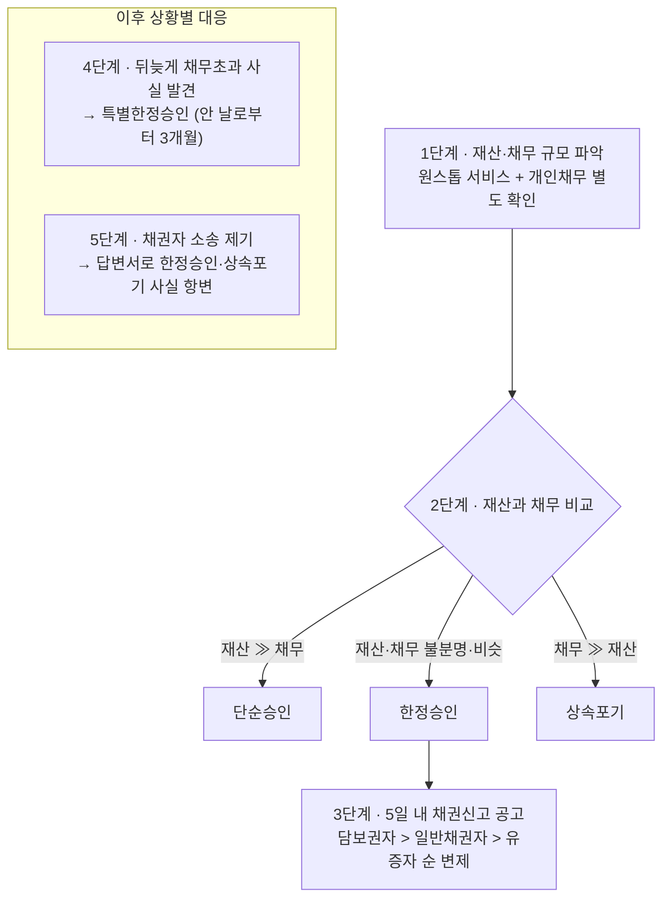

# 상속승인과 포기

> [!info] 출처와 범위
> [[정재완]] 변호사(법무법인 시완, [[상속마스터 정변 유튜브 스터디|상속마스터 정변]] 채널)의 강의를 재구성했다. 상속개시 직후 "재산·채무를 어떻게 받을 것인가"를 다루며, 상속세 계산·유류분 등 다른 상속 쟁점과는 별개의 절차 축이다.
> 상속개시 직후 전체 절차는 [[상속분쟁과-유류분]]에서 확인한다. 상속세 신고 기한·재산 파악은 [[상속세-과세체계와-전략]]에서 확인한다.

---

## 1. 먼저 결론

상속이 개시되면 상속인은 **상속개시가 있음을 안 날로부터 3개월 이내에** 단순승인·한정승인·상속포기 중 하나를 선택(또는 방치 시 단순승인 의제)해야 한다. 선택을 잘못하면 **본인 고유재산으로 피상속인의 빚을 갚아야 하는 상황**이 될 수 있고, 반대로 뒤늦게 빚을 발견해도 **특별한정승인**이라는 구제책이 있다.

핵심 세 가지:
1. **재산 파악이 먼저다**. 안심상속 원스톱 서비스로 조회하되, **개인 간 채무는 조회되지 않는 사각지대**다.
2. **선택에 따라 채무가 다음 순위 상속인·재상속으로 계속 흘러갈 수 있다**. 한 번의 선택으로 끝나지 않는다.
3. **소송이 걸리면 반드시 대응해야 한다**. 한정승인·상속포기를 했어도 채권자 소송에 무대응하면 전액 변제 판결이 그대로 확정될 수 있다.

---

## 2. 왜 중요한가

- 재산보다 채무가 많은 상속에서 선택을 잘못하면 상속인 본인의 고유재산으로 변제해야 하는 결과가 생긴다.
- 개인 간 채무(지인에게 빌린 돈 등)는 안심상속 원스톱 서비스로 조회되지 않아, 단순승인 후 몇 달 뒤 채권자 소송으로 뒤늦게 드러나는 사례가 실무상 많다.
- 상속포기·한정승인을 했다는 사실만으로 안심할 수 없다. 채권자 소송에 대응하지 않으면 그 이점이 사라진다.

---

## 3. 기본 개념

### 3-1. 세 가지 선택지

| 선택 | 재산 | 채무 |
|---|---|---|
| **단순승인** | 그대로 받음 | 그대로 받음(전액 변제 의무) |
| **한정승인** | 그대로 받음 | 상속받은 재산 범위 내에서만 변제 |
| **상속포기** | 받지 않음 | 받지 않음 |

- **단순승인**은 별도 신청 없이, 3개월 내 아무 조치를 하지 않으면 자동으로 의제된다(민법 §1026 2호).
- ⚠️ **처분행위(§1026 1호)는 승인·포기의 효력이 생기기 전의 처분**이다. 효력은 가정법원 심판을 **고지받은 때** 생기므로, 포기 신고서를 낸 뒤라도 심판 고지 전에 상속재산을 처분하면 단순승인이 된다(대법원 2016. 12. 29. 선고 2013다73520 판결). 한정승인·포기 **후**에는 처분이 아니라 **은닉·부정소비·고의로 재산목록에 기입하지 않은 것**이 사유다(§1026 3호). (2026-11-17 정정: 종전 "한정승인 후 처분해도 단순승인" 서술은 조문 구조와 맞지 않았다)
  - 장례비는 합리적 범위라면 상속비용으로 보아 처분이 아니다(대법원 2003. 11. 14. 선고 2003다30968 판결). 고인의 채권을 추심해 받은 것은 처분으로 본 판례가 있다(대법원 2010. 4. 29. 선고 2009다84936 판결). 고인의 돈으로 고인의 채무를 갚는 행위를 직접 판단한 대법원 판례는 찾지 못했다 `[원문 확인 필요]`.
- **한정승인·상속포기**는 가정법원에 **상속개시를 안 날로부터 3개월 이내** 신청해야 한다.

### 3-2. 절차 순서

1. **사망신고** → 가족관계증명서와 주민등록에 사망 사실이 반영된다.
2. **안심상속 원스톱 서비스**로 예금·주식·보험·부동산 등 재산·채무 조회(⚠️ 개인 간 채무는 조회 안 됨).
3. **3개월 내**에 단순승인·한정승인·상속포기 중 하나를 결정한다.
4. **6개월 내**에 상속세를 신고한다(→ [[상속세-과세체계와-전략]]).

---

## 4. 판단 구조

```
1단계  재산·채무 규모 파악 (원스톱 서비스 + 개인채무 별도 확인)
2단계  재산≫채무 → 단순승인 / 재산·채무 불분명·비슷 → 한정승인 / 채무≫재산 → 상속포기
3단계  (한정승인 시) 5일 내 채권신고 공고 → 담보권자 > 일반채권자 > 유증자 순 변제
4단계  뒤늦게 채무초과 사실 발견 → 특별한정승인(안 날로부터 3개월)
5단계  채권자 소송 제기 시 → 반드시 답변서로 한정승인·상속포기 사실 항변
```

**판단 흐름 (위 5단계와 같은 내용)**

%% ciat-design: 시각화 추가 — 아래 다이어그램은 이 절 본문의 내용만 옮긴 것 (원문 우선) %%




---

## 5. 상세 설명

### 5-1. 상속포기는 원칙적으로 취소 불가

승인·포기는 3개월 기간 안이라도 취소하지 못한다(민법 §1024①). 다만 **총칙편의 취소(착오·사기·강박·제한능력 등)**는 가능하며, 그 취소권은 **추인할 수 있는 날부터 3개월, 승인·포기한 날부터 1년** 안에 행사해야 한다(§1024②). 나중에 재산이 더 많았던 것으로 밝혀져도 되돌리기 어려우므로, 포기 전 재산·채무 파악이 중요하다. (2026-11-17 정정: 종전 "기망·강박 외 취소 불가"는 착오 등 총칙상 사유와 행사기간을 빠뜨렸다)

### 5-1b. 생전 포기 각서는 무효, 포기한 몫은 다른 공동상속인에게 간다 (2026-10-25 추가)

([[2026-04-02-부모님 재산 분배의 충격 진실 상속 분쟁, 이대로 좋은가 안원용 변호사-소스요약]])

- **사전 포기 불가**: 상속포기는 상속개시를 안 날부터 3개월 내 **가정법원 신고**로만 할 수 있다. 부모 생전에 "아파트를 먼저 받는 대신 나중에 아무것도 안 받겠다"는 각서·인감·공증은 효력이 없다. 이런 약속을 믿는 쪽은 부모로부터 **유언장**을 받아 두어야 한다.
- **포기 지분의 귀속**: 공동상속인 중 1명이 포기하면 그 몫은 **다른 공동상속인의 상속분 비율대로** 귀속된다. "내가 포기하면 내 자녀가 받는다"는 오해가 많다. 외동이거나 같은 순위 전원이 포기해야 다음 순위로 내려간다. 이때는 상속공제·세대생략 할증 문제가 생긴다는 설명이다 `[현행 기준 확인 필요]` → [[상속세-과세체계와-전략]]
- 분할협의서에서 "나는 안 받는다"고 쓰는 것은 포기가 아니라 **분할협의**다(아래 5-2의 채권자 대응 차이 참조).

### 5-2. 상속재산분할협의 vs 상속포기: 채권자 대응력의 차이

여러 상속인 중 특정인만 재산을 받고 특정인은 빠지는 **상속재산분할협의**는 다른 상속인의 채권자가 사해행위취소소송으로 다툴 수 있다. 반면 **상속포기는 채권자가 다툴 여지가 없다**. 애초에 상속인 지위 자체가 소급해 소멸하기 때문이다. → 채무초과 상속에서는 분할협의보다 포기가 채권자 대응 면에서 안전하다.

### 5-3. 특별한정승인: 뒤늦게 발견한 채무 초과의 구제책

단순승인(또는 방치로 인한 의제) 후에도, **상속채무가 상속재산을 초과한다는 사실을 중대한 과실 없이 몰랐다가 그 사실을 안 날로부터 3개월 이내**에 별도로 한정승인을 신청할 수 있다.

- "안 날"은 통상 **채권자의 소장을 송달받은 날**로 판단된다.
- 이미 상속재산을 처분·소비했다면 그 범위에서는 변제 책임이 남는다. 처분 재산의 목록과 가액을 함께 제출하고(§1030②), **남은 재산에 처분한 재산의 가액을 합해** 배당변제한다. 한정승인 전에 상속채권자에게 변제한 가액은 처분 가액에서 뺀다(§1034②).
- ✅ "중대한 과실 없이 몰랐다"의 증명책임은 상속인에게 있다. 중대한 과실은 조금만 주의를 기울였다면 알 수 있었는데 이를 게을리한 것을 말한다(대법원 2010. 6. 10. 선고 2010다7904 판결).
- ⚠️ **미성년 상속인 특례**: 과거에는 친권자가 단순승인하면 미성년 자녀도 그대로 구속됐으나, 법 개정으로 **미성년자는 성년이 된 후 상속채무 초과 사실을 안 날로부터 3개월 이내**에 별도로 한정승인을 신청할 수 있다.

### 5-4. 한정승인·상속포기 후 채권자 소송 대응

한정승인·상속포기를 마쳤어도 피상속인의 채권자가 상속인에게 전액 변제를 청구하는 소송을 걸 수 있다(포기·한정승인은 등기·공시되지 않아 채권자가 모를 수 있음).

- **소장을 받은 날로부터 30일 이내에 답변서**로 한정승인·상속포기 사실을 제출해야 한다.
- 한정승인을 했다면 상속재산 범위 안에서 변제하라는 판결을, 상속포기를 했다면 청구기각 판결을 받는다.
- ⚠️ **대응하지 않으면 치명적**: 의제자백으로 확정판결이 나면 전액 변제 판결이 그대로 확정된다.
- 사후 구제: 한정승인의 경우 판결 확정 후라도 **청구이의의 소**로 강제집행 범위를 한정승인 책임 범위로 제한받을 여지가 있다. **상속포기는 확정판결 후 구제 방법이 사실상 없다.** ✅ 대법원 2009. 5. 28. 선고 2008다79876 판결: 기판력에 의한 실권효 제한 법리는 상속포기에는 적용되지 않는다.
- 한정승인이 인정돼도 법원은 채무 **전액**의 이행판결을 하고 주문에 "상속재산의 한도에서" 집행할 수 있다는 유보를 붙인다. 한정승인은 채무의 존재가 아니라 책임의 범위를 제한한다(대법원 2003. 11. 14. 선고 2003다30968 판결).

### 5-5. 한정승인 후 채권자 변제 절차

1. 한정승인 결정 후 **5일 이내** 신문 공고로 채권 신고 촉구, 알고 있는 채권자에게는 **개별 최고(등기우편·내용증명)**.
2. **변제 순위**: ① 담보권(근저당권 등) 있는 채권자 → ② 일반채권자(채권액 비율 안분) → ③ 유증받은 자.
3. ⚠️ **변제 순서를 어기면 한정승인한 상속인 본인이 부당변제 책임**을 진다.
4. 특별한정승인으로 전환한 경우, 기존에 소비한 상속재산도 합산해 다시 변제해야 한다.

### 5-6. 대습·재상속으로 채무가 계속 흘러가는 구조

- **선순위 상속인이 상속포기하면 그 몫은 차순위 상속인에게 넘어간다.** 이때 차순위 상속인도 **자신이 안 날로부터 3개월 이내**에 별도로 포기해야 한다. 선순위자가 뒤늦게 포기하면 차순위자의 기산점과 어긋나 예기치 못한 승계가 발생할 수 있다.
- ⚠️ **전원합의체 판례 변경(2023)**: 피상속인의 배우자와 자녀가 공동상속인인데 **자녀 전부가 상속을 포기한 경우**, 손자녀나 피상속인의 직계존속이 있더라도 배우자가 단독상속인이 된다. 종전처럼 배우자와 손자녀·직계존속이 공동상속인이 된다고 보지 않는다(대법원 2023.3.23. 자 2020그42 전원합의체 결정; 종전 대법원 2015.5.14. 선고 2013다48852 변경). 일부 자녀만 포기한 경우까지 같은 결론으로 일반화하지 않는다.
- **차순위 연쇄는 방계까지 간다 (2026-10-14 보강)**: 상속순위는 직계비속 → 직계존속 → 형제자매 → **4촌 이내 방계혈족**이고 같은 순위에서는 촌수가 가까운 사람이 먼저다(배우자 별도 확인). 그래서 **피상속인의 자녀·형제가 모두 포기하면 조카에게** 빚이 내려간다. 포기한 사람이 빚을 "넘긴" 것이 아니라 법정 순위가 이동한 결과다. 친분·수령 여부는 순위와 무관하다. ([[2026-10-13-상속포기하면 끝 내 자녀에게 빚이 넘어가는 경우 (상속전문변호사)-소스요약]]) ✅ 민법 §1000①② 2026-10-25 대조
  - **차순위자의 3개월 기산점** = 사망일이 아니라 **선순위자들의 포기로 자신이 상속인이 된 사실을 안 날**. 대법원은 배우자와 자녀 전원 포기로 손자녀가 상속인이 된 경우, 일반인이 그로써 자신이 상속인이 된 사실까지 아는 것은 "오히려 이례"라며 상속개시 원인사실만 안 날을 기산점으로 본 원심을 파기했다(대법원 2005. 7. 22. 선고 2003다43681 판결). 언제 알았는지는 사실관계로 판단되므로 → 독촉장·소장 수령일, 가족과 주고받은 문자·통화기록, 선순위자의 **포기 심판문**을 증거로 모은다. (2026-11-17 정정: 종전 "가족에게 들어 이미 알았다면 늦출 수 없다"는 단정은 판례보다 엄격했다. "장례식 참석" 표현의 판례 근거는 확인하지 못해 뺐다)
  - **"상속인임을 몰랐다"와 "채무초과를 몰랐다"는 다른 주장**이다. 전자는 통상 기산점 문제, 후자는 특별한정승인(5-3).
  - ⚠️ **이미 포기한 선순위자가 한정승인으로 바꾸는 것은 원칙적으로 불가**: 청구를 받은 차순위자는 선순위자의 절차를 되돌리려 기다리지 말고 **자기 기한부터** 챙긴다.
- ⚠️ **재상속(대습) 시 이전 상속포기 효과는 승계되지 않는다**: 아버지 사망 시 상속포기를 했어도, 그 채무가 할머니에게 넘어갔다가 할머니 사망 시 대습상속으로 손자에게 다시 승계될 수 있다. **상속포기의 효과는 그 상속(아버지의 상속)에만 미치고, 별개의 새로운 상속개시(할머니의 상속)에는 미치지 않는다.** ✅ 대법원 2017. 1. 12. 선고 2014다39824 판결(대습상속은 상속과 별개의 원인. 대습상속인에는 피대습자의 배우자도 포함되며 특별한정승인으로 보호받을 여지가 있다). 2020그42 이후에는 배우자가 남아 있으면 자녀만 포기해도 배우자 단독상속이 되므로, 이 사례는 배우자와 자녀(손자녀 포함)가 모두 포기해 직계존속에게 넘어간 경우를 전제로 한다. 예방책은 최초 상속 시 특정 상속인 1명이 (포기가 아니라) **한정승인**을 해두어 다음 순위로 채무가 넘어가는 것 자체를 막는 것이다.

### 5-7. 상속포기·한정승인의 세금 연결 (2026-11-17 추가)

상속세 계산 자체는 [[상속세-과세체계와-전략]]이 정본이다. 여기서는 승인·포기 선택에 영향을 주는 세금 사실만 둔다. 블로그 원고 5단계 법률검증에서 원문으로 확인했다.

- **포기자도 상증법상 상속인**이다(상증법 §2 4호). 납부의무는 각자 받았거나 받을 재산 기준이고 연대납부도 그 재산이 한도다(§3의2). 포기자가 실제로 받은 **사전증여재산(10년, §13)·간주상속 보험금(§8)**이 있으면 그 몫만큼 부담한다. 추정상속재산(§15)은 과세가액을 키울 뿐, 받은 재산이 없는 포기자에게 직접 납부의무를 만들지는 않는 것으로 정리했다 `[LLM 해석: 포기자 배분 실무 예규 미확인]`.
- **채무초과분은 사전증여재산을 상쇄하지 못한다**: 채무가 상속재산을 초과하면 그 초과액은 없는 것으로 보고 사전증여재산을 가산한다(§13① 후단). 사전증여재산 차감에 따른 공제한도 축소는 **과세가액 5억원 초과 시에만** 적용된다(§24 단서·3호).
- **사망보험금은 민법·세법 결론이 다르다**: 수익자 상속인의 보험금은 고유재산이라 포기해도 받을 수 있고 수령이 단순승인 사유도 아니다(대법원 2004. 7. 9. 선고 2003다29463 판결). 세법은 피상속인 납입분을 상속재산으로 본다(대법원 2007. 11. 30. 선고 2005두5529 판결, §8 합헌).
- ⚠️ **체납세금 승계**: 피상속인이 상속인을 수익자로 한 보험의 보험금을 한정승인·포기한 상속인이 받으면 그 **전액**을 상속받은 재산으로 보아 피상속인의 국세를 승계한다(국세기본법 §24②1호, 포기자도 상속인으로 봄. 2026-10-02 시행본 대조). 지방세기본법 §42②도 같은 취지.
- ⚠️ **한정승인 후 경매 양도소득세**: 임의경매도 양도이고 소유자인 한정승인 상속인에게 양도소득이 귀속된다. 이 양도소득세는 상속인 **고유의 채무**라 한정승인으로 상속재산 한도로 제한되지 않는다(대법원 2012. 9. 13. 선고 2010두13630 판결. 상속비용으로 보아 상속재산 한도 책임을 인정할 여지는 "별론"). 상속개시일 평가액이 양도 취득가액이 되므로(소득세법 시행령 §163⑨) 시가 평가로 상속세를 신고해 두는 실익이 있다 → [[상속세-과세체계와-전략]] 5-15.
- **포기로 다음 순위가 받는 경우**: 그 재산은 상속공제 한도에서 차감되고(§24 2호), 손자녀면 세대생략 할증 30%(§27)가 붙는다.

이 내용으로 쓴 블로그 원고: `drafts/2026-11-17-상속포기-한정승인.md` (게시 전)

---

## 6. 사례

**사례 A. 개인 간 채무 뒤늦게 발견**
- 상황: 안심상속 원스톱 서비스로는 금융권 채무만 조회되어 재산이 많다고 보고 단순승인. 몇 달 후 아버지 지인이 "5억 빌려줬다"며 소송.
- 대응: 특별한정승인 신청(소장 송달일로부터 3개월 이내).

**사례 B. 대습·재상속 채무 순환**
- 상황: 아버지 사망 시 상속포기 → 채무가 할머니에게 승계 → 할머니 사망 시 대습상속으로 손자·며느리에게 재승계.
- 왜: 상속포기의 효과는 최초 상속에만 미치고 대습상속에는 미치지 않기 때문이다.
- 대응: 특별한정승인(채무 초과 사실을 안 날로부터 3개월).

**사례 C. 이모의 빚이 조카에게: 지급명령으로 처음 안 경우** (2026-10-14 추가, 가상 사례)
- 상황: 이모 사망(배우자·손자녀·직계존속 없음) → 이모 아들 상속포기 → 유일한 형제인 어머니도 포기("다 처리했다"고만 전함) → 8개월 뒤 30세 외동딸에게 대여금 7천만원 **지급명령**.
- 대응 순서: ① **지급명령 송달일부터 2주 내 이의신청**(가정법원 포기·한정승인 신청과 별개다. 지급명령 절차를 멈추지 않으며, 확정되면 예금 압류 등 강제집행 근거) ② 자신이 상속인이 된 사실을 **안 날부터 3개월 내** 가정법원에 상속포기 또는 한정승인 ③ 기산점 입증자료(어머니와의 대화 기록·선순위 포기 심판문) 확보.
- 예방: 어머니가 포기 대신 **한정승인**을 했다면 상속인으로 남아 상속재산(예: 300만원) 범위에서 정리되고 딸에게 넘어가지 않았다(5-6 대습 사례와 같은 예방 논리). 한정승인 후에도 채권자 통지·청산 절차는 지켜야 한다(5-5).
- 출처: ([[2026-10-13-상속포기하면 끝 내 자녀에게 빚이 넘어가는 경우 (상속전문변호사)-소스요약]]) ✅ 민사소송법 §470: 지급명령 송달일부터 2주(불변기간), 2026-10-25 대조

---

## 7. 헷갈리기 쉬운 부분

> [!warning] 혼동 주의
> - **한정승인·상속포기를 했다고 안심 금지**: 채권자 소송에 대응하지 않으면 그 이점이 사라진다.
> - **개인 간 채무는 안심상속 원스톱 서비스로 조회되지 않는다.**
> - **상속포기는 원칙적으로 취소 불가**(총칙상 취소 사유만 예외, 3개월·1년 안 행사).
> - **포기 신고만 내고 심판 고지 전에 상속재산을 처분하면 단순승인**이다(2013다73520).
> - **한정승인을 해도 경매 양도소득세는 상속인 고유채무**다(2010두13630).
> - **상속포기의 효과는 그 상속 1건에만 미친다**. 대습·재상속에는 다시 대응해야 한다.
> - **특별한정승인의 3개월은 "상속개시를 안 날"이 아니라 "채무초과 사실을 안 날"**이 기준이다.
> - **선순위자의 늦은 포기는 차순위자의 기산점과 충돌**할 수 있다.

---

## 8. 실무상 체크포인트

1. 사망신고 → 안심상속 원스톱 서비스 조회 (+ 개인 간 채무 별도 탐문).
2. 3개월 안에 단순승인/한정승인/상속포기 중 하나를 결정한다.
3. 한정승인을 했다면 5일 안에 채권신고를 공고하고, 변제 순위(담보권자>일반채권자>유증자)를 지킨다.
4. 채권자가 소송을 걸면 30일 안에 답변서로 항변한다.
5. 뒤늦게 채무초과를 발견하면 특별한정승인(안 날로부터 3개월)을 검토한다.
6. 여러 순위 상속인이 있으면 차순위자도 동시에 대응 조율(포기의 연쇄효과). **채무 때문에 가족이 포기한다면 "다음 상속인이 누구인지"(형제자매·조카까지)를 확인하고 알린다**. 선순위 중 1명의 한정승인이 연쇄를 끊는 방법이다.
7. 법원 서류(지급명령·소장)가 오면 **2주·30일 등 그 절차의 기한을 가정법원 신청과 별도로** 관리한다.

---

## 9. 핵심 정리

- 3개월 안에 단순승인·한정승인·상속포기 중 하나를 결정한다. 그대로 두면 단순승인한 것으로 본다.
- 안심상속 원스톱 서비스는 **개인 간 채무를 놓친다.**
- 상속포기는 원칙적으로 **취소 불가**, 상속재산분할협의는 사해행위취소 위험이 있으나 상속포기는 그 위험이 없다.
- **특별한정승인**: 채무초과 사실을 중대한 과실 없이 안 날로부터 3개월 이내에 할 수 있다. 미성년자는 성년이 된 뒤 따로 기산한다.
- 한정승인·상속포기 후에도 **채권자 소송에 반드시 대응**(30일 내 답변서): 방치하면 전액을 변제하라는 판결이 확정된다.
- 한정승인 변제는 **담보권자 → 일반채권자 → 유증자** 순서로 하며, 순서를 어기면 부당변제 책임을 진다.
- **상속포기·재상속 채무는 계속 흘러갈 수 있다**. 별개의 상속이 새로 개시되면 다시 승인·포기를 판단해야 한다(2023년 전원합의체 판례는 배우자와 자녀 중 자녀 전부가 포기한 사안의 손자녀 직접 승계를 막았을 뿐, 이후 배우자의 사망으로 생기는 별도 상속까지 없애지는 않는다).

관련 문서: [[상속분쟁과-유류분]] · [[상속세-과세체계와-전략]]

---

## 10. 출처

- [[정재완]] 변호사([[상속마스터 정변 유튜브 스터디|상속마스터 정변]] 채널) 소스요약 7건: 2023-10-18~2024-05-01. 상세는 각 소스요약의 "관련 교재" 참조.
- 추가 반영(2026-10-14): ([[2026-10-13-상속포기하면 끝 내 자녀에게 빚이 넘어가는 경우 (상속전문변호사)-소스요약]]): 방계(조카)까지 가는 차순위 연쇄·지급명령 대응·기산점 입증(5-6·사례 C)
- [대법원 2023.3.23. 자 2020그42 전원합의체 결정](https://www.law.go.kr/precInfoP.do?mode=0&precSeq=234385&vSct=2020%EA%B7%B842): 배우자와 자녀 중 자녀 전부가 상속포기한 경우 배우자 단독상속
- 2026-11-17 블로그 원고 법률검증(`drafts/검증기록/2026-11-17-상속포기-한정승인/법률검증-보고서.md`)에서 원문·링크 확인 후 추가한 판례: [2003다43681](https://www.law.go.kr/precInfoP.do?mode=0&precSeq=83968) · [2013다73520](https://www.law.go.kr/precInfoP.do?mode=0&precSeq=187951) · [2003다30968](https://www.law.go.kr/precInfoP.do?mode=0&precSeq=82909) · [2009다84936](https://www.law.go.kr/precInfoP.do?mode=0&precSeq=143820) · [2014다39824](https://www.law.go.kr/precInfoP.do?mode=0&precSeq=184102) · [2008다79876](https://www.law.go.kr/precInfoP.do?mode=0&precSeq=135842) · [2010다7904](https://www.law.go.kr/precInfoP.do?mode=0&precSeq=144540) · [2003다29463](https://www.law.go.kr/precInfoP.do?mode=0&precSeq=83347) · [2005두5529](https://www.law.go.kr/precInfoP.do?mode=0&precSeq=85426) · [2010두13630](https://www.law.go.kr/precInfoP.do?mode=0&precSeq=165451). 조문: 민법 2026-03-17 시행본, 상증법 2026-01-02 시행본, 국세기본법 2026-10-02 시행본.

> [!caution] 검증 상태
> [자동자막] 전량 auto-caption이므로 그 밖의 구술 용어·수치는 소스요약의 개별 경고를 따른다.
