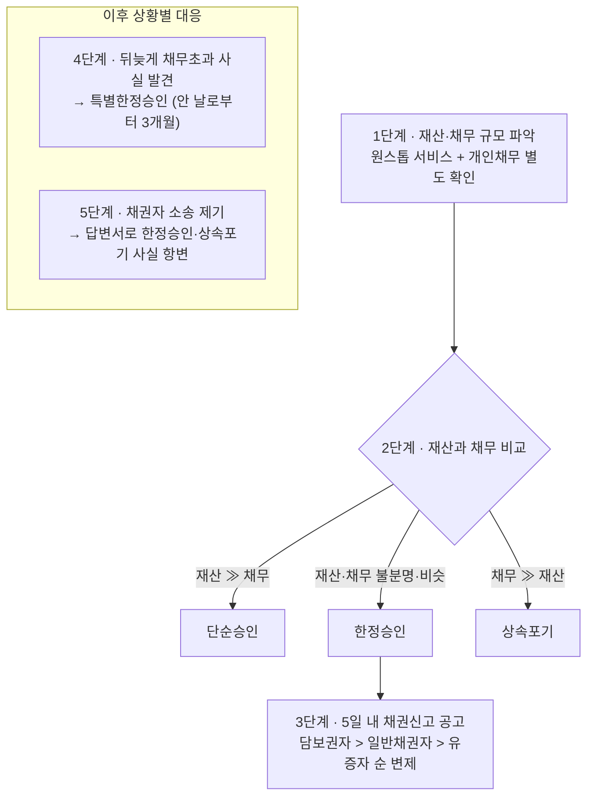

# 상속승인과 포기

> [!info] 출처와 범위
> [[정재완]] 변호사(법무법인 시완, [[상속마스터 정변 유튜브 스터디|상속마스터 정변]] 채널)의 강의를 재구성했다. 상속개시 직후 "재산·채무를 어떻게 받을 것인가"를 다루며, 상속세 계산·유류분 등 다른 상속 쟁점과는 별개의 절차 축이다.
> 상속개시 직후 전체 절차는 [[상속분쟁과-유류분]] 참고. 상속세 신고 기한·재산 파악은 [[상속세-과세체계와-전략]] 참고.

---

## 1. 먼저 결론

상속이 개시되면 상속인은 **상속개시가 있음을 안 날로부터 3개월 이내에** 단순승인·한정승인·상속포기 중 하나를 선택(또는 방치 시 단순승인 의제)해야 한다. 선택을 잘못하면 **본인 고유재산으로 피상속인의 빚을 갚아야 하는 상황**이 될 수 있고, 반대로 뒤늦게 빚을 발견해도 **특별한정승인**이라는 구제책이 있다.

핵심 세 가지:
1. **재산 파악이 먼저다** — 안심상속 원스톱 서비스로 조회하되, **개인 간 채무는 조회되지 않는 사각지대**다.
2. **선택에 따라 채무가 다음 순위 상속인·재상속으로 계속 흘러갈 수 있다** — 한 번의 선택으로 끝나지 않는다.
3. **소송이 걸리면 반드시 대응해야 한다** — 한정승인·상속포기를 했어도 채권자 소송에 무대응하면 전액 변제 판결이 그대로 확정될 수 있다.

---

## 2. 왜 중요한가

- 재산보다 채무가 많은 상속에서 선택을 잘못하면 상속인 본인의 고유재산으로 변제해야 하는 결과가 생긴다.
- 개인 간 채무(지인에게 빌린 돈 등)는 안심상속 원스톱 서비스로 조회되지 않아, 단순승인 후 몇 달 뒤 채권자 소송으로 뒤늦게 드러나는 사례가 실무상 많다.
- 상속포기·한정승인을 했다는 사실만으로 안심할 수 없다 — 채권자 소송에 대응하지 않으면 그 이점이 사라진다.

---

## 3. 기본 개념

### 3-1. 세 가지 선택지

| 선택 | 재산 | 채무 |
|---|---|---|
| **단순승인** | 그대로 받음 | 그대로 받음(전액 변제 의무) |
| **한정승인** | 그대로 받음 | 상속받은 재산 범위 내에서만 변제 |
| **상속포기** | 받지 않음 | 받지 않음 |

- **단순승인**은 별도 신청 없이, 3개월 내 아무 조치를 하지 않으면 자동으로 의제된다. 한정승인 후 상속재산을 처분해도 법정단순승인으로 간주될 수 있다.
- **한정승인·상속포기**는 가정법원에 **상속개시를 안 날로부터 3개월 이내** 신청해야 한다.

### 3-2. 절차 순서

1. **사망신고** → 가족관계증명서·주민등록에 사망 반영.
2. **안심상속 원스톱 서비스**로 예금·주식·보험·부동산 등 재산·채무 조회(⚠️ 개인 간 채무는 조회 안 됨).
3. **3개월 내** 단순승인·한정승인·상속포기 결정.
4. **6개월 내** 상속세 신고(→ [[상속세-과세체계와-전략]]).

---

## 4. 판단 구조

```
1단계  재산·채무 규모 파악 (원스톱 서비스 + 개인채무 별도 확인)
2단계  재산≫채무 → 단순승인 / 재산·채무 불분명·비슷 → 한정승인 / 채무≫재산 → 상속포기
3단계  (한정승인 시) 5일 내 채권신고 공고 → 담보권자 > 일반채권자 > 유증자 순 변제
4단계  뒤늦게 채무초과 사실 발견 → 특별한정승인(안 날로부터 3개월)
5단계  채권자 소송 제기 시 → 반드시 답변서로 한정승인·상속포기 사실 항변
```

**판단 흐름 (위 5단계와 같은 내용)**

%% ciat-design: 시각화 추가 — 아래 다이어그램은 이 절 본문의 내용만 옮긴 것 (원문 우선) %%




---

## 5. 상세 설명

### 5-1. 상속포기는 원칙적으로 취소 불가

일단 법원 결정으로 효력이 발생하면, **타인의 기망·강박에 의한 경우가 아닌 한 취소할 수 없다.** 나중에 재산이 더 많았던 것으로 밝혀져도 되돌릴 수 없으므로, 포기 전 재산·채무 파악이 중요하다.

### 5-2. 상속재산분할협의 vs 상속포기 — 채권자 대응력의 차이

여러 상속인 중 특정인만 재산을 받고 특정인은 빠지는 **상속재산분할협의**는 다른 상속인의 채권자가 사해행위취소소송으로 다툴 수 있다. 반면 **상속포기는 채권자가 다툴 여지가 없다** — 애초에 상속인 지위 자체가 소급 소멸하기 때문. → 채무초과 상속에서는 협의보다 포기가 채권자 대응 면에서 안전.

### 5-3. 특별한정승인 — 뒤늦게 발견한 채무 초과의 구제책

단순승인(또는 방치로 인한 의제) 후에도, **상속채무가 상속재산을 초과한다는 사실을 중대한 과실 없이 몰랐다가 그 사실을 안 날로부터 3개월 이내**에 별도로 한정승인을 신청할 수 있다.

- "안 날"은 통상 **채권자의 소장을 송달받은 날**로 판단된다.
- 이미 상속재산을 처분·소비했다면 그 범위에서는 변제 책임이 남는다(이미 얻은 이익이므로).
- ⚠️ **미성년 상속인 특례**: 과거에는 친권자가 단순승인하면 미성년 자녀도 그대로 구속됐으나, 법 개정으로 **미성년자는 성년이 된 후 상속채무 초과 사실을 안 날로부터 3개월 이내**에 별도로 한정승인을 신청할 수 있다.

### 5-4. 한정승인·상속포기 후 채권자 소송 대응

한정승인·상속포기를 마쳤어도 피상속인의 채권자가 상속인에게 전액 변제를 청구하는 소송을 걸 수 있다(포기·한정승인은 등기·공시되지 않아 채권자가 모를 수 있음).

- **소장을 받은 날로부터 30일 이내에 답변서**로 한정승인·상속포기 사실을 제출해야 한다.
- 한정승인 시: 상속재산 범위 내 변제 판결. 상속포기 시: 청구기각 판결.
- ⚠️ **대응하지 않으면 치명적**: 의제자백으로 확정판결이 나면 전액 변제 판결이 그대로 확정된다.
- 사후 구제: 한정승인의 경우 판결 확정 후라도 **청구이의의 소**로 강제집행 범위를 한정승인 책임 범위로 제한받을 여지가 있다. **상속포기는 확정판결 후 구제 방법이 사실상 없다.**

### 5-5. 한정승인 후 채권자 변제 절차

1. 한정승인 결정 후 **5일 이내** 신문 공고로 채권 신고 촉구, 알고 있는 채권자에게는 **개별 최고(등기우편·내용증명)**.
2. **변제 순위**: ① 담보권(근저당권 등) 있는 채권자 → ② 일반채권자(채권액 비율 안분) → ③ 유증받은 자.
3. ⚠️ **변제 순서를 어기면 한정승인한 상속인 본인이 부당변제 책임**을 진다.
4. 특별한정승인으로 전환한 경우, 기존에 소비한 상속재산도 합산해 다시 변제해야 한다.

### 5-6. 대습·재상속으로 채무가 계속 흘러가는 구조

- **선순위 상속인이 상속포기하면 그 몫은 차순위 상속인에게 넘어간다.** 이때 차순위 상속인도 **자신이 안 날로부터 3개월 이내**에 별도로 포기해야 한다 — 선순위자가 뒤늦게 포기하면 차순위자의 기산점과 어긋나 예기치 못한 승계가 발생할 수 있다.
- ⚠️ **전원합의체 판례 변경(2023)**: 피상속인의 배우자와 자녀가 공동상속인인데 **자녀 전부가 상속을 포기한 경우**, 손자녀나 피상속인의 직계존속이 있더라도 배우자가 단독상속인이 된다. 종전처럼 배우자와 손자녀·직계존속이 공동상속인이 된다고 보지 않는다(대법원 2023.3.23. 자 2020그42 전원합의체 결정; 종전 대법원 2015.5.14. 선고 2013다48852 변경). 일부 자녀만 포기한 경우까지 같은 결론으로 일반화하지 않는다.
- **차순위 연쇄는 방계까지 간다 (2026-10-14 보강)**: 상속순위는 직계비속 → 직계존속 → 형제자매 → **4촌 이내 방계혈족**이고 같은 순위에서는 촌수가 가까운 사람이 먼저다(배우자 별도 확인). 그래서 **피상속인의 자녀·형제가 모두 포기하면 조카에게** 빚이 내려간다 — 포기한 사람이 빚을 "넘긴" 것이 아니라 법정 순위가 이동한 결과다. 친분·수령 여부는 순위와 무관하다. ([[2026-10-13-상속포기하면 끝 내 자녀에게 빚이 넘어가는 경우 (상속전문변호사)-소스요약]]) `[원문 확인 필요 — 민법 §1000]`
  - **차순위자의 3개월 기산점** = 사망일이 아니라 **선순위자들의 포기로 자신이 상속인이 된 사실을 안 날**. 장례식 참석만으로 알았다고 보지 않지만, 가족에게 들어 이미 알았다면 나중 독촉장 수령일로 늦출 수 없다 → 가족과 주고받은 문자·통화기록, 선순위자의 **포기 심판문**을 증거로 모은다.
  - **"상속인임을 몰랐다"와 "채무초과를 몰랐다"는 다른 주장**이다 — 전자는 통상 기산점 문제, 후자는 특별한정승인(5-3).
  - ⚠️ **이미 포기한 선순위자가 한정승인으로 바꾸는 것은 원칙적으로 불가** — 청구를 받은 차순위자는 선순위자의 절차를 되돌리려 기다리지 말고 **자기 기한부터** 챙긴다.
- ⚠️ **재상속(대습) 시 이전 상속포기 효과는 승계되지 않는다**: 아버지 사망 시 상속포기를 했어도, 그 채무가 할머니에게 넘어갔다가 할머니 사망 시 대습상속으로 손자에게 다시 승계될 수 있다. **상속포기의 효과는 그 상속(아버지의 상속)에만 미치고, 별개의 새로운 상속개시(할머니의 상속)에는 미치지 않는다.** 예방책은 최초 상속 시 특정 상속인 1명이 (포기가 아니라) **한정승인**을 해두어 다음 순위로 채무가 넘어가는 것 자체를 막는 것.

---

## 6. 사례

**사례 A. 개인 간 채무 뒤늦게 발견**
- 상황: 안심상속 원스톱 서비스로는 금융권 채무만 조회되어 재산이 많다고 보고 단순승인. 몇 달 후 아버지 지인이 "5억 빌려줬다"며 소송.
- 대응: 특별한정승인 신청(소장 송달일로부터 3개월 이내).

**사례 B. 대습·재상속 채무 순환**
- 상황: 아버지 사망 시 상속포기 → 채무가 할머니에게 승계 → 할머니 사망 시 대습상속으로 손자·며느리에게 재승계.
- 왜: 상속포기 효과는 최초 상속에만 미치고 대습상속에는 미치지 않음.
- 대응: 특별한정승인(채무 초과 사실을 안 날로부터 3개월).

**사례 C. 이모의 빚이 조카에게 — 지급명령으로 처음 안 경우** (2026-10-14 추가, 가상 사례)
- 상황: 이모 사망(배우자·손자녀·직계존속 없음) → 이모 아들 상속포기 → 유일한 형제인 어머니도 포기("다 처리했다"고만 전함) → 8개월 뒤 30세 외동딸에게 대여금 7천만원 **지급명령**.
- 대응 순서: ① **지급명령 송달일부터 2주 내 이의신청**(가정법원 포기·한정승인 신청과 별개 — 지급명령 절차를 멈추지 않으며, 확정되면 예금 압류 등 강제집행 근거) ② 자신이 상속인이 된 사실을 **안 날부터 3개월 내** 가정법원에 상속포기 또는 한정승인 ③ 기산점 입증자료(어머니와의 대화 기록·선순위 포기 심판문) 확보.
- 예방: 어머니가 포기 대신 **한정승인**을 했다면 상속인으로 남아 상속재산(예: 300만원) 범위에서 정리되고 딸에게 넘어가지 않았다(5-6 대습 사례와 같은 예방 논리). 한정승인 후에도 채권자 통지·청산 절차는 지켜야 한다(5-5).
- 출처: ([[2026-10-13-상속포기하면 끝 내 자녀에게 빚이 넘어가는 경우 (상속전문변호사)-소스요약]]) `[원문 확인 필요 — 지급명령 이의기간 민사소송법 §470]`

---

## 7. 헷갈리기 쉬운 부분

> [!warning] 혼동 주의
> - **한정승인·상속포기를 했다고 안심 금지** — 채권자 소송에 대응하지 않으면 그 이점이 사라진다.
> - **개인 간 채무는 안심상속 원스톱 서비스로 조회되지 않는다.**
> - **상속포기는 원칙적으로 취소 불가**(기망·강박 예외).
> - **상속포기의 효과는 그 상속 1건에만 미친다** — 대습·재상속에는 다시 대응해야 한다.
> - **특별한정승인의 3개월은 "상속개시를 안 날"이 아니라 "채무초과 사실을 안 날"** 기준.
> - **선순위자의 늦은 포기는 차순위자의 기산점과 충돌**할 수 있다.

---

## 8. 실무상 체크포인트

1. 사망신고 → 안심상속 원스톱 서비스 조회 (+ 개인 간 채무 별도 탐문).
2. 3개월 내 단순승인/한정승인/상속포기 결정.
3. 한정승인 시 5일 내 채권신고 공고 + 변제 순위(담보권자>일반채권자>유증자) 준수.
4. 채권자 소송 발생 시 30일 내 답변서로 항변.
5. 뒤늙게 채무 초과 발견 시 특별한정승인(안 날로부터 3개월) 검토.
6. 여러 순위 상속인이 있으면 차순위자도 동시에 대응 조율(포기의 연쇄효과). **채무 때문에 가족이 포기한다면 "다음 상속인이 누구인지"(형제자매·조카까지)를 확인하고 알린다** — 선순위 중 1명의 한정승인이 연쇄를 끊는 방법이다.
7. 법원 서류(지급명령·소장)가 오면 **2주·30일 등 그 절차의 기한을 가정법원 신청과 별도로** 관리한다.

---

## 9. 핵심 정리

- 3개월 내 단순승인·한정승인·상속포기 결정. 방치 시 단순승인 의제.
- 안심상속 원스톱 서비스는 **개인 간 채무를 놓친다.**
- 상속포기는 원칙적으로 **취소 불가**, 상속재산분할협의는 사해행위취소 위험이 있으나 상속포기는 그 위험이 없음.
- **특별한정승인**: 채무초과 사실을 중대한 과실 없이 안 날로부터 3개월 이내. 미성년자는 성년 후 별도 기산.
- 한정승인·상속포기 후에도 **채권자 소송에 반드시 대응**(30일 내 답변서) — 방치 시 전액 변제 판결 확정.
- 한정승인 변제는 **담보권자 → 일반채권자 → 유증자** 순, 순서 위반 시 부당변제 책임.
- **상속포기·재상속 채무는 계속 흘러갈 수 있다** — 별개의 상속이 새로 개시되면 다시 승인·포기를 판단해야 한다(2023년 전원합의체 판례는 배우자와 자녀 중 자녀 전부가 포기한 사안의 손자녀 직접 승계를 막았을 뿐, 이후 배우자의 사망으로 생기는 별도 상속까지 없애지는 않는다).

관련 문서: [[상속분쟁과-유류분]] · [[상속세-과세체계와-전략]]

---

## 10. 출처

- [[정재완]] 변호사([[상속마스터 정변 유튜브 스터디|상속마스터 정변]] 채널) 소스요약 7건 — 2023-10-18~2024-05-01. 상세는 각 소스요약의 "관련 교재" 참조.
- 추가 반영(2026-10-14): ([[2026-10-13-상속포기하면 끝 내 자녀에게 빚이 넘어가는 경우 (상속전문변호사)-소스요약]]) — 방계(조카)까지 가는 차순위 연쇄·지급명령 대응·기산점 입증(5-6·사례 C)
- [대법원 2023.3.23. 자 2020그42 전원합의체 결정](https://www.law.go.kr/precInfoP.do?mode=0&precSeq=234385&vSct=2020%EA%B7%B842) — 배우자와 자녀 중 자녀 전부가 상속포기한 경우 배우자 단독상속

> [!caution] 검증 상태
> [자동자막] 전량 auto-caption이므로 그 밖의 구술 용어·수치는 소스요약의 개별 경고를 따른다.
