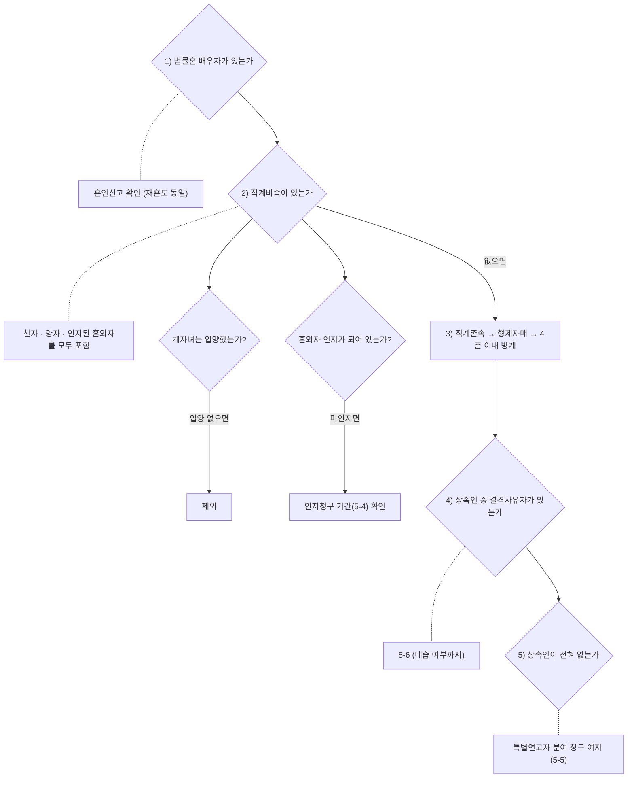

# 상속인 자격과 가족관계

> [!info] 개요
> **이 문서의 역할**: **"누가 상속인인가"** 를 가족관계별로 판정하는 정본이다.
> 상속분 계산·유류분·분쟁 해결은 [[상속분쟁과-유류분]], 승인·포기는 [[상속승인과-포기]], 세금은 [[상속세-과세체계와-전략]]이 소유한다.

## 1. 먼저 결론

**상속권은 "함께 산 세월"이 아니라 "가족관계등록부에 등재된 법적 지위"가 결정한다.** 감정적으로 가장 가까운 사람이 법적으로는 아무 권리가 없는 경우가 흔하고, 그 반대도 마찬가지다.

| 관계 | 상속권 | 결정적 요건 |
|---|---|---|
| 법률혼 배우자(재혼 포함) | ✅ 있음 | **혼인신고** |
| 사실혼 배우자 | ❌ 없음 | 동거기간 무관 → 5-5 |
| 이혼한 전 배우자 | ❌ 없음 | 이혼으로 인척관계 소멸 |
| 전혼 자녀(친자) | ✅ 있음 | 부모 이혼과 **무관하게 유지** |
| 계자녀(배우자가 데려온 자녀) | ❌ 없음 | **입양해야** 발생 → 5-3 |
| 혼외자 | ✅ 있음 | **인지**(임의인지 또는 인지판결) → 5-4 |
| 양자 | ✅ 있음 | 입양신고(친양자는 친생부모와 관계 단절) |

⚠️ **가장 자주 깨지는 통념 세 가지**: ① "20년 같이 살았으니 사실혼 배우자도 받는다" ❌ ② "친자식처럼 키운 계자녀도 당연히 받는다" ❌ ③ "이혼했으니 전처 자식은 못 받는다" ❌ (전처 자식은 받는다)

## 2. 왜 중요한가

- **상속인이 한 명 늘거나 줄면 모든 계산이 바뀐다.** 법정상속분·유류분·일괄공제·배우자상속공제 한도가 전부 상속인 구성의 함수다.
- **상속인을 빠뜨린 분할협의는 무효다.** 뒤늦게 혼외자가 인지되면 이미 끝난 분할이 되돌아온다(5-4).
- **재혼가정은 구조적으로 분쟁이 예정되어 있다.** 재혼 배우자와 전혼 자녀는 혈연이 없으면서 같은 상속재산을 두고 공동상속인이 되기 때문이다(5-2).

## 3. 기본 개념: 판정의 출발점은 가족관계등록부

상속인 판정은 추측이 아니라 **서류 확인**에서 시작한다.

- **확인 대상**: 혼인신고 여부 · 입양신고 여부 · 자녀 등재(인지 포함) 여부 · 이혼 기록
- 피상속인의 **출생부터 사망까지 전 제적등본·가족관계증명서(상세)** 를 떼야 숨은 상속인(혼외자·전혼 자녀·양자)이 드러난다.
- 상속순위 자체는 → [[상속분쟁과-유류분]] 3-1

## 4. 판단 구조

```
1) 법률혼 배우자가 있는가        → 혼인신고 확인 (재혼도 동일)
2) 직계비속이 있는가              → 친자 · 양자 · 인지된 혼외자를 모두 포함
     ├ 계자녀는 입양했는가?       → 입양 없으면 제외
     └ 혼외자 인지가 되어 있는가? → 미인지면 인지청구 기간(5-4) 확인
3) 없으면 직계존속 → 형제자매 → 4촌 이내 방계
4) 상속인 중 결격사유자가 있는가  → 5-6 (대습 여부까지)
5) 상속인이 전혀 없는가           → 특별연고자 분여 청구 여지 (5-5)
```

**다이어그램 (위 코드블록과 같은 내용)**

%% ciat-design: 시각화 추가 — 아래 다이어그램은 바로 위 코드블록의 내용만 옮긴 것 (원문 우선) %%



## 5. 상세 설명

### 5-1. 이혼한 전 배우자와 그 자녀: 정반대로 갈린다

- **전 배우자: 상속권 없음.** 이혼으로 배우자 지위가 소멸한다.
- **전혼 자녀: 상속권 유지.** 부모의 이혼은 친자관계에 영향을 주지 않는다. 양육권을 누가 가졌는지도 무관하다.
- 사례 계산(전처 아들 1 + 후처 1 + 후처 아들 1): 배우자 1.5 : 자녀 1 : 자녀 1 → **후처 3/7 · 전처 아들 2/7 · 후처 아들 2/7** ([[2023-12-06-[상속마스터의 눈으로 보는 '실제상황'] 전처와 후처가 동거 재산은 누가 상속받을 수 있을까-소스요약]])

### 5-2. 재혼가정의 기본 구도: 혈연 없는 공동상속인

재혼 배우자(혼인신고 O)와 전혼 친자녀가 **함께** 상속인이 된다. 서로 혈연이 없으면서 같은 재산을 나눠야 하므로 분쟁 밀도가 높다.

⚠️ **계모자·계부자 상속관계는 1990년 민법 개정으로 폐지됐다.** 개정 전에는 계모자 간에도 상속이 인정됐으나 **현행법상 새어머니가 사망해도 (입양하지 않은) 의붓자녀는 상속받지 못한다.** "내가 죽으면 네 몫을 떼어주겠다"는 새어머니의 약속이 법적으로 담보되지 않는 이유다 `[현행 기준 확인 필요]`.

⭐ **실무 함정: "배우자공제 30억이니 도장 찍어라"**: 새어머니가 단독상속을 위해 분할협의서 날인을 권유하며 "배우자공제가 30억이라 세금이 0"이라고 설명하는 사례. **공제 한도 구조를 잘못 이해한 것이다.** 배우자상속공제는 「법정상속분 · 실제 수령액 · 30억」 **중 최소값**이다.

- 30억·자녀 1명 사례: 배우자 법정상속분 3/5 → 공제 한도는 **18억**(30억이 아니다).
- **단독상속이 오히려 불리할 수 있다**: 새어머니 단독상속 시 약 20억 공제(배우자공제 18억 + 기초공제 2억, 일괄공제 미적용)인 반면, 아들과 **공동상속하면 일괄공제 5억이 더해져 총 23억**까지 공제된다.
- 계산 원리의 정본 → [[상속세-과세체계와-전략]] 3-2b

### 5-3. 계자녀: 입양 여부가 전부다

배우자가 데려온 전혼 자녀는 **아무리 오래 함께 살고 친자식처럼 키웠어도 정식 입양 절차를 밟지 않으면 상속권이 없다.** 반대로 입양하면 친생자와 동일한 권리가 발생한다.

- 재혼가정에서 계자녀에게 재산을 남기려면 **① 입양 ② 유언·유증 ③ 생전증여** 중 하나를 능동적으로 선택해야 한다. 아무것도 하지 않으면 한 푼도 가지 못한다.

### 5-4. 혼외자: 인지가 관문, 기간이 함정

**모자관계와 부자관계는 성립 시기가 다르다.** 어머니와 자녀의 친생자관계는 **출생과 동시에 당연히** 성립하지만, 아버지와 자녀 사이에는 **인지**가 있어야 성립한다.

- **인지되면 혼인 중 자녀와 완전히 동등한 상속권**을 갖는다.
- ⚠️ **아버지 사망 후 인지청구는 기간 제한이 있다**: 사망 사실을 안 날로부터 **2년 이내**에 **검사를 상대로** 인지청구소송을 제기해야 한다. 기간을 넘기면 소가 부적법해질 수 있다. 친자관계는 DNA 검사로 입증한다.
  > ✅ **2026-09-08 조문 대조 완료(법제처 law-kr)**: 민법 §864: "제862조 및 제863조의 경우에 부 또는 모가 사망한 때에는 **그 사망을 안 날로부터 2년내에 검사를 상대로** 하여 인지에 대한 이의 또는 인지청구의 소를 제기할 수 있다." 종전의 `[현행 기준 확인 필요]`는 해소되었다.
- ⭐ **기산점은 "사망 사실을 안 날"이지 "그가 내 친아버지임을 안 날"이 아니다.** 조문 문언이 그러하고, 대법원도 친아버지라는 사실까지 알아야 하는 것은 아니라는 취지로 판시했다고 소개된다 `[원문 확인 필요]`. 실무상 **장례식장에 다녀왔다면 그때 사망 사실을 안 것**이 되어 2년이 흐르기 시작한다. 예외: 미성년자였고 법정대리인이 소를 내지 않았다면 성년이 된 뒤 다시 2년, 소를 낼 수 없었던 사유가 있었다면 가능해진 시점부터로 본 판례가 있다고 한다 `[원문 확인 필요]`. ([[2026-09-02-유언장 믿고 자다간 큰일. 법이 정한 '이것' 때문에 집안 거덜 납니다 절세미녀-소스요약]])

**인지 시점에 따라 구제 수단이 갈린다.**

| 인지 확정 시점 | 처리 |
|---|---|
| 상속재산 **분할협의 전** | 다른 상속인과 함께 정상적으로 분할협의에 참여 |
| 분할협의 **후**(이미 분할 완료) | **상속분 상당 가액 지급청구**(민법 §1014): 현물 회수가 아니라 금전 환산액 |

- **후순위 상속인이 이미 나눠 가진 경우**: 혼외자가 인지되면 선순위 직계비속으로 확정되므로, 후순위(예: 직계존속)가 나눠 가진 상속관계는 **전부 무효가 되어 재정리**된다.
- **인지의 소급효와 그 한계(민법 §860)**: 인지판결이 확정되면 출생 시로 소급하지만, 그 소급효는 **제3자가 이미 취득한 권리를 해하지 못한다.**

### 5-4a. ⚠️ 10년 방어선을 둘러싼 쟁점 (2026-09-08 추가)

[[김희연]] 회계사는 "종전에는 분할 후 10년이 지나면 청구할 수 없었으나 **2024년 헌법재판소가 10년으로 자르는 것은 위헌이라고 판단**해 그 방어선이 사라졌고, 지금은 사망일부터 2년 내 인지청구 → **판결 확정일부터 3년 이내** 상속분 상당액 청구의 순서"라고 설명한다. ([[2026-09-02-유언장 믿고 자다간 큰일. 법이 정한 '이것' 때문에 집안 거덜 납니다 절세미녀-소스요약]])

⚠️ **다만 조문 문언은 그대로다.** 2026-09-08 법제처 원문 대조 결과 **민법 §999②는 여전히 "침해를 안 날부터 3년, 상속권의 침해행위가 있은 날부터 10년"**을 유지하고 있다(시행 2026-03-17). 즉 강사가 말한 것은 조문 개정이 아니라 **헌재 결정의 효력**이며, 그 결정이 §999②의 10년을 전면 무효화한 것인지 **피인지자의 §1014 가액지급청구에 적용하는 부분에 한정된 것인지**는 결정문으로 확인해야 한다. 사건번호가 제시되지 않았다. `[원문 확인 필요]`

> [!note] 검토 메모
> 🔎 **2026-09-08 확인 시도 결과**: 법제처 API(law-kr)는 **법원 판례만 제공하고 헌법재판소 결정례는 수록하지 않는다.** "상속회복청구"·"민법 제999조 제2항 위헌"·"상속분가액지급청구권 제척기간"으로 검색했으나 해당 헌재 결정을 찾지 못했다. 따라서 이 쟁점은 **헌법재판소 판례검색(search.ccourt.go.kr)에서 직접 확인해야 하는 백로그**로 남긴다. 그때까지는 §999② 문언(3년/10년)을 기준으로 하되 10년 방어선을 신뢰하지 않는 실무 태도를 유지한다.

- 실무상으로는 **"인지청구 2년"과 "가액지급청구 3년"의 두 시계를 각각 관리**하고, 10년 방어선을 전제로 안심하지 않는 편이 안전하다.

⚠️ **§1014와 일반 상속회복청구를 혼동하지 않는다.** §1014(가액 지급)는 **인지로 새로 상속인이 된 경우**에 적용된다. "어머니가 같은 이복형제"처럼 **출생 시부터 이미 상속인이었으나 그 존재를 모르고 단독상속으로 처분한 경우**는 §1014가 아니라 **일반 상속회복청구**로 처리되며, 이때는 제3자 명의 등기도 원칙적으로 **말소** 대상이 된다(실무에서는 금전 정산 조정이 현실적 해법). ([[2024-07-10-어머니는 같고 아버지는 다른 형제들과 상속분쟁이 생긴다면-소스요약]])

### 5-5. 사실혼 배우자: 상속권 없음

동거기간이 아무리 길어도 **혼인신고가 없으면 법정상속권이 없다.**

- **생전 해소 vs 사망 종료의 결정적 차이**: 생전에 사실혼을 해소하면 재산분할청구권이 유추적용되지만, **사망으로 종료되면 재산분할청구권도 인정되지 않아 아무 권리가 없다.** → 상세 정본 [[상속분쟁과-유류분]] 5-15
- **예외: 특별연고자**: 상속인이 **전혀 없는** 경우에 한해 특별연고자로서 상속재산 분여를 청구할 길이 열린다(예외적 상황).
- **대비책**: 재산 형성 기여를 입증해 소유권·공유지분을 주장하거나, 생전에 **유언·증여**를 받아둔다.
- **국민연금 등 공적 급여는 사실혼 배우자도 유족으로 인정될 수 있으나 상속과는 별개 제도**다. 혼동하지 않는다.
- 사실혼 배우자와의 자녀는 **인지되면 직계비속 상속인**이다(5-4).

### 5-6. 상속결격: 자격이 있어도 박탈되는 경우

민법상 결격사유(피상속인 살해·유언 방해·**유언장 위조/변조/파기/은닉** 등)에 해당하면 상속권이 박탈된다. **별도의 선고 없이 당연히 효력이 발생**한다(선고가 필요한 상속권 상실 제도와 다르다 → [[상속분쟁과-유류분]] 5-16b).

⚠️ **"유언장 은닉"의 문턱은 생각보다 높다.** 판례상 **유언장 소재를 불명하게 하려는 고의**가 필요하며, 단순히 적극적으로 알리지 않은 것만으로는 은닉이 아니다.

- 공증유언장 은닉 주장이 배척된 사례의 논거: ① 평소 피상속인이 가족 전원 앞에서 분배 의사를 밝혀왔고 ② **공정증서 유언은 원본이 공증사무실에 보관되어 은닉으로 소멸시킬 수 없는 구조**이며 ③ 등기 지연은 장례·가족 불화로 인한 주저로 볼 여지가 있다. ([[2024-07-05-공증유언장 은닉한 장남 상속결격사유일까-소스요약]])
- **결격의 효과와 대습**: 결격자의 몫은 소멸하지 않고, 결격자에게 배우자·자녀가 있으면 **대습상속**으로 넘어간다.

### 5-7. 며느리·사위: 상속인이 아니다 (대습은 예외)

- 며느리·사위는 인척일 뿐 상속인이 아니다. 다만 **배우자(아들·딸)가 먼저 사망하면 대습상속권**이 생긴다 → [[상속분쟁과-유류분]] 3-3
- ⚠️ **재혼하면 인척관계가 소멸해 대습상속권도 잃는다.**
- 시부모가 사망한 아들의 아파트를 며느리에게 반환하라고 요구하는 사례에서, **아들 명의 재산은 며느리(및 손자녀)의 상속재산**이지 시부모가 회수할 대상이 아니다(시부모는 직계비속이 있으면 후순위). ([[2024-04-03-남편 잃고 재산도 위협받다 시부모님의 충격적인 아파트 회수 요구 I 설마 부의금까지-소스요약]])

## 6. 사례

**A. 내연녀에게 재산, 처자식에게 빚**: 재산은 생전증여·유증으로 내연녀에게 넘기고 채무만 남은 경우. 배우자·자녀는 ① [[상속승인과-포기]](한정승인·포기)로 채무를 차단하고 ② 내연녀를 상대로 **유류분 반환청구**를 병행하는 2단 대응이 필요하다. 상속포기를 하면 유류분권도 함께 잃으므로 **순서와 조합을 반드시 검토**한다. ([[2024-07-03-내연녀에게 재산을, 부인과 자식에게는 빚을 남긴 남자-소스요약]])

**B. 재혼 후 사망, 계자녀 미입양**: 재혼 배우자 + 전혼 친자녀가 공동상속인이 되고, 배우자가 데려온 계자녀는 상속권이 없다. 계자녀에게 재산을 남기려면 생전에 입양·유증·증여 중 하나를 실행해야 한다.

## 7. 헷갈리기 쉬운 부분

- **"오래 같이 살았다" ≠ 상속권.** 사실혼·계자녀 모두 기간과 무관하다.
- **이혼해도 자녀의 상속권은 유지된다.** 소멸하는 것은 배우자 지위뿐이다.
- **인지 = 상속권 발생, 그러나 기간 제한이 있다.** 사망 후에는 **사망 사실을 안 날부터 2년**이라는 문턱이 있다(민법 §864, 2026-09-08 조문 대조 완료).
- **상속결격(당연 효력)과 상속권 상실 선고(법원 선고 필요)는 다른 제도다** → [[상속분쟁과-유류분]] 5-16b
- **배우자상속공제 30억은 한도가 아니라 상한**이다. 실제 공제액은 법정상속분에 갇힌다(5-2).
- **단독상속이 세금상 항상 유리하지 않다.** 공동상속 시 일괄공제 5억이 추가된다(5-2).

## 8. 실무상 체크포인트

1. **피상속인의 출생~사망 전 제적등본·가족관계증명서(상세)를 먼저 뗀다.** 추정으로 상속인을 확정하지 않는다.
2. **분할협의서에 도장을 찍기 전 반드시 상속인 구성과 공제 구조를 검산한다.** 특히 재혼가정의 단독상속 권유는 세금상 불리할 수 있다(5-2).
3. **재혼가정이면 계자녀 입양 여부를 확인하고, 의도한 배분과 법적 결과가 일치하는지 대조한다.**
4. **혼외자 존재 가능성이 있으면 인지청구 기간(사망 인지 후 2년)을 달력에 먼저 표시한다.**
5. **사실혼 배우자에게 재산을 남기려면 생전에 유언·증여로 처리한다.** 사망 후에는 방법이 없다.
6. 상속인 확정 후 → 승인·포기 판단 [[상속승인과-포기]] → 분할·유류분 [[상속분쟁과-유류분]] → 세금 [[상속세-과세체계와-전략]]

## 9. 핵심 정리

- 상속권은 **서류상 법적 지위**가 결정한다. 동거기간·정서적 친밀도는 무관하다.
- **재혼 배우자·전혼 친자녀는 받고, 사실혼 배우자·미입양 계자녀는 못 받는다.**
- **혼외자는 인지되면 동등**하되, 사망 후 인지청구는 **2년** 제한이 있다.
- 인지가 분할 후면 현물이 아니라 **가액 지급청구**(§1014)다. 다만 **처음부터 상속인이었던 경우는 §1014가 아니라 상속회복청구**다.
- 상속결격은 **당연 효력**, 상속권 상실은 **법원 선고**: 별개 제도다.

## 10. 출처

- [[정재완]] 변호사([[상속마스터 정변 유튜브 스터디|상속마스터 정변]] 채널) 소스 8건 [자동자막]: 컬렉션 카탈로그의 「가족관계·재혼·혼외자·사실혼」 클러스터
- ⚠️ 전량 자동자막이며 화자의 구술 설명이다. 법조문·기간·판례는 `[현행 기준 확인 필요]` 표시를 따르고, 실제 사건에는 원문 대조 후 적용한다.
- 관련 정본: [[상속분쟁과-유류분]] · [[상속승인과-포기]] · [[상속세-과세체계와-전략]] · [[유언대용신탁과-치매대비-재산관리]]
