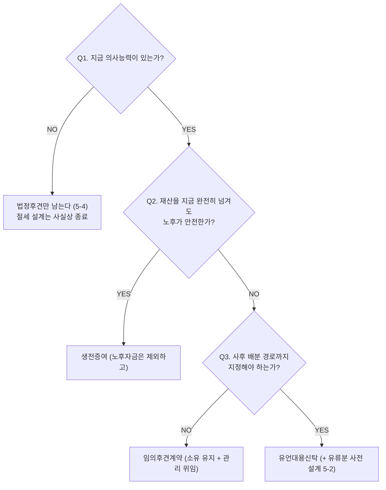

# 유언대용신탁과 치매대비 재산관리

> [!info] 개요
> **이 문서의 역할**: **의사능력을 잃기 전에 재산 관리·승계 경로를 미리 설계하는 수단**의 정본이다.
> 유언의 요식 요건·무효 판정은 [[상속분쟁과-유류분]] 5-7·5-11이, 유류분 계산은 같은 문서 5-13이 소유한다. 여기서는 **신탁·후견이라는 대안 수단**과 그 한계를 다룬다.

## 1. 먼저 결론

**모든 준비는 의사능력이 있을 때만 가능하다.** 판단능력을 잃는 순간 선택지는 법정후견 하나로 줄어들고, 그 제도는 절세를 목적으로 설계되어 있지 않다.

| 수단 | 소유권 | 관리권 | 사후 배분 지정 | 핵심 한계 |
|---|---|---|---|---|
| **생전증여** | 넘어감 | 넘어감 | — | **되돌릴 수 없다**. 노후자금까지 넘기면 본인이 곤란 |
| **임의후견계약** | 유지 | 위임 | ❌ | 사후 배분은 못 정함. 공정증서 필요 |
| **유언대용신탁** | 수탁자 | 수탁자 | ✅ | 신탁보수. **유류분 취급이 미확립** |
| **법정후견**(사후 대응) | 유지 | 법원 선임 후견인 | ❌ | 거주부동산 처분에 **법원 허가**. 절세 증여 사실상 불가 |

**선택 기준**: 재산을 아예 넘겨도 되면 **증여**, 소유는 지키고 관리만 맡기려면 **후견계약**, 사후 분배 경로까지 짜두려면 **신탁**. 조합도 가능하다(노후자금은 보유 · 일부 증여 · 큰 부동산은 신탁).

## 2. 왜 중요한가

⚠️ **치매가 오면 재산이 동결된다.** 본인은 예금 인출·부동산 처분을 할 수 없고, 자녀가 대신 하려 해도 **위임장은 본인의 의사능력이 있을 때 작성되어야 유효**하므로 대리 자체가 불가능해진다. 매달 병원비는 나가는데 부모 명의 통장·연금에 손댈 수 없는 상황이 실제로 벌어진다.

- 이 문제는 **사후 대비(유언)로는 해결되지 않는다.** 유언은 사망 후에만 효력이 있고, 문제는 **살아 있는 동안의 관리 공백**이기 때문이다.
- 1인 가구·자녀 없는 가구에서는 유언·신탁이 없으면 재산이 의도와 무관하게 후순위 상속인이나 국고로 흘러간다.

## 3. 기본 개념 — 세 가지 수단

### 3-1. 생전증여

의사능력이 있을 때 미리 넘긴다.

- **장점**: 10년 증여공제 사이클을 일찍 돌릴 수 있고, 상속인에 대한 증여는 **10년이 지나면 상속재산가액 합산에서 빠진다** → [[증여세-과세체계]]
- ⚠️ **단점**: 되돌릴 수 없다. **노후자금은 반드시 부모 손에 남긴다.**

### 3-2. 임의후견계약

**재산 소유권은 그대로 둔 채 관리권한만** 신뢰할 사람에게 **공정증서로** 미리 위임한다.

- 판단능력을 잃으면 **법원이 감독인을 붙이면서 계약이 비로소 효력을 갖는다.**
- 재산을 넘기지 않으면서 관리 공백을 막는 **균형적 수단**이다.
- 한계: 사후 배분 경로는 정할 수 없다.

### 3-3. 유언대용신탁

재산을 신탁회사(수탁자)에 맡기되 **생존 중에는 본인이 수익**을 누리고, **사후에는 미리 정한 대로 이전**되도록 설계한다.

- ⭐ **핵심 강점**: **치매 진단 이후에도 계약서에 정한 대로 신탁이 멈추지 않고 계속 이행된다**(예: 매달 요양비 지급). 후견 개시를 기다릴 필요가 없다.
- 사후 수익자·배분까지 미리 정해둘 수 있어 **형제간 분쟁을 줄인다.**
- **수익자연속신탁**: 1차 수익자 사후 2차 수익자로 승계되도록 설계할 수 있다(예: 아들 → 손자).
- 단점: 신탁회사 **수수료**.

## 4. 판단 구조

```
Q1. 지금 의사능력이 있는가?
    NO → 법정후견만 남는다 (5-4). 절세 설계는 사실상 종료.
    YES ↓
Q2. 재산을 지금 완전히 넘겨도 노후가 안전한가?
    YES → 생전증여 (노후자금은 제외하고)
    NO  ↓
Q3. 사후 배분 경로까지 지정해야 하는가?
    NO  → 임의후견계약 (소유 유지 + 관리 위임)
    YES → 유언대용신탁 (+ 유류분 사전 설계 5-2)
```

**다이어그램 (위 코드블록과 같은 내용)**

%% ciat-design: 시각화 추가 — 아래 다이어그램은 바로 위 코드블록의 내용만 옮긴 것 (원문 우선) %%



## 5. 상세 설명

### 5-1. 유언대용신탁의 유류분 — ⚠️ 미확립 쟁점

**신탁을 쓰면 유류분을 피할 수 있다는 설명은 위험하다.** 하급심 판단이 갈린다.

| 판결 | 논리 | 결론 |
|---|---|---|
| 성남지원 | **형식** 중시 — 수탁자에게 증여된 것으로 봄 | 유류분 반환 대상 **아님** |
| 마산지원 | **실질** 중시 — 신탁재산을 수익자의 특별수익으로 봄 | 유류분 반환 대상 **임** |

`[원문 확인 필요]` — 사건번호·상급심 확정 여부·최신 판례 동향은 확인되지 않았다. **재판부에 따라 결론이 갈릴 수 있는 미확립 영역으로 취급한다.**

- **유언(공정증서)으로 손자에게 유증해도 아들의 유류분은 막지 못한다.**
- **생전증여도 마찬가지다**: 증여자·수증자 쌍방이 "이렇게 하면 유류분권리자가 침해된다"는 것을 알 수 있는 사정(전 재산 증여, 재산 증가 가능성 없음)이 있으면 **1년 이전 증여라도 반환 대상**이 된다 → [[상속분쟁과-유류분]] 5-8

### 5-2. 실무 대안 — 유류분을 "피하는" 것이 아니라 "침해하지 않게" 설계한다

분쟁을 없애는 확실한 방법은 유류분권자에게 **유류분 이상을 주되 형태를 통제**하는 것이다.

- 아들에게 법정 유류분에 해당하는 **수익권**(원본 인출은 제한, 임대료·이자 등 **수익만** 수취)을 부여하고 나머지를 손자에게 배분.
- **수익권 발생에 조건**(예: 일정 소득 이상 유지)을 걸어 낭비를 방지.
- 아들 사후에는 **수익자연속신탁**으로 손자에게 승계.
- 같은 원리의 다른 표현 → [[상속분쟁과-유류분]] 5-12(기여분 대신 유언으로 더 주기)

### 5-3. 신탁의 방어적 활용 — 자녀 이혼 리스크 차단

⚠️ **특유재산도 재산분할 대상이 될 수 있다.** 혼인 전 소유·혼인 중 상속·증여받은 재산은 원칙적으로 분할 대상이 아니지만, 배우자가 가사노동·소득활동으로 그 재산의 **유지·감소방지에 기여**했다고 인정되면 법원이 분할 대상에 포함시킨다. 혼인기간이 길고 자녀가 있을수록 기여도가 높게 평가되며, **30~50%까지 분할이 인정된 사례**가 있다고 소개된다 `[원문 확인 필요]`.

**설계 구조**: 부모 명의로 주택을 매입해 아들 앞으로 **신탁**하고, 수익자를 부모와 아들 **공동**으로, **위탁자(부모)가 언제든 해지 가능**하도록 규정한다.

- **신탁법상 유효성**: 수탁자가 **유일한** 수익자인 신탁은 무효이나, **공동수익자 중 1인**이면 유효해 아들이 수탁자 겸 수익자로 거주·사용할 수 있다.
- **세금**: 신탁 설정·해지 시 **취득세가 부과되지 않는다**(증여와의 결정적 차이). 아들의 무상사용에 대한 증여세는 발생할 수 있으나 **5년간 무상사용이익 합계 1억 원 미만이면 비과세**이므로, 시가 약 13억 원 이하 주택은 증여세가 발생하지 않는다는 계산 `[현행 기준 확인 필요]`.
- ⚠️ **조항 설계 주의**: "이혼 시 수익권 소멸"이라고 **직접 규정하면 혼인을 강제하는 효과**로 문제될 수 있다. **위탁자가 임의로 해지 가능**하다고만 규정하는 우회 설계가 제시된다.
- ⚠️ `[강사견해]` 이 구조는 며느리·사위의 정당한 기여를 배제하려는 목적으로도 쓰일 수 있다. 실행 전 가족 갈등·신의칙 측면을 별도로 검토한다.

### 5-4. 의사능력 상실 후 — 법정후견의 한계

판단력을 잃은 뒤에는 법원이 후견인을 선임하는 **법정후견**만 남는다.

- **거주부동산 처분에 법원 허가**가 필요해 시간·비용이 크다.
- ⚠️ **이 제도는 본인 재산 보호가 목적이므로 절세 목적의 자녀 증여가 사실상 막힌다.**
- → **준비는 반드시 의사능력이 있을 때 끝내야 한다**는 결론의 근거.

### 5-5. 공유물 분할 방지 수단으로서의 신탁

공동상속받은 빌딩 등은 공유자 한 명의 공유물분할청구소송으로 헐값 처분될 수 있다. 신탁(임의 처분 제한)·가족법인이 방지책이 된다. → 정본 [[상속분쟁과-유류분]] 5-10 · [[가족법인-자산승계]]

## 6. 사례

**A. 아들을 건너뛰고 손자에게** — 유언·생전증여 모두 아들의 유류분을 막지 못하고, 신탁도 유류분 취급이 갈린다. 실효적 해법은 **아들에게 유류분 상당의 수익권을 주고 원본을 손자에게 승계**시키는 조건부 설계(5-2). ([[2024-04-10-아들 대신 손자에게 바로 상속하는 법 I 유류분반환청구소송 없는 유언대용신탁 계약조건 구성하기-소스요약]])

**B. 치매 부모의 요양비** — 생전증여는 노후자금까지 넘어갈 위험, 후견계약은 사후 배분 불가. 요양비 정기지급 + 사후 배분을 한 번에 해결하는 것은 **유언대용신탁**이다(5-3·3-3). ([[2026-08-04-치매 부모님 재산을 완벽하게 관리하는 법 (상속전문변호사)-소스요약]])

## 7. 헷갈리기 쉬운 부분

- **"신탁하면 유류분을 피한다" ❌** — 하급심이 갈리는 미확립 쟁점이다(5-1).
- **유언은 살아 있는 동안의 관리 공백을 해결하지 못한다.** 그 영역은 후견·신탁의 몫이다.
- **임의후견과 법정후견은 다르다.** 전자는 의사능력이 있을 때 미리, 후자는 잃은 뒤에 법원이.
- **신탁 설정·해지에는 취득세가 없다**(증여와 다름). 다만 무상사용 증여세는 별개다(5-3).
- **후견이 개시되면 절세 증여는 사실상 닫힌다.** 후견은 보호 제도이지 승계 설계 제도가 아니다.

## 8. 실무상 체크포인트

1. **의사능력이 있는 지금이 유일한 설계 가능 구간**임을 고객에게 먼저 인식시킨다.
2. **노후자금 규모를 먼저 확정**한 뒤 증여 가능액을 산정한다(순서를 뒤집지 않는다).
3. 신탁 제안 시 **유류분 미확립 쟁점(5-1)을 반드시 고지**한다. "유류분을 피할 수 있다"고 설명하지 않는다.
4. 임의후견계약은 **공정증서**로 작성한다.
5. 신탁 설계 시 **수탁자 ≠ 유일 수익자** 요건을 확인한다(5-3).
6. 세무 연계: 증여세 [[증여세-과세체계]] · 상속세 합산 [[상속세-과세체계와-전략]] · 유언 요식 [[상속분쟁과-유류분]] 5-11

## 9. 핵심 정리

- **치매는 재산을 동결시킨다.** 유언으로는 해결되지 않는 생전 관리 공백이 문제다.
- 세 수단의 축은 **소유권을 넘기는가 · 관리만 넘기는가 · 사후 배분까지 정하는가**다.
- **유언대용신탁의 최대 강점은 치매 이후에도 계약대로 계속 이행된다는 점**이다.
- **신탁은 유류분 만능키가 아니다** — 하급심이 갈린다.
- **의사능력 상실 후에는 법정후견뿐이고, 절세 설계는 닫힌다.**

## 10. 출처

- [[정재완]] 변호사([[상속마스터 정변 유튜브 스터디|상속마스터 정변]] 채널) 소스 4건 [자동자막] — 컬렉션 카탈로그의 「신탁·유언·후견」 클러스터
- ⚠️ 전량 자동자막이며 화자의 구술 설명이다. 판례·세율·한도는 `[원문 확인 필요]` / `[현행 기준 확인 필요]` 표시를 따른다. 특히 5-1의 하급심 대립과 5-3의 증여세 계산은 원문 대조 전 실행 근거로 쓰지 않는다.
- 관련 정본: [[상속분쟁과-유류분]] · [[상속인-자격과-가족관계]] · [[증여세-과세체계]] · [[가족법인-자산승계]]
