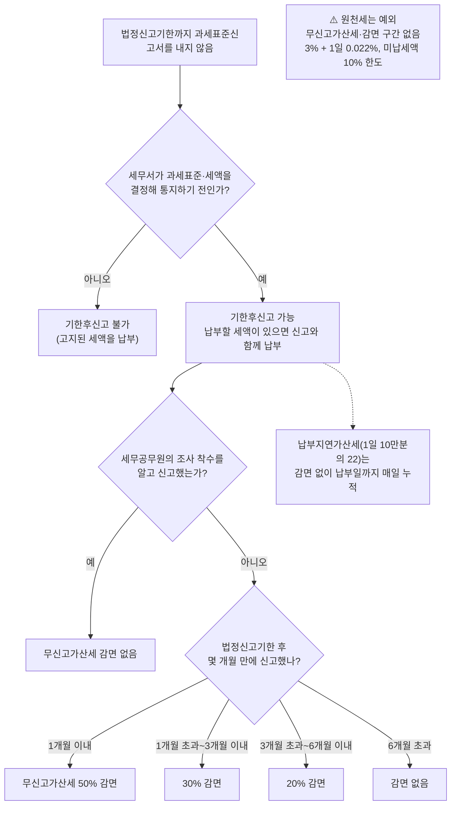

# 기한후신고와 가산세 감면

> [!info] 이 문서의 범위
> 신고기한을 놓친 뒤 **언제·어떻게 늦게라도 신고하느냐**를 다루는 정본이다. 경정청구(과다납부 환급)·수정신고(과소신고 보완)와의 구분은 [[경정청구]], 세목별 가산세표는 각 세목 정본(예: [[부가가치세-과세체계와-신고]] 「무신고와 가산세」)이 소유한다. ([[기한후신고 가산세 감면 언제 하느냐로 달라지는 금액-소스요약]])

## 먼저 결론

> [!summary] 핵심 요약
> - 기한후신고의 시한은 날짜가 아니라 **"관할 세무서가 과세표준과 세액을 결정해 통지하기 전"**이다(국세기본법 §45의3①). 고지서를 받은 뒤에는 기한후신고라는 선택지가 없다.
> - 감면되는 것은 **무신고가산세 하나**다 — 법정신고기한 후 **1개월 내 50% · 3개월 내 30% · 6개월 내 20%**, 6개월 초과는 감면 없음(§48②2호). **납부지연가산세(1일 10만분의 22)는 감면 없이 매일 쌓인다.**
> - 그래서 **"기다려서 유리해지는 것은 없다."** 세무서 연락을 기다리는 동안 감면 구간은 지나가고, 세무서가 먼저 결정하면 기한후신고 자체가 막힌다.
> - ⚠️ **원천세에는 무신고가산세도 감면 구간도 없다** — 대신 원천징수 등 납부지연가산세에 미납세액 10% 한도가 있다.

## 왜 중요한가

- 무신고 상태의 부과제척기간은 **7년**(신고 5년, 부정행위 10년)이라 "연락이 없으니 넘어갔다"고 볼 수 없다.
- 같은 세금이라도 **신고 시점만으로 부담이 두 배 넘게** 벌어진다(아래 사례).
- 기한후신고에는 가산세 외의 비용도 따른다 — 일부 세액감면 배제, 복식부기 서류 요건, 조사관 개별 검토(→ [[부가가치세-과세체계와-신고]] 「가산세 외의 불이익」 `[강사견해]`).

## 기본 구조

| 구분 | 내용 | 근거 |
|---|---|---|
| 신고 가능 시한 | 세무서가 결정해 **통지하기 전**까지(날짜 마감 없음) | 국기법 §45의3① |
| 납부 | 납부할 세액이 있으면 신고와 함께 납부 | 국기법 §45의3② `[원문 확인 필요]` |
| 세무서 결정 | 기한후신고일부터 **3개월 내** 결정·통지(부득이하면 사유 통지) | 국기법 §45의3③ `[원문 확인 필요]` |
| 재신고 | 결정 통지 전이면 다시 기한후신고 가능(2019 국세청 회신), 결정·경정 통지 전 수정신고도 가능 | 필자 인용 |
| 무신고가산세 | 세액의 20%(부정 40%, 역외거래 부정 60%) | 국기법 §47의2 |
| 감면 | 1개월 내 50% / 3개월 내 30% / 6개월 내 20% — **조사 착수를 알고 낸 경우 제외** | 국기법 §48②2호 |
| 납부지연가산세 | 미납세액 × 일수 × 10만분의 22(연 약 8%), 감면 없음 | 국기법 §47의4 |
| 감면 신청 | 관할 세무서장에게 **감면 신청서** 제출(세목·부과연도·가산세 종류·금액 기재) | 필자 인용 `[원문 확인 필요]` |

- **"결정할 것을 미리 알고"** = 해당 세금에 관해 세무공무원이 조사에 착수한 것을 알고 신고서를 낸 경우. 그때는 감면이 없다.
- 감면 구간은 **법정신고기한**부터 센다. 기한이 토·일·공휴일이면 다음 날이 기한이다.
- 고지 이후에도 납부기한까지 내지 않으면 3%가 한 번 더 붙고 월 단위 가산이 이어진다 — 필자는 **2026.7.1 시행 규정**이며 고지서별·세목별 150만원 미만은 월 단위 가산 미적용이라고 설명한다 `[원문 확인 필요]`.

**판단 흐름** — 위 표와 아래 「세목별 차이」의 원천세 예외를 한 장으로 옮겼다.

%% ciat-design: 시각화 추가 — 아래 다이어그램은 이 절 본문의 내용만 옮긴 것 (원문 우선) %%

## 계산 사례 — 시점만 바꿔 본다

개인사업자, 2026년 1기 부가세 납부세액 300만원 무신고(법정신고·납부기한 2026.7.27, 부정행위 아님, 무신고가산세 60만원), 세무서 결정 전 자진 신고·납부. 세금계산서합계표 가산세·지방세 제외. ([[기한후신고 가산세 감면 언제 하느냐로 달라지는 금액-소스요약]])

| 신고·납부일 | 감면 | 무신고가산세 | 납부지연가산세 | 합계 |
|---|---|---|---|---|
| 2026.8.20 (23일) | 50% | 30만 | 1만 5,180 | **31만 5,180** |
| 2026.10.20 (84일) | 30% | 42만 | 5만 5,440 | 47만 5,440 |
| 2027.1.20 (176일) | 20% | 48만 | 11만 6,160 | 59만 6,160 |
| 2027.3.20 (235일) | 없음 | 60만 | 15만 5,100 | **75만 5,100** |

✅ 납부지연가산세는 300만원 × 일수 × 0.00022로 재계산해 일치 확인.

### 2026년 10월 현재 구간 (필자 정리)

| 세목 | 법정신고기한 | 50% | 30% | 20% |
|---|---|---|---|---|
| 2025년 귀속 종합소득세(성실신고확인 대상 제외) | 2026.6.1 (5.31 일요일) | ~7.1 | ~9.1 | ~12.1 |
| 2026년 1기 부가세 확정 | 2026.7.27 (7.25 토요일) | ~8.27 | ~10.27 | ~2027.1.27 |

여러 과세기간을 놓쳤다면 **기간마다 구간을 따로** 본다(부가세는 과세기간별, 종소세는 연도별). 당장 전액 납부가 어려워도 감면 구간은 **신고 시점**으로 정해지므로 신고와 납부 계획을 분리해 검토한다.

## 세목별 차이

| 세목 | 기한후신고에서 확인할 것 |
|---|---|
| **부가가치세** | 매입처별 세금계산서합계표를 기한후신고서와 함께 내면 **매입세액공제가 막히지 않고 합계표 관련 가산세도 없다.** 다만 원래 불공제 대상은 그대로이고, 종이 발급·전송 지연 세금계산서 가산세는 별도. 간이과세자 납부의무 면제자는 무신고가산세 미적용. → [[부가가치세-과세체계와-신고]] |
| **종합소득세** | 복식부기의무자는 재무상태표·손익계산서·합계잔액시산표·조정계산서를 함께 내야 하고, **없으면 신고하지 않은 것으로 본다.** 창업중소기업 세액감면·중소기업특별세액감면 등 **조특법이 기한후신고 시 배제하도록 열거한 감면·공제**는 적용받지 못한다 → 가산세와 별도로 세액 차이를 계산. → [[창업중소기업-세액감면]] · [[중소기업특별세액감면]] |
| **법인세·복식부기의무자** | 세액이 0원이어도 **세액 20%와 수입금액 0.07% 중 큰 금액**이 무신고가산세일 수 있다. |
| **원천세** | 원천징수이행상황신고서는 과세표준신고서가 아니라는 국세청 해석(2001년 회신, 당시 법령)에 따라 **무신고가산세·감면 구간 없음.** 원천징수 등 납부지연가산세 = 3% + 1일 0.022%, 합계 **미납세액 10% 한도**. → [[지급명세서-제출의무와-가산세]] |
| **양도소득세** | 비과세로 판단해 무신고했다가 과세로 밝혀지면 이 문서의 가산세 구조가 그대로 붙는다. → [[양도소득세-1세대1주택-비과세]] 3-6 |
| **증여세** | 증여일 오인으로 정기신고가 기한후신고가 되는 함정 → [[증여세-과세체계]] 9d |

### 예정신고를 놓쳤을 때

예정신고기한을 넘겼어도 **확정신고기한까지 그 예정신고분을 따로 기한후신고**하면 그 기간 무신고가산세가 50% 줄어드는 규정이 있다(경정할 것을 미리 알고 신고한 경우 제외). 국세청은 부동산매매업자가 토지 등 매매차익 예정신고분을 따로 기한후신고하지 않고 **확정신고에 포함한 경우는 감면 대상이 아니라고** 봤다. 부가세 예정신고분에 같은 논리가 적용되는지는 개별 확인이 필요하나, 따로 기한후신고하는 쪽이 조문에 맞다 `[원문 확인 필요]`.

## 헷갈리기 쉬운 부분

> [!warning] 혼동 주의
> - **기한후신고 ≠ 수정신고 ≠ 경정청구.** 처음 신고를 안 했으면 기한후신고, 신고했는데 적게 했으면 수정신고, 많이 냈으면 경정청구. → [[경정청구]]
> - **감면은 무신고가산세만.** 납부지연가산세까지 같은 비율로 줄어드는 것이 아니다.
> - **"세무서 연락을 기다리면 된다"는 틀렸다.** 결정 통지가 오면 기한후신고 자체가 불가능해지고, 그 사이 감면 구간은 지나간다.
> - **세액 0원 = 가산세 0원이 아니다**(복식부기의무자·법인의 수입금액 기준 가산세).

## 실무 체크포인트

1. 놓친 **세목·과세기간·법정신고기한**, 세무서 안내문·고지서 수령 여부를 먼저 정리한다.
2. 지금이 어느 감면 구간인지 확인하고, **구간이 바뀌기 전 날짜를 1차 목표**로 잡는다.
3. 기한후신고서의 가산세가 구간에 맞게 계산됐는지 확인하고 **감면 신청서**를 함께 낸다.
4. 종소세는 복식부기 서류 첨부와 **기한후신고 배제 감면** 여부를, 부가세는 매입처별 합계표 첨부를 확인한다.
5. 원천세는 미납 월별 급여대장으로 납부지연가산세(10% 한도)만 계산한다.
6. 기한후신고 후 3개월 내 세무서 결정 전까지 누락 자료를 다시 점검한다(재신고·수정신고 가능).

## 관련 문서

- [[경정청구]] · [[부가가치세-과세체계와-신고]] · [[종합소득세-과세체계와-신고]] · [[증여세-과세체계]] · [[양도소득세-1세대1주택-비과세]] · [[개인사업자-폐업시-세금정리]]

## 출처

- [[기한후신고 가산세 감면 언제 하느냐로 달라지는 금액-소스요약]] — [[이명환]] 회계사(텍스트 원고, 2026-10-12)

> [!caution] 검증 상태
> `[원문 확인 필요]` 국세기본법 §45의3·§47의2·§47의4·§48②는 필자 인용 문언을 따랐고, 이 문서 작성 시 법제처 직접대조는 하지 못했다(law-kr 연결 실패). 2026.7.1 시행 고지 후 가산 규정, 기한후신고 배제 감면 열거(조특법 §128 등), 원천세 해석은 다음 조문 대조 배치에 넣는다.
