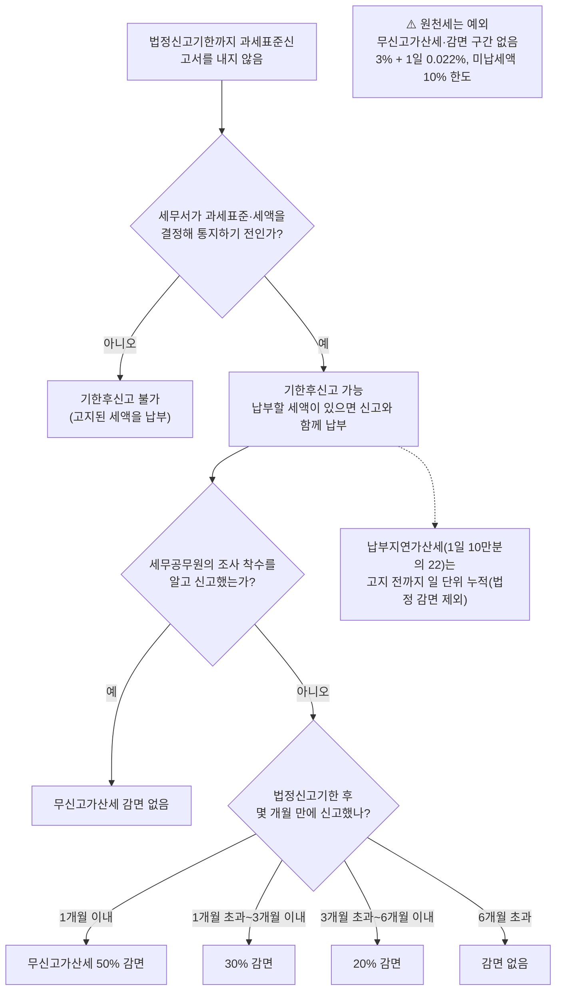

# 기한후신고와 가산세 감면

> [!info] 이 문서의 범위
> 신고기한을 놓친 뒤 **언제·어떻게 늦게라도 신고하느냐**를 다루는 정본이다. 경정청구(과다납부 환급)·수정신고(과소신고 보완)와의 구분은 [[경정청구]], 세목별 가산세표는 각 세목 정본(예: [[부가가치세-과세체계와-신고]] 「무신고와 가산세」)이 소유한다. ([[기한후신고 가산세 감면 언제 하느냐로 달라지는 금액-소스요약]])

## 먼저 결론

> [!summary] 핵심 요약
> - 기한후신고의 시한은 날짜가 아니라 **"관할 세무서가 과세표준과 세액을 결정해 통지하기 전"**이다(국세기본법 §45의3①). 고지서를 받은 뒤에는 기한후신고라는 선택지가 없다.
> - 감면되는 것은 **무신고가산세 하나**다. 법정신고기한 후 **1개월 내 50% · 3개월 내 30% · 6개월 내 20%**, 6개월 초과는 감면 없음(§48②2호). **납부지연가산세(1일 10만분의 22)는 감면 없이 매일 쌓인다.**
> - 그래서 **"기다려서 유리해지는 것은 없다."** 세무서 연락을 기다리는 동안 감면 구간은 지나가고, 세무서가 먼저 결정하면 기한후신고 자체가 막힌다.
> - ⚠️ **원천세에는 무신고가산세도 감면 구간도 없다**. 대신 원천징수 등 납부지연가산세에 미납세액 10% 한도가 있다.

## 왜 중요한가

- 무신고 상태의 부과제척기간은 **7년**(신고 5년, 부정행위 10년)이라 "연락이 없으니 넘어갔다"고 볼 수 없다.
- 같은 세금이라도 **신고 시점만으로 부담이 두 배 넘게** 벌어진다(아래 사례).
- 기한후신고에는 가산세 외의 비용도 따른다. 일부 세액감면 배제, 복식부기 서류 요건, 조사관 개별 검토(→ [[부가가치세-과세체계와-신고]] 「가산세 외의 불이익」 `[강사견해]`).

## 기본 구조

| 구분 | 내용 | 근거 |
|---|---|---|
| 신고 가능 시한 | 세무서가 결정해 **통지하기 전**까지(날짜 마감 없음) | 국기법 §45의3① |
| 납부 | 납부할 세액이 있으면 신고와 함께 납부 | 국기법 §45의3② ✅ (2026-10-25 대조) |
| 세무서 결정 | 기한후신고일부터 **3개월 내** 결정·통지(부득이하면 사유 통지) | 국기법 §45의3③ ✅ (2026-10-25 대조) |
| 재신고 | 결정 통지 전이면 다시 기한후신고 가능(2019 국세청 회신), 결정·경정 통지 전 수정신고도 가능 | 필자 인용 |
| 무신고가산세 | 세액의 20%(부정 40%, 역외거래 부정 60%) | 국기법 §47의2 |
| 감면 | 1개월 내 50% / 3개월 내 30% / 6개월 내 20%: **조사 착수를 알고 낸 경우 제외** | 국기법 §48②2호 |
| 납부지연가산세 | 미납세액 × 일수 × 10만분의 22(연 약 8%), 기한후신고 정률 감면 없음(정당한 사유 부과 제외 및 과세전적부심사 지연 50% 감면은 별도) | 국기법 §47의4·§48 |
| 감면 신청 | 관할 세무서장에게 **감면 신청서** 제출(세목·부과연도·가산세 종류·금액 기재) | 필자 인용 `[원문 확인 필요]` |

- **"결정할 것을 미리 알고"** = 해당 세금에 관해 세무공무원이 조사에 착수한 것을 알고 신고서를 낸 경우. 그때는 감면이 없다.
- 감면 구간은 **법정신고기한**부터 센다. 기한이 토·일·공휴일이면 다음 날이 기한이다.
- 현행 국세기본법 §47의4①1의 납부지연가산세 일수는 **납부기한의 다음 날부터 납부고지일(그 전에 납부하면 납부일)의 전날까지**로 센다. 납부일을 포함하지 않는다(국기법 §47의4, 2026-10-31 재대조). 예: 납부기한 6월 1일, 실제 납부 8월 10일이면 6월 2일~8월 9일로 **69일**이다. 현행법의 납부일 전날 기준을 적용한다. ([[건설업 기장신고 vs 기준경비율 추계신고 - 검증학습노트-소스요약]]) 고지 후에는 지정납부기한 미납 시 3% 및 월 0.67%(최대 5년, 150만원 미만 제외) 구조로 전환된다.
- 기한 안에 신고했지만 세액을 적게 신고한 경우는 무신고가 아니라 **과소신고**(일반 10%)와 납부지연가산세 문제이며, 정확히 신고하고 세액만 적게 납부한 경우는 **납부지연가산세**만 적용된다.
- 고지서의 지정납부기한까지 납부하지 않으면 법정 3%와 지정기한 다음 날부터 납부일 전날까지 경과한 개월 수에 따른 월 **1만분의 67** 가산 등을 구분한다. 고지서별·세목별 체납세액 150만원 미만은 월 가산 등의 적용 제외 대상이다(국세기본법 §47의4①·⑧, 시행령 §27의4②, 현행 적용 시 경과규정도 확인).

**판단 흐름**: 위 표와 아래 「세목별 차이」의 원천세 예외를 한 장으로 옮겼다.

%% ciat-design: 시각화 추가 — 아래 다이어그램은 이 절 본문의 내용만 옮긴 것 (원문 우선) %%

## 계산 사례: 시점만 바꿔 본다

개인사업자, 2026년 1기 부가세 납부세액 300만원 무신고(법정신고·납부기한 2026.7.27, 부정행위 아님, 무신고가산세 60만원), 세무서 결정 전 자진 신고·납부. 세금계산서합계표 가산세·지방세 제외. ([[기한후신고 가산세 감면 언제 하느냐로 달라지는 금액-소스요약]])

| 신고·납부일 | 감면 | 무신고가산세 | 납부지연가산세 | 합계 |
|---|---|---|---|---|
| 2026.8.20 (23일) | 50% | 30만 | 1만 5,180 | **31만 5,180** |
| 2026.10.20 (84일) | 30% | 42만 | 5만 5,440 | 47만 5,440 |
| 2027.1.20 (176일) | 20% | 48만 | 11만 6,160 | 59만 6,160 |
| 2027.3.20 (235일) | 없음 | 60만 | 15만 5,100 | **75만 5,100** |

✅ 납부지연가산세는 300만원 × 일수 × 0.00022로 재계산해 일치함을 확인했다.

### 2026년 10월 현재 구간 (필자 정리)

| 세목 | 법정신고기한 | 50% | 30% | 20% |
|---|---|---|---|---|
| 2025년 귀속 종합소득세(성실신고확인 대상 제외) | 2026.6.1 (5.31 일요일) | ~7.1 | ~9.1 | ~12.1 |
| 2026년 1기 부가세 확정 | 2026.7.27 (7.25 토요일) | ~8.27 | ~10.27 | ~2027.1.27 |

여러 과세기간을 놓쳤다면 **기간마다 구간을 따로** 본다(부가세는 과세기간별, 종소세는 연도별). 당장 전액 납부가 어려워도 감면 구간은 **신고 시점**으로 정해지므로 신고와 납부 계획을 분리해 검토한다.

## 세목별 차이

| 세목 | 기한후신고에서 확인할 것 |
|---|---|
| **부가가치세** | 매입처별 세금계산서합계표를 기한후신고서와 함께 내면 **매입세액공제가 막히지 않고 합계표 관련 가산세도 없다.** 다만 원래 불공제 대상은 그대로이고, 종이 발급·전송 지연 세금계산서 가산세는 별도. 간이과세자 납부의무 면제자는 무신고가산세 미적용. → [[부가가치세-과세체계와-신고]] |
| **종합소득세** | 복식부기의무자는 재무상태표·손익계산서·합계잔액시산표·조정계산서를 함께 내야 하고, **없으면 신고하지 않은 것으로 본다.** 창업중소기업 세액감면·중소기업특별세액감면 등 **조특법이 기한후신고 시 배제하도록 열거한 감면·공제**는 적용받지 못한다 → 가산세와 별도로 세액 차이를 계산. → [[창업중소기업-세액감면]] · [[중소기업특별세액감면]] |
| **법인세·복식부기의무자** | 세액이 0원이어도 **세액 20%와 수입금액 0.07% 중 큰 금액**이 무신고가산세일 수 있다. |
| **원천세** | 원천징수이행상황신고서는 과세표준신고서가 아니라는 국세청 해석(2001년 회신, 당시 법령)에 따라 **무신고가산세·감면 구간 없음.** 원천징수 등 납부지연가산세 = 3% + 1일 0.022%, 합계 **미납세액 10% 한도**. → [[지급명세서-제출의무와-가산세]] |
| **양도소득세** | 비과세로 판단해 무신고했다가 과세로 밝혀지면 이 문서의 가산세 구조가 그대로 붙는다. → [[양도소득세-1세대1주택-비과세]] 3-6 |
| **증여세** | 증여일 오인으로 정기신고가 기한후신고가 되는 함정 → [[증여세-과세체계]] 9d |

### 예정신고를 놓쳤을 때

예정신고기한을 넘겼어도 **확정신고기한까지 그 예정신고분을 따로 기한후신고**하면 그 기간 무신고가산세가 50% 줄어드는 규정이 있다(경정할 것을 미리 알고 신고한 경우 제외). 국세청은 부동산매매업자가 토지 등 매매차익 예정신고분을 따로 기한후신고하지 않고 **확정신고에 포함한 경우는 감면 대상이 아니라고** 봤다. 부가세 예정신고분에 같은 논리가 적용되는지는 개별 확인이 필요하나, 따로 기한후신고하는 쪽이 조문에 맞다 ✅ 국세기본법 §48②3호라목(예정신고 미이행 후 확정신고기한까지 기한후신고 시 50%)은 2026-10-25 대조. 부동산매매업자 국세청 해석은 `[원문 확인 필요]`.

## 헷갈리기 쉬운 부분

> [!warning] 혼동 주의
> - **기한후신고 ≠ 수정신고 ≠ 경정청구.** 처음 신고를 안 했으면 기한후신고, 신고했는데 적게 했으면 수정신고, 많이 냈으면 경정청구. → [[경정청구]]
> - **감면은 무신고가산세만.** 납부지연가산세까지 같은 비율로 줄어드는 것이 아니다.
> - **"세무서 연락을 기다리면 된다"는 틀렸다.** 결정 통지가 오면 기한후신고 자체가 불가능해지고, 그 사이 감면 구간은 지나간다.
> - **세액 0원 = 가산세 0원이 아니다**(복식부기의무자·법인의 수입금액 기준 가산세).

## 실무 체크포인트

1. 놓친 **세목·과세기간·법정신고기한**, 세무서 안내문·고지서 수령 여부를 먼저 정리한다.
2. 지금이 어느 감면 구간인지 확인하고, **구간이 바뀌기 전 날짜를 1차 목표**로 잡는다.
3. 기한후신고서의 가산세가 구간에 맞게 계산됐는지 확인하고 **감면 신청서**를 함께 낸다.
4. 종소세는 복식부기 서류 첨부와 **기한후신고 배제 감면** 여부를, 부가세는 매입처별 합계표 첨부를 확인한다.
5. 원천세는 미납 월별 급여대장으로 납부지연가산세(10% 한도)만 계산한다.
6. 기한후신고 후 3개월 내 세무서 결정 전까지 누락 자료를 다시 점검한다(재신고·수정신고 가능).

## 관련 문서

- [[경정청구]] · [[부가가치세-과세체계와-신고]] · [[종합소득세-과세체계와-신고]] · [[증여세-과세체계]] · [[양도소득세-1세대1주택-비과세]] · [[개인사업자-폐업시-세금정리]]

## 삼일 Tax Agent 교차검증 (2026-10-26)

> [!caution] 검증 상태
> [[삼일 Tax Agent]]에 이 문서의 서술이나 관련 쟁점을 물어 받은 판정이다. LLM 답이므로 근거 번호는 법제처 목록에서 실재 여부만 확인했고 결론은 원문과 대조하지 않았다 `[원문 확인 필요]`. 판정이 「일부 수정·틀림」인 항목은 본문 오류 후보이며, 원문으로 확인한 뒤에 본문을 고친다. 원문을 확인해 이미 고친 항목은 본문에 ✅로 표시했다.

**A19** [[2026-10-26-A19-기한후신고-가산세-소스요약]] (번호 13/14 실재, 못 찾음 1)

| 질문한 서술 | 삼일 판정 | 삼일 답 요지 |
| --- | --- | --- |
| 기한후신고 감면율·신청 | 맞음—조건 보완 | 1개월 이내 50%, 1개월 초과 3개월 이내 30%, 3개월 초과 6개월 이내 20%. 감면 신청의 직접 근거는 제48조 제3항, 서식은 시행규칙 별지 제17호입니다. |
| 2026.7.1. 개정 | 맞음—내용 보완 | 지정납부기한 후 3%와 월 단위 가산을 구분합니다. 150만원 미만이면 월 단위 가산뿐 아니라 독촉비용도 적용하지 않지만, 3%까지 제외하지는 않습니다. |
| 예정신고분 50% 감면 | 맞음—별도 기한후신고 필요 | 확정신고기한까지 그 예정신고분을 기한후신고해야 합니다. 종합소득세 확정신고에 소득을 포함한 것만으로는 부족하다는 국세청 해석이 확인됩니다. |
| 일 10만분의 22 | 일부 수정 | 고지 전 일 단위 이자율은 맞습니다. 지정납부기한 후 월 단위 이자율은 월 1만분의 67입니다. |
| 추가 매매대금 수정신고 | 일부 수정 | 해당 회신의 유리한 결론은 확인됩니다. 다만 직접 확인된 대상은 비상장주식이며, 당초 대금 미확정·기한 내 신고납부·조건성취 후 즉시 수정신고납부 등의 요건이 있습니다. |
| 제45조의3·제47조의2·제47조의4 | 현행 문언 요지 확인 | 아래에 신고 가능 시점, 무신고가산세율, 납부지연가산세 구조를 구분하였습니다. |

**D03** [[2026-10-26-D03-2026.7.1-시행-국세기본법-국세징수법-개정-소스요약]] (번호 인용 번호 없음)

| 질문한 서술 | 삼일 판정 | 삼일 답 요지 |
| --- | --- | --- |
| 고지 전 지연분 | 법정납부기한 다음 날부터 납부고지일 또는 고지 전 납부일의 전날까지, 일 0.022% | 국세기본법 제47조의4 제1항 제1호·제2호, 제47조의5 제1항 제2호 및 시행령 제27조의4 제1항 |
| 지정납부기한 경과 후 | 지정납부기한 다음 날부터 납부일 전날까지 경과한 개월 수 × 월 0.67% | 같은 법 제47조의4 제1항 제1호의2·제2호의2, 제47조의5 제1항 제3호 및 시행령 제27조의4 제2항 |
| 일반 납세자의 정률 가산 | 지정납부기한까지 미납한 세액 등에 대한 3% 가산 유지 | 같은 법 제47조의4 제1항 제3호 |
| 독촉비용 | 등기우편 요금·수수료를 가산세에 포함 | 같은 법 제47조의4·제47조의5 각 제1항 제4호, 시행령 제27조의4 제3항 |
| 소액 체납 예외 | 납부고지서별·세목별 체납세액이 150만원 미만이면 월 단위 가산과 독촉비용 제외 | 같은 법 제47조의4 제8항, 제47조의5 제5항 |

## 삼일 Tax Agent 교차검증 (2026-10-27~29)

> [!caution] 검증 상태
> [[삼일 Tax Agent]]에 이 문서의 절이나 서술을 다시 물어 받은 판정이다(2026-10-27~29 배치). LLM 답이고 인용 번호의 실재 여부도 아직 확인하지 않았다 `[원문 확인 필요]`. 「일부 수정·틀림」 항목은 본문 오류 후보이며, 원문으로 확인한 뒤에 본문을 고친다. 아래 표는 「맞음」이 아닌 항목만 옮겼다.

**V025** [[2026-10-27-V025-국세기본-기한후신고와-가산세-감면-시한-감면율-세목별-차이-세무조사-대응-소스요약]] (번호 확인 미실시(인용 번호 17개); 맞음 1 · 일부 수정 6 · 확인 불가 3)

| 질문한 서술 | 삼일 판정 | 삼일 답 요지 |
| --- | --- | --- |
| 1. 가산세 감면 신청 | 맞음 — 보완 필요 | 필자 인용 대신 시행령·시행규칙을 직접 인용. 법률상 ‘신청할 수 있다’는 문언도 함께 표시 |
| 2. 고지 후 3%·월 단위 가산 | 일부 수정 | 지정납부기한, 월 가산율, 적용기간 상한, 소액 예외를 정확히 표시. 시행일·경과조치는 미확인 |
| 3. 유명인 추징 보도 | 일부 수정 | 편집 원칙으로 유지하되 누락 문구 보완. 특정 사건의 확정 여부는 미확인 |
| 4. 병의원 평균 소득률 | 확인 불가 | 수치 출처가 확보되기 전 삭제 또는 강의 예시로 한정 |
| 5. 인건비 60∼70% | 일부 수정 | 비율에 따른 일률적 과다 판단은 근거 미확인. 실제 근로·지급 여부와 구분 |
| 6. 추징세액 연동 성과금 도입 | 확인 불가 | 도입 확정으로 기재하지 않음 |
| 7. 법령보충적 행정규칙·지정 판결 | 일부 수정 | 확인된 판결별 유효·무효 판단 구분. 두 판결 및 훈령 명칭 관계는 미확인 |
| 8. LLM·강사 발언의 근거 구분 | 일부 수정 | 법적 명제가 아니라 위키 편집 원칙으로 명시. 누락된 분류 보완 |
| 9. 홍콩 신탁 사례 | 확인 불가 | 특정 사례 및 제도 신설의 직접 계기로 단정하지 않음 |
| 10. 외국인 거주자 과태료 사례 | 일부 수정 | 사건 자체는 미확인. 신고의무 면제 여부를 먼저 검토하도록 수정 |

**V047** [[2026-10-27-V047-국세기본-경정청구-기한후신고와-가산세-감면-시한-감면율-세목별-차이-세무-소스요약]] (번호 확인 미실시(인용 번호 19개); 일부 수정 5 · 확인 불가 1)

| 질문한 서술 | 삼일 판정 | 삼일 답 요지 |
| --- | --- | --- |
| 3. 「기한후신고와 가산세 감면 — 시한·감면율·세목별 차이 › 왜 중요한가」 기한후신고에는 가산세 외의 비용도 따른다. 일부 세액감면 배제, 복식부기 서류 요… | 일부 수정 | 일부 감면 배제와 복식부기 서류 요건은 근거가 있습니다. “조사관 개별 검토”는 세무서장의 결정·통지 절차로 고쳐야 합니다.(조세특례제한법 제128조, 소득세법 제70조, 국세기본법 제45조의 3) |

**W43** [[2026-10-28-W43-기한후신고와-가산세-감면-무신고-과소신고-납부지연-감면-소스요약]] (번호 확인 미실시(인용 번호 1개); 맞음 1 · 일부 수정 5 · 틀림 3)

| 질문한 서술 | 삼일 판정 | 삼일 답 요지 |
| --- | --- | --- |
| “납부일까지…납부일 포함…70일” | 틀림 | 확인된 개정 조문은 납부일 전날까지이다. 따라서 개정 규정 적용분이라면 예시는 69일이다. 종전 규정 적용 여부를 구분한다. |
| “감면 없음”, 도식 “감면 없이 매일 누적” | 틀림 | 기한후신고에 따른 정률 감면은 없지만, 정당한 사유 등에 따른 부과 제외와 과세전적부심사 통지 지연기간의 50% 감면은 별도다. 고지 후까지 일 단위 누적하는 것도 부정확하다. |
| “고지 후 3%와 월 단위 가산…150만원 미만 제외” | 일부 수정 | 지정납부기한 미납 시 3%, 이후 월 0.67%, 기간 상한 5년. 150만원 미만은 월 가산뿐 아니라 독촉비용도 제외된다. |
| 원천세 “3%＋일 0.022%, 합계 10% 한도” 및 도식 | 일부 수정 | 개정 조문상 3%＋고지 전 일 가산만 10% 한도이고, 고지 후 월 가산·독촉비용을 포함한 전체 한도는 **50%**다. |
| “기한 안에 신고했지만 세액을 적게 낸 경우…과소신고” | 틀림 | 적게 신고했으면 과소신고, 정확히 신고하고 적게 납부만 했으면 납부지연 문제다. |
| 과소신고 감면 설명 누락 | 일부 수정 | 기한 내 신고자의 자진 수정신고는 경정 사전인지 제외하에, 경과기간 1·3·6개월·1년·1년6개월·2년 이내별 90·75·50·30·20·10% 감면을 구분한다. |
| 부가세 “합계표 함께 내면 공제·가산세 없음” | 일부 수정 | 적법하게 발급받은 세금계산서의 합계표를 함께 제출하여 세무서장이 결정하는 경우 공제 가능하며, 해당 합계표 미제출 가산세는 제외된다. 다른 불공제·가산세는 별도다. |
| 법인·복식 “20%와 수입금액 0.07% 중 큰 금액” | 일부 수정 | 일반 무신고 기준임을 명시한다. 부정 무신고는 세액 40%(역외 부정 60%)와 수입금액 0.14% 중 큰 금액이다. 부가세 영세율 무신고분은 과세표준 0.5% 추가도 검토한다. |

- 그 밖의 1개 항목은 「맞음」 판정이다.

**W82** [[2026-10-29-W82-절-검수-기한후신고와-가산세-감면-(표지-1곳)-소스요약]] (번호 확인 미실시(인용 번호 2개); 일부 수정 3 · 확인 불가 1)

| 질문한 서술 | 삼일 판정 | 삼일 답 요지 |
| --- | --- | --- |
| “예정신고기한을 넘겼어도 확정신고기한까지 그 예정신고분을 따로 기한후신고하면…무신고가산세가 50% 줄어드는 규정이 있다(경정할 것을 미리 알고 신고한 경우 제외… | 일부 수정 | 해당 예정신고분을 확정신고기한까지 기한후신고하면 제47조의2의 무신고가산세를 50% 감면한다. 경정을 미리 알고 신고한 경우는 제외되며, 기한후신고 자체는 세무서장의 결정·통지 전에 해야 한다. 납부지연가산세까지 감면하는 규정은 아니다. |
| “국세청은…따로 기한후신고하지 않고 확정신고에 포함한 경우는 감면 대상이 아니라고 봤다.” 및 “부동산매매업자 국세청 해석은 [원문 확인 필요].” | 일부 수정 | 국세청은 감면을 부인하였다. 그러나 조세심판원은 구법이 적용된 2020년 귀속 사건에서 별도 기한후신고 없이 확정신고한 경우에도 50% 감면을 인정하였다. |
| “부가세 예정신고분에 같은 논리가 적용되는지는 개별 확인이 필요하나, 따로 기한후신고하는 쪽이 조문에 맞다.” | 일부 수정 | 현행 조문상 예정신고 미이행분의 감면은 별도 기한후신고를 전제로 판단한다. 다만 위 국세청 회신과 심판결정은 소득세 사건이므로 부가가치세의 직접 판단 근거로 단정하지 않는다. |
| “국세기본법 §48②3호라목…은 2026-10-25 대조.” | 확인 불가 | “2025.12.23. 개정 문언에서 기한후신고 요건을 확인함. 시행일·적용례는 부칙 추가 확인 필요.”로 교체한다. |

## 삼일 Tax Agent 보강 자료 (2026-10-27~29)

> [!note] 참고
> 이 주제와 관련해 [[삼일 Tax Agent]]에 물어 받은 정리·사례·동향 답이다(2026-10-27~29 배치). 본문에는 반영하지 않았고, 원문을 대조한 뒤 필요한 내용만 옮긴다 `[원문 확인 필요]`.

- [[2026-10-27-N12-부과제척기간과-징수권-소멸시효-소스요약]]: N12 부과제척기간과 징수권 소멸시효
- [[2026-10-27-N14-체납과-징수유예-소스요약]]: N14 체납과 징수유예
- [[2026-10-27-N16-가산세-체계-소스요약]]: N16 가산세 체계
- [[2026-10-27-P25-양도세-미신고-1년-경과-소스요약]]: P25 양도세 미신고 1년 경과
- [[2026-10-27-T08-국세기본법(가산세-경정청구-불복)-최신-동향(2026.4~10)-소스요약]]: T08 국세기본법(가산세·경정청구·불복) 최신 동향(2026.4~10)
- [[2026-10-27-T17-국세기본법(가산세-경정청구-불복)-동향(2025.10~2026.3)-소스요약]]: T17 국세기본법(가산세·경정청구·불복) 동향(2025.10~2026.3)
- [[2026-10-28-N80-체납-압류해제-매각유예-정리보류-소스요약]]: N80 체납 압류해제·매각유예·정리보류

## 출처

- [[기한후신고 가산세 감면 언제 하느냐로 달라지는 금액-소스요약]]: [[이명환]] 회계사(텍스트 원고, 2026-10-12)

> [!caution] 검증 상태
> `[원문 확인 필요]` 국세기본법 §45의3·§47의2·§47의4·§48②는 필자 인용 문언을 따랐고, 이 문서 작성 시 법제처 직접대조는 하지 못했다(law-kr 연결 실패). 2026.7.1 시행 고지 후 가산 규정, 기한후신고 배제 감면 열거(조특법 §128 등), 원천세 해석은 다음 조문 대조 배치에 넣는다.

## 2026-10-31 정정 근거

이번 정정 항목: ETC-004, ITX-010. 본문에 기재한 조문·확인 범위에 한하며, 문서 전체의 모든 사례·해석례를 대조 완료했다는 뜻은 아니다.

[국세기본법](https://www.law.go.kr/법령/국세기본법) · [국세기본법시행령](https://www.law.go.kr/법령/국세기본법시행령) · [소득세법](https://www.law.go.kr/법령/소득세법) · [소득세법시행령](https://www.law.go.kr/법령/소득세법시행령)
