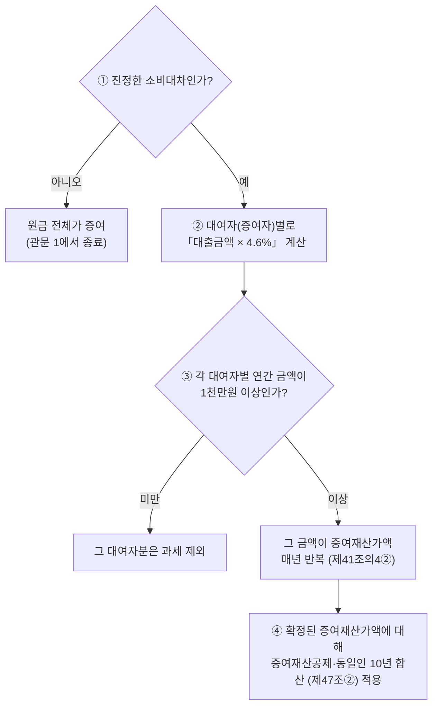

# 금전 무상대출 등에 따른 이익의 증여

> [!info] 개요
> 이 문서는 부모가 성년 자녀에게 이자 없이(또는 낮은 이자로) 돈을 빌려줄 때 증여세가 나오는지를 다루는 정본 노드다.
> 인용한 법령은 korean-law MCP의 `verify_citations`로 실제로 존재하는지와 제목이 일치하는지를 검증했다(2026-08-09).
> 증여재산공제·10년 합산·동일인 합산은 [[증여세-과세체계]]에서, 채무를 함께 넘기는 증여는 [[부담부증여]]에서 확인한다.

---

## 1. 먼저 결론

가족 간 무이자 대여에는 **서로 독립된 관문 두 개**가 있다. "이자가 1천만원 이하면 비과세"라는 흔한 이해는 **틀렸다.**

1. **관문 1: 원금을 실제로 빌려준 것인가(증여추정 극복).** 형식만 차용이고 실질이 증여라면 **원금 전체가 증여**로 과세된다. 이것이 가장 큰 위험이며, 이자 문제보다 훨씬 크다. (상증세법 제45조 재산 취득자금 등의 증여 추정)
2. **관문 2: 무상대출로 얻은 이익의 증여.** 실제로 빌려준 돈이라도 `대출금액 × 적정이자율(4.6%)`이 **연 1천만원 이상**이면 그 이자 상당액이 증여재산가액이 된다(상증세법 제41조의4).

가장 흔한 오해를 바로잡으면, **1천만원 기준은 "이자"가 아니라 "증여이익(적정이자 상당액 − 실제로 지급한 이자)"**에 적용되며, **증여자(대여자)별로, 그리고 대출받은 날별로** 판단한다.

---

## 2. 법적 근거 (검증 완료)

| 근거                      | 내용                                                                                             |
| ----------------------- | ---------------------------------------------------------------------------------------------- |
| **상증세법 제41조의4 제1항**     | 무상으로 대출받으면 `대출금액 × 적정이자율`을 대출받은 자의 증여재산가액으로 한다. **다만 그 금액이 기준금액 미만이면 제외한다.** 낮은 이자로 대출받았다면 `적정이자 − 실제로 지급한 이자`로 계산한다. |
| **상증세법 제41조의4 제2항**     | 대출기간을 정하지 않으면 1년으로 보고, **대출기간이 1년 이상이면 1년이 되는 날의 다음 날에 매년 새로 대출받은 것으로 보아** 해마다 계산한다.                    |
| **상증세법 시행령 제31조의4 제2항** | 기준금액은 **1천만원**이다.                                                                               |
| **상증세법 시행령 제31조의4 제3항** | 이익은 **"금전을 대출받은 날"**(여러 차례 대출받았다면 각각 대출받은 날)을 기준으로 계산한다.                                               |
| **적정이자율 = 연 4.6%**      | 시행령 제31조의4 제1항이 법인세법 시행규칙 제43조 제2항의 "당좌대출이자율 연 1,000분의 46"을 적용하도록 한다. *(법인에서 대출받은 경우에는 가중평균차입이자율 등 별도 기준을 쓴다.)*  |
| **상증세법 제45조**           | 자금출처와 채무상환에 관한 증여추정 규정이다(관문 1).                                                                         |
| **상증세법 제47조 제2항**       | 10년 안에 **동일인(직계존속의 배우자 포함)**에게서 받은 증여재산가액을 합산한다. 따라서 부와 모가 각각 준 금액은 합산과세 대상이다.                                         |
| **국세기본법 제14조**          | 실질과세 원칙으로, 인위적으로 나눈 거래를 하나로 재구성하는 근거가 된다.                                                                          |

> [!note] 참고
> **적정이자율이 바뀌어 왔다는 점에 주의한다.** 당좌대출이자율은 과거 8.5%였다가 **2016.3.(시행규칙 개정) 이후 4.6%**가 되었다. 대여를 시작한 시점이 그보다 앞서면 당시 이자율과 부칙을 확인해야 한다. `[거래 시점 확인 필요]`

---

## 3. 판단 구조

```
① 진정한 소비대차인가?  ──── 아니오 ──▶ 원금 전체가 증여 (관문 1에서 종료)
        │ 예
        ▼
② 대여자(증여자)별로 「대출금액 × 4.6%」 계산
        │
        ▼
③ 각 대여자별 연간 금액이 1천만원 이상인가?
        │ 미만 → 그 대여자분은 과세 제외
        │ 이상 → 그 금액이 증여재산가액 → 매년 반복(제41조의4②)
        ▼
④ 확정된 증여재산가액에 대해 증여재산공제·동일인 10년 합산(제47조②) 적용
```

**다이어그램 (위 코드블록과 같은 내용)**

%% ciat-design: 시각화 추가 — 아래 다이어그램은 바로 위 코드블록의 내용만 옮긴 것 (원문 우선) %%



**증여자별로 판단하는 근거:** 제41조의4 제1항은 "**그 금전을 대출받은 자의** 증여재산가액"이라고 규정하고, 시행령 제31조의4 제3항은 "**대출받은 날**"을 기준으로 삼는다. 따라서 증여재산가액과 1천만원 관문은 **타인(대여자)별로, 대출 건별로** 산정된다. 제47조 제2항의 동일인(부모) 합산은 **이미 증여재산가액으로 확정된 금액을 나중에 합산**하는 규정이며, 1천만원 관문을 통과했는지 판단하는 단계에 적용되는 규정이 아니다.

---

## 4. 사례: 부모 4억 무이자 대여 (부 2억·모 2억, 5년, 0%)

**사실관계:** 부모가 성년 자녀에게 4억(모 2억·부 2억)을 이자율 0%로 5년 동안 빌려주었다. 원금은 실제로 송금했고 차용증도 있으며, 자녀는 매월 **원금만** 갚고 있다.

**적용:**

| 대여자 | 대출금액 | ×4.6% | 1천만원 기준 |
|---|---|---|---|
| 부(父) | 2억 | **920만원** | 미만이므로 **제외** |
| 모(母) | 2억 | **920만원** | 미만이므로 **제외** |
| (합산한다고 가정) | 4억 | 1,840만원 | 이상이므로 과세 |

- 부와 모가 **각자 자기 고유재산에서 2억씩** 빌려준 것이라면 두 대차는 별개다. 각각 920만원으로 1천만원에 미달하므로 **무상대출 이익에 대한 증여세는 없다.**
- 자녀가 매월 **원금을 갚으면 잔액이 줄어들기** 때문에 2년차부터는 연간 이익이 920만원보다 더 작아지고, 기준에 더 크게 미달한다.
- **결론:** "문제없다"는 납세자의 결론은 방향은 맞을 수 있지만, 그 근거로 든 "이자 1천만원 이하 비과세"는 틀렸다. 실제 이유는 **증여자별 연간 증여이익이 기준금액에 미달**하기 때문이다. **남는 리스크는 이자가 아니라 원금 4억에 대한 증여추정이다.**

### 과세관청 반대논리
1. **원금 자체를 증여로 본다**: 이자가 0%이고 만기가 불명확하며 자녀의 상환능력이 부족하다는 점을 들어 "형식만 차용이고 실질은 4억 증여"라고 보아 원금에 과세한다(과세표준 4억 − 5천만원 공제 = 3.5억). ← **가장 큰 위험이다.**
2. **실질과세로 합산한다(국기법 제14조)**: 부와 모가 나눠 빌려준 것을 조세회피 목적의 인위적 분할로 보아 4억 하나로 재구성하고, 1,840만원에 과세한다(특히 자금이 실제로는 한쪽에서 나왔을 때).
3. **상환을 부인한다**: 원금을 갚았다는 사실이 객관적인 증빙(계좌이체 등)으로 입증되지 않으면 상환을 인정하지 않고, 그만큼의 이자상당액을 증여재산가액에 가산한다.

### 납세자 반대논리
1. **실제로 빌려준 돈이다**: 실제 송금, 차용증, **매월 계좌이체로 갚은 실적**이 있으면 증여추정을 뒤집을 수 있다.
2. **증여자별로 판단해야 한다는 문언 해석**: 제41조의4①과 시행령 제31조의4③이 "대출받은 자·대출받은 날"을 기준으로 삼으므로, 부와 모 각각 920만원 < 1천만원이 되어 법문상 각각 제외된다.
3. **잔액이 줄어든다**: 원금을 갚아 나가므로 해마다 이익이 줄어든다.

---

## 4b. 생활비·교육비 명목이면 무조건 비과세인가 (2026-08-24 보강)

상속세및증여세법§46-5호는 **사회통념상 인정되는 피부양자의 생활비·교육비**를 비과세로 규정한다. 다만 이 예외를 적용하려면 다음 두 요건을 **함께** 따져야 한다.

1. **실제로 생활비·교육비로 지출됐는지**
2. **받는 사람에게 이미 스스로 충분한 소득이 있는지**

⚠️ **"용돈"이라는 명목이 붙었더라도 그 돈으로 자산을 취득하면 증여로 과세된다.** 생활비 명목으로 받은 돈을 저축하거나 부동산·주식을 사는 데 쓰면 더 이상 "생활비"가 아니라는 것이 과세관청의 논리다. 이 원칙은 위 4장의 대여금 사례와는 별개로, **처음부터 빌려준 돈이 아니라 순수하게 지원한 돈**을 검토할 때 먼저 짚어야 하는 관문이다.

> [!quote] 출처
> 출처: ([[가족 간 금전거래에 따른 증여세 위험 현금증여 및 차용증에 대한 설명-소스요약]])

## 4c. "최악의 돈거래 TOP 3": 실제 걸리는 지점은 금액이 아니라 증거다 (김희연 회계사, 2026-08-25 추가)

이 절의 핵심은 국세청이 "마음"이 아니라 "계좌와 증거"만 본다는 점이다. 위 4장과 4b장의 원칙이 실제로 어떻게 적발되는지를 흔한 패턴 세 가지로 정리한다.

### ① 차용증 없는 목돈 대여: 적발 시점은 이체 순간이 아니다

부모가 차용증 없이 자녀에게 목돈(예: 전세금 2억)을 빌려주면 **원칙적으로 증여로 추정**된다. ⚠️ **문제가 되는 시점은 돈을 이체한 순간이 아니라, 몇 년 뒤 자녀가 그 돈으로 집을 살 때**다. 자금출처조사에서 소득으로 설명되지 않는 금액이 드러나면 그때 소명을 요구받는다. 차용증, 원금 상환기록, 이자 지급기록이 전혀 없으면 그대로 증여세(본세+가산세)가 부과되고, 부모 쪽 자금출처(신고하지 않은 사업소득 등)까지 조사가 번질 수 있다.

### ② 매달 보내는 애매한 돈: 목돈보다 위험할 수 있다

증여세는 원칙적으로 **10년치를 합산**해 과세한다. 매달 100만원씩 이체하면 연 1,200만원이고, 10년이면 1억 2,000만원이 되므로 성년 자녀의 공제한도(5,000만원)를 넘는 7,000만원이 과세대상이 될 수 있다. ⚠️ **목돈과 결정적으로 다른 점은 "아무도 기억하지 못한다"는 것**이다. 나중에 소명을 요구받으면 준 사람도 받은 사람도 그 돈을 어디에 썼는지 설명하기 어렵다.

- **실제 상담사례**: 딸이 결혼할 때부터 어머니가 월 100만원씩 8년(약 9,600만원)을 보냈다. 딸은 그 돈을 쓰지 않고 적금과 주식으로 모았고, 그 자금으로 아파트 계약금을 넣자마자 국세청의 소명 요구를 받았다. 위 4b장의 "모으면 안 된다"는 원칙이 실제로 적발된 사례다.

### ③ 반대 방향: 자녀가 부모에게 보내는 돈

**병원비·간병비는 부모(피상속인) 본인의 계좌나 카드로 내야 한다.** 자녀가 대신 내면 부모의 재산이 그대로 남아, 나중에 상속세가 그만큼 더 붙는다. 반대로 부모 재산에서 병원비 1억원을 지출하면 상속세율 50% 구간을 기준으로 약 5,000만원의 세금이 줄어드는 효과가 있다(→ [[상속세-과세체계와-전략]] 「장례비 공제의 실제 절세효과」와 같은 논리 구조). 자녀가 이미 부담한 병원비가 있다면 영수증을 남겨 나중에 정산할 근거로 삼되, **법적으로 자동 정산되지는 않는다**는 점에 유의한다.

⚠️ **더 흔한 역방향 함정**: "효도한다"며 매달 부모님 계좌로 돈을 넣어 적금을 들어 드리는 경우가 있다. 그 돈이 부모님 명의로 쌓이는 순간 **법적으로는 부모님 재산**이 된다. 그래서 상속이 개시되면 원래 자녀 자신의 돈이었던 적금을 **상속세를 내고 다시 받아 와야** 하는 역설적인 결과가 생긴다. 자녀 소유라는 점을 입증하려 해도 결국 차명계좌 문제로 이어지며, 금융소득종합과세를 피하거나 소득세를 분산하려 했다는 의심을 받을 위험도 있다.

> [!quote] 출처
> 출처: ([[2026-08-24-부모 자식 돈거래 최악의 1위… 99%가 효도인 줄 알고 저지릅니다 절세미녀-소스요약]])

## 5. 헷갈리기 쉬운 부분

- **기준은 "이자 1천만원"이 아니다.** 기준금액 1천만원은 `대출금액 × 4.6%`(무상인 경우) 또는 그 금액에서 실제로 지급한 이자를 뺀 금액에 적용한다.
- **원금이 얼마면 과세되는가:** `대출금액 × 4.6% ≥ 1천만원`이 되려면 **대출금액이 약 2억1,740만원(≒ 2.17억) 이상**이어야 한다. 이 금액 이상이면 대여자 한 명만으로도 과세 대상이 된다. 2억이면 920만원이어서 아슬아슬하게 미달한다.
- **해마다 다시 판정한다(제41조의4②):** 1년 넘게 빌리면 매년 새로 판단한다. 잔액이 줄면 유리하고, 이자율이 오르면 불리하다.
- **관문 1과 관문 2는 별개다:** 무상대출 이익이 과세에서 제외되더라도, 원금에 대한 증여추정을 뒤집지 못하면 원금이 통째로 과세된다. 두 관문을 따로 검토해야 한다.

### 4d. 추가 유권해석·심판례 (정찬우 회계사, 2026-08-25 추가)

- **합산배제 근거: 서면-2016-상속증여-4687(2018.06.21.)**: 무상대출 이익이 기준금액(1천만원)에 미달하면 애초에 증여재산가액 자체가 성립하지 않으므로, 제47조②의 동일인 합산 규정도 적용하지 않는다고 확인했다.
- **여러 사람에게서 각각 빌린 경우: 서면-2018-상속증여-2137(2019.01.23.)**: 부·모·조모·동생에게서 각각 2억원씩(총 8억원) 무이자로 빌리는 사안에서, 국세청은 위 서면-2016-상속증여-4687을 인용하면서 "1천만원 미만이면 과세도 합산도 하지 않는다"고만 회신했다. **계산 단위(사람별인지, 통산인지)를 문구로 명시하지는 않았지만**, 실무에서는 이 회신을 **대여자별(사람별) 계산**을 지지하는 근거로 해석한다. 다만 자금의 출처와 흐름이 사실상 하나라면 사실관계에 따라 달리 판단될 수 있다.
- **장기·만기일시상환 조건의 차용 부인: 조심2021서6614(2022.06.22.)**: 부동산 취득자금을 해외에 사는 자녀에게서 빌렸다고 주장한 사안이다. 원금은 5년·10년 뒤에, 이자도 만기에 한꺼번에 갚는 조건이었다. 심판원은 이런 조건이 통상적인 금전소비대차와 다르다는 점 등을 들어 차용 자체를 인정하지 않았다(직계존비속 간의 소비대차는 원칙적으로 인정하기 어렵다는 상증세법 기본통칙 45-31…1도 함께 참조).
- **상속개시 전 무상대출 이익의 사전증여재산 가산: 조심2024중5770(2025.03.21.)**: 피상속인이 특수관계법인에 무상으로 대출했던 사안에서, 사망 전 5년 이내(상속인이 아닌 자 기준)의 이자 이익이 상속재산에 가산됐다. 위 7장의 "판단을 바꿀 수 있는 추가 사실"과 연결되는 실제 사례다.
- ⚠️ **채무 면제나 포기는 출구가 아니다**: 빌린 뒤 갚을 여력이 없어 채무를 면제받으면, 그 이익이 다시 증여세 과세 대상이 된다(상증세법§36). 이 이익에는 **혼인·출산 증여재산공제(각 1억원)가 적용되지 않는다**(상증세법§53의2④·§4①4호). 무상대출 이익 자체도 같은 이유로 혼인·출산 공제를 받을 수 없다.
- ⚠️ **이자를 실제로 지급하면 빌려준 쪽에 원천징수 문제가 생긴다**: 부모가 받는 이자는 "비영업대금의 이익"이어서 소득세 25%와 지방소득세 2.5%(소득세의 10%)를 합한 **27.5%를 원천징수**해야 한다(소득세법§129①1호나목, 지방세법§103의13). 낮은 이자라도 실제로 지급하면 증여이익이 줄고 차용의 증거도 남는 장점이 있지만, 이 원천징수 부담도 함께 고려해야 한다.

> [!quote] 출처
> 출처: ([[증여세법 부모님께 2억 1,700만원까지는 무이자로 빌려도 될까요(금전 무상대출 등에 따른 이익의 증여)-소스요약]])

---

## 6. 실무 체크포인트

1. **원금은 반드시 계좌이체로 갚고**, 차용증에는 **상환 일정·만기·이자 조건**을 적는다(현금으로 갚고 현금수령증만 남기면 상환을 인정받지 못할 위험이 있다: 조심2021전0495).
2. **부와 모가 각자의 계좌에서 따로 송금하고, 자녀도 각각에게 따로 상환**해 두 대차가 별개라는 점을 실제 거래로 유지한다(실질과세에 따른 합산 재구성을 막기 위해서다).
3. 안전장치로 **소액이라도 이자를 지급**하면 대차라는 성격이 분명해지고, 지급한 이자만큼 증여이익도 줄어든다.
4. **잔액을 관리**해 대여자별 연간 증여이익을 1천만원 미만으로 유지한다(대여자 한 명당 원금을 2.17억 미만으로 유지하는 것이 안전선이다).
5. **자녀가 상환하는 자금의 출처**(소득·자산)를 문서로 남겨, 원금과 상환자금에 대한 증여추정을 방어한다(상증세법 제45조).
6. 대여를 시작한 지 오래됐다면 **당시 시행되던 이자율과 부칙**을 다시 확인한다.

## 6b. 차용증이 있어도 증여로 보는 세 패턴과 친인척 차용 (2026-10-08 추가)

([[2026-10-06-차용증 썼는데도 증여세 부모님께 돈 빌려 집 샀다면 보세요. (상속전문변호사)-소스요약]] · [[2026-09-23-국방부 장관 아들도 쓴 방법, 이모한테 10년 무이자로 2억 빌리세요 (국세청 반응 짐작) 절세미녀-소스요약]])

**[[정재완]] 변호사: 국세청이 증여로 보는 세 패턴**

1. **빌렸다는 설명과 당시의 기록이 다르다**. 이체 메모에 "집값 보태줌"·"전세자금 지원"이라고 적혀 있고, 당시 메시지에는 상환 언급이 없으며, 차용증에는 상환기한만 적혀 있는 경우다. 메모 한 줄로 증여가 확정되지는 않지만, **실제로 어떤 약속을 했는지 다시 입증**해야 한다. 반대로 **실제로는 준 돈에 "대여금"이라고 적어 두는 것도 해결책이 아니다**. 돌려받을 생각이 없고 실제로 갚지 않으면 메모와 관계없이 증여로 본다.
2. **차용증은 있지만 상환능력이나 상환내역이 없다**. 차용증을 공증받았더라도 실제 거래는 따로 본다. 자녀의 소득으로 갚을 수 있는 규모인지, 기한이 현실적인지, 약정한 원리금을 실제로 지급했는지를 확인한다. 매달 원금을 갚아야만 한다는 뜻은 아니지만, **만기에 한꺼번에 갚는 조건이라면 만기 상환계획과 실제 이행 여부**를 본다.
3. **부모가 자녀 통장을 거치지 않고 직접 지급했다**: 전세보증금을 집주인에게, 분양대금을 시행사에 직접 보내거나 자녀의 대출을 은행에 직접 갚은 경우다. 자녀가 **돈을 입금받은 적이 없어도**, 자녀가 부담해야 할 돈을 부모가 대신 냈다면 자녀가 이익을 얻은 것이다. 처음부터 대여로 정하고 지급만 대신한 거래라면 **약정–송금–상환 기록이 서로 이어져** 있어야 한다.

- 숫자로 확인하면: **3억을 무이자로** 빌리면 4.6%를 적용한 이익이 **1,380만원**이고 1천만원 이상이다. 이때 초과분 380만원이 아니라 **1,380만원 전체**가 증여재산이 된다(1절의 설명과 일치한다).
- ⭐ **실제로 빌려준 돈이라면 부모가 사망할 때 그 채권은 상속재산**에 포함되고, 다른 형제와 상속재산을 정리할 때에도 반영해야 할 수 있다. 차용증은 세금 신고용으로만 쓰는 문서가 아니다.
- ⚠️ **나중에 차용증을 새로 만들어 끼워 넣지 않는다**. 당시의 대화·송금·상환 기록부터 모은다. 증여세를 냈더라도 자료는 보관한다(10년 동일인 합산과 상속 시 10년 합산 때문이다). **증여 합산기간(10년)과 부과제척기간(원칙 10년, 무신고 15년)은 서로 다른 개념이다** → [[세법-불복절차-용어정리]].

**[[김희연]] 회계사: 친인척(이모·장모 등)에게서 빌리는 "쿠션"과 기간** `[강사견해]`

- 고위공직자 인사청문 보도(친인척에게서 10년 동안 무이자로 약 2.15억을 빌렸고, 1년간 원금상환을 유예하고 4.6%를 약정했다는 내용 등)를 소재로 설명한다. 특수관계인이 아니라면 **10년 만기 대출은 현실에 없다**. 금융권도 1~2년 단위로 연장하므로 **차용증 기간을 1~2년보다 길게 잡지 말라**는 것이 화자의 실무 기준이다. 원금과 이자를 **이체한 내역이 없으면 차용증 한 장으로는 인정받기 어렵다.** (보도된 사실관계는 확인하지 않았다 `[원문 확인 필요]`)
- 친인척 개인 사이의 대여도 §41의4의 대상이다. 조문은 "**타인으로부터**" 빌린 경우를 대상으로 삼는다. 다만 **특수관계인이 아닌 사람 사이**에서는 **거래 관행상 정당한 사유가 없는 경우에만** 과세한다(③항, ✅ 2026-10-08 대조). 이모와 이모부는 4촌 이내의 혈족·인척이어서 **특수관계인**에 해당하므로 ③항의 완화 규정이 적용되지 않는다.

---

## 7. 판단을 바꿀 수 있는 추가 사실

- 대여를 시작한 정확한 날짜(어느 이자율이 적용되는지, "5년"이 지났는지). `[거래 시점 확인 필요]`
- 자금의 출처(부와 모가 각자 고유재산에서 냈는지, 한쪽이 실질적으로 부담했는지에 따라 합산 재구성 여부가 갈린다).
- 원금을 실제로 갚았는지와 그 증빙(계좌이체인지 현금인지).
- 만기와 상환조건을 약정했는지, 실제 이자가 완전히 0원인지.
- 자녀의 소득과 상환능력.
- 차용증을 작성한 시점, 확정일자와 공증 여부(나중에 작성했다는 의심을 배제하기 위해서다).

---

## 8. 핵심 정리

- 가족 간 무이자 대여의 관문은 **① 원금을 실제로 빌려준 것인가(증여추정) ② 무상대출 이익(제41조의4)** 두 가지다.
- 제41조의4의 1천만원 기준은 **이자가 아니라 증여이익**에 적용되며, **증여자별·대출 건별**로 판단한다. 적정이자율은 **4.6%**다.
- **대여자 한 명당 원금이 2.17억 미만**이면 연간 이익이 1천만원에 미달하므로 무상대출 이익은 과세되지 않는다.
- 그러나 **본질적인 위험은 원금 자체에 대한 증여추정**이며, 계좌이체 상환·차용증·자금출처 자료로 방어해야 한다.

---

## 8b. 차용증 실무 기준 ([[택스인사이드 유튜브 스터디|택스인사이드]])

상당수가 법정 기준이 아니라 **화자의 실무 기준**([강사견해])이므로, 그 구분을 유지하며 정리한다.

### 국세청이 보는 두 축

1. **채권자와 채무자의 관계를 맺을 의사가 실제로 있었는가**: 차용증과 대여 조건이 있는지를 본다
2. **실제로 갚고 있는가**: 법정이자율을 지켰는지, 자녀에게 갚을 능력이 있는지, 원금 상환기록이 있는지를 본다

⚠️ **"현금으로 갚았다"는 주장은 인정되지 않는다.**

### 차용증 필수 기재사항

채권자·채무자 인적사항 / 차용일·변제기한 / 금액 / 이자율 / 변제하지 않을 때의 처리 / 변제 계좌와 시기

### 실무 기준 [강사견해]

- ⚠️ **변제기한은 5년 이내**로 짧게 잡는다. 제3자에게 10~20년씩 돈을 빌려주지는 않는다는 상식이 기준이다. 5년이 지나도 갚지 못한 부분은 **갱신이나 재계약**으로 부채관리를 이어 간다. 20~30년이나 60년 뒤에 갚겠다는 설정은 인정받기 어렵다.
- ⚠️ **원리금 상환액은 자녀 근로소득의 세후 금액 기준 50% 이내**로 정한다. 월 소득이 200~300만원인 사람이 5~10억을 빌려 갚겠다는 설계는 성립하지 않는다.
- **금액이 작더라도 상환기록을 남긴다.** 5억을 빌렸다면 매월 50만원씩이라도 이체한 기록이 있어야 제3자가 보더라도 대여로 보인다.
- **공증의 대안**: 공증 수수료가 부담된다면 작성한 날짜가 드러나도록 당일에 **사진**을 남기거나, **이메일로 주고받아** 날짜를 특정하는 방법도 근거가 된다.

### ⚠️ 이자율의 흔한 오해

법정이자율이 정해져 있다고 해서 **모든 차용에 그 이자율을 적용해 지급해야 하는 것은 아니다.** 일정 금액까지는 무이자로도 빌릴 수 있고, 그보다 큰 금액도 차용 자체는 가능하다. 세부담을 최소화하려면 문제가 되지 않는 가장 낮은 이자율을 설계한다. (구체적인 한도 계산은 이 문서의 3~4장 참조)

### 자금 세팅 최대치 예시 (참고)

증여재산공제, 혼인·출산 추가공제, 무이자 차용 한도를 조합하면 **1인당 약 3억 5천만원**, 양가가 모두 활용하면 약 7억원을 마련할 수 있다. 여기에 주택담보대출과 신용대출을 더하면 **자기자금 없이 약 14억원**까지 마련할 수 있다는 계산이다 `[현행 기준 확인 필요]`. ⚠️ **모든 조건이 최대로 충족된다고 가정한 수치**이며, 개인의 신용과 가정 상황에 따라 크게 달라진다.

### ⚠️ 부채 사후관리: 작성이 끝이 아니다

- 국세청은 자금조달계획서를 제출받은 뒤 **1~2년이 지나 비정기적으로** 소명을 요구한다. 최근 3년 동안 세무조사 370건, 부채 사후관리 3,000건이 진행됐다는 언급이 있다 `[원문 확인 필요]`.
- ⚠️ 조사에서 "가족 간 차용이 맞다"는 결정을 받아도 **전산에 등록되어 실제로 갚는지 계속 추적**된다.
- ⚠️ **부모가 1~2년 뒤 조용히 대신 갚으면 당초의 차용 자체가 부인**되어 증여세와 가산세가 부과된다.
- 상환재원(임대수익·양도차익·근로소득)을 미리 계획하고 접근한다.

### 특수관계가 아닌 경우의 규율 공백

⚠️ 부모와 자녀처럼 **특수관계인 사이**에서는 상증세법이 무상대출 이익을 규율하지만, **특수관계가 아닌 제3자 사이의 무이자 대여는 규율할 규정이 마땅치 않다**는 점이 2026년 사인 간 근저당 거래 논란에서 쟁점이 되었다.

> [!warning] 주의
> ⚠️ **2026-10-08 조문 대조: 위 강사의 주장과 조문의 문언이 다르다.** §41의4①은 "**타인으로부터**" 무상 또는 낮은 이자로 대출받은 경우를 대상으로 하므로 특수관계인이 아닌 사람 사이에도 적용된다. 또한 ③항은 "특수관계인이 아닌 자 간의 거래인 경우에는 **거래의 관행상 정당한 사유가 없는 경우에 한정하여**" 적용한다고 규정한다. 즉 "규정이 없다"가 아니라 **"정당한 사유가 없을 때만 과세한다"** 가 정확하다. 실무상의 쟁점은 규정이 없다는 점이 아니라 **정당한 사유를 입증하는 일과 과세관청이 거래를 포착하는 일**이다. `[강사견해]` vs 조문 ([[2026-08-07-🏠세무사와 함께하는 부동산 토론회ㅣ2026 부동산세제개편안은 집값보다 증세가 목표다ㅣ택스인사이드 이정근 세무사-소스요약]])

---

## 9. 출처

- **법령(검증 완료, korean-law MCP verify_citations 2026-08-09):** 상증세법 제41조의4·제45조·제47조 제2항, 상증세법 시행령 제31조의4, 법인세법 시행규칙 제43조 제2항, 국세기본법 제14조.
- **조세심판례:** 조심2021전0495(2021.7.5., 기각): 현금수령증만으로는 원금상환을 인정할 수 없고, 상환이 부인된 부분의 이자상당액은 증여재산가액에 가산한다고 판단했다(전문 확인).
- **국세청 해석례:** 「금전 무상대출 등에 따른 이익의 증여」에 관한 해석례가 다수 있지만 **본문 전문을 확보하지 못했다 → [원문 미확인]**. 위의 "증여자별 판단" 결론은 해석례가 아니라 **검증된 법령 문언의 구조**에 근거한다.
