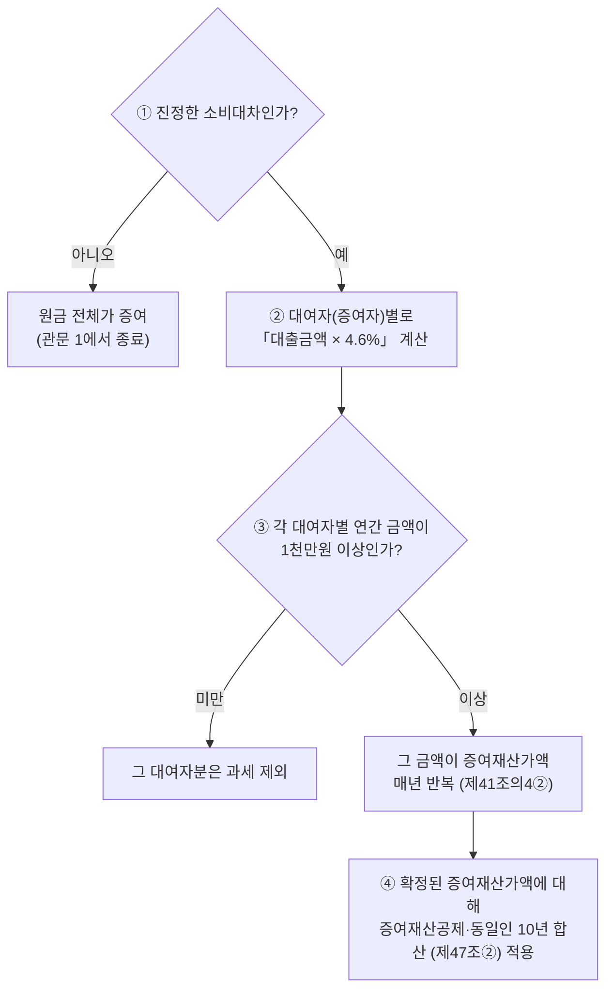

# 금전 무상대출 등에 따른 이익의 증여

> [!info] 개요
> 부모가 성년 자녀에게 무이자(또는 저리)로 돈을 빌려줄 때 증여세가 나오는가에 관한 정본 노드.
> 인용 법령은 korean-law MCP `verify_citations`로 실존·제목 일치를 검증했다(2026-08-09).
> 증여재산공제·10년 합산·동일인 합산은 [[증여세-과세체계]], 빚 낀 증여는 [[부담부증여]] 참조.

---

## 1. 먼저 결론

가족 간 무이자 대여에는 **두 개의 독립된 관문**이 있다. 흔한 오해("이자 1천만원 이하면 비과세")는 **틀렸다.**

1. **관문 1 — 원금의 대차 진정성(증여추정 극복).** 형식만 차용이고 실질이 증여면 **원금 전체가 증여**로 과세된다. 이것이 가장 큰 위험이며, 이자 이슈보다 크다. (상증세법 제45조 재산 취득자금 등의 증여 추정)
2. **관문 2 — 무상대출 이익의 증여.** 진정한 대차라도, `대출금액 × 적정이자율(4.6%)`이 **연 1천만원 이상**이면 그 이자 상당액이 증여재산가액이 된다(상증세법 제41조의4).

핵심 오해 교정: **1천만원 기준은 "이자"가 아니라 "증여이익(적정이자 상당액 − 실제지급이자)"**이며, **증여자(대여자)별 × 대출받은 날별**로 판단한다.

---

## 2. 법적 근거 (검증 완료)

| 근거                      | 내용                                                                                             |
| ----------------------- | ---------------------------------------------------------------------------------------------- |
| **상증세법 제41조의4 제1항**     | 무상 대출 시 `대출금액 × 적정이자율`을 대출받은 자의 증여재산가액으로 함. **다만 그 금액이 기준금액 미만이면 제외.** 저리 대출은 `적정이자 − 실제지급이자`. |
| **상증세법 제41조의4 제2항**     | 대출기간을 정하지 않으면 1년으로 보고, **1년 이상이면 1년이 되는 날의 다음 날에 매년 새로 대출받은 것으로 보아** 매년 계산.                    |
| **상증세법 시행령 제31조의4 제2항** | 기준금액 = **1천만원**.                                                                               |
| **상증세법 시행령 제31조의4 제3항** | 이익은 **"금전을 대출받은 날"**(여러 차례면 각각의 대출받은 날) 기준으로 계산.                                               |
| **적정이자율 = 연 4.6%**      | 시행령 제31조의4 제1항 → 법인세법 시행규칙 제43조 제2항 "당좌대출이자율 연 1,000분의 46". *(법인에서 대출받은 경우는 가중평균차입이자율 등 별도.)*  |
| **상증세법 제45조**           | 자금출처·채무상환의 증여추정(관문 1).                                                                         |
| **상증세법 제47조 제2항**       | 10년 내 **동일인(직계존속의 배우자 포함)** 증여재산가액 합산. → 부·모는 합산과세 대상.                                         |
| **국세기본법 제14조**          | 실질과세(인위적 분산의 재구성 근거).                                                                          |

> [!note] 참고
> **적정이자율 변천 주의:** 당좌대출이자율은 과거 8.5% → **2016.3.(시행규칙 개정) 이후 4.6%**. 대여 개시가 그 이전이면 당시 이자율·부칙을 확인해야 한다. `[거래 시점 확인 필요]`

---

## 3. 판단 구조

```
① 진정한 소비대차인가?  ──── 아니오 ──▶ 원금 전체가 증여 (관문 1에서 종료)
        │ 예
        ▼
② 대여자(증여자)별로 「대출금액 × 4.6%」 계산
        │
        ▼
③ 각 대여자별 연간 금액이 1천만원 이상인가?
        │ 미만 → 그 대여자분은 과세 제외
        │ 이상 → 그 금액이 증여재산가액 → 매년 반복(제41조의4②)
        ▼
④ 확정된 증여재산가액에 대해 증여재산공제·동일인 10년 합산(제47조②) 적용
```

**다이어그램 (위 코드블록과 같은 내용)**

%% ciat-design: 시각화 추가 — 아래 다이어그램은 바로 위 코드블록의 내용만 옮긴 것 (원문 우선) %%



**증여자별 판단의 근거:** 제41조의4 제1항은 "**그 금전을 대출받은 자의** 증여재산가액"이라 하고, 시행령 제31조의4 제3항은 "**대출받은 날** 기준"이라 한다. 즉 증여재산가액과 1천만원 관문은 **타인(대여자)별·대출건별**로 산정된다. 제47조 제2항의 동일인(부모) 합산은 **이미 증여재산가액으로 확정된 금액을 사후에 합산**하는 규정이지, 1천만원 관문 통과 여부를 판단하는 단계의 규정이 아니다.

---

## 4. 사례 — 부모 4억 무이자 대여 (부 2억·모 2억, 5년, 0%)

**사실관계:** 부모가 성년 자녀에게 4억(모 2억·부 2억)을 이자율 0%로 5년 대여. 실제 원금 송금·차용증 존재, 매월 **원금만** 상환.

**적용:**

| 대여자 | 대출금액 | ×4.6% | 1천만원 기준 |
|---|---|---|---|
| 부(父) | 2억 | **920만원** | 미만 → **제외** |
| 모(母) | 2억 | **920만원** | 미만 → **제외** |
| (합산 가정) | 4억 | 1,840만원 | 이상 → 과세 |

- 부·모가 **각자 고유재산에서 각 2억씩** 빌려준 것이면 각각 별개 대차 → 각 920만원 < 1천만원 → **무상대출 이익 증여세 없음.**
- 매월 **원금을 상환하면 잔액이 감소**하므로 2년차부터 연간 이익은 920만원보다 더 작아져 기준 미달이 강화된다.
- **결론:** 납세자의 "문제없음" 결론은 방향은 맞을 수 있으나, 근거("이자 1천만원 이하 비과세")는 틀렸다. 실제 이유는 **증여자별 연간 증여이익이 기준금액 미만**이기 때문이다. **남는 리스크는 이자가 아니라 원금 4억의 증여추정.**

### 과세관청 반대논리
1. **원금 자체 증여**: 이자 0%·만기 불명확·자녀 상환능력 부족을 들어 "형식만 차용, 실질은 4억 증여"로 원금 과세(과세표준 4억 − 5천만원 공제 = 3.5억). ← **최대 위험.**
2. **실질과세 합산(국기법 제14조)**: 부·모 분산 대여를 조세회피 목적 인위적 분할로 보아 4억을 하나로 재구성 → 1,840만원 과세(특히 자금이 실질적으로 한쪽에서 나왔을 때).
3. **상환 부인**: 원금상환이 객관적 증빙(계좌이체 등)으로 입증되지 않으면 상환을 부인하여 이자상당액을 증여재산가액에 가산.

### 납세자 반대논리
1. **대차 진정성**: 실제 송금 + 차용증 + **매월 계좌이체 상환 실적** = 증여추정 번복.
2. **증여자별 문언 해석**: 제41조의4①·시행령 제31조의4③의 "대출받은 자·대출받은 날" 기준 → 부·모 각각 920만원 < 1천만원 → 법문상 각각 제외.
3. **잔액 감소**: 원금 상환으로 매년 이익 감소.

---

## 4b. 생활비·교육비 명목이면 무조건 비과세인가 (2026-08-24 보강)

상속세및증여세법§46-5호는 **사회통념상 인정되는 피부양자의 생활비·교육비**를 비과세로 규정한다. 다만 이 예외는 두 요건을 **함께** 봐야 한다.

1. **실제로 생활비·교육비 명목으로 지출됐는지**
2. **받는 자가 이미 스스로 충분한 소득이 있는지**

⚠️ **"용돈"이라는 명목이 붙었어도 그 돈으로 자산을 취득하면 증여로 과세된다.** 생활비 명목으로 받은 돈을 저축하거나 부동산·주식 매입에 쓰면 더 이상 "생활비"가 아니라는 것이 과세관청의 논리다. 이 원칙은 위 4장의 대여금 사례와 별개로, **애초에 대차가 아닌 순수 지원금**을 검토할 때 먼저 짚어야 할 관문이다.

> [!quote] 출처
> 출처: ([[가족 간 금전거래에 따른 증여세 위험 현금증여 및 차용증에 대한 설명-소스요약]])

## 4c. "최악의 돈거래 TOP 3" — 실제 걸리는 지점은 금액이 아니라 증거다 (김희연 회계사, 2026-08-25 추가)

국세청은 "마음"이 아니라 "계좌·증거"만 본다는 것이 이 절의 핵심이다. 위 4·4b장의 원칙이 실제로 어떻게 적발되는지를 세 가지 흔한 패턴으로 정리한다.

### ① 차용증 없는 목돈 대여 — 적발 시점은 이체 순간이 아니다

차용증 없이 부모가 자녀에게 목돈(예: 전세금 2억)을 빌려주면 **기본적으로 증여로 추정**된다. ⚠️ **문제가 되는 시점은 돈을 이체한 순간이 아니라, 몇 년 뒤 그 자녀가 그 돈으로 집을 살 때**다 — 자금출처조사에서 소득으로 설명이 안 되는 금액이 드러나면 그때 소명을 요구받는다. 차용증·원금상환기록·이자기록이 전혀 없으면 그대로 증여세(본세+가산세)가 부과되고, 부모 쪽 자금출처(미신고 사업소득 등)까지 함께 조사가 번질 수 있다.

### ② 매달 보내는 애매한 돈 — 목돈보다 위험할 수 있다

증여세는 원칙적으로 **10년치를 합산**해서 과세한다. 매달 100만원씩 이체하면 연 1,200만원, 10년이면 1억 2,000만원이 되어 성년 자녀 공제한도(5,000만원)를 넘는 7,000만원이 과세대상이 될 수 있다. ⚠️ **목돈과 결정적으로 다른 점은 "아무도 기억을 못 한다"는 것**이다 — 나중에 소명을 요구받으면 준 사람도 받은 사람도 용도를 설명하기 어렵다.

- **실제 상담사례**: 결혼할 때 어머니가 월 100만원씩 8년(약 9,600만원)을 보냈고, 딸이 그 돈을 쓰지 않고 적금·주식에 모았다가 그 자금으로 아파트 계약금을 넣는 순간 국세청 소명 요구가 들어왔다 — 위 4b장의 "모으면 안 된다" 원칙이 실제로 적발된 사례다.

### ③ 반대 방향 — 자녀가 부모에게 보내는 돈

**병원비·간병비는 부모(피상속인) 본인의 계좌·카드로 내야 한다.** 자녀가 대신 내면 상속재산이 그대로 남아 나중에 상속세가 그만큼 더 붙는다 — 반대로 부모 재산에서 병원비 1억원을 지출하면, 상속세율 50% 구간 기준으로 약 5,000만원의 세금이 줄어드는 효과가 있다(→ [[상속세-과세체계와-전략]] 「장례비 공제의 실제 절세효과」와 같은 논리 구조). 자녀가 이미 부담한 병원비가 있다면 영수증을 남겨 나중에 정산 근거로 삼되, **법적으로 자동 정산되지는 않는다는 점**에 유의한다.

⚠️ **더 흔한 역방향 함정**: "효도한다고" 매달 부모님 계좌로 돈을 넣어 적금을 들어드리는 경우, 그 돈이 부모님 명의로 쌓이는 순간 **법적으로는 부모님 재산**이 된다. 상속이 개시되면 원래 자녀 자신의 돈이었던 그 적금을 **상속세를 내고 다시 받아와야** 하는 역설적 결과가 생긴다. 자녀 소유임을 입증하려 해도 결국 차명계좌 문제로 귀결되며, 금융소득종합과세·소득세 분산을 피하려는 의도로 의심받을 위험도 있다.

> [!quote] 출처
> 출처: ([[2026-08-24-부모 자식 돈거래 최악의 1위… 99%가 효도인 줄 알고 저지릅니다 절세미녀-소스요약]])

## 5. 헷갈리기 쉬운 부분

- **"이자 1천만원"이 아니다.** 기준금액 1천만원은 `대출금액 × 4.6%`(무상) 또는 그것에서 실제지급이자를 뺀 금액이다.
- **원금이 얼마면 걸리나:** `대출금액 × 4.6% ≥ 1천만원` → **대출금액 약 2억1,740만원(≒ 2.17억) 이상**이면 한 대여자만으로도 과세권에 든다. 2억이면 920만원으로 아슬하게 미달.
- **매년 재판정(제41조의4②):** 1년 넘게 빌리면 해마다 새로 판단한다. 잔액이 줄면 유리, 이자율이 오르면 불리.
- **관문 1과 2는 별개:** 무상대출 이익이 과세 제외라도, 원금의 증여추정이 깨지면 원금이 통째로 과세된다. 두 관문을 분리해서 검토할 것.

### 4d. 추가 유권해석·심판례 (정찬우 회계사, 2026-08-25 추가)

- **합산배제 근거 — 서면-2016-상속증여-4687(2018.06.21.)**: 무상대출 이익이 기준금액(1천만원) 미달이면 애초에 증여재산가액 자체가 성립하지 않으므로, 제47조②의 동일인 합산 규정도 적용하지 않는다고 확인했다.
- **여러 사람에게 각각 대여 — 서면-2018-상속증여-2137(2019.01.23.)**: 부·모·조모·동생에게 각각 2억원씩(총 8억원) 무이자로 빌리는 사안에서, 국세청은 위 서면-2016-상속증여-4687을 인용하며 "1천만원 미만이면 과세도 합산도 하지 않는다"고만 회신했다. **계산 단위(사람별 vs 통산)를 문구로 명시하지는 않았지만**, 실무에서는 이 회신이 **대여자별(사람별) 계산**을 지지하는 근거로 해석된다 — 단, 자금의 출처·흐름이 사실상 하나라면 사실관계에 따라 달리 판단될 수 있다.
- **장기+만기일시상환 조건의 차용 부인 — 조심2021서6614(2022.06.22.)**: 부동산 취득자금을 해외거주 자녀에게 빌렸다고 주장했으나, 원금을 5년·10년 후에, 이자도 만기에 한꺼번에 갚는 조건이었다. 심판원은 이런 조건이 통상적인 금전소비대차와 다르다는 점 등을 들어 차용 자체를 인정하지 않았다(직계존비속 간 소비대차는 원칙적으로 인정하기 어렵다는 상증세법 기본통칙 45-31…1도 함께 참조).
- **상속개시 전 무상대출 이익의 사전증여재산 가산 — 조심2024중5770(2025.03.21.)**: 피상속인이 특수관계법인에 무상대출했던 사안에서, 사망 전 5년 이내(상속인 아닌 자 기준)의 이자 이익이 상속재산에 가산됐다 — 위 7장의 "판단을 바꿀 수 있는 추가 사실"과 연결되는 실제 사례.
- ⚠️ **면제·포기는 출구가 아니다**: 빌린 뒤 갚을 여력이 없어 채무를 면제받으면, 그 이익이 다시 증여세 과세 대상이 된다(상증세법§36). 이 이익에는 **혼인·출산 증여재산공제(각 1억원)가 적용되지 않는다**(상증세법§53의2④·§4①4호) — 무상대출 이익 자체도 같은 이유로 혼인·출산 공제 대상이 아니다.
- ⚠️ **이자를 실제로 지급하면 대여자 쪽에 원천징수 문제가 생긴다**: 부모가 받는 이자는 "비영업대금의 이익"으로 소득세 25% + 지방소득세 2.5%(소득세의 10%) = **합계 27.5% 원천징수** 대상이다(소득세법§129①1호나목, 지방세법§103의13). 이자를 낮게라도 실제 지급하는 것이 증여이익을 줄이고 차용의 증거도 남기는 장점이 있지만, 이 원천징수 부담까지 함께 고려해야 한다.

> [!quote] 출처
> 출처: ([[증여세법 부모님께 2억 1,700만원까지는 무이자로 빌려도 될까요(금전 무상대출 등에 따른 이익의 증여)-소스요약]])

---

## 6. 실무 체크포인트

1. **원금상환은 반드시 계좌이체**로, 차용증에 **상환스케줄·만기·이자조건** 명시(현금 상환·현금수령증만으로는 상환 부인 위험 — 조심2021전0495).
2. **부·모 각각의 계좌에서 각각 송금·상환**하여 두 개의 별개 대차임을 물리적으로 유지(실질과세 합산 재구성 차단).
3. 안전판으로 **소액이라도 이자를 지급**하면 대차 성격이 강해지고 지급이자만큼 증여이익도 차감된다.
4. **잔액 관리**로 각 대여자별 연간 증여이익을 1천만원 미만으로 유지(대여자당 원금 2.17억 미만 유지가 안전선).
5. **자녀의 상환자금 출처**(소득·자산) 문서화 → 원금·상환자금 증여추정 방어(상증세법 제45조).
6. 대여 개시가 오래됐으면 **당시 시행 이자율·부칙** 재확인.

## 6b. 차용증이 있어도 증여로 보는 세 패턴과 친인척 차용 (2026-10-08 추가)

([[2026-10-06-차용증 썼는데도 증여세 부모님께 돈 빌려 집 샀다면 보세요. (상속전문변호사)-소스요약]] · [[2026-09-23-국방부 장관 아들도 쓴 방법, 이모한테 10년 무이자로 2억 빌리세요 (국세청 반응 짐작) 절세미녀-소스요약]])

**[[정재완]] 변호사 — 국세청이 증여로 보는 세 패턴**

1. **빌렸다는 설명과 당시 기록이 다르다** — 이체 메모 "집값 보태줌"·"전세자금 지원", 당시 메시지에 상환 언급 없음, 차용증엔 상환기한만. 메모 한 줄로 증여가 확정되진 않지만 **실제 약속을 다시 입증**해야 한다. 반대로 **실제로는 준 돈에 "대여금"이라고 써 두는 것도 해결책이 아니다** — 돌려받을 생각이 없고 갚지 않으면 메모와 무관하게 증여.
2. **차용증은 있으나 상환능력·상환내역이 없다** — 공증해도 실제 거래는 따로 본다. 자녀 소득으로 갚을 수 있는 규모인가, 기한이 현실적인가, 약정 원리금을 실제 지급했는가. 매달 원금 상환이 필수라는 뜻은 아니지만 **만기 일시상환이면 만기 상환계획과 실제 이행**을 본다.
3. **부모가 자녀 통장을 거치지 않고 직접 지급** — 전세보증금을 집주인에게, 분양대금을 시행사에, 자녀 대출을 은행에 직접 상환. **입금받은 적이 없어도** 자녀가 부담할 돈을 대신 냈다면 이익을 얻은 것이다. 처음부터 대여로 정하고 지급만 대신한 거래라면 **약정–송금–상환 기록이 연결**되어야 한다.

- 숫자 확인: **3억 무이자** → 4.6% 이익 **1,380만원** ≥ 1천만원 → 초과분 380만원이 아니라 **1,380만원 전체**가 증여재산(1절과 일치).
- ⭐ **실제 대여라면 부모 사망 시 그 채권은 상속재산**에 들어가고, 다른 형제와의 상속재산 정리에도 반영해야 할 수 있다. 세금 신고용으로만 차용증을 쓸 일이 아니다.
- ⚠️ **사후에 차용증을 새로 꾸미지 않는다** — 당시 대화·송금·상환 기록부터 모은다. 증여세를 냈어도 자료는 보관(10년 동일인 합산·상속 시 10년 합산). **증여 합산기간(10년)과 부과제척기간(원칙 10년, 무신고 15년)은 다르다** → [[세법-불복절차-용어정리]].

**[[김희연]] 회계사 — 친인척(이모·장모 등) 차용 "쿠션"과 기간** `[강사견해]`

- 고위공직자 인사청문 보도(친인척에게서 10년 무이자로 약 2.15억 차용, 1년 원금상환 유예 + 4.6% 약정 등)를 소재로: 특수관계인이 아니면 **10년 만기 대출은 현실에 없다** — 금융권도 1~2년 단위 연장이므로 **차용증 기간은 1~2년을 넘기지 말라**는 것이 화자의 실무 기준. 원금·이자 **이체 내역이 없으면 차용증 한 장으로 인정받기 어렵다.** (보도 사실관계는 확인하지 않았다 `[원문 확인 필요]`)
- 친인척 개인 간 대여도 §41의4 대상이다 — 조문은 "**타인으로부터**" 빌린 경우를 대상으로 한다. 다만 **특수관계인이 아닌 자 사이**에서는 **거래 관행상 정당한 사유가 없는 경우에만** 과세한다(③항, ✅ 2026-10-08 대조). 이모·이모부는 4촌 이내 혈족·인척이라 **특수관계인**이므로 ③항 완화가 적용되지 않는다.

---

## 7. 판단을 바꿀 수 있는 추가 사실

- 대여 개시 정확한 일자(이자율 적용기간·"5년" 경과). `[거래 시점 확인 필요]`
- 자금 출처(부·모 각자 고유재산 vs 한쪽 실질 부담 → 합산 재구성 여부).
- 원금상환의 실제 이행·증빙(계좌이체 vs 현금).
- 만기·상환조건 약정, 실제 이자 완전 0원 여부.
- 자녀의 소득·상환능력.
- 차용증 작성 시점·확정일자·공증 유무(사후작성 의심 배제).

---

## 8. 핵심 정리

- 무이자 가족 대여의 관문은 **①원금의 대차 진정성(증여추정) ②무상대출 이익(제41조의4)** 두 개.
- 제41조의4의 1천만원 기준은 **이자가 아니라 증여이익**이며 **증여자별·대출건별**로 본다. 적정이자율 **4.6%**.
- **대여자당 원금 2.17억 미만**이면 연간 이익이 1천만원에 미달 → 무상대출 이익 과세 제외.
- 그러나 **원금 자체의 증여추정 리스크가 본질**이며, 계좌이체 상환·차용증·자금출처로 방어해야 한다.

---

## 8b. 차용증 실무 기준 ([[택스인사이드 유튜브 스터디|택스인사이드]])

법정 기준이 아니라 **화자의 실무 기준**([강사견해])이 상당수이므로 그 구분을 유지해 정리한다.

### 국세청이 보는 두 축

1. **채권자–채무자 관계를 설정할 의사가 실제로 있었는가** — 차용증·조건의 존재
2. **실제로 갚고 있는가** — 법정이자율 준수 여부, 자녀의 변제능력, 원금 상환기록

⚠️ **"현금으로 갚았다"는 주장은 인정되지 않는다.**

### 차용증 필수 기재사항

채권자·채무자 인적사항 / 차용일·변제기한 / 금액 / 이자율 / 변제하지 않을 때의 처리 / 변제 계좌와 시기

### 실무 기준 [강사견해]

- ⚠️ **변제기한은 5년 이내**로 짧게. 제3자에게 10~20년씩 빌려주지 않는다는 상식 기준. 5년 후 미상환분은 **갱신·재계약**으로 부채관리를 이어간다. 20~30년·60년 뒤 변제 같은 설정은 인정받기 어렵다.
- ⚠️ **원리금 상환액은 자녀 근로소득의 세후 금액 기준 50% 이내**로 설정. 월 200~300만원 소득자가 5~10억을 빌려 상환하겠다는 설계는 성립하지 않는다.
- **금액 불문 상환기록을 남긴다.** 5억을 빌리고 매월 50만원씩이라도 이체 기록이 떠 있어야 제3자가 봐도 대여로 보인다.
- **공증의 대안**: 수수료가 부담되면 작성 당일 날짜가 드러나게 **사진**을 남기거나 **이메일로 주고받아** 날짜를 특정하는 방법도 근거가 된다.

### ⚠️ 이자율의 흔한 오해

법정이자율이 정해져 있다고 해서 **모든 차용에 그 이자율을 지급해야 하는 것은 아니다.** 일정 금액까지는 무이자로도 가능하며, 그 이상도 차용 자체는 가능하다. 세부담을 최소화하려면 문제되지 않는 최저 이자율을 설계한다. (구체적 한도 계산은 이 문서의 3~4장 참조)

### 자금 세팅 최대치 예시 (참고)

증여공제 + 혼인·출산 추가공제 + 무이자 차용 한도를 조합하면 **1인당 약 3억 5천만원**, 양가 모두 활용 시 약 7억원. 여기에 주택담보대출·신용대출을 더하면 **자기자금 없이 약 14억원**까지 세팅 가능하다는 계산 `[현행 기준 확인 필요]`. ⚠️ **모든 조건이 최대로 충족된 가정**이며 개인 신용·가정 상황에 따라 크게 달라진다.

### ⚠️ 부채 사후관리 — 작성이 끝이 아니다

- 국세청은 자금조달계획서 제출 후 **1~2년 뒤 비정기적으로** 소명을 요구한다. 최근 3년 세무조사 370건, 부채 사후관리 3,000건이 진행됐다는 언급 `[원문 확인 필요]`.
- ⚠️ 조사에서 "가족 간 차용이 맞다"고 결정되어도 **전산에 등록되어 상환 여부가 계속 추적**된다.
- ⚠️ **부모가 1~2년 뒤 조용히 대신 상환하면 당초 차용 행위 자체가 부인**되어 증여세 + 가산세가 부과된다.
- 상환재원(임대수익·양도차익·근로소득)을 사전에 계획하고 접근한다.

### 특수관계가 아닌 경우의 규율 공백

⚠️ 부모–자녀 등 **특수관계인 간**에는 상증세법이 무상대출 이익을 규율하지만, **특수관계가 아닌 제3자 간의 무이자 대여는 규율할 규정이 마땅치 않다**는 점이 2026년 사인 간 근저당 거래 논란에서 쟁점이 되었다.

> [!warning] 주의
> ⚠️ **2026-10-08 조문 대조 — 위 강사 주장과 문언이 다르다.** §41의4①은 "**타인으로부터**" 무상·저리로 대출받은 경우를 대상으로 하므로 비특수관계인 간에도 적용되며, ③항이 "특수관계인이 아닌 자 간의 거래인 경우에는 **거래의 관행상 정당한 사유가 없는 경우에 한정하여**" 적용한다고 규정한다. 즉 "규정이 없다"가 아니라 **"정당한 사유가 없을 때만 과세"** 가 정확하다. 실무상 쟁점은 규정 부재가 아니라 **정당한 사유의 입증·과세관청의 포착**이다. `[강사견해]` vs 조문 ([[2026-08-07-🏠세무사와 함께하는 부동산 토론회ㅣ2026 부동산세제개편안은 집값보다 증세가 목표다ㅣ택스인사이드 이정근 세무사-소스요약]])

---

## 9. 출처

- **법령(검증 완료, korean-law MCP verify_citations 2026-08-09):** 상증세법 제41조의4·제45조·제47조 제2항, 상증세법 시행령 제31조의4, 법인세법 시행규칙 제43조 제2항, 국세기본법 제14조.
- **조세심판례:** 조심2021전0495(2021.7.5., 기각) — 현금수령증만으로는 원금상환 인정 불가, 상환 부인분 이자상당액 증여재산가액 가산(전문 확인).
- **국세청 해석례:** 「금전 무상대출 등에 따른 이익의 증여」 관련 다수 존재하나 **본문 전문 미확보 → [원문 미확인]**. 위 "증여자별 판단" 결론은 해석례가 아니라 **검증된 법령 문언 구조**에 근거함.
