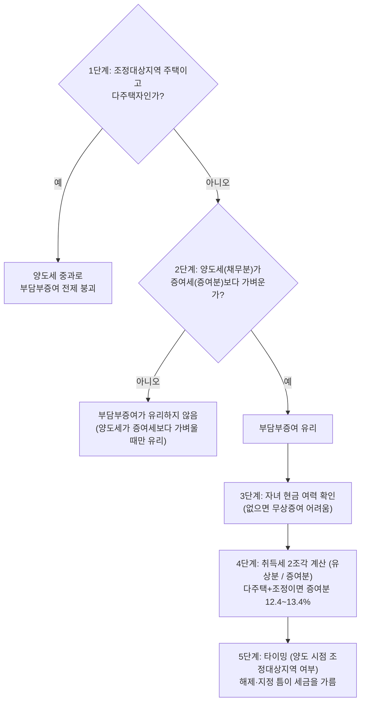

# 부담부증여

> [!info] 개요
> 세무법인다솔 엄해림 세무사의 "복잡해진 부담부증여, 다주택자라면 이렇게 합니다" 강의를 재구성했다.
> 부담부증여는 **양도세 · 증여세 · 취득세가 한꺼번에 얽히는** 개념이라, [[증여세-과세체계]] · [[양도소득세-세율과-중과]] · [[취득세-주택]]를 함께 봐야 한다.

---

## 1. 먼저 결론

부담부증여는 **"빚(채무)이 낀 재산을 증여하면서, 그 빚을 받는 사람이 함께 떠안는" 증여**다. 떠안은 빚만큼은 증여재산에서 빠진다. 그래서 절세로 알려졌지만, **빠진 빚은 "판 것(양도)"으로 보아 증여자에게 양도소득세**가 붙는다.

핵심 한 줄: **부담부증여가 이득이 되려면 "그 양도세가 증여세보다 가벼울 때"뿐**이다. 조정대상지역 다주택자에게는 이 전제가 무너진다(양도세 중과).

- 증여 부분 → **증여세**(받는 사람).
- 채무(빚) 부분 → **양도**로 보아 **양도소득세**(주는 사람).
- 취득세는 두 조각(빚=유상취득 낮은 세율 / 증여 부분=증여취득세)으로 나뉜다.

---

## 2. 왜 중요한가

- "부담부증여 = 절세"라는 공식이 **2026년 5월 10일부터 조정대상지역 다주택자에겐 이미 쓰기 어려운 카드**가 됐다(다주택 중과 유예 종료로 양도세 중과 부활: [[양도소득세-세율과-중과]]).
  - 🚨 **[2026-08-21 갱신] 이 문서의 전제가 적용되는 범위가 크게 넓어졌다.** 2025-10-15 서울 전역과 경기 12곳 지정에 이어, 2026-07-01 **구리시·용인시 기흥구·화성시 동탄구**가 추가되어 현재 경기 규제지역은 **15곳**이다. 종전처럼 "우리 집은 강남 아니니 괜찮다"고 판단해서는 안 된다. 지정 범위는 [[양도소득세-1세대1주택-비과세]] 3-2 참조.
- 같은 부담부증여인데 **누구는 세금을 반으로 줄이고, 누구는 더 낼 수 있다.** 그 차이는 "내가 다주택자인지 / 그 집이 조정대상지역인지 / 언제 하는지"에서 갈린다.
- 취득세까지 얹으면 계산이 확 복잡해지고, 지자체가 신설 규정을 잘못 적용해 **과다 납부**하는 사고도 난다(아래 5-4).

---

## 3. 기본 개념

### 3-1. 구조
- 부모가 자녀에게 집을 증여하면서, 그 집에 낀 **전세보증금·주택담보대출**을 자녀가 떠안는다.
- 자녀가 빚 갚을 의무를 지므로, **그 빚만큼 증여재산에서 제외**되므로 증여세가 줄어든다.
- 그러나 빠진 빚은 사라지지 않고 **세법상 "자녀에게 팔아넘긴 것(양도)"**으로 보아 부모에게 양도소득세가 과세된다.

### 3-2. 이득 조건
- **양도소득세 < 증여세**일 때만 부담부증여가 유리하다.
- 무상증여(빚 안 끼움)와의 비교: 무상증여는 **자녀가 증여세 낼 현금**이 있어야 한다(목돈 없으면 막막).

---

## 4. 판단 구조

```
1단계  그 집이 조정대상지역인가 / 나는 다주택자인가  → 예면 양도세 중과로 전제 붕괴
2단계  양도세(채무분) vs 증여세(증여분) 비교         → 양도세가 가벼우면 부담부증여 유리
3단계  자녀 현금 여력                                → 없으면 무상증여 어려움
4단계  취득세 2조각 계산 (유상분 / 증여분)            → 다주택+조정이면 증여분 12.4~13.4%
5단계  타이밍(양도 시점 조정대상지역 여부)            → 해제·지정 틈이 세금을 가름
```

**다이어그램 (위 내용과 같은 내용)**

%% ciat-design: 시각화 추가 — 아래 다이어그램은 위 판단 구조의 내용만 옮긴 것 (원문 우선) %%



---

## 5. 상세 설명

### 5-1. 조정대상지역 다주택자에서 전제가 무너지는 이유
- 양도하는 집이 **조정대상지역**이고 내가 **다주택자**면 양도소득세가 중과된다. 페널티 두 가지:
  1. **세율 +20%p / +30%p**.
  2. **장기보유특별공제 배제**.
- **2026년 5월 10일부터** 본격적으로 어려워진다(다주택 중과 유예가 끝나 중과 부활). 부담부증여의 채무 부분이 바로 이 중과 양도로 잡힌다. → [[양도소득세-세율과-중과]]
- 조정대상지역이면서 **토지거래허가구역**이면, 양도 부분 때문에 **실거주 의무** 같은 규정까지 얽혀 자녀가 실제로 들어가 살아야 하는 상황이 생긴다.
- 동탄·기흥·구리는 **2026.7.1** 조정대상지역·투기과열지구로, 2026.7.5 토지거래허가구역으로 추가 지정됐다. 자동자막의 2025년 표기는 오류다.

### 5-2. 다주택자 3가지 전략
1. **무상증여**: 자녀가 증여세를 다 낸다. 현금 여력이 있으면 깔끔하다.
2. **부담부증여**: 빚을 끼워 증여세는 줄이되, **부모가 양도세를 감당**. 증여세보다 양도세가 더 나올 수도 있지만, 자산이 많은 부모가 **"차라리 내가 양도세를 내는 게 상속세를 줄이는 데 도움"**이라 판단해 진행하는 경우가 많다. → [[상속세-과세체계와-전략]]
3. **버티기**: 종부세 중과 개편 논의를 지켜보며 대기(종부세가 다시 줄어들 거란 기대).

### 5-3. 취득세: 두 조각
- 부담부증여의 취득세는 **빚 떠안은 부분("샀다" → 낮은 유상취득세)** + **공짜로 받은 증여 부분("증여취득세")**으로 나뉜다.
- 부모가 **다주택자이고 그 집이 조정대상지역의 일정 기준을 넘으면**, 증여 부분 취득세가 **12.4%**까지, 전용면적 85㎡ 초과면 농특세·지방교육세까지 얹어 **13.4%**가 되기도 한다. → [[취득세-주택]]

### 5-4. 배우자·직계존비속 부담부증여: 유상취득 인정과 저가취득 규정
- 지방세법 §7⑪은 배우자·직계존비속의 부동산등 취득을 원칙적으로 증여취득으로 보되, 대가 지급의 법정 입증 요건을 갖춘 경우 유상취득으로 본다. 다만 저가 대가의 차액 기준에 해당하는 경우는 별도로 규정한다.
- 같은 조 ⑫는 일반 부담부증여의 채무 상당 부분을 유상취득으로 보면서도, 배우자·직계존비속 부담부증여에는 ⑪을 적용하도록 명시한다. 실제 채무 승계·대가 지급 입증 및 취득 시점의 적용 규정을 함께 검토한다.
- 종전 “부담부증여에는 30% 규정이 적용되지 않는다”는 행정해석은 원문을 확보하지 못했다. 따라서 일반적인 적용 배제를 확정하지 않으며, **상환능력만 입증하면 항상 낮은 세율이라는 결론도 내리지 않는다.**

### 5-4b. 대법원2024두67238(2025.10.16.): "빚 갚을 능력"의 입증 기준이 확정됐다 (2026-08-24 보강)

위 5-4의 "빚 갚을 능력 증명"이 구체적으로 무엇을 뜻하는지가 대법원 파기환송 판결로 확정됐다(서울 강서구 아파트, 임대차보증금 3.5억 인수 사안).

- **채무인수분을 유상취득으로 인정받으려면**, 수증자(자녀)가 **취득 시점에 스스로 갚을 자력**이 있음을 입증해야 한다.
- ⚠️ **자력 판단에서 제외되는 것**: 지금 증여받는 그 부동산 자체, 그리고 장래 발생할 임대보증금(순환논리이기 때문). **자녀 본인의 기존 소득·재산으로만 입증**해야 한다.
- **소득 없는 자녀가 부담부증여를 받으면 유상취득 인정 자체가 흔들릴 수 있다**. "형식상 채무 인수"만으로는 부족하다.

#### 증여세와 취득세의 판단기준이 서로 다르다는 것도 이 판결로 재확인됐다

| | 증여세 | 취득세 |
|---|---|---|
| 판단기준 | 채무의 **객관적 실재 여부**(서류로 확인되면 공제) | 수증자의 **변제 자력 여부** |

⚠️ **이 괴리 때문에 증여세에서는 채무공제를 받았는데 취득세는 전액 무상(증여)으로 과세되는 경우**가 생길 수 있다. 계산 사례(조정대상지역 시가9억+전세5억 아파트)에서 **자력 미입증 시 전액 무상중과 12%=1억800만원 vs 자력 입증 성공 시 유상500만+무상1,400만=1,900만원**으로 **약 5.7배 차이**가 났다.

### 5-4c. 추가 함정: 이월과세 10년 확대

**2023.1.1. 이후 증여분부터 이월과세 기간이 5년 → 10년으로 확대**됐다(소득세법§97의2). 부담부증여로 넘긴 뒤 자녀가 짧은 기간 내 되팔면, 취득가액을 **부모의 당초 취득가액**으로 계산하는 이월과세가 더 오래 걸린다는 뜻이다. → [[양도소득세-계산구조와-취득가액]]

⚠️ **담보대출만 인수하는 경우도 은행의 DSR 심사가 별도 관문**이 된다. 세법상 요건을 갖춰도 대출 실행 자체가 막히면 설계가 성립하지 않는다.

### 5-5. 다주택자 주택 수 제외 카드
- 일정 요건의 **다세대주택·조합원입주권·등록임대주택**처럼 주택 수 계산에서 빠지는 카드가 있으면, 중과 자체를 피할 수 있다(케이스별로 크게 다름). → [[취득세-주택]], [[양도소득세-1세대1주택-비과세]]

### 5-6. 타이밍이 세금을 가른다
- **다주택 중과는 "양도하는 그 시점"에 조정대상지역이냐로 판단**한다. 조정대상지역은 지정·해제를 반복한다.
  - 예: 광명이 2017 지정 → 2024 해제 → 2025 재지정으로 출렁였다.
- 같은 집·같은 자녀·같은 부담부증여라도 **언제 하느냐로 세금이 두 배 이상** 벌어진다. **해제된 틈, 지정되기 전 틈**의 "한 끗"이 세금을 반으로 가른다.
- 즉 여기서는 **자산 크기가 아니라 "언제 움직였느냐"가 세금을 정한다.**

---

## 6. 사례

**사례 A. 지자체의 30% 룰 오적용 (8,400만 → 1억 2,000만)** **[해석 원문 미확보]** 이 문장은 소스의 주장으로, 채무승계·유상취득 인정 요건 및 적용 조문을 확인하기 전 확정 안내로 사용하지 않는다.
- 상황: 부담부증여 취득세. 정상 계산 8,400만 원.
- 논리: 지자체가 30% 룰을 부담부증여에 적용 → 채무분까지 전부 증여로 봄. **[해석 원문 미확보]** 이 문장은 소스의 주장으로, 채무승계·유상취득 인정 요건 및 적용 조문을 확인하기 전 확정 안내로 사용하지 않는다.
- 계산 상태: 종전 강의의 8,400만원·1억2,000만원 비교는 행정해석 원문과 거래 전제를 확보하기 전 재현·확정하지 않는다.

**사례 B. 타이밍 (광명)**
- 상황: 광명 소재 주택, 다주택자.
- 논리: 중과는 양도 시점 조정대상지역 여부로 판단. 광명 2017 지정→2024 해제→2025 재지정.
- 결과: 해제 시점에 양도하면 중과 회피, 지정 시점이면 중과 → 세금 두 배 차이.

**사례 C. 부모가 양도세를 감당하는 선택**
- 상황: 자산 많은 부모, 다주택.
- 논리: 부담부증여로 증여세는 줄이되 부모가 양도세 부담. 양도세 > 증여세여도 진행.
- 왜: 지금 양도세를 내는 것이 **미래 상속세(유산세, 최고 50%)를 줄이는 데 더 유리**하다고 판단. → [[상속세-과세체계와-전략]]

---

## 7. 헷갈리기 쉬운 부분

- **채무분 = 양도(양도세), 증여분 = 증여(증여세).** 취득세도 유상분과 증여분 2조각으로 나뉜다.
- **이득 조건은 "양도세 < 증여세"**뿐. 조정지역 다주택자는 양도세 중과로 전제 붕괴(2026.5.10~).
- **취득세 증여분이 다주택+조정이면 12.4~13.4%**.
- 배우자·직계존비속 부담부증여는 지방세법 §7⑪·⑫를 함께 검토한다. 저가취득 규정의 일반적 적용 배제를 단정하지 않는다.
- **중과는 양도 시점의 조정대상지역 여부**로 판단하므로 타이밍이 핵심이다.
- 무상증여는 **자녀 현금 필요**.

---

### 5-7. ⚠️ 세금 계산이 끝나도 절차가 남는다. 규제지역·분양권 (2026-09-08 신설)

**완전 무상증여는 토지거래허가 대상이 아니지만, 부담부증여는 채무상당액만큼 "대가를 받고 이전하는" 유상거래**라 「부동산 거래신고 등에 관한 법률」 §11①의 허가 대상이 된다. **허가 없이 체결한 계약은 효력이 없다**(§11⑥). 규제지역 물건은 세액 비교를 마쳐도 **허가·검인·채무인수·권리의무승계**를 통과하지 못하면 실행 자체가 무산된다.

- 실행 순서: 토지거래허가(구청) → 증여계약서 검인(구청) → 중도금 대출 **채무인수 동의**(은행) → **권리의무승계**(분양사무소) → 채무인수 완료 → 증여세·양도세 신고
- ⚠️ **중도금 납입 자체는 부담부증여가 아니다.** 부담부증여는 수증자가 중도금 **대출**을 인수할 때만 생긴다. 증여자가 감정 뒤 증여일까지 낸 중도금은 입주권 값에 더해지는 금액이다. → [[감정평가-이슈]] 5-9
- ⭐ **토지거래허가증을 받았으면 검인은 받은 것으로 의제된다**(같은 법 §20②). 현장이 이 규정을 몰라 이중으로 요구하는 일이 잦다.
- ⚠️ **유주택자가 분양권을 받을 때 규정이 충돌한다**. 기존 주택 처분을 요구하는 허가 기준이 "실거주" 취지와 어긋난다. 반려로 끝내지 말고 **공식 불허가처분을 요구**해야 이의신청·행정심판으로 갈 수 있다.
- 절차·서식·대응 논거의 상세는 → **[[분양권-부담부증여-실행절차]]** (2026-09-08 조문 대조 완료)

## 8. 실무상 체크포인트

1. **그 집이 조정대상지역인가 / 나는 다주택자인가** → 양도세 중과 여부.
2. **양도세(채무분) vs 증여세(증여분)** 실제 숫자 비교.
3. 채무의 실재·인수·실제 이행·대가 지급의 법정 입증 자료를 갖춘다. 상환능력 하나로 유상취득 인정이나 저가취득 규정 배제를 확정하지 않는다.
4. **취득세 2조각** 계산(다주택+조정 증여분 12.4~13.4%).
5. **주택 수 제외 카드**(다세대·입주권·등록임대) 활용 가능성.
6. **타이밍**: 양도 시점의 조정대상지역 지정·해제 상태.
7. **상속세 큰 자산가**라면 부담부증여 양도세 부담이 상속세 절감에 유리한지 시뮬레이션.

---

## 9. 핵심 정리

- 부담부증여 = 빚 낀 재산 증여 + 채무 인수. **채무분=양도세(주는 사람), 증여분=증여세(받는 사람)**.
- **이득 조건: 양도세 < 증여세.** 조정지역 다주택자는 2026.5.10~ 양도세 중과로 이 전제가 무너진다.
- 취득세 2조각(유상/증여), 다주택+조정 증여분 12.4~13.4%.
- 저가취득 규정과 가족 간 부담부증여의 관계는 법 §7⑪·⑫ 및 해당 시행령을 대조한다. 원문 미확보 행정해석은 확정 근거로 사용하지 않는다.
- 다주택자 3전략: 무상증여 / 부담부증여(부모 양도세, 상속세 절감 목적) / 버티기.
- **타이밍**(양도 시점 조정대상지역 여부)이 세금을 두 배로 가른다. 자산 크기가 아니라 "언제"가 관건이다.

관련 문서: [[증여세-과세체계]] · [[양도소득세-세율과-중과]] · [[취득세-주택]] · [[상속세-과세체계와-전략]] · [[양도소득세-계산구조와-취득가액]] (부담부증여 채무액 평가)

---

## 삼일 Tax Agent 교차검증 (2026-10-26)

> [!caution] 검증 상태
> [[삼일 Tax Agent]]에 이 문서의 서술이나 관련 쟁점을 물어 받은 판정이다. LLM 답이므로 근거 번호는 법제처 목록에서 실재 여부만 확인했고 결론은 원문과 대조하지 않았다 `[원문 확인 필요]`. 판정이 「일부 수정·틀림」인 항목은 본문 오류 후보이며, 원문으로 확인한 뒤에 본문을 고친다. 원문을 확인해 이미 고친 항목은 본문에 ✅로 표시했다.

**C02** [[2026-10-26-C02-아파트-자녀-이전-방법-비교-소스요약]] (번호 11/11 실재)

| 질문한 서술 | 삼일 판정 | 삼일 답 요지 |
| --- | --- | --- |
| 증여재산공제 후 과세표준 | 14.5억원 | 8.5억원 1억원 |
| 신고세액공제 후 | 4.074억원 | 1.8915억원 0.097억원 |
| 계산 근거 | 상증세법 제47조·제53조·제56조 | 같은 법 제47조 및 시행령 제36조 같은 법 제35조 및 시행령 제26조 |


## 삼일 Tax Agent 교차검증 (2026-10-27~29)

> [!caution] 검증 상태
> [[삼일 Tax Agent]]에 이 문서의 절이나 서술을 다시 물어 받은 판정이다(2026-10-27~29 배치). LLM 답이고 인용 번호의 실재 여부도 아직 확인하지 않았다 `[원문 확인 필요]`. 「일부 수정·틀림」 항목은 본문 오류 후보이며, 원문으로 확인한 뒤에 본문을 고친다. 아래 표는 「맞음」이 아닌 항목만 옮겼다.

**W14** [[2026-10-28-W14-부담부증여-채무인수와-양도-증여-취득세-구분-소스요약]] (번호 확인 미실시(인용 번호 2개); 맞음 1 · 일부 수정 6 · 틀림 2 · 확인 불가 1)

| 질문한 서술 | 삼일 판정 | 삼일 답 요지 |
| --- | --- | --- |
| 3-1 “빚만큼 제외”, 5-4b “객관적 실재 여부(서류로 확인되면 공제)” | 일부 수정 | 증여재산에 담보·관련된 증여자 채무를 실제 인수해야 한다. 직계존비속 간에는 인수하지 않은 것으로 추정하므로 객관적 입증이 필요하다. 채무의 존재만으로 부족하다. |
| 3-1 “채무분은 양도”, 5-3 “취득세 두 조각” | 맞음·단서 보완 | 인정되는 채무분은 양도·유상취득, 나머지는 증여로 구분한다. 다만 취득세에서는 자녀의 채무인수 능력을 별도 입증한다. |
| 3-2·4 및 다이어그램 “양도세＜증여세일 때만 유리” | 틀림 | 무상증여 총부담과 부담부증여 총부담을 비교한다. 부담부증여 후 남는 증여세와 양측 취득세 차이를 누락하면 안 된다. |
| 4·5-1 “다주택+조정이면 전제 붕괴”, “5.10부터 중과” | 일부 수정 | 중과대상이면 +20%p/+30%p 및 장기보유특별공제 배제. 다만 세대별 주택 수·중과 제외·경과요건을 먼저 확인한다. 일부 매매 경과규정은 2026.11.9.까지이나 부담부증여에 자동 적용되지 않는다. |
| 4·5-3 “유상분은 낮은 세율”, “부모 다주택이면 증여분 중과” | 일부 수정 | 유상분도 수증자 세대의 주택 수 등에 따라 중과 가능. 무상분은 조정대상지역·전체 주택 시가표준액 3억원 이상 및 1세대1주택자 가족증여 예외를 확인한다. |
| 5-4 “30%나 3억 중 적은 금액을 넘으면”, “행안부 정리” | 일부 수정 | 배우자·직계존비속 저가취득은 차액이 3억원 이상 또는 시가인정액의 30% 이상인 경우다. 부담부증여 채무분에는 이 저가취득 단서를 적용하지 않되 자력 입증은 필요하다. |
| 5-4b “입증 기준이 확정”, “기존 소득·재산으로만” | 일부 수정 | 2025.10.16. 파기환송으로 법리를 제시했다. 취득 시점 자력을 판단하며 목적 부동산·그 장래 보증금은 제외한다. 다만 취득 전 이미 과세·신고된 상속·수증재산 예외가 있다. 환송 후 확정 여부는 확인 불가. |
| “9억·전세5억: 1억800만원 vs 1,900만원” | 틀림 | 무상분 4억원에 중과 12%를 적용하면 4,800만원이다. 원문의 유상분 500만원을 그대로 두어도 합계 5,300만원이므로 1,900만원·5.7배 비교는 성립하지 않는다. 유상분 세율·부가세 포함 최종액은 재산정 필요. |
| 5-4c “2023년 이후 10년”, 5-5 “주택 수 제외 카드”, 5-6 “시점만으로 결정” | 일부 수정·일부 확인 불가 | 이월과세는 현행 10년이나 법정 제외사유가 있다. 2023년 증여분 적용 부칙은 미확인. 주택 수 불산입과 해당 주택 중과 제외를 구별하고, 입주권을 일괄 제외하지 않는다. “두 배·절반”은 계산자료 없어 삭제한다. |
| 동탄·기흥·구리 지정일 / 광명 연혁·실거주·DSR·상속세 절감·종부세 기대·8,400만원 사례 | 일부 맞음·나머지 확인 불가 | 정부자료에서 토지거래허가구역 2026.7.5. 시행·아파트 한정은 확인된다. 나머지 고시 원문·적용요건·계산은 미확인이므로 확정 서술하지 않는다. |

## 삼일 Tax Agent 보강 자료 (2026-10-27~29)

> [!note] 참고
> 이 주제와 관련해 [[삼일 Tax Agent]]에 물어 받은 정리·사례·동향 답이다(2026-10-27~29 배치). 본문에는 반영하지 않았고, 원문을 대조한 뒤 필요한 내용만 옮긴다 `[원문 확인 필요]`.

- [[2026-10-27-N35-상속-증여-취득세-소스요약]]: N35 상속·증여 취득세
- [[2026-10-28-N75-부담부증여-보증금-대출-인수의-입증-소스요약]]: N75 부담부증여 보증금·대출 인수의 입증
- [[2026-10-28-P37-부부-공동주택-지분-부담부증여-후-매각-소스요약]]: P37 부부 공동주택 지분 부담부증여 후 매각
- [[2026-10-28-P52-보증금-승계-부담부증여-후-부모가-반환-소스요약]]: P52 보증금 승계 부담부증여 후 부모가 반환

## 10. 출처

- **현행 공식자료 확인(2026-08-21)**: [국세청 다주택 중과 한시 배제 종료 안내](https://sc.nts.go.kr/nts/na/ntt/selectNttInfo.do?mi=2201&nttSn=1349339) · [국토교통부 2026-07-01 규제지역 추가 지정](https://www.molit.go.kr/USR/NEWS/m_71/dtl.jsp?id=95092167)
- `복잡해진 부담부증여, 다주택자라면 '이렇게' 합니다.txt` (엄해림 세무사)
- 추가 반영(2026-08-24): ([[부담부증여 취득세 함정 소득 없는 자녀, 유상취득 인정 안 될 수 있습니다-소스요약]]): 대법원2024두67238 변제자력 입증기준, 증여세vs취득세 판단기준 차이, 이월과세10년 확대, 토지거래허가구역 봉쇄효과

> [!note] 참고
> 조정대상지역 지정 현황(동탄·기흥·구리 2026.7.1)과 다주택 중과 한시 배제 종료(2026.5.9)는 2026-08-21 공식 자료로 확인했다. [원문 확인 필요] 30% 룰·행안부 유권해석, 부담부증여 채무액을 실가/기준시가 중 무엇으로 보는지 등 세부는 [[양도소득세-계산구조와-취득가액]] 및 현행 조문 참조.

## 2026-10-31 정정 근거

이번 정정 항목: IGT-003. 본문에 기재한 조문·확인 범위에 한하며, 문서 전체의 모든 사례·해석례를 대조 완료했다는 뜻은 아니다.

[상속세및증여세법](https://www.law.go.kr/법령/상속세및증여세법) · [지방세법](https://www.law.go.kr/법령/지방세법) · [지방세법시행령](https://www.law.go.kr/법령/지방세법시행령)
