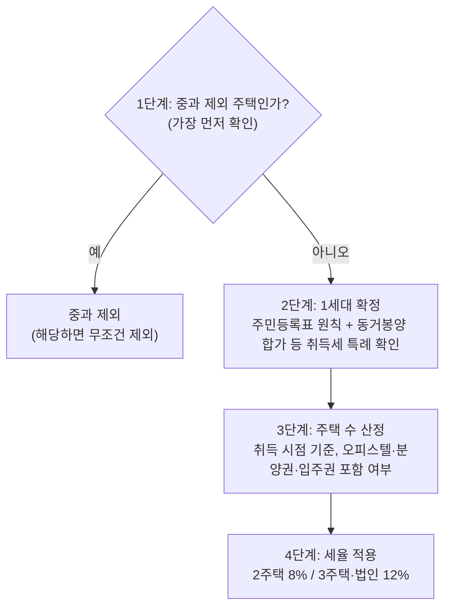

# 취득세 (주택)

> [!info] 개요
> 세무법인다솔 안수남 대표세무사 강의에서 주택 취득세(중과·주택수 판정)를 재구성했다. 판정 4단계는 지병근 세무사의 교재를 인용했다.
> 전사 오류(중가세→중과세, 조종대상→조정대상, 소용신축→소형신축, 저합원 입주권→조합원입주권 등)는 교정했다.

---

## 1. 먼저 결론

주택 취득세는 **"중과 여부를 4단계로 판정"**한다. 그리고 가장 중요한 두 가지 함정이 있다.

1. **세대 기준이 양도세와 다르다.** 취득세는 65세 이상 직계존속을 동거봉양하기 위해 일정 요건의 성년 직계비속이 합가한 경우 별도 세대로 본다. 단순히 직계존속의 나이만으로 분리되는 것은 아니다.
2. **주택 수 판정 시점·대상이 세목마다 다르다.** 오피스텔·분양권·조합원입주권은 2020.8.12 이후 취득분만 주택 수에 포함되며, "주택 수에는 포함되지만 그 자체가 중과 대상 주택은 아니다".

취득세 중과세율: 일반 1~3%, 중과 구간은 **8% 또는 12%**다. 주택 수·법인 여부·조정대상지역 여부에 따라 적용 구간이 달라지며, 지방교육세·농어촌특별세까지 포함하면 최고 약 13.4%가 될 수 있다.

양도세 세대·주택수와의 차이는 [[양도소득세-1세대1주택-비과세]], 종부세는 [[종합부동산세]]에서 확인한다.

---

## 2. 왜 중요한가

- 중과세를 모르고 샀다가 **세금 폭탄**을 맞는 사고가 흔하다. 예: 강릉 2주택 보유자가 서울 도시형생활주택(6.2억)을 매입해 **취득세 중과 8천만 원**을 맞고, 시세도 5천만 원 손해(분양업자가 기존 주택 계산도 안 하고 "등기 시 중과된다"고만 알려준 사례).
- 특히 **소형신축주택을 중과 제외로 알고 5채(연립주택)를 샀다가 중과**되는 사고: "취득 시 중과 안 함"이 아니라 "보유 주택 수에서 뺀다"는 규정을 오해한 결과다.
- 취득세는 개정이 잦고 어렵게 설계되어 있어, 중개사가 반드시 확인해야 할 영역이다.

---

## 3. 기본 개념

### 3-0. 과세표준 산정: 취득 유형별로 계산 방법 자체가 다르다 (2026-08-24 보강)

취득세 과세표준(지방세법§10·§10의2)은 취득 유형에 따라 산정 방법이 갈린다. 세율표를 보기 전에 **"과세표준을 어떻게 잡을지"**부터 정해야 한다.

| 취득 유형 | 과세표준 |
|---|---|
| **유상승계취득**(매매 등) | **사실상취득가격**(직접비용 + 중개보수·채무인수액 등 간접비용까지 포함) |
| **무상취득**(상속·증여) | **시가인정액**(취득일 전 6개월 ~ 후 3개월 매매사례가액·감정가액 등) |
| **원시취득**(신축 등) | **사실상취득가격**(확인 불가 시 시가표준액) |

⚠️ **부담부증여는 이원 적용된다.** 채무인수분은 **유상취득**(사실상취득가격 기준), 나머지 잔액은 **무상취득**(시가인정액 기준)으로 각각 나눠 계산한다 → [[부담부증여]].

### 일반세율 표 요약

- **유상취득**: 농지 3.4%, **주택은 가액·면적별 1.1~3.5%**, 그 밖 부동산 4.6%.
- **무상취득 및 원시취득**: 상속 2.56~3.16%, **1세대1주택 상속은 0.96~1.16%로 우대**, 증여 3.8~4.0%, 원시취득 2.96~3.16%.
- ⚠️ **주거용 오피스텔은 지방세법상 "주택"이 아니다**. 취득세는 **4%**가 적용된다(양도세·종부세의 "실질 주거용이면 주택 수 포함" 판정과는 별개 층위).

### 3-1. 취득세 중과세율

- 일반 세율: 6억 이하 1%, ~9억 구간 누진, 9억 초과 3%(주택 특례세율).
- 중과: 조정대상지역은 **2주택 8%, 3주택 이상 12%**, 비조정대상지역은 **3주택 8%, 4주택 이상 12%**, 법인은 12%다. 지방교육세·농어촌특별세까지 포함하면 최고 약 **13.4%**가 될 수 있다.
- 조정대상지역은 2주택부터, 비조정지역은 3주택부터 중과된다. [강의 시점 기준]
  - **[2026-08-20 확인]** 중과세율 자체(조정 2주택 8%·3주택 이상 12% / 비조정 3주택 8%·4주택 이상 12%)는 현행과 일치한다. 2022년 발표된 중과 완화안(2주택 중과 폐지 등)은 **입법되지 않아 시행되지 않았다.**
  - ⚠️ **[2026-08-21 확인]** 2025-10-15에는 서울 전역과 경기 12곳이 지정됐고, 2026-07-01 **구리시·용인시 기흥구·화성시 동탄구**가 추가됐다. 현재는 서울 25개 자치구 전역과 경기 **15곳**이다. 지정 이력은 [[양도소득세-1세대1주택-비과세]] 3-2 참조.
- 상속취득은 이 조의 주택 유상거래 중과 대상이 아니다. 증여 등 무상취득은 **조정대상지역의 일정가액 이상 주택**이면 12% 중과될 수 있지만, 1세대 1주택자의 배우자·직계존비속 증여 등 시행령상 예외가 있으므로 증여라는 이유만으로 일률적으로 중과된다고 단정하지 않는다.

### 3-2. 세대 기준 (취득세)

- **동거봉양 합가 특례**: 취득일 현재 65세 이상 직계존속을 동거봉양하기 위해 **30세 이상, 혼인한 사람 또는 소득요건을 충족하는 성년 직계비속**이 합가한 경우 각각 별도 세대로 본다. 직계존속 부부 중 한 명이 65세 미만이어도 포함한다. 합가 경위와 직계비속 요건을 갖추지 않으면 주민등록표상 세대 원칙으로 돌아간다.
- **30세 미만 미혼 자녀**는 같은 세대로 보되, 소득이 있거나 부득이한 사유가 있으면 별도(양도세와 유사).

### 3-3. 주택 수에 포함되는 것 (2020.8.12 이후 취득분)

- **오피스텔·분양권·조합원입주권**은 2020.8.12 이후 취득분부터 주택 수에 포함된다.
- **오피스텔**: 원칙은 업무용(주택 수 제외). **주거용으로 재산세를 부과받아야**(본인이 신청) 주택 수에 포함된다. 임대사업자로 등록하면 당연히 주택이다.
- ⚠️ "주택 수에는 포함되지만, 그 자체(오피스텔·입주권·분양권)를 거래할 때 중과 대상 주택은 아니다." (예: 오피스텔·조합원입주권 취득 시 토지분 4.6%.)

---

## 4. 판단 구조: 중과세 판정 4단계 (지병근 세무사)

```
1단계  중과 제외 주택 확인    → 걸리면 무조건 제외 (여기 해당되는지 먼저 확인)
2단계  1세대 확정            → 주민등록표 원칙 + 동거봉양 합가 등 취득세 특례 확인
3단계  주택 수 산정          → 취득 시점 기준, 오피스텔·분양권·입주권 포함 여부
4단계  세율 적용            → 2주택 8% / 3주택·법인 12%
```

**다이어그램 (위 내용과 같은 내용)**

%% ciat-design: 시각화 추가 — 아래 다이어그램은 위 판단 구조의 내용만 옮긴 것 (원문 우선) %%



- **1단계(중과 제외 주택)를 가장 먼저** 확인한다. 여기 해당하면 무조건 제외된다.

---

## 5. 상세 설명

### 5-1. 재개발·재건축 취득세 메커니즘

- 조합원이 종전부동산에 대한 **권리가액**(종전 감정평가액 × 비례율)을 갖고, 새 아파트의 조합원분양가가 정해진다. 조합원분양가 − 권리가액 = 청산금/분담금.
- **조합원분양계약서상 금액은 실제 낸 돈이 아니므로 취득세 과세표준·양도세 취득가액과 무관하다.** 실제 낸 돈 = 종전부동산 취득가 + 추가분담금.
- 재개발·재건축에서 땅을 승계취득하고 건물이 지어지면 **보존등기**(매매·증여 아님)이므로 중과 대상이 아니다. 건축비 상당으로 취득세를 낸다. → [[재개발재건축-양도세]]

### 5-2. 중과 제외 주택: 소형신축주택

- **소형신축주택은 취득 시 중과 제외 + 보유 주택 수에서도 제외**된다. 지역 제한 없음(수도권도 해당).
- ⚠️ **오해 주의**: "소형신축주택을 취득해도 중과 안 함"으로 끝나는 게 아니다. 규정은 "**해당 주택을 제외하고** 중과 대상 주택 수를 산정한다"는 것. 즉 A·B 보유 상태에서 소형신축주택(C)을 취득하면 C는 주택 수에서 빼서 **2주택 중과**로 판정된다(C를 안 빼면 3주택). C 자체의 취득세는 중과 안 되지만, 주택 수에서 빠질 뿐이며 다른 주택의 판정에 영향을 준다.
- 사고 사례: 소형신축주택 중과 제외로 알고 연립주택 5채를 매입 → 중과.
- 특례기간·요건(강의 시점): 소형 신축주택 6억 이하(다가구·도시형생활주택, 아파트 제외) / 지방 미분양은 85㎡ 아파트만 등. (특례주택은 세목마다 적용이 달라 [[종합부동산세]]·[[양도소득세-1세대1주택-비과세]]와 교차 확인.)

### 5-3. 농어촌주택 요건

- 농어촌주택 중과 제외는 시행령 §28의2 11호의 **네 요건을 모두** 충족해야 한다. ① 읍·면 소재, ② 대지 660㎡ 이내·건물 연면적 150㎡ 이내, ③ 건물 가액 6,500만원 이내, ④ 수도권·도시지역 등 법정 제외지역에 해당하지 않을 것(접경지역 등 단서 포함)이다. 저가주택 예외와 별도로 판단한다.

### 5-4. 주택신축판매업자(건설업) 멸실 사후관리

- 주택을 지어 분양하는 주택신축판매업자(건설업)의 중과 제외 요건: 취득 후 **1년 내 멸실 + 3년 내 신축 + 분양**. 미분양 문제로 3년에서 **5년으로 연장**되었다.
- 저가주택 중과 제외는 전체 주택 **시가표준액이 수도권 1억원 이하·수도권 밖 2억원 이하**인지를 본다. 다만 정비구역 또는 소규모주택정비사업 시행구역 소재 주택은 이 저가주택 예외에서 제외한다(시행령 §28의2 1호).

### 5-5. 분양권·주택 취득 시점 판정과 세대 합가

- **다주택 취득세 중과는 취득할 때(잔금 낼 때) 주택 수로 판단**한다. A·B 2주택 상태에서 분양권(C)을 취득하면 3주택이 되고, 그 사이 A를 팔아도 취득 시점에 판단하므로 중과된다.
- **세대 합가 쟁점**: 별도 세대 자녀가 분양권을 취득했는데 잔금 시점에 부모와 합가해 동일 세대가 되면? 조세심판원은 "분양권 취득 시점(별도 세대)" 기준으로 중과 아니라 봤으나, 행정안전부는 "취득일(잔금) 현재" 기준으로 보아 **유권해석대로 법을 개정**(주택 취득일 현재로 명확화). 강사는 입법취지상 심판원이 맞다고 평가한다. → 대응: 잔금 전에 합가하지 않거나, 부모가 65세를 넘길 때까지 기다린다.

### 5-6. 분양권 증여 꼼수 방지

- 과거 꼼수: A·B 주택 + C 분양권 보유자가, A를 양도하고 C를 배우자에게 증여해 주택 수를 줄이는 방식으로 중과를 회피했다.
- 개정: **1세대 내에서 배우자 증여·교환으로 동일 분양권의 취득일이 둘 이상이면, 나중 것이 아니라 당초 취득일 기준**으로 판단(꼼수 차단). 2025.1.1 이후 취득 분양권부터 적용(경과부칙으로 이전 취득분은 종전대로). [원문 확인 필요: "2005"는 문맥상 2025로 추정]

### 5-7. 상속주택 (취득세)

- 상속개시일부터 **5년간 주택 수 제외**(단독 상속은 채수 무제한, 5채여도 5년간 제외). 5년이 지나면 주택 수에 포함된다.
- 종부세·양도세의 상속주택 처리와 각각 다르다(강사가 "왜 세목마다 다르게 만들었냐"고 반복 지적). → [[종합부동산세]], [[양도소득세-1세대1주택-비과세]].

---

## 6. 사례

**사례 A. 강릉 2주택 + 서울 도시형생활주택 → 중과 8천만 원**

- 상황: 강릉 2주택 보유자가 서울 도시형생활주택 6.2억 매입.
- 논리: 취득 시점 3주택 → 취득세 중과 12%.
- 판단: 중과세 약 8천만 원 + 시세 손해 5천.
- 왜: 분양업자가 기존 주택 수를 계산 안 하고 "중과된다"고만 통지. 중개사에게 한 번만 확인했어도 피할 수 있었다.

**사례 B. 소형신축주택 오해로 연립 5채 중과**

- 상황: 소형신축주택 중과 제외로 알고 연립주택 5채 매입.
- 논리: "제외"는 취득세 면제가 아니라 "해당 주택을 빼고 주택 수 산정"의 의미.
- 판단·결과: 중과(12.4% 등) 폭탄.
- 왜: 규정 문언("해당 주택을 제외하고 중과 대상 주택 수를 산정")을 오해.

**사례 C. 분양권 취득 후 세대 합가 (심판원 vs 행안부)**

- 상황: 별도 세대 자녀가 분양권 취득 → 잔금 시 부모와 합가.
- 논리: 취득 시점(별도 세대) vs 취득일=잔금일(동일 세대) 판단 충돌.
- 결과: 행안부가 취득일 현재로 법을 개정. 대응은 잔금 전 합가 회피.

---

## 7. 헷갈리기 쉬운 부분

- **취득세 세대 ≠ 양도세 세대**. 취득세의 65세 이상 직계존속 특례는 동거봉양 합가와 직계비속 요건을 함께 본다.
- **오피스텔·분양권·입주권**: 2020.8.12 이후분만 주택 수. 오피스텔은 주거용 재산세 신청 시만.
- **"주택 수 포함 ≠ 그 자체가 중과 대상"**.
- **소형신축주택 "제외"는 주택 수 산정에서 빼는 것**(취득세 면제 아님).
- **다주택 중과는 취득(잔금) 시점 주택 수**로 판단.
- **상속은 중과 안 함, 증여는 중과**(주택 증여).
- **세목별 상속주택·특례 처리가 다름**.

---

## 8. 실무상 체크포인트

1. **취득세 세대 기준**으로 주택 수 산정(주민등록표 원칙, 동거봉양 합가 특례 등).
2. **기존 주택 수 + 오피스텔·분양권·입주권**(2020.8.12 이후분) 확인 → 중과 여부.
3. **중과 제외 및 주택 수 산정 특례**(소형신축·농어촌·저가주택 등. 정비구역은 저가주택 예외 제외에 주의) 우선 확인(4단계 중 1단계).
4. **분양권 취득 시점 vs 잔금 시점 세대** 변화 주의(합가).
5. **재개발·재건축**: 조합원분양계약서 금액은 취득세 과표 무관, 보존등기 여부.
6. **분양업자의 말만 믿지 않는다**: 기존 주택 수를 반드시 합산해 확인한다.

---

## 9. 핵심 정리

- 주택 취득세 중과: 2주택 8%, 3주택·법인 12%(최고 13.4%). 조정 2주택/비조정 3주택부터.
- 판정 4단계: **중과 제외 주택 → 1세대 확정 → 주택 수 산정(취득 시점) → 세율**.
- **취득세 세대**는 주민등록표 원칙과 동거봉양 합가 등 시행령상 별도세대 특례를 순서대로 적용한다.
- 오피스텔·분양권·입주권: 2020.8.12 이후분만 주택 수(오피스텔은 주거용 재산세 신청 시).
- 소형신축주택 "제외" = 주택 수에서 빼는 것(취득세 면제 아님).
- 다주택 중과는 취득(잔금) 시점 주택 수. 상속 5년 주택 수 제외.
- 상속취득은 주택 유상거래 중과 대상이 아니며, 증여는 조정대상지역·가액·예외 요건에 따라 중과 여부가 갈린다.

관련 문서: [[양도소득세-1세대1주택-비과세]] · [[재개발재건축-양도세]] · [[종합부동산세]] · [[부동산-법인활용]] (법인 주택 취득세 12%)

---

## 9b. 상속 취득세와 고급주택 중과 ([[택스인사이드 유튜브 스터디|택스인사이드]])

### 상속 취득세: 1주택자 특례가 크다

- 상속 취득세율은 **2.8%**(농특세·지방교육세 포함 약 **3.16%**).
- ⚠️ 상속인이 **1주택자**면 특례세율 **0.8%**(국민주택규모 초과 시 0.96%)로 **1% 안쪽**에서 정리된다.
- 과세표준은 시가가 아니라 **공동주택가격·개별주택가격**이다.
- **상속주택 자체는 취득세 중과 대상이 아니다.** 다만 ⚠️ **상속개시일부터 5년이 지나면 주택수에 포함**되어, 이후 다른 주택을 취득할 때 중과 판정에 들어간다.

### ⚠️ 무주택 상속인 최다지분 설계: 51:49의 실익

- **무주택자인 상속인이 최다지분자**가 되면 특례세율이 적용되어 약 **2%p** 감면된다.
- ⚠️ **50:50이 아니라 51:49로 1%p만 조정**해도 요건이 충족되며, **상속인 전원**이 감면 효과를 받는다.
- 사례: 시가 15억·공시가 10억을 자녀 2인이 상속. 무주택 자녀를 최다지분자로 두면 세율이 약 3.16% → 0.96%로 낮아져 **약 2천만원 절세**.
- → [[상속재산-협의분할-세금검토-체크리스트]]

#### 판정 규칙의 정확한 문언과 숫자 사례 (2026-10-08 보강, [[상속세법절세전략 상속주택 취득세, 무주택 상속인에게 가장 큰 지분을-소스요약|정찬우 회계사]])

✅ **2026-10-08 법제처 대조: 지방세법 시행령 §29**(2026.10.1 시행분):

- **1가구** = 상속인 + **세대별 주민등록표에 함께 기재된 가족**(동거인 제외). 단 **상속인의 배우자, 상속인의 미혼 30세 미만 직계비속, 상속인이 미혼·30세 미만이면 그 부모**는 따로 살아도 같은 가구로 본다(①항). 그 가구가 국내 **1개 주택**(고급주택 제외)을 소유하는 경우 → 특례.
- 공동소유자는 **각각 1주택 소유**로 보고, 부속토지만 소유해도 주택 소유로 본다(②항).
- ⭐ **공동상속이면 지분이 가장 큰 상속인을 소유자로 본다.** 최다지분자가 2명 이상이면 **①그 주택에 거주하는 사람 → ②나이가 가장 많은 사람** 순(③항). → **법정상속분대로 똑같이 나누면 맏이의 주택 보유 여부로 세율이 정해진다.**
- **과반일 필요는 없다**. 다른 상속인보다 크기만 하면 된다. 가구 판정은 **상속개시일 현재**. 본인이 무주택이어도 같은 세대 가족이 주택을 보유하면 무주택 가구가 아니다.

**사례** (85㎡ 이하 아파트, 공동주택가격 15억, 자녀 3인: 첫째 2주택·둘째 1주택·셋째 부부 무주택, 아무도 거주 안 함):

| | A: 1/3씩 | B: 셋째 40%·첫째·둘째 30% |
|---|---|---|
| 소유자로 보는 상속인 | 첫째(최연장, 2주택) | 셋째(무주택 가구) |
| 취득세 | 15억 × 2.8% = 4,200만 | 15억 × 0.8% = 1,200만 |
| 지방교육세 | 240만 | 240만 |
| **합계** | **4,440만원** | **1,440만원** |

→ 지분 비율만 바꿔 **3,000만원** 절감(국민주택규모 이하 농특세 비과세, 농어촌특별세법 §4 11호).

- ⚠️ **취득세만 보고 지분을 정하지 않는다**. 지분은 나중의 양도세와 실제 재산 배분으로 이어진다. 지분은 **상속등기 시 협의분할**로 확정.
- ⚠️ **소스 간 표현 차이**: 위 택스인사이드 정리는 "상속인이 **1주택자**면 특례"라고 썼으나, 문언상 요건은 **상속 결과 그 가구가 1주택이 되는 것**(즉 기존 무주택 가구)이다. 정찬우 정리("무주택 가구가 상속으로 1주택이 되면 0.8%")가 §15①2호 가목·시행령 §29의 문언에 부합한다. 또 택스인사이드의 "국민주택규모 **초과** 시 0.96%"는 정찬우의 "85㎡ **이하** 0.96%(취득세 0.8 + 지방교육세 0.16, 농특세 비과세)"와 어긋난다. 85㎡ 초과는 농특세가 추가될 수 있다. ✅ 2026-10-25 대조: 지방세법 §15①2호가목·시행령 §29①은 **상속인과 같은 세대 가족으로 구성된 1가구가 국내에 1주택을 소유하는 경우**(공동상속은 지분이 가장 큰 상속인 기준, ③)로 정해 정찬우 정리가 문언에 맞다. 0.96%의 지방교육세·농특세 구성은 미대조 `[원문 확인 필요]`

### ⚠️ 지방세법상 고급주택: 면적·시설과 시가표준액을 함께 확인한다

공동주택도 면적 요건만으로 판단하지 않는다. 지방세법 시행령 제28조 제4항 단서에 따라 해당 주택·부속토지의 취득 당시 **시가표준액 9억원 초과** 요건을 함께 확인한다. 단독주택의 일부 시설 기준 등은 같은 항 각 호를 따로 적용한다(2026-11-13 원문 대조).


- 고급주택에 해당하면 일반세율 3%에 **8%p가 추가**되어 부가세목 포함 12%를 넘는다.
> [!success] 확인
> ✅ **2026-09-08 근거조문 대조 완료**: 「지방세법」 **제13조제5항제3호**(시행 2026-01-01): 고급주택 등을 취득하는 경우 취득세는 "제11조 및 제12조의 세율과 **중과기준세율(2%)의 100분의 400**을 합한 세율"을 적용한다. 즉 가산분은 **8%p**로 조문상 확정된다. 같은 호 단서에 **취득일부터 60일**(상속은 상속개시일이 속하는 달의 말일부터 6개월, 국외 주소자는 9개월) 이내에 주거용이 아닌 용도로 사용하거나 고급주택이 아닌 용도로 쓰기 위한 **용도변경공사에 착공**하면 제외하는 규정이 있다.
> ✅ **2026-08-23 조문 검증 완료**: 「지방세법 시행령」 **제28조제4항**(시행 2026-07-01) 원문을 법제처 API로 대조했다. 아래 면적 기준은 조문과 일치하며 `[현행 기준 확인 필요]`는 해소되었다.

**조문상 고급주택 기준(제28조④): 강의가 말한 245㎡는 「공동주택」 기준이다**

| 호 | 대상 | 기준 |
|---|---|---|
| 4호 | **공동주택**(아파트 등) | 건축물 연면적(**공용면적 제외**) **245㎡ 초과**: 복층형은 **274㎡ 초과**, 단 **한 층이 245㎡를 초과하면 복층 완화 배제** |
| 1호 | 주거용 건축물(단독 등) | 1구의 연면적(주차장 제외) **331㎡ 초과** |
| 2호 | 주거용 건축물 부속토지 | 1구의 대지면적 **662㎡ 초과** |
| 2호의2 | 주거용 건축물 | **엘리베이터 설치**(적재하중 200kg 이하 소형 제외): **공동주택은 제외** |
| 3호 | 주거용 건축물 | **에스컬레이터** 또는 **67㎡ 이상 수영장**: **공동주택은 제외** |

- ⚠️ **가격 요건은 "사라진" 것이 아니라 조문에 살아 있다.** 제28조④ 단서상 **1호·2호·2호의2·4호는 취득 당시 시가표준액이 9억원을 초과하는 경우에만** 고급주택에 해당한다. 강의가 "가격 요건은 의미 없다"고 한 것은 **초고가 아파트에서는 9억 요건이 항상 충족되므로 실질 변별력이 면적뿐**이라는 실무적 표현이며, 조문 해석으로 오해하면 안 된다.
  - ⚠️ **3호(에스컬레이터·수영장)에는 9억 요건이 붙지 않는다**. 단서의 열거에서 빠져 있다.
- ⚠️ **최고가 단지들의 전용면적이 245㎡ 직전에 몰려 있다.** 전용 244㎡, 복층 273㎡ 등.
  - 사례 계산: 전용 273.41㎡가 220억에 거래되어 취득세 약 **6억 6천만원**. 만약 **274㎡를 넘었다면 약 26억 4천만원**으로 **약 20억 차이**.
  - 같은 단지 안에서도 갈린다. 전용 231㎡ 타입은 해당하지 않고 464㎡ 타입은 해당한다.
- **실제 과세 분쟁**: 서울시가 **세대별 지하창고·엘리베이터 홀을 전용공간으로 보아** 취득세를 중과했고 한 단지의 추징 규모만 약 2,000억원대(지방세 사상 최대)였으나, **조세심판원에서 중과 취소 결정**이 나왔다 `[원문 확인 필요]` (2026-09-06 후속 영상에서도 같은 취지로 반복 언급되나 사건번호는 여전히 제시되지 않는다).
- ⚠️ 화자는 이를 **탈세가 아니라 합법 설계**로 규정하면서도 "법이 정한 선이 이렇게 정확히 피해질 수 있다면 그 선이 제 역할을 하는가"라는 문제를 제기한다 → [[세제-정책비판-강사견해]]

### 관련: 왜 29세대인가 (규제 회피 설계의 배경)

주택법상 **30세대 이상**을 공급하면 사업계획승인 대상이 되고 **분양가상한제**·입주자 모집공고·공개청약 의무가 따라온다. **29세대면 이 궤도에 진입하지 않아** 시행사가 분양가를 자유롭게 정할 수 있다. 초고가 하이엔드 주택이 29세대로 지어지는 구조적 이유다. ([[2026-08-21-218억짜리 하이엔드 아파트 거래의 비밀ㅣ요즘 주택가격이 난리난 이유ㅣ돈이 돌고 돌다가 결국 부동산으로 간다ㅣ택스인사이드 이정근 세무사-소스요약]])

### 법인의 수도권 과밀억제권역 중과

- 법인의 **본점 주소만으로 취득세 중과 여부나 세율을 정하지 않는다.** 법인 설립·지점 설치·전입, 5년 이내 취득, 본점 사업용 신축·증축, 부동산 용도 및 중과 제외 업종 등을 나눠 판단한다(지방세법 제13조·시행령 제26조·제27조).
- 200억 건물 기준 약 18.8억 vs 약 9.2억으로 **약 10억 차이**.
- ⚠️ **국세청·지자체가 보는 것은 주소가 아니라 실질**이다. 직원이 상주하지 않고 실제 업무가 불가능한 공간이면 페이퍼컴퍼니로 보아 중과 회피가 부인된다. → [[법인활용-소득분산과-실질과세]]

### 특수관계인 저가 양수도의 취득세 중과 (2026.1.1. 시행, 2026-08-24 확정)

**조정대상지역 소재 + 시가표준액 3억원 이상 주택**을 가족 등 특수관계인에게 **시가 대비 Min(3억원, 30%) 이상 저가로 양도**하면, 그 취득 전체를 **유상취득이 아닌 증여(무상취득)로 간주**해 **12% 중과세율**을 적용한다(지방세법§7⑪4호, 2026.1.1. 이후 취득분부터).

⚠️ **이 지방세법상 중과는 소득세법·상증세법의 저가양도 규정과는 기준선이 다르다**. 세 법이 같은 "가족 간 저가양도"를 다루지만 문턱이 제각각이다.

| 법 | 판정기준 | 효과 |
|---|---|---|
| 소득세법§101①(부당행위계산부인) | 차액이 **Min(3억, 시가5%)** 이상 | 시가 기준으로 양도세 재계산 |
| 상증세법§35①(저가양수 이익의 증여) | 차액이 **Min(3억, 시가30%)** 이상 | 차액에서 기준금액을 뺀 나머지를 증여재산가액으로 과세 |
| 지방세법§7⑪4호(2026~) | 차액이 **Min(3억, 시가30%)** 이상 + 조정대상지역·3억 이상 주택 | 유상취득 전체를 무상취득(증여)으로 간주, **12% 중과** |

⚠️ **저가양도 구간이 3단계로 나뉜다**: ① 차액 < Min(3억,5%)이면 양쪽 다 배제 ② Min(3억,5%) ≤ 차액 < Min(3억,30%)이면 소득세법상 양도세만 적용(1주택 비과세를 활용하면 세부담이 0이 될 수 있어 실무상 편법증여 통로로 악용된 사례가 있다) ③ 차액 ≥ Min(3억,30%)이면 소득세법·상증세법 양쪽 모두 적용되지만, 여기에 2026년부터 **지방세법상 12% 취득세 중과까지 추가**된다.

또한 **취득세 주택수 산정 기준이 다르다**. 증여는 **증여자 기준**, 양도는 **매수자 기준**.

### 규제지역 지정의 간접효과

규제지역으로 지정되면 세법을 직접 건드리지 않아도 **증여 취득세가 4%에서 최대 13.4%까지 중과**될 수 있다. 2025년 10·15 대책 당시 이미 부담부증여를 진행 중이던 납세자들이 증여 취득세가 약 3배로 뛰어 혼란을 겪었다. → [[부담부증여]]

---

## 판례 목록: 주택 취득세 (엘박스 판결문 원문 발췌, 2026-11-14)

> [!note] 이 표를 읽는 법
> 엘박스 AI에 쟁점별 판례를 물어([[2026-11-13-P12-주택-취득세-소스요약]]) 답에 나온 판결의 원문을 받아 위키 `raw/엘박스/판결문/`에 두었다. 아래 '판시사항·판결요지'는 판결문 문장을 그대로 옮긴 것이다(길면 앞부분만). '주문'은 주문 문구로 자동 분류했으므로 결론을 쓸 때는 판결문 이유를 읽어 확인한다. 옛 법령을 적용한 판결이 많아 현행 조문과 대조가 필요하다. 하급심은 확정 여부를 확인하지 않았다. 이 표의 쟁점을 본문 서술에 반영하는 일은 아직 하지 않았다 `[원문 확인 필요: 쟁점별 본문 반영]`.

| 판결 | 주문(자동 분류) | 판시사항·판결요지 원문 발췌 |
| --- | --- | --- |
| 대법원 2025. 10. 16. 2024두67238 [취득세등부과처분취소] | 파기환송 | 판시사항: 조세법규의 해석 원칙 및 조세법규에 관하여 합목적적 해석이 불가피한 경우 |
| 대법원 2015. 3. 26. 2012두13511 [취득세등중과세부과처분취소] | 상고 기각(납세자 패소) | 판시사항: 대도시에서 법인 설립, 지점·분사무소 설치 및 법인의 본점·주사무소·지점·분사무소의 대도시 전입에 따라 부동산을 취득하는 경우와 그 설립·설치·전입 이후 5년 이내에 대도시 내에서 부동산을 취득하는 경우, 취득세 중과대상이 되는 요건 |
| 서울행정법원 2026. 9. 11. 2026구단4371 [취득세처분취소및지방교육세처분취소] | 청구 기각(납세자 패소) |  |
| 대구지방법원 2026. 9. 3. 2025구합20772 [경정거부처분취소청구의소] | 청구 기각(납세자 패소) |  |
| 수원지방법원 2026. 9. 2. 2025구합61593 [취득세경정청구거부처분취소청구] | 청구 기각(납세자 패소) |  |
| 수원지방법원 2026. 8. 27. 2025구합61745 [취득세등부과처분취소] | 청구 기각(납세자 패소) |  |
| 수원지방법원 2026. 4. 29. 2025구합61061 [취득세등부과처분취소] | 청구 기각(납세자 패소) |  |
| 인천지방법원 2026. 1. 15. 2025구합50810 [취득세등부과처분취소] | 청구 기각(납세자 패소) |  |
| 서울행정법원 2025. 10. 31. 2024구합87959 [경정청구거부처분취소] | 청구 기각(납세자 패소) |  |
| 서울행정법원 2025. 6. 13. 2024구합72841 [취득세등경정거부처분취소] | 청구 기각(납세자 패소) |  |

## 삼일 Tax Agent 교차검증 (2026-10-26)

> [!caution] 검증 상태
> [[삼일 Tax Agent]]에 이 문서의 서술이나 관련 쟁점을 물어 받은 판정이다. LLM 답이므로 근거 번호는 법제처 목록에서 실재 여부만 확인했고 결론은 원문과 대조하지 않았다 `[원문 확인 필요]`. 판정이 「일부 수정·틀림」인 항목은 본문 오류 후보이며, 원문으로 확인한 뒤에 본문을 고친다. 원문을 확인해 이미 고친 항목은 본문에 ✅로 표시했다.

**A22** [[2026-10-26-A22-주택-취득세-소스요약]] (번호 10/10 실재, 법제처 미수록 기관 4)

| 질문한 서술 | 삼일 판정 | 삼일 답 요지 |
| --- | --- | --- |
| 상속주택 0.8% | 일부 수정 | 상속인 개인의 무주택 여부가 아니라 시행령상 1가구·1주택 요건을 적용하고, 재외국민·고급주택·공동상속 규정을 확인해야 합니다. |
| 지하창고·엘리베이터 홀 관련 2026년 취소결정 | 확인 불가 | 질문의 사실관계와 결론에 일치하는 2026년 조세심판원 결정번호를 확인하지 못했습니다. 다른 사건을 그 결정으로 대체할 수 없습니다. |
| 본점 소재지에 따른 9.4%·4.6% | 틀림 | 비주택 일반 부동산의 특정 취득에서는 해당 합계세율이 성립하지만, 본점 소재지만으로 결정되지 않으며 법인의 주택 취득은 별도 중과규정이 있습니다. |
| 분양권·입주권 증여 관련 2025년 적용 | 일부 수정·적용시점 확인 불가 | 확인된 개정문은 동일 세대 내 주택분양권의 가장 빠른 취득일에 관한 것입니다. 개정일은 2024.12.31.이나, 부칙을 확보하지 못해 정확한 최초 적용대상은 확정하지 못했습니다. |
| 소형 신축주택 특례 | 일부 수정 | 매수자의 주택 수 제외 특례와 매각·임대 목적 신축자의 취득세 감면은 대상·기간·효과가 다릅니다. |


## 삼일 Tax Agent 교차검증 (2026-10-27~29)

> [!caution] 검증 상태
> [[삼일 Tax Agent]]에 이 문서의 절이나 서술을 다시 물어 받은 판정이다(2026-10-27~29 배치). LLM 답이고 인용 번호의 실재 여부도 아직 확인하지 않았다 `[원문 확인 필요]`. 「일부 수정·틀림」 항목은 본문 오류 후보이며, 원문으로 확인한 뒤에 본문을 고친다. 아래 표는 「맞음」이 아닌 항목만 옮겼다.

**V031** [[2026-10-27-V031-여러-분야-연말정산-자료수집-실무-지급명세서-제출의무와-가산세-취득세-소스요약]] (질문·답변의 소유 문서를 2026-11-13 재확인)

| 질문한 서술 | 삼일 판정 | 삼일 답 요지 |
| --- | --- | --- |
| Q4: 「취득세 › 지방세법상 고급주택: 실질 기준은 면적 하나다」 실제 과세 분쟁: 서울시가 세대별 지하창고·엘리베이터 홀을 전용공간으로 보아 취득세를 중과했고 한 단지의 추징 규모만 약 2,000억원대(지방세 사상 최대)였으나, 조세심판원에서 중과 취소 결정이 나왔다 (2026-09-06 후속 영상에서도 같은 취지로 반복 언급되나 사건번호는 여전히 제시되지 않는다). | 제목의 법리는 틀림 / 특정 사건은 확인 불가 | 공동주택에도 면적 외에 시가표준액 요건이 있습니다. 나인원한남 중과취소 보도는 확인되지만, 해당 사건번호·결정일·결정 원문은 확보하지 못했습니다. 다른 단지의 결정으로 대체할 수 없습니다. (지방세법 시행령 제28조) (v.daum.net) |
| Q5: 「취득세 › 법인의 수도권 과밀억제권역 중과」 과밀억제권역에 본점을 둔 법인이 같은 권역의 부동산을 취득하면 취득세가 중과된다(약 9.4%). 본점이 권역 밖이면 일반세율(약 4.6%). | 틀림 | 본점 주소만으로 중과·일반세율이 결정되지 않습니다. 설립·설치·전입, 5년, 지점과의 관계, 신축·증축, 중과제외 업종 등을 구분해야 합니다. (지방세법 제13조, 지방세법 시행령 제27조, 지방세법 시행령 제26조) |

**W39** [[2026-10-28-W39-취득세-주택-주택-수-세대-중과-판정-소스요약]] (번호 확인 인용 번호 없음; 일부 수정 6 · 틀림 4)

| 질문한 서술 | 삼일 판정 | 삼일 답 요지 |
| --- | --- | --- |
| 유상취득 “중개보수…포함” | 틀림 | 사실상취득가격이 원칙이나, 법인이 아닌 자의 중개보수·건설자금이자·할부이자 등은 제외한다. |
| “무상취득(상속·증여)은 시가인정액” / 원시취득 “확인 불가 시 시가표준액” | 일부 수정 | 상속은 시가표준액이다. 그 밖의 무상취득도 시가표준액 1억원 이하이면 선택 특례, 시가인정액 산정 곤란 시 보충규정이 있다. 원시취득의 확인 불가 특례는 비법인의 건축물 건축취득에 한정한다. |
| 평가기간 “전 6개월∼후 3개월” | 일부 수정 | 해당 물건의 기본 평가기간이다. **유사부동산은 취득 전 1년부터 신고납부기한까지(기한 내 신고 시 신고일까지)**이며 심의 확장도 별도다. |
| “부담부증여는 이원 적용” | 일부 수정 | 채무분이 유상취득으로 인정되는 경우에 분리한다. 배우자·직계존비속 간에는 대가 지급 입증 등 법 제7조 제11항을 먼저 적용한다. |
| “30세 미만…소득이 있거나 부득이한 사유” | 틀림 | 부모와 주민등록이 분리된 성년 자녀로서 직전 12개월 소득이 연환산 기준 중위소득 40% 이상이고 독립생계 가능해야 한다. 취득 후 60일 이내 전입 특례 등은 별도 판정한다. 배우자는 주소가 달라도 원칙적으로 같은 세대다. |
| 오피스텔 “본인이 신청”, “임대사업자 등록하면 당연히 주택” | 틀림 | 주택분 재산세 과세 여부로 가산하며 신청·등록만으로 단정하지 않는다. 시가표준액 1억원 이하 및 요건을 갖춘 소형 오피스텔 등의 제외도 확인한다. |
| “오피스텔·입주권 취득 시 토지분 4.6%” | 일부 수정 | 오피스텔 유상취득의 본세는 4%다. 입주권 거래는 실제 취득 부동산과 멸실 여부를 구별하고, 분양권 자체 취득과 토지 취득을 동일시하지 않는다. |
| “중과 제외에 걸리면 무조건 제외” | 틀림 | 취득 주택의 중과 제외와 보유 주택 수 제외는 별도다. 각 호의 사용·처분 등 사후요건도 확인한다. |
| “취득 시점 기준” / “2주택 8%·3주택·법인 12%” | 일부 수정 | 분양권·입주권으로 취득하는 주택은 권리 취득일 기준 주택 수를 적용한다. 세율은 조정지역 2주택 8%·3주택 이상 12%, 비조정지역 3주택 8%·4주택 이상 12%로 구분한다. 일시적 2주택·지정 전 계약금 지급 특례를 추가한다. |
| 일시적 2주택 처분기한 누락 | 일부 수정 | 확인 조문은 원칙 3년, 종전·신규 모두 조정지역이면 2년이다. |

## 삼일 Tax Agent 보강 자료 (2026-10-27~29)

> [!note] 참고
> 이 주제와 관련해 [[삼일 Tax Agent]]에 물어 받은 정리·사례·동향 답이다(2026-10-27~29 배치). 본문에는 반영하지 않았고, 원문을 대조한 뒤 필요한 내용만 옮긴다 `[원문 확인 필요]`.

- [[2026-10-27-N26-오피스텔-세무-소스요약]]: N26 오피스텔 세무
- [[2026-10-27-N28-농어촌특별세-소스요약]]: N28 농어촌특별세
- [[2026-10-27-N29-지방세-감면-소스요약]]: N29 지방세 감면
- [[2026-10-27-N34-비주택-취득세-소스요약]]: N34 비주택 취득세
- [[2026-10-27-N35-상속-증여-취득세-소스요약]]: N35 상속·증여 취득세
- [[2026-10-27-T07-지방세(취득세-재산세)-최신-동향(2026.4~10)-소스요약]]: T07 지방세(취득세·재산세) 최신 동향(2026.4~10)
- [[2026-10-27-T16-지방세(취득세-재산세)-동향(2025.10~2026.3)-소스요약]]: T16 지방세(취득세·재산세) 동향(2025.10~2026.3)
- [[2026-10-27-T21-2027-시행-지방세-개정-소스요약]]: T21 2027 시행 지방세 개정
- [[2026-10-28-N72-공동상속주택-소수지분의-세목별-판정-소스요약]]: N72 공동상속주택 소수지분의 세목별 판정
- [[2026-10-28-N84-교육세-농특세-부가세목-체크표-소스요약]]: N84 교육세·농특세 부가세목 체크표
- [[2026-10-28-P45-부동산과다보유법인의-일부-지분-양도-소스요약]]: P45 부동산과다보유법인의 일부 지분 양도
- [[2026-10-28-P72-부부-공동명의-상가를-법인에-현물출자-시-지분-비율과-취득세-소스요약]]: P72 부부 공동명의 상가를 법인에 현물출자 시 지분 비율과 취득세

## 10. 출처

- **현행 공식자료 확인(2026-08-21)**: [지방세법 시행령 제28조의3](https://www.law.go.kr/LSW/lsSideInfoP.do?docCls=jo&joBrNo=03&joNo=0028&lsiSeq=285497&urlMode=lsScJoRltInfoR): 세대 기준·동거봉양 합가 특례 · [국토교통부 2026-07-01 규제지역 추가 지정](https://www.molit.go.kr/USR/NEWS/m_71/dtl.jsp?id=95092167)
- `[몰아보기] 2025 부동산 세법 총정리…  안수남 세무사.txt` (판정 4단계, 세대기준, 주택수, 소형신축·농어촌·주택신축판매업, 분양권 증여 꼼수, 상속주택: 주 소스)
- `부동산 세금 총정리, 집 팔려고 내놨다가 '이 법' 몰라 세금 폭탄…  안수남 대표 세무사.txt` (오피스텔 세목별 주택 수)
- 추가 반영(2026-08-24): ([[2026년 부동산 취득세 정리 취득 유형별 세율부터 다주택자 중과세율까지 정리-소스요약]]): 과세표준 산정방법(유상/무상/원시취득 구분), 부담부증여 이원적용, 일반세율표(1세대1주택상속 0.96~1.16% 우대), 주거용오피스텔 4% · ([[가족 간 저가양도 취득세 중과 2026년부터는 주의하셔야 합니다-소스요약]]): 지방세법§7⑪4호 확정 내용, 소득세법·상증세법·지방세법 3법 기준선 비교표, 저가양도 3단계 구간

- 추가 반영(2026-09-08): ([[2026-09-06-초고가아파트의 소름돋는 공통점 초고가주택 부동산 아파트-소스요약]]): 고급주택 중과의 근거조문(지방세법 §13⑤3호) 대조. 면적 기준·사례는 기존 서술과 동일해 중복 서술하지 않았다.

> [!note] 참고
> 중과세율·세대 기준·조정대상지역은 2026-08-21 현행 법령·국토교통부 자료로 대조했다. [원문 확인 필요] 5-6의 분양권 증여 개정 적용 시점("2005"는 문맥상 2025로 추정), 소형신축주택 특례 세부 요건은 현행 조문 확인 필요.

## 2026-10-31 정정 근거

이번 정정 항목: ETC-001. 본문에 기재한 조문·확인 범위에 한하며, 문서 전체의 모든 사례·해석례를 대조 완료했다는 뜻은 아니다.

[지방세법](https://www.law.go.kr/법령/지방세법) · [지방세법시행령](https://www.law.go.kr/법령/지방세법시행령)
