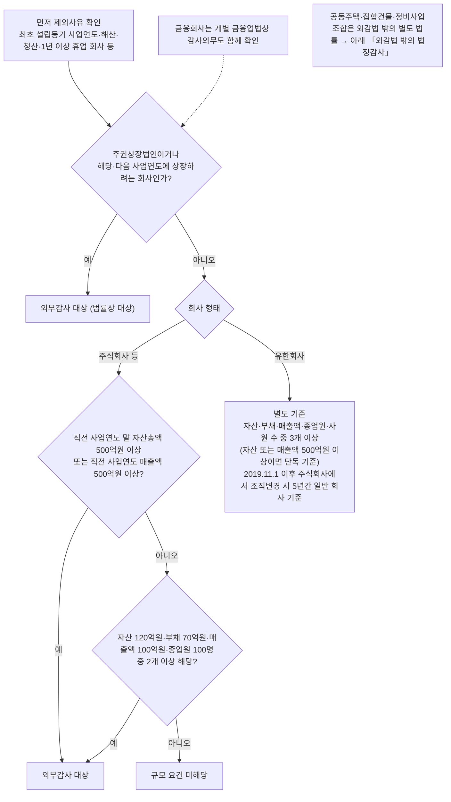

# 외부감사 대상과 감사인 선임

## 먼저 결론

> [!summary] 핵심 요약
> - 회계감사는 **선택이 아니라 법정 의무**다. 대상이 되면 받아야 하고, 안 받으면 회사가 민·형사 책임을 진다.
> - 대상 판정은 두 갈래다 — **주권상장법인과 상장예정회사는 법률상 대상**, 그 밖의 회사는 외부감사법 시행령의 규모 요건과 개별 업권법을 함께 본다. 금융회사라고 해서 외부감사법 제4조만으로 전부 자동 대상이라고 단정하지 않는다.
> - ⚠️ **선임 기한을 놓치면 과태료로 끝나지 않는다.** **지정감사** 대상이 되어 감사인을 스스로 고를 수 없게 된다.
> - ⚠️ 감사를 받지 않던 회사가 처음 대상이 되면 **세법 기준으로 만들던 재무제표를 회계기준으로 다시 맞춰야** 한다. 이것이 첫해 부담의 실체다.

## 왜 중요한가

감사 대상 여부는 **회사가 커지면 어느 시점에 자동으로 걸리는 문턱**이다. 미리 알고 준비한 회사와 통보받고 시작하는 회사의 첫해 비용·혼란은 크게 갈린다.

또한 감사 대상은 **성장의 부산물**이므로, 대상에 근접한 회사는 결산·기장 체계를 미리 정비해 두어야 한다. → [[기장업무-전체프로세스]]

## 기본 개념 — 회계감사란

**기업이 작성한 재무제표가 회계기준에 맞게 작성되었는지를 외부 전문가인 공인회계사가 확인하는 절차**다. 회사가 스스로 "우리 숫자는 맞다"고 하는 것과, 이해관계가 없는 제3자가 확인해 의견을 내는 것은 신뢰도가 다르다.

- 수행 주체는 **공인회계사**뿐이다. **회계법인** 또는 **감사반** 형태로 수행한다.
- 목적은 주주·투자자·채권자 등 **이해관계자가 재무제표를 믿고 의사결정을 내릴 수 있게** 하는 것이다.

## 판단 구조 — 누가 대상인가

### ① 주권상장법인 · 상장예정회사 — 법률상 대상

- **상장회사**: 주식시장에서 자금을 조달하므로 투자자가 많고, 정확한 재무정보 제공 의무가 크다.
- **해당 사업연도 또는 다음 사업연도에 상장하려는 회사**도 포함된다.
- **금융회사**는 회사 형태·규모 외에 개별 금융업법상 감사의무도 함께 확인한다. 외부감사법 제4조가 모든 금융회사를 규모와 무관하게 일괄 열거하는 구조는 아니다.

### ② 비상장회사 — 규모 요건

주식회사 등 일반 회사는 다음 세 갈래 중 **하나**에 해당하면 대상이다. 유한회사는 별도 기준을 적용한다.

| 항목 | 기준 |
|---|---|
| 단독 기준 ① | 직전 사업연도 말 **자산총액 500억원 이상** |
| 단독 기준 ② | 직전 사업연도 **매출액 500억원 이상** |
| 복합 기준 | 자산 120억원·부채 70억원·매출액 100억원·종업원 100명 중 **2개 이상** |

> [!success] 확인
> ✅ 외감법 시행령 §5①② 대조(2026-10-08, 2026.5.26 시행분) — 위 기준과 유한회사(5개 중 3개, 사원 50명) 모두 일치. 보충: **종업원 수에서 일용근로자 등(소득령 §20①)·파견근로자는 제외**, 직전 사업연도가 12개월 미만이면 매출액을 **12개월 환산**. 최초 설립등기 사업연도 회사·해산·청산·1년 이상 휴업 회사 등은 외부감사 제외(③).

**유한회사**는 원칙적으로 자산·부채·매출액·종업원·사원 수 기준 중 **3개 이상**을 보며, 자산 또는 매출액 500억원 이상이면 단독 기준이 적용된다. 2019년 11월 1일 이후 주식회사에서 유한회사로 조직변경한 경우에는 등기일부터 5년까지 일반 회사 기준을 적용한다. 신설 첫 사업연도 등 시행령 제5조제3항의 제외사유도 함께 확인한다.

**대상 판정 흐름** — 위 ①·② 본문과 표, 시행령 대조 메모를 한 장으로 옮겼다. 수치는 본문 표를 따른다.

%% ciat-design: 시각화 추가 — 아래 다이어그램은 이 절 본문의 내용만 옮긴 것 (원문 우선) %%

기준이 이렇게 설계된 이유는 **기업 규모와 이해관계자 수가 늘수록 재무정보 신뢰성을 보장할 필요가 커지기** 때문이다.

## 감사인 선임 기한 — 놓치면 감사인을 못 고른다

- 원칙적으로 **매 사업연도 개시일부터 45일 이내** 선임한다. 12월 결산법인은 통상 **2월 14일**까지다.
- **직전 사업연도에 감사를 받지 않은 최초 외부감사 대상회사**는 사업연도 개시일부터 **4개월 이내** 선임한다. 의무적으로 감사위원회를 설치해야 하는 회사는 사업연도 개시 전에 선임한다.
- 보고의 법정 상대는 **증권선물위원회**다. 회사와 감사인은 원칙적으로 감사계약 체결일부터 **2주 이내** 전자문서로 보고한다. 실무 제출창구가 금융감독원 전자신고시스템이더라도 법률상 수신기관과 구분한다.
- 다만 주권상장법인·대형비상장주식회사·금융회사가 아닌 회사가 **직전 감사인을 재선임**하면 회사의 선임보고는 생략할 수 있다. 주주 등에 대한 보고·통지·공고 의무는 별도로 본다.

### ⚠️ 미선임의 대가

| 결과 | 내용 |
|---|---|
| 과태료 | 부과된다 |
| **지정감사** | ⚠️ **감사인을 회사가 고르지 못하고 지정받는다** |

**지정감사가 실무에서 껄끄러운 이유**는 비용·일정·커뮤니케이션을 회사가 통제할 수 없기 때문이다. 선임 기한 준수는 **금액이 아니라 통제권의 문제**다.

## 왜 받아야 하는가 — 비용 이상의 효익

감사를 받지 않던 소규모 비상장회사 대표가 "왜 생돈을 내고 감사를 받아야 하느냐"고 묻는 것은 자연스럽다. 답은 넷이다.

1. **법정 의무다.** 감사를 받지 않거나 부실한 재무제표를 공시하면 **민·형사 책임**을 진다.
2. **자금조달이 쉬워진다.** 감사받은 재무제표는 투자자·금융기관의 신뢰가 높다. **적정의견이 나온 재무제표는 금융기관과 세무당국조차 더 신뢰하는 경향**이 있다 `[강사견해]`.
3. **내부통제를 점검받는다.** 감사인은 재무제표뿐 아니라 **내부통제 시스템도 함께 검토**하므로, 그동안 몰랐던 회사의 문제점이 외부 시각으로 드러난다.
4. **결과적으로 만족하는 경우가 많다** `[강사견해]` — 첫해의 거부감과 실제 경험이 다르다는 관찰이다.

## 외감법 밖의 법정감사

공동주택과 재건축·재개발 등 정비사업조합은 일반 회사의 외감법 규모요건과 별개의 근거 법률·사업단계에 따라 감사의무가 생길 수 있다. 따라서 “회사 외부감사 대상이 아니다”라는 결론을 공동주택·조합에 그대로 적용하지 않는다. 각 제도의 대상, 감사대상 기간, 선정주체와 제출기한은 적용 연도의 공동주택관리법·도시정비법 등 원문을 확인한다. ([[공동주택 회계감사 대상·기한 총정리 우리 단지도 매년 받아야 할까-소스요약]]) ([[정비사업조합 외부회계감사 의무 재건축·재개발·가로주택 등의 외부감사 의무정리-소스요약]])

### 아파트 vs 상가·오피스텔(집합건물) — 법률·기준·책임자가 모두 다르다 (2026-10-14 추가)

([[상가·오피스텔 회계감사 대상 150개·3억원 기준과 아파트와 다른 점-소스요약]] · [[아파트 관리사무소 회계처리 기준 관리외수익만 현금주의를 고를 수 있는 이유-소스요약]], [[이명환]] 회계사 — 조문은 필자 인용 기준 `[원문 확인 필요]`)

| 구분 | 아파트(의무관리대상 공동주택) | 상가·오피스텔 등 집합건물 |
|---|---|---|
| 근거 법령 | 공동주택관리법·시행령 | 집합건물법·시행령 |
| 회계처리기준 | 국토교통부 고시 「공동주택 회계처리기준」 | 법무부 고시 「집합건물 회계처리기준」(2021.7.12 시행) |
| 회계 책임자 | 관리주체(관리사무소장·주택관리업자) | **관리인**(관리단 대표, 구분소유자 10인 이상이면 선임 의무) |
| 감사 대상 | 의무관리대상 단지(300세대↑ 등) | 전유부분 **150개↑ + 직전연도 징수 관리비(사용료 포함) 3억↑ 또는 수선적립금 3억↑** → 매년. 50~150개는 3억 요건(또는 3년 미감사+1억) + **구분소유자 1/5 연서 요구** 시 |
| 감사 생략 | 입주자등 서면동의(300세대↑ 2/3, 미만 과반) | 관리단집회 구분소유자 2/3 **및** 의결권 2/3 결의(그 연도만) |
| 감사 범위 | 재무제표 4종 | 재무제표 4종 **+ 관리비 운영의 적정성** |
| 관리외수익 현금주의 | 계정별 선택 가능·매년 계속 | 선택 조항 없음 |
| 감사기한 | 회계연도 종료 후 9개월 | 9개월(감사인은 종료 후 3개월 내 선임, 관리위원회 있으면 결의) |

- **집합건물은 관리단이 자동 성립**(별도 설립절차 없음). 오피스텔만으로 된 구분소유 건물은 공동주택관리법이 아니라 집합건물법을 따른다(준주택·업무시설).
- 공통 함정: 주택관리업자가 아파트·상가를 함께 관리하거나 회계프로그램 기본값이 공동주택용이면 **집합건물 재무제표를 공동주택 서식으로 만드는 오류**가 생긴다. 집합건물은 건물 1개가 작성단위, 공통경비 배부기준은 주석.
- 집합건물 **수선적립금은 관리비와 구분 징수·관리단 명의 계좌·비유동부채** 계상(관리비 수입으로 잡으면 기준 위반). 전유부분 50개↑ 건물은 감사와 별개로 **월별 장부·증빙 5년 보관**(2023.9.29 시행). 감사결과는 1개월 내 구분소유자에게 서면 보고(미이행 과태료).
- **공동주택 회계처리기준의 원칙과 단서**: 복식부기·발생주의가 원칙(§4 본문), **관리외수익(주차·재활용·광고·중계기 임대·이자 등)만 계정별로 현금주의 선택 가능**하고 매년 계속 적용·주석 기재(§4 단서). 관리비용·관리수익은 선택 불가 → 12월 용역을 1월에 지급해도 12월 비용(미지급비용). 결산서는 종료 후 **2개월 내** 입주자대표회의 제출 — 감사를 서면동의로 생략해도 결산 의무는 남는다. **매월 재무제표 작성 + 매월 말 예금잔고증명 대조**(§29, 2023.6 개정으로 감사도 대조 — 관리비 횡령 방지 내부통제).

### 서울 정비사업 조합 — 표준 예산·회계규정 (2026-10-14 추가)

([[정비사업 조합 예산회계규정 서울시 표준규정 안내-소스요약]] — 조례·고시는 필자 인용 기준 `[원문 확인 필요]`)

- **근거**: 서울시 도시정비 조례 §83 — 추진위원회·조합은 예산회계처리 규정을 정해 운영, 시장은 표준규정 고시. 조합(또는 공동) 시행 정비사업은 공공지원 대상(토지등소유자 100명 미만·주거용 50% 미만 도시정비형 재개발 등 예외는 구청 확인).
- **견본 45개 조문 중 22개는 그대로("확정")** — 결산서류·계정과목·현금/발생주의 구분, 예산·예비비·예산 외 지출 금지, 조합 명의 통장·현금 원칙 미보유(부득이 50만원), 증빙·용역 착수 전 집행 금지, 업무추진비·법인카드·분기 자금수지 보고. 나머지(회계책임자·인계인수·직인·통장 구분·계약 세부절차)는 조합이 정한다.
- **결산서류**: 자금수지계산서(**현금주의**) + 운영계산서·재무상태표(**발생주의**) + 부속명세서, 외부감사용이면 주석. 종료 후 3개월 내 조합 감사 의견서 첨부 대의원회 보고. **차입금은 수익이 아니므로** 통장엔 돈이 있는데 운영계산서는 적자일 수 있다 — 차이는 주석·사업비명세서로 설명.
- 규정 밖은 법무부 「중소기업회계기준」 준용, 추진위는 조합설립인가일부터 30일 내 장부 인계, 업무추진비는 과목 일원화·다음 달 15일까지 공개.
- 국토부 실태점검(2022~2025, 47개 조합) 위반 700건 중 **예산·회계 209건** — 조합 회계는 감사 이전에 규정 정합성부터 본다.

## 헷갈리기 쉬운 부분

> [!warning] 혼동 주의
> - **감사받지 않는 소규모 기업의 재무제표는 대개 "세법 기준"으로 만들어져 있다.** 회계기준에 따라 작성한 것이 아니다. 감사 대상이 되는 순간 이 차이를 조정해야 하며, 이것이 첫해 감사에서 가장 시간이 많이 드는 지점이다.
> - **세무조정과 회계감사는 다른 일이다.** 세무조정은 재무제표와 세법의 차이를 조정해 세금을 산출하는 것이고(→ [[세무기장-서비스범위와-보수]]), 회계감사는 재무제표 자체의 적정성을 검증한다.
> - 외부감사 대상이 아니어도 재무제표는 적용되는 일반기업회계기준 등에 따라 작성해야 한다. 다만 세무신고 중심으로 결산해 온 회사는 회계기준과 세법 차이를 충분히 반영하지 못했을 수 있어 첫 감사 전에 조정이 많이 발생한다.

## 실무 체크포인트

- 자산·매출·부채·종업원 수가 기준의 **80% 수준에 도달하면 그 시점부터 준비**한다. 통보받고 시작하면 늦다.
- **결산 일정을 앞당긴다.** 감사인은 결산 종료 후에 들어오므로, 결산이 늦으면 감사 일정 전체가 밀린다.
- 선임 기한과 **증권선물위원회 보고 기한(계약일부터 2주)** 을 캘린더에 별도로 등록한다.
- 첫 감사라면 **회계기준과 세법 기준의 차이 항목**(감가상각·충당부채·수익인식 등)을 미리 뽑아 둔다.

## 관련 문서

- 감사 실무: [[ECL-감사절차와-체크리스트]] · [[현금흐름표-작성-체크리스트]]
- 재무제표 해석: [[현금흐름-중심의-경영판단]]
- 회계기준 적용: [[리스회계-K-IFRS1116]] · [[연결납세-법인세회계]]

## 출처

- [[공동주택 회계감사 대상·기한 총정리 우리 단지도 매년 받아야 할까-소스요약]]
- [[정비사업조합 외부회계감사 의무 재건축·재개발·가로주택 등의 외부감사 의무정리-소스요약]]
- [[회계감사 가이드 제1장 우리 회사 회계감사 대상일까-소스요약]]
- 추가 반영(2026-10-14): [[상가·오피스텔 회계감사 대상 150개·3억원 기준과 아파트와 다른 점-소스요약]] · [[아파트 관리사무소 회계처리 기준 관리외수익만 현금주의를 고를 수 있는 이유-소스요약]] · [[정비사업 조합 예산회계규정 서울시 표준규정 안내-소스요약]]

- ([[2025-02-05-회계감사는 왜 받아야하나요 외부감사 대상과 외부감사인 선임기한 알려드려요 절세미녀-소스요약]]) — 감사의 정의, 대상 2갈래, 선임기한·지정감사, 효익
- [외부감사법 제4조·제10조·제12조 및 시행령 제5조·제18조](https://www.law.go.kr/LSW/lsLinkCommonInfo.do?chrClsCd=010202&lspttninfSeq=149577) — 외부감사 대상, 감사인 선임·보고의 현행 기준

> [!caution] 검증 상태
> 자동자막 소스의 대상 요건과 선임 기한을 2026-08-21 현재 법령으로 대조했다. 실제 판정에서는 회사 형태·첫 감사 여부·감사위원회 설치 여부와 개별 업권법을 함께 확인한다.
