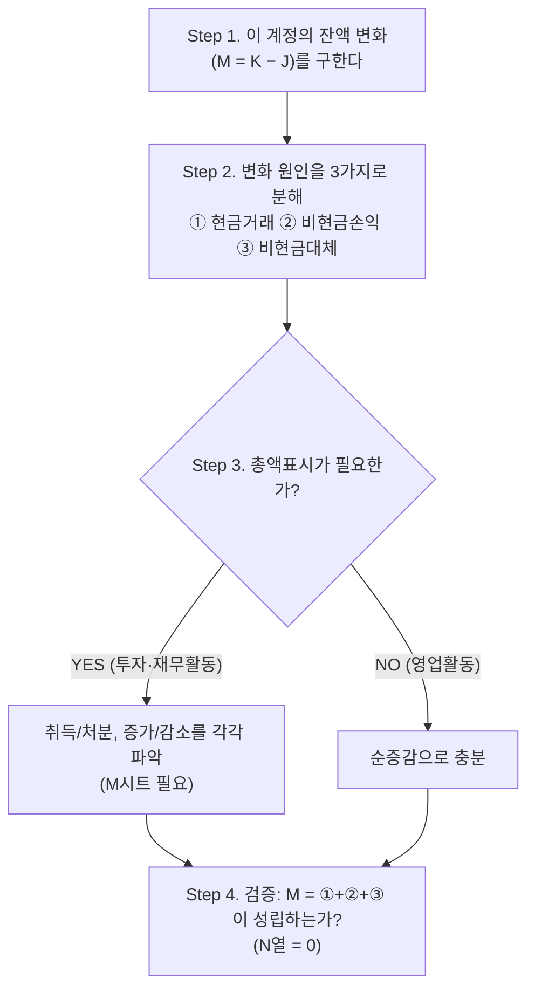

[[은행-현금흐름표-완전학습가이드|← 목차]]

> [!quote] 출처
> 원본: `raw/회계자문 및 회계감사/현금흐름표/은행_현금흐름표_작성_실무가이드.md` 5장

---

# 5. BS 증감에서 실제 Cash Flow를 도출하는 방법

## 5-1. 판단 프레임워크

어떤 계정을 만나든 다음 4단계로 판단하면 된다. `[일반 원칙]`

```
Step 1. 이 계정의 잔액 변화(M = K − J)를 구한다

Step 2. 변화 원인을 3가지로 분해한다
        ① 현금거래  ② 비현금손익  ③ 비현금대체

Step 3. 총액표시가 필요한가?
        YES (투자·재무활동) → 취득/처분, 증가/감소를 각각 파악 (M시트 필요)
        NO  (영업활동)      → 순증감으로 충분

Step 4. 검증: M = ①+②+③ 이 성립하는가? (N열 = 0)
```

**다이어그램 (위 코드블록과 같은 내용)**

%% ciat-design: 시각화 추가 — 아래 다이어그램은 바로 위 코드블록의 내용만 옮긴 것 (원문 우선) %%



## 5-2. "BS 증감 ≠ 현금흐름"의 5가지 유형

파일에서 확인된 실제 사례로 정리한다. (계정별 상세는 각 [[은행-현금흐름표-완전학습가이드|Accounts]] 카드 참조)

### 유형 1: 비현금손익이 개입: 부호까지 뒤집히는 경우

| 계정 | BS 증감(M) | 실제 CF(U) | 차이 원인 |
|---|---|---|---|
| **대출채권** | +7,862,781,480,304 | **−6,383,960,148,742** | 대손상각·충당금·현할차 |
| **FVPL** | +1,013,493,204,848 | **−1,569,161,223,121** | 공정가치 평가손익 |
| **파생상품자산** | +3,138,970,783,618 | −2,057,626,723,026 | 평가손익 (P 4.4조 / S 5.4조) |

> [!note] 참고
> **교훈**: 부호가 반대인 경우가 실제로 존재한다. BS 증감을 그대로 쓰면 "현금이 들어왔다"와 "나갔다"가 뒤바뀐다. `[파일 확인]`

### 유형 2: 총액이 순액에 가려지는 경우

| 계정 | BS 순증감 | 총액 (취득/처분) | 배율 |
|---|---|---|---|
| **FVOCI** | −292,203,591,344 | 처분 10.9조 / 취득 10.5조 | **약 73배** |
| **AC** | +3,476,766,999,501 | 처분 5.4조 / 취득 8.6조 | 약 4배 |
| **보증금** | −19,556,712,621 | 회수 2,269억 / 지급 1,983억 | 약 22배 |

> [!note] 참고
> **교훈**: 순증감만 보면 실제 거래 규모가 완전히 은폐된다. 투자·재무활동에 총액표시를 요구하는 이유다. `[파일 확인]`

### 유형 3: 비현금 인식이 개입: 리스

| 계정 | BS 증감 | 실제 현금유출 | 차이 |
|---|---|---|---|
| **리스부채** | −22,831,011,972 | **144,249,737,720** | 신규리스 인식 AL 119,060,849,162 |

> [!note] 참고
> **교훈**: 리스 개시는 현금이 0인데 부채가 늘어난다. BS 증감을 쓰면 현금유출이 약 1/6로 과소 표시된다. `[파일 확인]`

### 유형 4: 상각이 개입

| 계정 | BS 증감 | 상각비 | 함의 |
|---|---|---|---|
| **무형자산** | −22,651,225,975 | P = 55,732,853,831 | 상각을 빼면 실제 취득 규모가 안 보임 |
| **발행금융채권 할인차금** | — | P336 = 64,610,415,352 | 상각으로 부채가 증가 (발행 아님) |

### 유형 5: 환율변동이 개입

| 항목 | 금액 | 처리 |
|---|---|---|
| **환율변동효과 (현금성자산)** | 364,097,508,327 | CF Ⅳ에 **별도 표시** |
| **해외사업환산차대 (파생)** | 15,658,562 | 190행에서 AI↔U **자기상쇄** |

## 5-3. 조정 우선순위 (실무 팁) `[논리 추론]`

금액 영향이 큰 순서로 조정하면 효율적이다.

```
1순위: 공정가치 평가손익      (파생·FVPL — 조 단위)
2순위: 총액 파악              (FVOCI·AC — 조 단위)
3순위: 대손충당금·상각        (대출채권 — 조 단위)
4순위: 비현금 인식            (리스 — 천억 단위)
5순위: 환율효과               (전 계정 — 천억 단위)
6순위: 단수조정               (원 단위)
```

---

**관련 개념**: [[CF-활동분류-논리|활동분류논리]] · [[CF-비현금거래|비현금거래]] · [[CF-숫자예제|숫자예제]]
